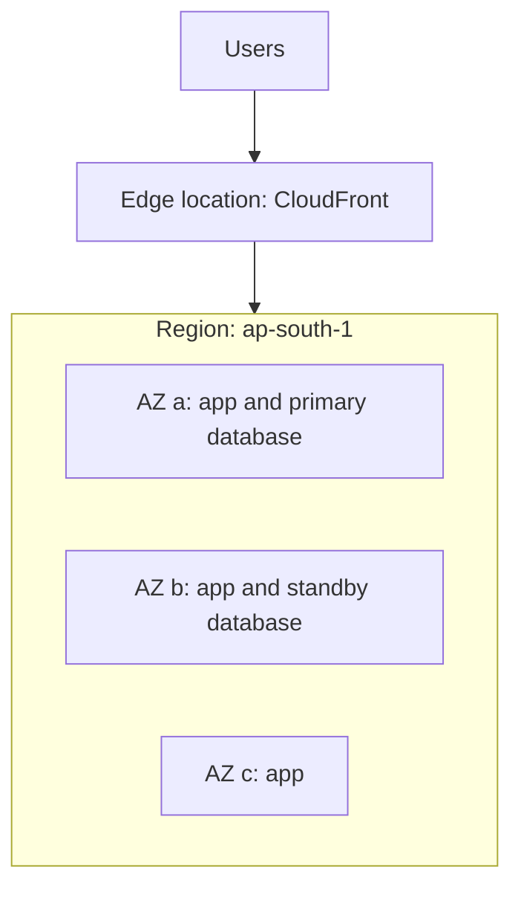
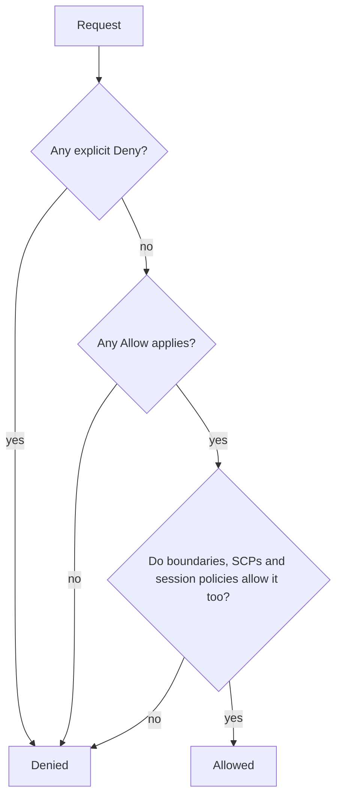
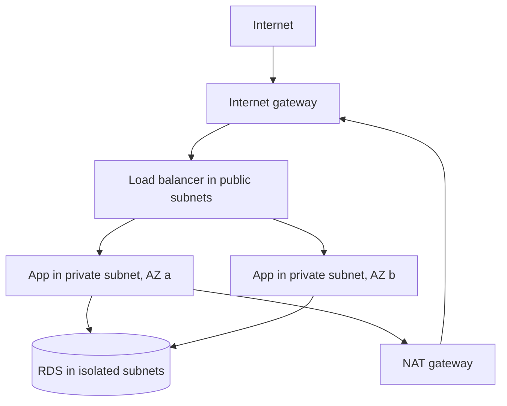

@part aws-foundations | AWS Part 1: Foundations, IAM and Networking | cloud
## The cloud model and how AWS is organised

Before cloud platforms, a company bought servers, waited weeks for delivery, and paid for them whether they were busy or idle. A cloud provider turns that into an API call: you ask for capacity, use it, and pay for what you used. Three properties explain almost every design decision you will make on AWS.

- **Elasticity.** Capacity can grow and shrink with demand, so you do not have to size for the busiest day of the year.
- **Managed services.** AWS can run the database, the queue or the load balancer. You trade some control and some money for far less operational work.
- **Pay as you go.** Cost becomes an engineering concern. A forgotten test environment is a real bill, and a good design can be measured in rupees.

### Service models

| Model | You manage | AWS manages | Example |
|---|---|---|---|
| IaaS | OS, runtime, app, patches | Hardware, virtualisation | EC2 |
| Container platform | Image, app, scaling rules | Servers (with Fargate), orchestration | ECS on Fargate |
| PaaS-like | App code and settings | Almost everything else | Elastic Beanstalk |
| FaaS | Function code | Servers, scaling, runtime patches | Lambda |
| Managed data | Schema, queries, size | Patching, backups, failover | RDS, DynamoDB |

The further down this table you go, the less you operate and the less you control. The right choice is usually the highest-level service that meets your needs. A junior mistake is to run PostgreSQL on an EC2 instance "to save money", and then spend weeks on backups and failover that RDS gives you for a modest premium.

### Regions and Availability Zones

A **Region** is a geographic area such as `ap-south-1` (Mumbai). Each Region holds several **Availability Zones** (AZs): separate data centre groups with independent power and networking, connected by fast private links. An **edge location** is a smaller site that CloudFront uses to serve content close to users.



The consequences matter more than the definitions:

- A single AZ can fail. Anything important runs in at least two.
- Data does not leave a Region unless you move it, which matters for laws such as data-localisation rules.
- Prices and available services differ by Region. New services often arrive in US Regions first.
- Traffic across AZs usually costs a small amount per GB, so chatty services can create a real bill.

!tip Choosing a Region :: Decide by four things, in this order: legal requirements, distance to users, service availability, then price.

### The shared responsibility model

AWS secures the cloud itself: buildings, hardware, the hypervisor. You secure what you put in it: IAM permissions, open network ports, encryption settings, patches on your EC2 instances and your own code. Most real cloud breaches are on the customer's side of this line, typically a public S3 bucket or a leaked access key.

!interview Interview answer :: **"Is my app secure because it runs on AWS?"** No. AWS secures the infrastructure, and you are responsible for configuration and code. The more managed the service, the more of the patching moves to AWS, but access control always stays with you.

### Accounts

An AWS **account** is a boundary for billing and for permissions. Companies use several: one each for development, staging and production, grouped under AWS Organizations. If a developer's mistake in the dev account cannot touch production, that is the account boundary doing its job. As a learner, one account is fine, but follow the rules in the next chapter on day one.

!keypoints Pick the highest-level service that fits ;; Run important workloads across two or more AZs ;; AWS secures the cloud, you secure what is in it ;; Separate accounts limit the damage from mistakes

?? What is the difference between a Region and an Availability Zone?
=> A Region is a geographic area containing several AZs. An AZ is an isolated group of data centres in that Region. You spread across AZs for availability, and across Regions only for disaster recovery or nearby users.
?? Why not always run your own database on EC2?
=> You would own patching, backups, failover and monitoring. RDS provides these for a premium that is usually far cheaper than the engineering time. Choose EC2 only for a specific need RDS cannot meet, such as an unsupported extension.
?? Who is responsible for patching the OS on an EC2 instance, and on RDS?
=> You patch EC2. AWS patches the OS under RDS, though you choose the maintenance window.

## Setting up an account safely

Most expensive beginner mistakes happen in the first hour. Do these steps before creating anything else.

1. **Protect the root user.** The email you signed up with can do anything, including closing the account. Enable MFA, then stop using it for daily work.
2. **Create a daily user.** Use IAM Identity Center (or, for a personal learning account, an IAM user) with MFA.
3. **Set a budget alarm.** In AWS Budgets, create a monthly budget with an email alert at a small amount.
4. **Never put access keys in code.** Keys committed to GitHub are found by bots within minutes.
5. **Use one Region** while learning, so nothing is left running somewhere you forget to look.

!warning Common surprise bills :: NAT gateways (charged per hour and per GB), RDS instances left running, Elastic IPs not attached to anything, load balancers from old experiments, and data transfer out to the internet. Delete what you are not using, and check the Billing page weekly.

### The CLI

Everything in the console is an API call, and the CLI lets you repeat it exactly.

```bash First commands
aws configure sso                      # sign in through IAM Identity Center
aws sts get-caller-identity            # who am I? Run this when anything is confusing
aws s3 ls                              # list buckets
aws ec2 describe-instances --region ap-south-1 \
  --query 'Reservations[].Instances[].[InstanceId,State.Name]' --output table
```

`sts get-caller-identity` solves a surprising share of permission problems, as people are often not the identity they think they are.

!keypoints MFA on root, then leave root alone ;; Budget alarm first ;; No long-lived keys in code ;; Learn the CLI: it shows that everything is an API

?? You committed an AWS access key to a public repository, then deleted the commit. Are you safe?
=> No. It remains in history and bots may already have it. Deactivate and delete the key immediately, review CloudTrail for its use, check for new users or resources, then fix the cause by moving to roles and secret scanning.
?? Why is the root user not used for daily work?
=> It cannot be restricted by normal IAM policies and can close the account, so a leak is catastrophic. Daily work uses limited identities, which keeps mistakes and leaks small.

## IAM in depth

Every call to AWS answers one question: **who** is asking, and **may** they do this? IAM answers it. Understanding IAM is the most valuable AWS skill, because every other service depends on it.

### Identities

- **User:** a long-lived identity for a person or old-style program. Prefer not to use these for applications.
- **Group:** a set of users sharing policies.
- **Role:** an identity with no password or permanent keys. Whoever is allowed to assume it gets **temporary credentials**. Applications, Lambda functions and ECS tasks use roles.

### Policies

A policy is JSON that states what is allowed or denied.

```json A least-privilege policy for an invoice service
{
  "Version": "2012-10-17",
  "Statement": [
    {
      "Effect": "Allow",
      "Action": ["s3:GetObject", "s3:PutObject"],
      "Resource": "arn:aws:s3:::acme-invoices/*"
    },
    {
      "Effect": "Allow",
      "Action": ["sqs:SendMessage"],
      "Resource": "arn:aws:sqs:ap-south-1:123456789012:invoice-events"
    }
  ]
}
```

Read a statement as: **Effect** on **Action** against **Resource**, optionally with a **Condition**. An ARN (Amazon Resource Name) identifies a resource uniquely. Note `/*` above: object permissions apply to objects inside the bucket, while `s3:ListBucket` would need the bucket ARN itself without `/*`. That single detail causes many "Access Denied" puzzles.

### How AWS decides



Three rules cover most cases: everything is denied by default, an Allow opens it, and an explicit Deny always wins.

### Identity policies and resource policies

An **identity policy** is attached to a user or role and says what it can do. A **resource policy** is attached to a resource, such as an S3 bucket or SQS queue, and says who can use it. Within one account, either can grant access. Across accounts, **both** sides must allow it.

### Roles for applications

A role has two parts: a **trust policy** (who may assume it) and **permission policies** (what it can do once assumed).

```json Trust policy: ECS tasks may assume this role
{
  "Version": "2012-10-17",
  "Statement": [{
    "Effect": "Allow",
    "Principal": { "Service": "ecs-tasks.amazonaws.com" },
    "Action": "sts:AssumeRole"
  }]
}
```

The AWS SDK finds the credentials by itself, through its default provider chain. Your code contains nothing secret, and credentials rotate automatically:

```java No keys anywhere: the SDK picks up the task role
S3Client s3 = S3Client.builder().region(Region.AP_SOUTH_1).build();

s3.putObject(
    PutObjectRequest.builder().bucket("acme-invoices").key("2026/inv-42.pdf").build(),
    RequestBody.fromBytes(pdfBytes));
```

!warning ECS has two roles :: The **task execution role** lets the ECS agent pull your image and fetch secrets at start-up. The **task role** is what your running code uses. Giving your app's S3 permissions to the execution role is a classic mistake that ends in Access Denied at run time.

### Least privilege in practice

Start narrow and add what is needed. Avoid `"Action": "*"` and `"Resource": "*"` in application roles. Use CloudTrail and IAM Access Analyzer to see what a role actually uses, then trim the rest. When you get Access Denied, read the error: it usually names the action and resource, and CloudTrail records the failed call.

!interview Interview answer :: **"How does your service get AWS credentials?"** Through an IAM role attached to the compute (task role, instance profile or Lambda execution role). The SDK fetches short-lived credentials automatically. No keys in code, environment variables or images.

!keypoints Roles and temporary credentials for applications ;; Deny by default, explicit Deny wins ;; Cross-account access needs both sides to allow ;; Read Access Denied errors, as they name what is missing

?? What is the difference between a user and a role?
=> A user has long-lived credentials and belongs to one person or program. A role has no permanent credentials: a trusted principal assumes it and receives temporary ones, which limits the damage from a leak.
?? An app can read objects from a bucket but listing fails with Access Denied. Why?
=> `s3:GetObject` applies to `bucket/*`, but `s3:ListBucket` applies to the bucket ARN without `/*`. The policy needs a separate statement for the bucket itself.
?? A policy allows s3:* and another attached policy denies s3:DeleteObject. Can the role delete?
=> No. An explicit Deny always wins.
?? What is a trust policy?
=> It is the part of a role that says who may assume it, such as a service or another account. Permission policies then say what the role can do.

## VPC networking

A **VPC** (Virtual Private Cloud) is your own private network in a Region. You choose its address range, split it into subnets and control what can talk to what. As a backend developer, you must be able to read a VPC diagram and debug "connection timed out".

### Subnets

A subnet is a slice of the VPC's address range, inside a single AZ. A subnet's type depends entirely on its **route table**:

| Subnet | Route to the internet | Typical contents |
|---|---|---|
| Public | Through an internet gateway | Load balancers, NAT gateways |
| Private | Outbound only, through a NAT gateway | Application tasks |
| Isolated | None | Databases |



### CIDR quickly

`10.0.0.0/16` means the first 16 bits are fixed, which gives 65,536 addresses. `/24` gives 256. AWS reserves five addresses in each subnet, so a `/24` has 251 usable ones. Avoid overlapping ranges between VPCs that may need connecting later, as peering requires them to differ.

### Security groups and network ACLs

| | Security group | Network ACL |
|---|---|---|
| Attached to | A network interface (a resource) | A subnet |
| Rules | Allow only | Allow and deny |
| State | Stateful: replies are allowed automatically | Stateless: replies need their own rule |
| Everyday use | Your main tool | Rarely changed |

The strongest habit is to reference other security groups rather than IP addresses:

```hcl The database accepts traffic only from the app's security group
resource "aws_security_group_rule" "db_from_app" {
  type                     = "ingress"
  from_port                = 5432
  to_port                  = 5432
  protocol                 = "tcp"
  security_group_id        = aws_security_group.db.id
  source_security_group_id = aws_security_group.app.id
}
```

When tasks scale up and get new IPs, this rule keeps working, and nothing else can reach the database.

### NAT gateways and VPC endpoints

A private task calling an external API goes through a NAT gateway. NAT is billed per hour and per GB, which often surprises people whose application reads a lot from S3 through it. A **gateway VPC endpoint** for S3 or DynamoDB sends that traffic privately at no extra data charge, and **interface endpoints** do the same for many other services at a small cost.

### Debugging a timeout

A timeout usually means that packets are dropped, rather than refused. "Connection refused" means you reached the host but nothing is listening.

1. Is the target's security group allowing this source and port?
2. Does the source's subnet have a route to the target?
3. Do network ACLs block it? (Rare, but check if someone has changed them.)
4. For external calls: does the private subnet route through a NAT gateway?
5. Does the DNS name resolve to the address you expect?

VPC Reachability Analyzer can check a path between two resources without sending traffic.

!interview Interview answer :: **"Your service cannot reach RDS. How do you debug it?"** Separate timeout from refused from auth failure. A timeout points to security groups or routes, so I check that the database's group allows the app's group on the port. Refused means wrong port or a stopped service. An auth error means that the network is already fine.

!keypoints A route table makes a subnet public or private ;; Security groups are stateful, ACLs are stateless ;; Reference security groups, not IPs ;; Use endpoints to avoid NAT costs for S3 and DynamoDB

?? What makes a subnet public?
=> Its route table has a route to an internet gateway. The word is not a setting of its own.
?? Why are security groups called stateful?
=> If an inbound request is allowed, the reply is automatically allowed, without any outbound rule. Network ACLs need rules in both directions.
?? A task in a private subnet reads gigabytes from S3 and the bill is high. What do you change?
=> Add an S3 gateway VPC endpoint, so the traffic avoids NAT gateway per-GB charges.
?? What does connection timed out suggest, compared with connection refused?
=> A timeout suggests that packets are being dropped, usually by a security group or a missing route. Refused means you reached the host, but nothing is listening on that port.
