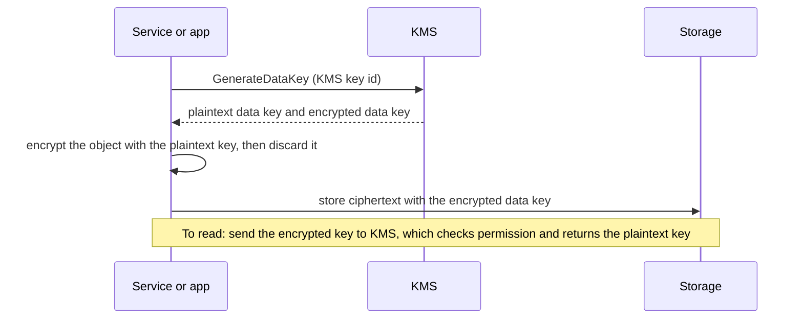
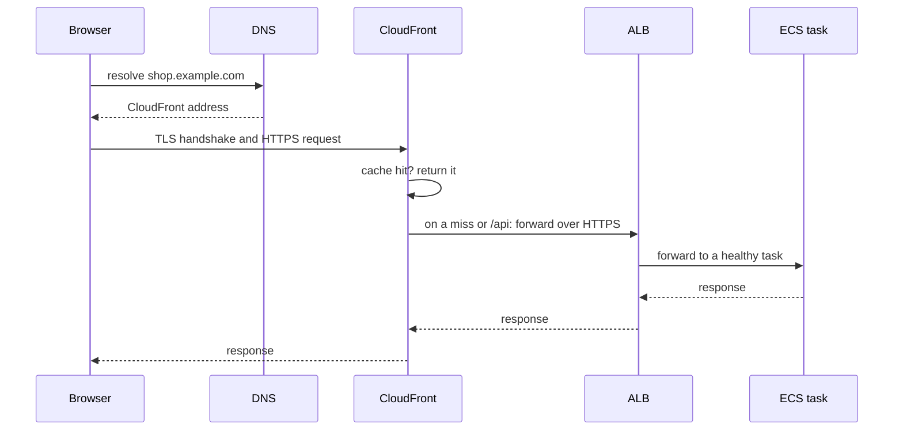
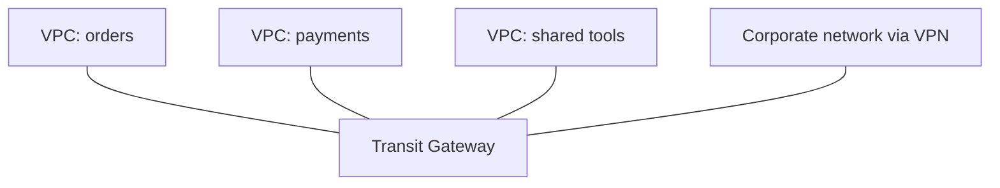

@more
## Encryption, KMS and secrets

Encryption on AWS is mostly about one question: who can use the key? Turning encryption on is often a single setting. Designing who can decrypt what is the real work.

### At rest and in transit

**In transit** means TLS: between users and CloudFront, CloudFront and the load balancer, and your app and the database. **At rest** means data on disks and in S3 is stored encrypted, and most AWS storage services encrypt it by default or with one setting. Interviewers often ask for both, as each protects against a different attacker.

### KMS and envelope encryption

KMS (Key Management Service) holds keys that never leave it in plain form. Encrypting a large file through KMS directly would be slow and limited in size, so services use **envelope encryption**:



This has two benefits. Bulk encryption happens locally, so it is fast. And access is centrally controlled: without `kms:Decrypt` on the key, the stored data is useless, even to someone who can read the bucket. Every KMS call also appears in CloudTrail, which gives you an audit trail of who decrypted what.

### Key types

| Type | Who controls it | Use |
|---|---|---|
| AWS owned | AWS, invisible to you | Default encryption, no extra thought |
| AWS managed | AWS, visible in your account | Simple per-service encryption |
| Customer managed | You: policy, rotation, deletion | Compliance, cross-account, tight control |

A customer managed key has a monthly fee, plus charges per API call. A high-traffic app calling KMS for each object can hit rate limits and bills, which is why S3 offers **Bucket Keys** to reduce those calls.

!warning Deleting a key deletes the data :: If a KMS key is deleted, everything encrypted under it is lost for good. AWS forces a waiting period of 7 to 30 days for this reason. Alarm on any scheduled key deletion.

### Secrets Manager or Parameter Store

| | Secrets Manager | Parameter Store |
|---|---|---|
| Built for | Passwords, API keys | Configuration, and some secrets |
| Rotation | Built in, with Lambda | Do it yourself |
| Cost | Per secret, per month | Standard parameters are free |
| Cross-account | Yes | More limited |

Both let you avoid putting values in images, Git or plain environment files.

### Reading secrets from Spring Boot

There are two common approaches. ECS can inject the secret into an environment variable at start-up, through the `secrets` section of a task definition. Alternatively, Spring Cloud AWS can load them as properties when the app starts:

```properties application.properties with Spring Cloud AWS
spring.config.import=aws-secretsmanager:/prod/orders/db
spring.datasource.username=${username}
spring.datasource.password=${password}
```

Remember what happens at rotation. A value injected at start-up stays old until tasks restart, while existing database connections keep working until they close. Rotation strategies therefore keep two valid users for a time, so that nothing breaks while tasks are replaced.

### Common secrets mistakes

- Printing configuration at start-up, or logging a request with an `Authorization` header.
- Baking a `.env` file into a Docker image: anybody who can pull the image can read every layer.
- Passing secrets as build arguments, which stay in image history.
- Putting real values into Terraform variables: state files keep them in plain text, so protect state like a secret.

!interview Interview answer :: **"How do you store a database password on AWS?"** In Secrets Manager, encrypted with KMS. The task's execution role may read only that secret, and it is injected at start-up. Rotation uses two users, so that it doesn't break running tasks. It never goes in Git, images or logs.

!keypoints Encrypt in transit and at rest ;; Envelope encryption gives speed and central control ;; A key's policy decides who can read the data ;; Plan how the app survives rotation

?? Why does envelope encryption exist?
=> KMS is slow and limited for bulk data, so a data key encrypts the object locally, and KMS only protects that data key. Access stays controlled by KMS permissions.
?? A user can read an S3 object's bytes but gets Access Denied. The bucket uses a customer managed key. What is missing?
=> `kms:Decrypt` permission on that key. Both S3 and KMS must allow the action.
?? Why is a secret in a Docker build argument unsafe?
=> It can remain visible in image history, and anybody able to pull the image can read it.

## DNS, TLS and domains

Most developers meet DNS and TLS when something breaks during a launch. Your Computer Networks guide covers the theory, while this chapter covers how AWS uses them.

### Route 53

Route 53 is AWS's DNS service. A **hosted zone** holds the records for a domain.

| Record | Points to | Example |
|---|---|---|
| A / AAAA | IPv4 / IPv6 address | `api.example.com` to an IP |
| CNAME | Another name (not at the zone root) | `www` to `example.com` |
| Alias | An AWS resource, also at the root | `example.com` to CloudFront |
| MX | Mail servers | Email for the domain |
| TXT | Text, used for verification | Domain ownership proof |

**Alias** is AWS-specific: it follows a load balancer's changing IPs, works at the zone root, and queries to AWS targets are free. Prefer it over CNAME for AWS resources.

### Routing policies

| Policy | Does | Use |
|---|---|---|
| Simple | One answer | Most records |
| Weighted | Split by percentage | Gradual migration |
| Latency | Nearest Region by latency | Multi-Region apps |
| Failover | Primary, then secondary if unhealthy | Disaster recovery |
| Geolocation | By user's location | Legal or language needs |

### TTL and migrations

DNS answers are cached for the record's TTL. To move a service with little disruption:

1. Lower the TTL, say to 60 seconds, a day or more before the change.
2. Wait for the old TTL to expire.
3. Change the record.
4. Keep the old system running for a while, because some clients ignore TTLs.
5. Raise the TTL again.

!warning JVM DNS caching :: Java can cache DNS answers, and with a security manager it could cache them forever. Modern defaults cache successful lookups for about 30 seconds, but check `networkaddress.cache.ttl` if your app keeps calling an old IP after a failover.

### TLS with ACM

AWS Certificate Manager issues free public certificates for ALBs and CloudFront, and renews them automatically when validated through DNS. Remember these details:

- CloudFront requires its certificate to be in `us-east-1`, regardless of where your app runs.
- An ALB's certificate must be in the ALB's Region.
- ACM public certificates can't be exported for use on your own servers.

TLS usually ends at the ALB. Traffic from ALB to tasks stays inside your VPC. Regulated workloads may also encrypt that hop.

### A full request



Being able to narrate this flow, including what can fail at each hop, is a strong interview answer.

!keypoints Use Alias records for AWS targets ;; Lower TTL before a migration ;; CloudFront certificates live in us-east-1 ;; Know each hop of a request

?? Why use an Alias record rather than a CNAME for a load balancer at the domain root?
=> A CNAME cannot exist at the zone root. Alias can, and it follows the load balancer's changing addresses.
?? A CloudFront setup cannot find your ACM certificate. What is the likely cause?
=> The certificate is in the wrong Region. CloudFront needs it in us-east-1.
?? You changed a DNS record, but some users still reach the old server. Why?
=> Resolvers and clients cache until the TTL ends, and some ignore it. Lower the TTL beforehand, and keep the old system up during the change.

## Connecting networks

A single VPC is rarely the whole story. Services in other accounts, offices and SaaS products must connect without going over the public internet.

| Option | Connects | Traits |
|---|---|---|
| VPC peering | Two VPCs | Simple, not transitive, no overlapping ranges |
| Transit Gateway | Many VPCs and on-premises | Hub and spoke; costs per attachment and GB |
| PrivateLink | One service to many consumers | One-way, works with overlapping ranges |
| Site-to-Site VPN | Office or data centre to VPC | Encrypted over internet, quick to set up |
| Direct Connect | Data centre to AWS | Private line, steady performance, slow to set up |

### Peering is not transitive

If A peers with B, and B peers with C, A still cannot reach C. With many VPCs, the number of peerings grows rapidly, which is the reason Transit Gateway exists.



### PrivateLink

PrivateLink exposes **one service** behind a Network Load Balancer, so consumers see a private endpoint in their own VPC. Nothing else is reachable, and address overlaps don't matter. It's the same technology behind interface VPC endpoints, and it is how SaaS vendors offer private connectivity.

### Bastion or Session Manager?

Engineers sometimes need to reach private resources. A bastion host needs a public address, an open SSH port and key management. **Session Manager** provides shell access through IAM, with no inbound ports and full audit logs, so prefer it. It can also forward a port to reach a private database from a laptop, for debugging.

```bash Reach a private RDS from your laptop through an instance
aws ssm start-session --target i-0abc123 \
  --document-name AWS-StartPortForwardingSessionToRemoteHost \
  --parameters '{"host":["orders.abc.ap-south-1.rds.amazonaws.com"],"portNumber":["5432"],"localPortNumber":["5432"]}'
```

### Choosing address ranges

Plan CIDR blocks across the whole company early. Overlapping ranges block peering and Transit Gateway routing, and re-addressing later is painful. Leave room: a `/16` for each VPC, and `/20` or `/24` subnets, is a common starting point.

!interview Interview answer :: **"Service A in one account needs to call service B in another, privately."** PrivateLink if A only needs that one service, since it exposes nothing else. Peering or Transit Gateway if whole networks must talk. Then add IAM or mTLS for authentication, as network reachability is not permission.

!keypoints Peering is not transitive ;; PrivateLink exposes one service ;; Prefer Session Manager over bastions ;; Plan address ranges early

?? VPCs A and B have overlapping CIDRs. How can A call a service in B?
=> PrivateLink, which does not route between the networks. Peering would not work.
?? Why replace a bastion host with Session Manager?
=> There is no open inbound port or SSH key to manage, access goes through IAM, and sessions are logged.
