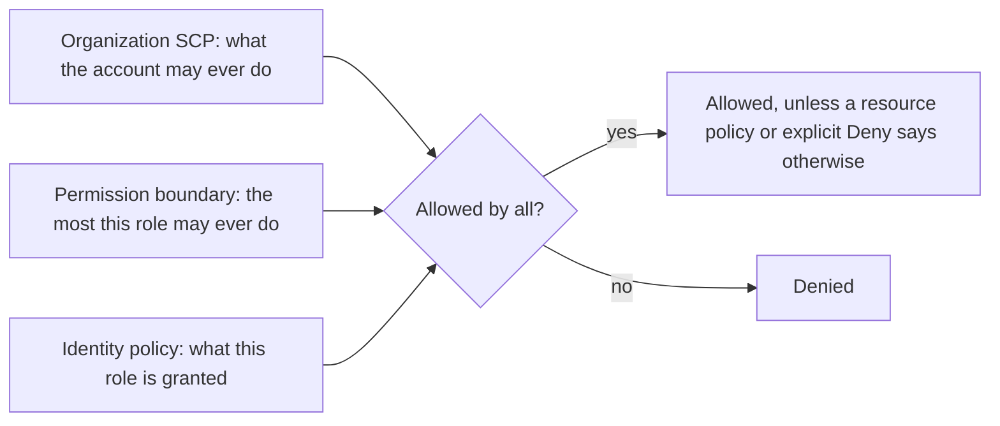
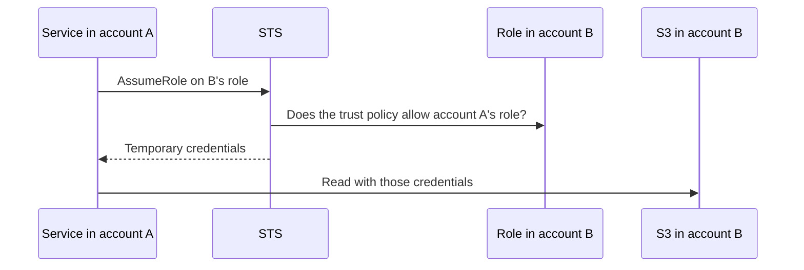

@more
## Advanced IAM: conditions, boundaries and cross-account access

The basics of IAM get an application running. These features come up as soon as a company has many teams and accounts.

### Conditions

A condition limits when a statement applies.

```json Allow S3 access only from one VPC endpoint, and only over TLS
{
  "Effect": "Allow",
  "Action": "s3:GetObject",
  "Resource": "arn:aws:s3:::acme-reports/*",
  "Condition": {
    "StringEquals": { "aws:SourceVpce": "vpce-0abc123" },
    "Bool": { "aws:SecureTransport": "true" }
  }
}
```

| Useful condition key | Purpose |
|---|---|
| `aws:SecureTransport` | Require TLS |
| `aws:SourceVpce`, `aws:SourceVpc` | Limit to your network |
| `aws:PrincipalTag/team` | Attribute-based access |
| `aws:RequestedRegion` | Keep work in approved Regions |
| `aws:MultiFactorAuthPresent` | Require MFA for sensitive actions |

### The layers of permission

A request must pass every layer that applies. Each layer can only reduce what's possible.



| Layer | Set by | Typical use |
|---|---|---|
| Service control policy (SCP) | Organization admins | "Nobody in dev may leave these Regions" |
| Permission boundary | Platform team | Developers may create roles, but never more powerful than this |
| Identity policy | Team | The actual grant |
| Session policy | Whoever assumes a role | Narrow a session further |

**Neither SCPs nor boundaries grant anything.** They only cap. A common puzzle: a role has `s3:*`, and Access Denied still appears, because an SCP blocks it. CloudTrail and the error message usually mention which type of policy denied the call.

### Cross-account access

To let account A's service use a resource in account B:



```java Assuming a role with automatic refresh
StsClient sts = StsClient.create();

StsAssumeRoleCredentialsProvider provider = StsAssumeRoleCredentialsProvider.builder()
    .stsClient(sts)
    .refreshRequest(r -> r
        .roleArn("arn:aws:iam::222222222222:role/report-reader")
        .roleSessionName("orders-service"))
    .build();

S3Client s3 = S3Client.builder().credentialsProvider(provider).build();
```

Both sides must agree: the role's trust policy names account A's role, and A's role has permission to call `sts:AssumeRole` on it.

### The confused deputy

When a third-party SaaS assumes a role in your account, a different customer of that SaaS might trick it into using **your** role, if they know its ARN. An **external ID** in the trust policy fixes this: the SaaS passes a value unique to you, and a condition requires it.

### Attribute-based access control

Rather than writing a policy per team, tag people and resources, and compare the tags: "allow if the principal's `team` tag equals the resource's `team` tag". New teams then need no new policies. It's powerful, though harder to audit, as who can do what depends on tags, and on who may change those tags.

### Debugging permissions

1. Run `aws sts get-caller-identity`: are you who you think you are?
2. Read the error: it names the action, the resource and often the policy type.
3. Check CloudTrail for the failed call.
4. Use the IAM Policy Simulator for a what-if test.
5. Remember KMS: encrypted resources need key permissions as well.

!interview Interview answer :: **"A role has AdministratorAccess, and still gets Access Denied. How?"** An SCP or permission boundary may cap it, an explicit Deny may apply, a resource policy may block it, or a KMS key may refuse it. I would read the error, then check CloudTrail.

!keypoints Boundaries and SCPs cap, they never grant ;; Cross-account access needs trust on one side and permission on the other ;; Use an external ID for third parties ;; Use conditions to require TLS or a network

?? What's the difference between a permission boundary and an identity policy?
=> An identity policy grants permissions. A boundary sets the maximum, and grants nothing by itself. Effective access is the overlap.
?? What does an external ID protect against?
=> The confused deputy problem, where another customer of a third party tricks it into using your role.
?? You added s3:GetObject, but the call fails on an encrypted bucket. Why?
=> The role probably also needs `kms:Decrypt` on the bucket's key.

## Planning a VPC: a worked example, and flow logs

### Requirements

A company runs production in `ap-south-1`, using three AZs. Fargate tasks use one IP each, and scale up to about 400. Databases need a few addresses. There will be more VPCs later, which must not overlap.

### Sizing subnets

| CIDR | Addresses | Usable (AWS reserves 5) |
|---|---|---|
| /28 | 16 | 11 |
| /26 | 64 | 59 |
| /24 | 256 | 251 |
| /22 | 1,024 | 1,019 |
| /20 | 4,096 | 4,091 |
| /16 | 65,536 | Whole VPC |

Each `/n` has 2^(32−n) addresses. Tasks are spread across three AZs, so a surge could put 200 or so in one zone if another AZ fails. A `/22` per AZ leaves plenty of space for that, for rolling deployments (which briefly double the count), and for future growth.

```text A plan for one VPC: 10.20.0.0/16
Public    10.20.0.0/24     10.20.1.0/24     10.20.2.0/24    ALB, NAT (251 usable each)
App       10.20.16.0/22    10.20.20.0/22    10.20.24.0/22   Tasks (1,019 usable each)
Data      10.20.32.0/24    10.20.33.0/24    10.20.34.0/24   RDS, ElastiCache
Spare     10.20.64.0/18 and beyond                          Future use
```

Company-wide, give each environment and Region its own block, such as `10.20.0.0/16` for production in Mumbai and `10.30.0.0/16` for staging. Keep a written register, because overlaps can't be undone cheaply.

!warning Running out of IPs :: A subnet that's too small fails in confusing ways: tasks stay stuck in provisioning and report no available addresses. This happens most with EKS, where every pod takes an IP.

### NAT design

| Option | Availability | Cost |
|---|---|---|
| One NAT gateway | Loses outbound in that AZ's failure; cross-AZ traffic charges | Lowest |
| One per AZ | Survives an AZ failure | Highest |
| VPC endpoints + few NATs | Reduces traffic through NAT | Balanced |

Production usually uses one per AZ, and development uses one.

### VPC Flow Logs

Flow logs record accepted and rejected traffic. They show metadata, never payloads.

```text A flow log line (simplified)
version account interface   srcaddr     dstaddr     srcport dstport proto packets bytes start end action status
2       1234    eni-0abc    10.20.16.5  10.20.32.7  49152   5432    6     5       300   ...   ... REJECT OK
```

`REJECT` here means that a security group or network ACL dropped traffic from an app task to the database's port. If the action says `ACCEPT` but the connection still fails, the problem is further along, such as the service, its port or a reply path.

```text Finding rejected traffic to a database with Logs Insights
fields @timestamp, srcAddr, dstAddr, dstPort, action
| filter dstPort = 5432 and action = "REJECT"
| stats count() by srcAddr
| sort count desc
```

Stateless network ACLs produce a telling pattern: an accepted request with a rejected reply, because replies use ephemeral ports (usually 1024 to 65535).

### Common traps

- The ALB must span at least two public subnets, and its security group must allow outbound traffic to the app.
- Lambda in a VPC needs a NAT or endpoints to reach the internet, although it's in a subnet.
- A public IP alone isn't enough: the subnet needs a route to an internet gateway.
- Interface endpoints need private DNS enabled for the default service names to resolve to them.

!keypoints Each /n has 2^(32−n) addresses, minus 5 ;; Size for failover and deployments, not just average ;; Keep a CIDR register ;; Flow logs show REJECT, not payloads

?? How many usable addresses does a /26 subnet have?
=> 2^6 = 64, minus 5 reserved by AWS, so 59.
?? Why size a subnet for more than the normal task count?
=> Rolling deployments briefly double tasks, and an AZ failure moves load to others.
?? Flow logs show ACCEPT for the request, and REJECT for the reply. What's the likely cause?
=> A stateless network ACL blocking the ephemeral return ports. Security groups would allow the reply automatically.
