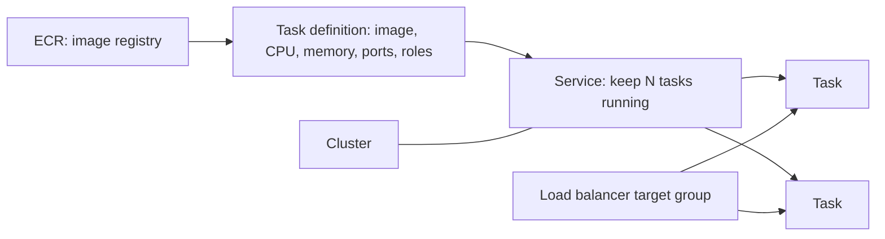
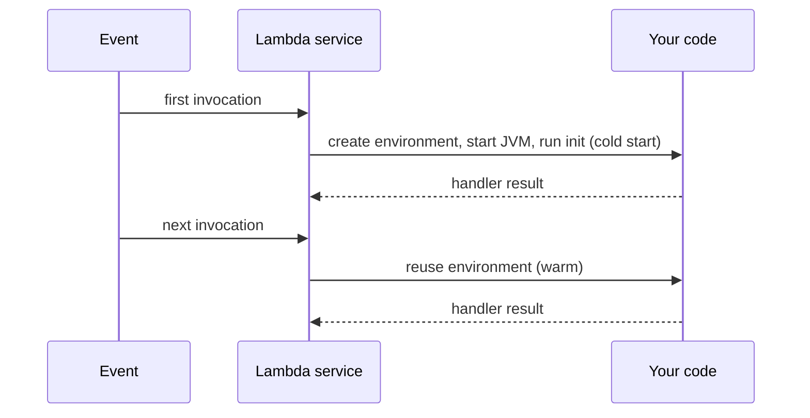

@part aws-compute | AWS Part 2: Compute: EC2, Containers and Lambda | cloud
## EC2: virtual machines

An EC2 instance is a virtual server. Even if you mainly use containers, EC2 explains what runs underneath, and many companies still run services directly on it.

### Choosing an instance

The name tells you the family: in `m7g.large`, `m` is general purpose, `7` the generation, `g` the Graviton (ARM) processor, and `large` the size.

| Family | Optimised for | Typical use |
|---|---|---|
| t | Burstable CPU | Low-traffic apps, development |
| m | Balance | Most Java services |
| c | CPU | Compute-heavy work, high-throughput APIs |
| r | Memory | Caches, large heaps |
| g, p | GPU | ML, graphics |

!warning Burstable instances :: `t` instances earn CPU credits while idle and spend them when busy. If credits run out, a service can suddenly crawl (unless unlimited mode is on, which costs more). Load tests on a `t3` often give misleading results for that reason.

### Pricing models

| Option | Commitment | Good for |
|---|---|---|
| On-Demand | None | Unpredictable or short workloads |
| Savings Plans or Reserved | 1 or 3 years | Steady baseline, large discount |
| Spot | None, but can be reclaimed with 2 minutes' notice | Batch jobs, stateless workers, CI |

A common design uses Savings Plans for the baseline, On-Demand for peaks and Spot for interruptible workers.

### Storage on EC2

**EBS** volumes are network disks that survive instance stops. **Instance store** disks are physically attached and very fast, but their data is lost when the instance stops. **EFS** is a shared file system many instances can mount at once. For most applications, the root EBS volume holds the OS only, and durable data goes to S3 or a database.

### Auto Scaling groups

An Auto Scaling group keeps a number of instances running, replaces unhealthy ones and adjusts capacity. It starts instances from a **launch template** (image, instance type, role, security groups). A good instance is disposable: it holds no state that matters, so losing one is routine.

!interview Interview answer :: **"Stateless services"** A service is stateless if any instance can handle any request. Sessions, uploads and caches live outside it: in Redis, S3 or the database. This is what makes autoscaling and rolling deployments safe.

!keypoints Instance family fits the workload ;; Avoid burstable instances for steady load ;; Use Spot only for interruptible work ;; Treat instances as disposable

?? Why might a load test on a t3 instance mislead you?
=> It can run on accumulated CPU credits, then slow sharply or cost more once they run out. Test on the family you plan to use in production.
?? When is Spot a good choice?
=> When work can be interrupted and resumed: batch jobs, CI runners, and stateless queue workers. A database is a poor fit.

## Containers on AWS: ECS and Fargate

Your Git, Docker and CI/CD guide covers building images. This chapter covers running them. ECS (Elastic Container Service) is AWS's own orchestrator, and it is simpler than Kubernetes.

### The vocabulary



- **Task definition:** a versioned recipe for a task. Think of it as a Kubernetes pod spec.
- **Task:** one running copy.
- **Service:** keeps a chosen number of tasks healthy and registers them with the load balancer.
- **Cluster:** a logical grouping of services.
- **Fargate:** run tasks with no servers to manage. The alternative, the EC2 launch type, runs them on instances that you manage.

### A Spring Boot task definition

```json Key parts of a task definition
{
  "family": "orders-service",
  "cpu": "1024",
  "memory": "2048",
  "networkMode": "awsvpc",
  "requiresCompatibilities": ["FARGATE"],
  "executionRoleArn": "arn:aws:iam::123456789012:role/orders-exec",
  "taskRoleArn": "arn:aws:iam::123456789012:role/orders-task",
  "containerDefinitions": [{
    "name": "app",
    "image": "123456789012.dkr.ecr.ap-south-1.amazonaws.com/orders:1.4.2",
    "portMappings": [{ "containerPort": 8080 }],
    "environment": [{ "name": "SPRING_PROFILES_ACTIVE", "value": "prod" }],
    "secrets": [{ "name": "DB_PASSWORD", "valueFrom": "arn:aws:secretsmanager:ap-south-1:123456789012:secret:orders-db" }],
    "logConfiguration": {
      "logDriver": "awslogs",
      "options": {
        "awslogs-group": "/ecs/orders",
        "awslogs-region": "ap-south-1",
        "awslogs-stream-prefix": "app"
      }
    }
  }]
}
```

Points that matter in production:

- `1024` CPU units equal one vCPU. Java thread pools and GC adapt to what the JVM sees.
- Use immutable image tags, such as a version or commit SHA, not `latest`, so a rollback means something.
- `secrets` injects values at start-up. The execution role needs permission to read them.

### JVM settings for containers

Modern JVMs respect container limits. Control heap as a percentage rather than a fixed size, and remember that the limit covers the whole process, including metaspace, thread stacks and direct buffers.

```bash Sensible start
JAVA_TOOL_OPTIONS="-XX:MaxRAMPercentage=75 -XX:+ExitOnOutOfMemoryError"
```

`ExitOnOutOfMemoryError` lets the orchestrator replace a broken task, rather than leaving it half alive.

### Health checks and graceful shutdown

The load balancer calls a path such as `/actuator/health/readiness`. During deployment, ECS starts new tasks, waits for them to be healthy, then drains old ones. On stop, the container gets SIGTERM, then SIGKILL after a timeout. Configure Spring Boot to finish in-flight requests:

```properties application-prod.properties
server.shutdown=graceful
spring.lifecycle.timeout-per-shutdown-phase=25s
management.endpoint.health.probes.enabled=true
```

!warning Slow starts :: A Spring Boot app can take 20 to 60 seconds to start. Without a health check grace period, ECS may kill tasks before they are ready, which looks like an endless restart loop. Set `healthCheckGracePeriodSeconds`.

### Autoscaling

Target tracking is the usual starting point: keep average CPU near a value, or track requests per target from the load balancer. CPU is a poor signal for an app that mostly waits on a database, so choose a metric that reflects the real limit.

### ECS or EKS?

| | ECS | EKS |
|---|---|---|
| Learning curve | Low | High |
| Operational load | Low | Higher: upgrades, add-ons |
| Portability | AWS only | Kubernetes works across clouds |
| Ecosystem | AWS integrations | Helm, operators, huge community |

!interview Interview answer :: **"ECS or EKS?"** ECS with Fargate if a small team just wants containers running. EKS if the company already has Kubernetes skills, needs its ecosystem or wants portability, because it carries more operational cost.

!keypoints Task definition is the recipe, service keeps it running ;; Execution role and task role are different ;; Use immutable image tags ;; Graceful shutdown and a grace period prevent deployment errors

?? Tasks keep restarting during deployment, although the app works locally. What do you check?
=> Whether the app starts within the health check grace period, whether the health path and port match, whether the security group lets the load balancer in, and the task's stopped reason and logs.
?? Why use -XX:MaxRAMPercentage rather than a fixed -Xmx?
=> It adapts to the container's memory limit, so changing the task size does not need a new setting. Leave room for non-heap memory.
?? How does a rolling deployment avoid dropped requests?
=> New tasks become healthy first, then the load balancer drains old tasks, which finish in-flight work on SIGTERM thanks to graceful shutdown.

## Lambda in depth

Lambda runs your function in response to an event. You upload code, and AWS handles servers and scaling. It is common for event processing: S3 uploads, queue messages, scheduled jobs and small APIs.

### The execution lifecycle



Each execution environment handles **one request at a time**. Static fields and clients created during init are reused across invocations, so create clients once. A burst of 100 concurrent events means up to 100 environments, each with its own JVM.

### Java and cold starts

The JVM makes cold starts slower than in Node or Python, and Spring adds more. Options, from simple to involved:

1. Keep the jar small, with few dependencies, and avoid heavy frameworks for simple functions.
2. Give it more memory: memory also scales CPU, so a larger setting may cost about the same while running faster.
3. Use **SnapStart**, which snapshots an initialised environment and restores it. Check its current runtime and Region support. Anything unique at init, such as random seeds or open connections, needs care after restore.
4. Provisioned concurrency keeps environments warm, at a cost.
5. Native images through GraalVM give fast starts, at the price of a more complex build.

### Limits that shape your design

| Limit | Value | Consequence |
|---|---|---|
| Timeout | 15 minutes | Long jobs belong on ECS or Step Functions |
| API Gateway timeout | Much shorter (historically 29 s by default) | Long work must be asynchronous |
| Concurrency | Per-account limit | One function can starve others; use reserved concurrency |
| Temporary storage | `/tmp`, configurable | Not durable |

### Connecting to a database

Every environment opens its own connections, so a spike can exhaust PostgreSQL. **RDS Proxy** pools them centrally. Use a pool size of 1 per function instance, and cap the function with reserved concurrency.

### An SQS consumer with partial failures

```java Report only the failed messages
public class InvoiceHandler implements RequestHandler<SQSEvent, SQSBatchResponse> {

    private static final S3Client S3 = S3Client.create();   // created once per environment

    @Override
    public SQSBatchResponse handleRequest(SQSEvent event, Context context) {
        List<SQSBatchResponse.BatchItemFailure> failures = new ArrayList<>();
        for (SQSEvent.SQSMessage message : event.getRecords()) {
            try {
                process(message);          // must be idempotent
            } catch (Exception e) {
                context.getLogger().log("failed " + message.getMessageId() + ": " + e);
                failures.add(new SQSBatchResponse.BatchItemFailure(message.getMessageId()));
            }
        }
        return new SQSBatchResponse(failures);
    }
}
```

This needs `ReportBatchItemFailures` turned on for the event source mapping. Without it, one bad message makes the whole batch return to the queue, and already-processed messages run again.

### Lambda or containers?

| Choose Lambda when | Choose ECS when |
|---|---|
| Traffic is spiky or low | Traffic is steady |
| Work is short and event-driven | Requests are long-lived, or use WebSockets |
| You want scale to zero | You need connection pools and warm caches |
| Each function is small | You have an existing Spring Boot service |

Cost flips at scale: a constantly busy Lambda usually costs more than an equivalent container.

!interview Interview answer :: **"Why is my Lambda slow only sometimes?"** Probably cold starts: a new environment starting the JVM and initialising code. I would check the Init Duration in the logs, then reduce init work, raise memory, or use SnapStart or provisioned concurrency.

!keypoints One request per environment at a time ;; Initialise clients once, outside the handler ;; Protect databases from concurrency ;; Always report partial batch failures, and make handlers idempotent

?? Why create the S3 client as a static field?
=> Init runs once per environment, so warm invocations reuse the client and its connections instead of paying for them each time.
?? Doubling a function's memory halved its duration. What happened to cost?
=> Roughly the same, as billing is memory times duration, and users get a faster response. Memory also increases CPU.
?? 2,000 Lambda instances connect to one RDS database. What goes wrong and how do you fix it?
=> The database runs out of connections. Use RDS Proxy, a small pool per instance, and reserved concurrency to cap the function.
