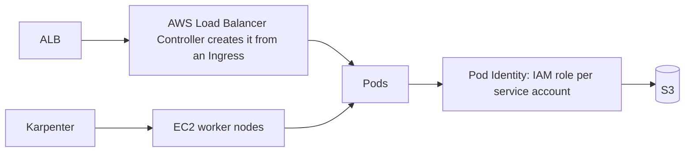
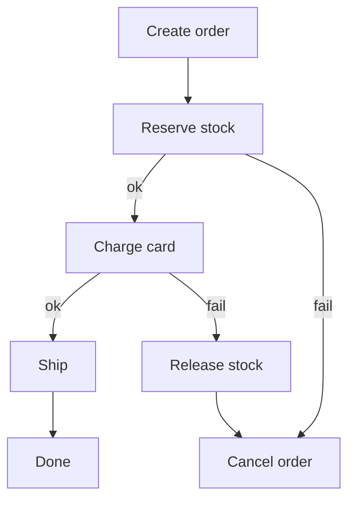

@more
## Hands-on: deploying Spring Boot to ECS Fargate

This chapter joins the previous ones into one deployment. Do it once by hand in a learning account. It will teach you more than any amount of reading. Delete everything when you finish.

### Step 1: a container that behaves

```dockerfile A layered Spring Boot image
FROM eclipse-temurin:21-jre
WORKDIR /app
RUN addgroup --system app && adduser --system --ingroup app app
COPY target/extracted/dependencies/ ./
COPY target/extracted/spring-boot-loader/ ./
COPY target/extracted/snapshot-dependencies/ ./
COPY target/extracted/application/ ./
USER app
ENV JAVA_TOOL_OPTIONS="-XX:MaxRAMPercentage=75 -XX:+ExitOnOutOfMemoryError"
EXPOSE 8080
ENTRYPOINT ["java", "org.springframework.boot.loader.launch.JarLauncher"]
```

Layered images mean a code change only rebuilds the top layer, and non-root users limit what a compromised process can do. Your Docker guide covers these steps in depth. Check the exact layout against the `layertools` output for your Spring Boot version.

### Step 2: push the image

```bash Create a repository and push
aws ecr create-repository --repository-name orders --region ap-south-1
ACCOUNT=$(aws sts get-caller-identity --query Account --output text)
REGISTRY=$ACCOUNT.dkr.ecr.ap-south-1.amazonaws.com
aws ecr get-login-password --region ap-south-1 | docker login --username AWS --password-stdin $REGISTRY
docker build -t $REGISTRY/orders:1.0.0 .
docker push $REGISTRY/orders:1.0.0
```

Build for the architecture you'll run: on an ARM laptop, use `--platform linux/amd64` unless you're deploying on ARM. "exec format error" in task logs means there's a mismatch.

### Step 3: the network

Create a VPC with two public and two private subnets, across two AZs, and a NAT gateway so that tasks can reach ECR and the internet. To save money in a learning account, you can run tasks in public subnets with public IPs, but know that this isn't the production shape.

Create three security groups:

| Group | Inbound | From |
|---|---|---|
| `alb` | 443 (or 80) | Internet |
| `app` | 8080 | `alb` group |
| `db` | 5432 | `app` group |

### Step 4: database and secret

Create a small PostgreSQL RDS instance in private subnets, using the `db` group, and let RDS manage the master password in Secrets Manager. Run your schema through Flyway at application start for this exercise. Larger teams run migrations as a separate pipeline step, to control timing and permissions.

### Step 5: roles

Create two roles:

- **Execution role:** the managed `AmazonECSTaskExecutionRolePolicy`, plus `secretsmanager:GetSecretValue` on your secret.
- **Task role:** only what the app needs at run time, such as S3 access to one bucket.

### Step 6: load balancer and service

Create an ALB in public subnets, and a target group of type **ip** on port 8080 with health check `/actuator/health/readiness`. Then create the cluster, task definition and service.

```bash Create the service
aws ecs create-service --cluster main --service-name orders \
  --task-definition orders:1 --desired-count 2 --launch-type FARGATE \
  --health-check-grace-period-seconds 90 \
  --deployment-configuration "deploymentCircuitBreaker={enable=true,rollback=true}" \
  --network-configuration "awsvpcConfiguration={subnets=[subnet-a,subnet-b],securityGroups=[sg-app]}" \
  --load-balancers "targetGroupArn=$TG_ARN,containerName=app,containerPort=8080"
```

### Step 7: debug what goes wrong

Something will. This table covers most first attempts.

| Symptom | Likely cause | Check |
|---|---|---|
| `CannotPullContainerError` | No route to ECR, or wrong execution role | NAT or VPC endpoints; role permissions |
| `ResourceInitializationError` on secrets | Execution role can't read the secret | IAM, and any KMS key |
| Task exits immediately | App crash at start | CloudWatch logs; `aws ecs describe-tasks` stopped reason |
| Target stays unhealthy | Wrong path or port, or security group | `app` allows `alb` on 8080; test the health path |
| Tasks restart during start-up | Grace period too short | Raise it |
| 502 from ALB | App closes connections or crashes | Keep-alive settings, logs |
| 504 from ALB | App too slow | Slow queries, timeouts |
| App can't reach RDS | Security group or wrong subnet | `db` allows `app` on 5432 |

### Step 8: deploy a new version

Change a line, push a new tag, register a new task definition revision and update the service. Watch it in the console: new tasks start and become healthy, the old ones drain and stop. Then push a broken version on purpose, and see the circuit breaker roll it back.

### Step 9: clean up

Delete the service, ALB, NAT gateway, RDS instance and any Elastic IPs. These cost money even when idle. Better still, redo it in Terraform, as Part 5 shows, so `terraform destroy` handles it.

!tip What to say afterwards :: "I deployed a Spring Boot service on ECS Fargate behind an ALB with RDS and Secrets Manager, and watched a failing deployment roll back automatically." This is honest project experience, and it gives you stories for every follow-up.

!keypoints Do one deployment by hand ;; Separate execution and task roles ;; Learn to read a task's stopped reason ;; Delete what costs money

?? Why does a Fargate task in a private subnet need a NAT gateway or endpoints?
=> To pull its image from ECR and reach AWS APIs, since a private subnet has no direct internet route.
?? Where do you look first when a task keeps stopping?
=> The stopped reason from `describe-tasks`, then the CloudWatch logs for that task.
?? What does exec format error mean in task logs?
=> The image was built for a different CPU architecture than the one it's running on.

## EKS and Kubernetes on AWS

Your Git, Docker and CI/CD guide teaches Kubernetes objects: pods, deployments, services and probes. This chapter covers what AWS changes.

### What EKS manages, and what you still manage

EKS runs the control plane. You remain responsible for worker capacity, add-ons, upgrades and everything running on the cluster.

| Layer | Who |
|---|---|
| API server, etcd, control plane | AWS |
| Worker nodes | You, helped by managed node groups, Karpenter or Fargate |
| Cluster version upgrades | You trigger and test them, roughly every few months to a year |
| CNI, CoreDNS, kube-proxy | Add-ons that you keep updated |
| Ingress, autoscaling, secrets integrations | You install them |
| Your workloads and their security | You |

### How AWS plugs in



- **VPC CNI:** each pod receives a real VPC IP. Subnets can run out of addresses in big clusters, so size them with care.
- **AWS Load Balancer Controller:** turns an Ingress into an ALB, and a Service into an NLB.
- **Pod Identity or IRSA:** gives each service account its own IAM role, instead of sharing the node's role. This keeps least privilege per workload.
- **Karpenter or Cluster Autoscaler:** adds nodes when pods can't be scheduled.
- **EBS and EFS CSI drivers:** provide persistent volumes.

```yaml An Ingress that creates an ALB
apiVersion: networking.k8s.io/v1
kind: Ingress
metadata:
  name: orders
  annotations:
    alb.ingress.kubernetes.io/scheme: internet-facing
    alb.ingress.kubernetes.io/target-type: ip
    alb.ingress.kubernetes.io/healthcheck-path: /actuator/health/readiness
spec:
  ingressClassName: alb
  rules:
    - http:
        paths:
          - path: /
            pathType: Prefix
            backend:
              service:
                name: orders
                port:
                  number: 8080
```

### Two kinds of scaling

**Pod scaling** (Horizontal Pod Autoscaler) adds replicas. **Node scaling** (Karpenter) adds machines when pods have nowhere to run. Accurate resource **requests** make both work. If requests are too low, nodes are overpacked, and pods get killed under memory pressure. If too high, you waste money.

### Upgrades

Kubernetes versions leave standard support quickly, and extended support costs more. Check deprecated APIs, upgrade the control plane, then add-ons and nodes, and test in a lower environment first. A cluster that nobody upgrades eventually becomes a big, risky project.

### ECS, EKS or something simpler?

| Situation | Choose |
|---|---|
| Small team, a few services | ECS Fargate or App Runner |
| Company already runs Kubernetes | EKS |
| Need operators, service mesh, Helm charts | EKS |
| Mostly batch and events | Lambda and Step Functions |

!interview Interview answer :: **"Why do pods get OOMKilled though the Java heap looks fine?"** The container limit covers the whole process: heap, metaspace, thread stacks and direct buffers. I would compare native memory use against the limit, and adjust `MaxRAMPercentage` or raise the limit.

!keypoints EKS manages only the control plane ;; Give each service account its own IAM role ;; Accurate requests make scaling work ;; Plan for regular upgrades

?? Why is sharing the node's IAM role across pods a problem?
=> Every pod gets all the permissions of the node. Pod Identity or IRSA gives each workload only what it needs.
?? New pods stay Pending. Which autoscaler should react?
=> The node autoscaler, such as Karpenter, because pods have nowhere to run. HPA only changes the desired number of pods.

## Step Functions, batch and scheduled work

Not everything is a web request. Backend systems run reports, imports and long processes, and each has a suitable home on AWS.

### Choosing a home

| Work | Duration | Service |
|---|---|---|
| Small event handling | Seconds | Lambda |
| Scheduled small job | Under 15 minutes | EventBridge Scheduler + Lambda |
| Scheduled large job | Minutes to hours | EventBridge Scheduler + ECS task |
| Many parallel jobs with queues | Hours | AWS Batch |
| Multi-step process with retries | Up to a year | Step Functions |
| Spring Batch job | Any length | ECS task with a job repository |

### Avoid @Scheduled on many instances

A `@Scheduled` method runs on **every** task, so two tasks mean duplicate reports. Either run it outside the service, using EventBridge Scheduler, or use a lock such as ShedLock:

```java One instance runs it, thanks to a database lock
@Scheduled(cron = "0 0 2 * * *")
@SchedulerLock(name = "nightlyReport", lockAtMostFor = "1h", lockAtLeastFor = "5m")
public void nightlyReport() {
    reports.generate();
}
```

### Step Functions

A state machine coordinates steps defined in JSON, with retries and error handling outside your code.

```json A payment step with retry and compensation
{
  "StartAt": "ChargeCard",
  "States": {
    "ChargeCard": {
      "Type": "Task",
      "Resource": "arn:aws:states:::lambda:invoke",
      "Parameters": { "FunctionName": "charge-card", "Payload.$": "$" },
      "Retry": [{
        "ErrorEquals": ["TransientError"],
        "IntervalSeconds": 2,
        "MaxAttempts": 3,
        "BackoffRate": 2
      }],
      "Catch": [{ "ErrorEquals": ["States.ALL"], "Next": "ReleaseStock" }],
      "Next": "ShipOrder"
    },
    "ReleaseStock": { "Type": "Task", "Resource": "arn:aws:states:::lambda:invoke", "Parameters": { "FunctionName": "release-stock", "Payload.$": "$" }, "End": true },
    "ShipOrder": { "Type": "Task", "Resource": "arn:aws:states:::lambda:invoke", "Parameters": { "FunctionName": "ship-order", "Payload.$": "$" }, "End": true }
  }
}
```

**Standard** workflows suit long, auditable processes, with exactly-once workflow execution. **Express** workflows suit high-volume, short ones, and asynchronous Express runs are at-least-once, so their steps must be idempotent. Step Functions can also wait for a callback, such as a human approval, with no compute running during the wait.

### Saga orchestration

Without a shared transaction across services, a failed step requires compensation. Step Functions fits as the orchestrator of a saga: charge the card, reserve stock, and on failure refund and release. Compensations must be idempotent and may themselves fail, so route them to alerts.



### Spring Batch on AWS

Your Spring knowledge transfers. Run the job as an ECS task started by EventBridge Scheduler, with the job repository in RDS. If it fails, restart: Spring Batch resumes from the last committed chunk. Use Spot capacity for cost, because restart support makes interruption tolerable.

!interview Interview answer :: **"A @Scheduled job runs twice in production."** Each instance runs it. I would move the trigger outside the service with EventBridge Scheduler, or add a distributed lock like ShedLock, and make the job idempotent in case it still runs twice.

!keypoints @Scheduled runs on every instance ;; Long or large jobs belong on ECS or Batch ;; Step Functions handles retries and state ;; Compensations must be idempotent

?? Why not run a 2-hour report in Lambda?
=> Lambda stops at 15 minutes. Use an ECS task, or split the work.
?? When would you choose Express rather than Standard Step Functions?
=> For high-volume, short workflows where at-least-once execution is fine and the steps are idempotent.
