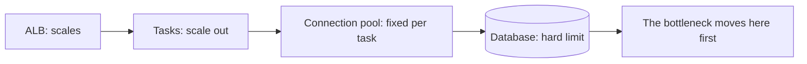
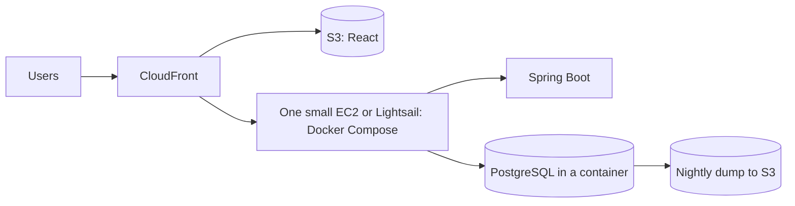

@more
## Capacity planning with real numbers

Interviewers ask "how many servers would you need?" to see whether you can reason, not whether you get an exact number.

### Little's law

**In-flight requests = arrival rate × time per request.** It's simple, and it works for tasks, thread pools, database connections and queues.

### A worked example

An API peaks at 300 requests per second, and takes 200 ms on average (150 ms of it waiting on the database, 50 ms using CPU).

| Question | Working | Answer |
|---|---|---|
| Requests in flight | 300 × 0.2 s | 60 |
| CPU needed | 300 × 0.05 s of CPU | 15 vCPUs at 100% |
| At a 60% CPU target | 15 ÷ 0.6 | 25 vCPUs |
| Tasks of 2 vCPU | 25 ÷ 2 | 13 tasks |
| Threads per task | 60 in flight ÷ 13 | About 5 busy on average |
| Database connections in use | 300 × 0.15 s | 45 |
| Connection pool per task | 45 ÷ 13, plus headroom | About 5 or 6 |
| Total pool | 13 × 6 | 78 connections |

Now you can check the design: does the database allow 78 connections, plus spare for deployments? During a rolling deployment, you may briefly have twice the tasks, so 156 potential connections. Does the database handle 45 busy queries at once? This is often the real limit, and it's why scaling tasks may not help.



### Reserve headroom

Run at about 50 to 70% of capacity at peak, so that losing an AZ doesn't overload what's left. With three AZs, losing one removes a third of your tasks, and the rest must absorb 150% of their normal load until new ones start. At a 60% CPU target, that becomes 90%, which is survivable. At 80%, it's not.

### Autoscaling: what to scale on

| Metric | Good when | Weak when |
|---|---|---|
| CPU | CPU-bound work | App mostly waits on I/O |
| Requests per target | Steady cost per request | Mixed fast and slow requests |
| Queue age or backlog per task | Workers | Rarely wrong for workers |
| Custom in-flight count | Fine control | More to build |

Remember that scaling takes time. A Spring Boot task may need a minute or more from launch to serving traffic, so a very sudden spike can't be solved by reactive autoscaling. For known peaks, use **scheduled scaling**: raise the minimum before the sale begins.

### Load test before you believe it

Your estimates are only hypotheses. Run a load test with k6 or Gatling, against a production-sized environment, with realistic data. Raise the load until something breaks, and note what broke first. Fix that, and repeat. Your backend extras chapter shows a k6 script.

### Worker capacity

For a queue: workers needed = messages per second × seconds per message. At 50 messages a second, taking 2 seconds each, you need 100 concurrent workers. Spring Cloud AWS's `@SqsListener` lets you set concurrency per task, and 10 tasks of 10 would meet it. Check whether whatever is downstream can take that load too.

!interview Interview answer :: **"How many servers for 1,000 requests per second?"** It depends on time per request and its CPU share. I'd apply Little's law: at 100 ms, there are 100 in flight. If 20 ms is CPU, that's 20 vCPUs, about 34 at a 60% target. Then I'd check the connection budget against the database, and verify with a load test.

!keypoints In-flight equals rate times duration ;; The database usually limits you first ;; Leave headroom for AZ failure ;; Scale before known peaks

?? 200 requests per second at 500 ms each. How many are in flight?
=> 200 × 0.5 = 100.
?? Why not autoscale CPU for a service that mostly waits on the database?
=> CPU stays low while requests pile up. Scale on request count or latency, and check the database.
?? 40 messages a second take 3 seconds each. How many concurrent workers are needed?
=> 40 × 3 = 120.

## Java on Lambda in depth

### Handler styles

| Style | Cold start | Use |
|---|---|---|
| Plain handler, SDK only | Fastest for Java | Small event functions |
| Spring Cloud Function | Slower | Reuse Spring beans |
| Spring Boot behind an adapter | Slowest | Moving an existing API |
| GraalVM native image | Very fast | Worth the build complexity at scale |

### Reduce init time

- Use the AWS SDK's `UrlConnectionHttpClient` or AWS CRT client, which load faster than Apache's for many cases, and exclude unused clients.
- Avoid classpath scanning and heavy reflection.
- Set `JAVA_TOOL_OPTIONS=-XX:+TieredCompilation -XX:TieredStopAtLevel=1` to favour quick start-up for short functions. Test it, as long-running work may become slower.
- Create clients in static fields or constructors.

### SnapStart hooks

SnapStart takes a snapshot after init, and restores it for new environments. Anything that's unique or time-sensitive at init becomes a problem, as all restored copies share it.

| Problem | Example | Fix |
|---|---|---|
| Stale connections | Database connection opened at init | Reconnect after restore |
| Shared randomness | Seeded generator in a static | Use `SecureRandom` properly; regenerate after restore |
| Stale values | Secrets or time cached at init | Reload after restore |

```java Runtime hooks with CRaC
public class Handler implements RequestHandler<Input, Output>, Resource {

    private static HikariDataSource pool;

    public Handler() {
        Core.getGlobalContext().register(this);
        pool = createPool();
    }

    @Override
    public void beforeCheckpoint(Context<? extends Resource> context) {
        pool.close();                 // do not snapshot open connections
    }

    @Override
    public void afterRestore(Context<? extends Resource> context) {
        pool = createPool();          // fresh connections per environment
    }

    @Override
    public Output handleRequest(Input in, com.amazonaws.services.lambda.runtime.Context ctx) {
        return process(in, pool);
    }
}
```

### Spring Cloud Function

```java Your function as a bean
@SpringBootApplication
public class App {

    public static void main(String[] args) {
        SpringApplication.run(App.class, args);
    }

    @Bean
    Function<OrderEvent, Receipt> processOrder(OrderService orders) {
        return orders::process;
    }
}
```

The adapter handler `org.springframework.cloud.function.adapter.aws.FunctionInvoker` calls your bean. Your business code remains testable without AWS, and can also run elsewhere.

### Powertools for AWS Lambda

Powertools provides structured logging, metrics, tracing, idempotency and batch processing utilities. Its idempotency module is valuable: it stores a hash of each event in DynamoDB, returning the saved result for repeats, which saves you from writing it.

### Observability and errors

A retry policy depends on how a function is invoked:

| Invocation | On error |
|---|---|
| Synchronous (API Gateway) | Caller sees the error; no automatic retry |
| Asynchronous (S3, SNS, EventBridge) | Retries twice by default; then a failure destination or DLQ |
| Queue or stream (SQS, Kinesis) | The event source retries; a stream can block its shard |

That last case is important: on Kinesis or DynamoDB Streams, one bad record can hold up a whole shard until it expires. Set `BisectBatchOnFunctionError`, a maximum retry count and a failure destination.

### Deploying

Use **versions** (immutable snapshots) and **aliases** (named pointers). Moving an alias gradually lets you shift 10% of traffic to a new version, watch alarms, and then finish or roll back.

### Cost compare

Lambda pays per GB-second and per request. A function using 1 GB for 200 ms, called 10 million times a month, needs 2 million GB-seconds. Compare the monthly result with a small always-on Fargate task, using current prices. At low or spiky traffic, Lambda usually wins. At steady high traffic, containers do.

!keypoints Plain handlers start fastest ;; Restore hooks fix SnapStart's shared-state problems ;; Retry behaviour depends on invocation type ;; Use aliases for gradual rollout

?? Why close database connections before a SnapStart checkpoint?
=> Connections can't survive a snapshot and restore, and many environments would share the same state. Reopen them after restore.
?? A bad record on a Kinesis stream stops processing for hours. Why, and how do you fix it?
=> Stream processing retries in order, so the shard is blocked. Use bisect on error, limit retries, and send failures to a destination.
?? 1 GB of memory for 200 ms, 10 million times. How many GB-seconds is that?
=> 1 × 0.2 × 10,000,000 = 2,000,000.

## Simpler options: App Runner, Beanstalk and Lightsail

Not every project needs ECS and a hand-built VPC. Knowing when simple is enough is a mark of good judgement, and these services suit your personal projects well.

| Service | What you give it | Good for | Watch out for |
|---|---|---|---|
| App Runner | Image or repository | One web service, automatic TLS and scaling | Less network control; check it's available in your Region and suits your needs |
| Elastic Beanstalk | Jar or image | Classic web apps, older systems | Feels dated; hidden EC2 details |
| Lightsail | Nothing but a choice of plan | Cheap fixed-price small server | Limited scale; not for big systems |
| ECS Fargate | Task definition | Most production services | More setup |
| EC2 + Docker Compose | Everything | Cheapest learning setup, single machine | You own all operations |

### The cheapest honest deployment for a portfolio

Your portfolio doesn't need Multi-AZ. A small project can be cheap and still show real skills.



Be open about the trade-offs in interviews: "This is a single machine, to keep costs low. In production, I'd move to ECS and RDS across two AZs, and here's why." This shows more judgement than an over-built system that you switched off after a day.

### When to move up

| Signal | Move to |
|---|---|
| Downtime during deploys matters | Rolling deployments on ECS |
| Data loss would hurt | RDS with backups |
| One machine is at capacity | Multiple tasks behind an ALB |
| Several services and teams | ECS or EKS with IaC |

!tip Free-tier caution :: Free-tier rules change, so read the current terms for your account. Set a budget alarm anyway, as a NAT gateway or a forgotten database is outside most free allowances.

!keypoints Pick the simplest thing that meets the need ;; A portfolio can run cheaply ;; Explain your trade-offs ;; Know the signals to move up

?? Is a single EC2 with Docker Compose acceptable for a project?
=> Yes, for a portfolio, if you explain the trade-offs: no high availability, and a manual backup and upgrade plan.
?? What would first make you move from one server to ECS and RDS?
=> When downtime or data loss matters, or one machine reaches its limit.
