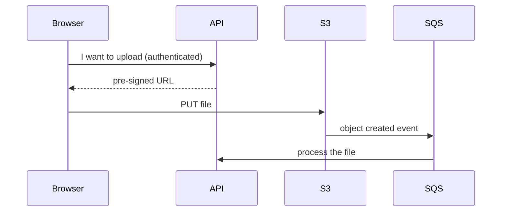
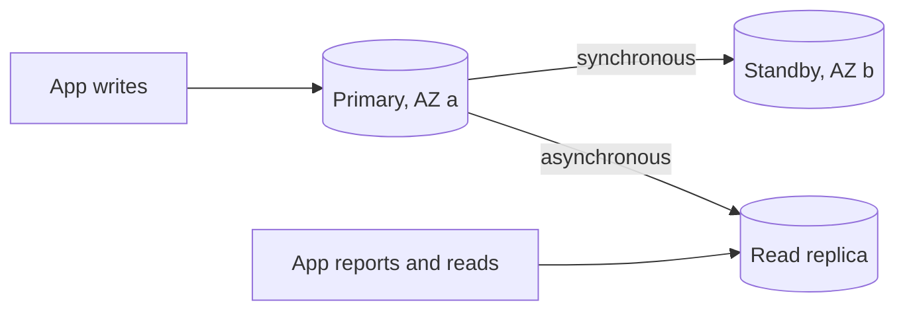
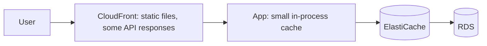

@part aws-data | AWS Part 3: Data: S3, RDS, DynamoDB and ElastiCache | cloud
## S3: object storage

S3 stores objects in buckets. It is not a file system: an object is written whole, and folders are only a naming convention (`2026/inv-42.pdf` is one key). In exchange, you get very high durability and almost unlimited scale.

### Consistency and limits

S3 offers strong read-after-write consistency: once a PUT succeeds, the next GET returns it. An object can be up to 5 TB, and uploads above about 100 MB should use multipart upload, which retries parts independently.

### Storage classes

| Class | Use | Trade-off |
|---|---|---|
| Standard | Frequently read data | Highest storage price |
| Intelligent-Tiering | Unknown patterns | Small monitoring fee |
| Standard-IA | Rarely read, needed fast | Retrieval fee, minimum duration |
| Glacier classes | Archives | Slower retrieval, lower storage cost |

Lifecycle rules move or delete objects automatically: for example, move invoices to Glacier after a year and delete temporary uploads after a week.

### Security

S3's "Block Public Access" should stay on unless a bucket truly serves public files, and even then CloudFront in front of a private bucket is better. Encrypt at rest (on by default) and use bucket policies for cross-account access. Most public S3 leaks come from misconfiguration, not from any flaw in S3.

### Pre-signed URLs

Never route large uploads through your API. Have the API authorise the user, then return a short-lived signed URL, so that the browser talks to S3 directly.

```java Issue a 10-minute upload URL
S3Presigner presigner = S3Presigner.create();

PutObjectRequest put = PutObjectRequest.builder()
    .bucket("acme-uploads")
    .key("users/" + userId + "/" + UUID.randomUUID() + ".pdf")
    .contentType("application/pdf")
    .build();

PresignedPutObjectRequest signed = presigner.presignPutObject(r -> r
    .signatureDuration(Duration.ofMinutes(10))
    .putObjectRequest(put));

return signed.url().toString();
```



This keeps your servers free of large bodies and scales with S3. Validate the object after upload, as a pre-signed URL trusts whoever holds it.

!keypoints S3 is object storage, not a file system ;; Upload directly with pre-signed URLs ;; Lifecycle rules save money ;; Keep Block Public Access on

?? Why not store user uploads on the server's disk?
=> Tasks are disposable, and other instances cannot see the file. S3 is durable and shared.
?? How do you serve private files to authorised users?
=> Check permission in the API, then issue a short-lived pre-signed GET URL or a signed CloudFront URL.
?? What is the risk of a pre-signed PUT with no later checks?
=> The holder can upload anything until it expires. Set a short expiry, restrict the key, then validate type and size after upload.

## RDS and Aurora

RDS runs relational engines for you: patching, backups and failover. Aurora is AWS's own engine, compatible with MySQL or PostgreSQL, with storage shared across AZs. Your Databases guide covers SQL itself; this chapter covers running it on AWS.

### Multi-AZ and read replicas

These two are often confused in interviews.

| | Multi-AZ standby | Read replica |
|---|---|---|
| Purpose | Availability | Read scaling |
| Replication | Synchronous | Asynchronous |
| Readable? | Not in the classic setup | Yes |
| On failure | Automatic failover, typically within a minute or two | Must be promoted |
| Risk | Slightly slower writes | Replication lag: stale reads |



After failover, the database endpoint's DNS points to the new primary, so existing connections break. Your connection pool must recover from this: HikariCP will retire dead connections, but keep sensible `maxLifetime` and connection timeouts, and retry idempotent operations.

### Connection limits

Tasks × pool size must stay under the database's `max_connections`. Twenty tasks with a pool of 20 is 400 connections, which may exceed a small instance's limit. If you scale out during a slowdown, you can make things worse by piling on connections. RDS Proxy can help, especially with Lambda.

### Backups and restore

Automated backups give point-in-time recovery within the retention window. A restore always creates a **new** instance, so plan how the app switches over. An untested backup is only a hope: run a restore on a schedule.

### Migrations during deployment

During a rolling deployment, old and new code run together, so the schema must work with both.

1. Add the new column as nullable and deploy code that writes both columns.
2. Backfill existing rows in small batches.
3. Move reads to the new column.
4. Remove the old column in a later release.

This is the **expand and contract** pattern. Flyway or Liquibase apply the steps from code.

!warning Locking migrations :: Adding an index on a big table without `CONCURRENTLY` in PostgreSQL blocks writes. A deployment can cause an outage by running a harmless-looking migration.

### Storing the password

Store credentials in Secrets Manager, which can rotate them automatically. Your task reads them at start-up, through the `secrets` section of the task definition. Rotation needs care: a running app holding the old password must reconnect successfully. Parameter Store is a cheaper option for ordinary configuration.

!interview Interview answer :: **"Your read replica shows old data."** That is replication lag, because replication is asynchronous. Read from the primary where freshness matters, such as just after a write, and use replicas for reports and pages that can tolerate some delay. Monitor `ReplicaLag`.

!keypoints Multi-AZ is for availability, replicas for reads ;; Failover drops connections, so the pool must recover ;; Watch tasks times pool size ;; Expand and contract keeps deployments safe

?? Will Multi-AZ help with a slow read-heavy application?
=> Generally no, because the standby is not used for reads in the classic setup. Add read replicas or caching, and fix slow queries.
?? Why must schema changes stay backward compatible during a rolling deployment?
=> Old and new versions run at once. If new schema breaks old code, then requests fail during the rollout, and rollback becomes unsafe.
?? How do you restore a database to yesterday at 3 p.m.?
=> Use point-in-time recovery, which creates a new instance. Verify the data, then point the application at it or copy back the lost rows.

## DynamoDB

DynamoDB is a managed key-value and document database with consistent single-digit-millisecond performance at nearly any scale, provided that you design for your access patterns. It rewards a mindset opposite to relational design.

### Keys

- **Partition key:** hashed to decide where an item lives.
- **Sort key (optional):** orders items within a partition, allowing range queries.

The only efficient reads are `GetItem` by full key and `Query` within one partition. A `Scan` reads the whole table and costs accordingly.

### Design from access patterns

In SQL you model entities and add queries later. In DynamoDB you **list queries first**. Suppose we need: get an order; list a customer's orders by date; list items in an order.

| PK | SK | Attributes |
|---|---|---|
| CUSTOMER#42 | ORDER#2026-10-31#9001 | total, status |
| ORDER#9001 | META | customerId, total |
| ORDER#9001 | ITEM#1 | sku, qty |
| ORDER#9001 | ITEM#2 | sku, qty |

Listing a customer's latest orders is now a single query, with no joins, at any scale. Storing different entity types in one table like this is **single-table design**. It is powerful, but it can be hard to change later.

```java Query a customer's orders with the SDK
QueryRequest request = QueryRequest.builder()
    .tableName("shop")
    .keyConditionExpression("PK = :pk AND begins_with(SK, :prefix)")
    .expressionAttributeValues(Map.of(
        ":pk", AttributeValue.fromS("CUSTOMER#42"),
        ":prefix", AttributeValue.fromS("ORDER#")))
    .scanIndexForward(false)   // newest first
    .limit(20)
    .build();

List<Map<String, AttributeValue>> orders = dynamo.query(request).items();
```

### Secondary indexes

A **global secondary index** gives another key shape, such as finding orders by status. It is updated asynchronously and has a cost, since every write also updates it. A **local secondary index** shares the partition key and must be defined at table creation.

### Hot partitions and capacity

If one key receives most traffic, say a viral product, that partition is throttled, even if the table has spare capacity. Choose high-cardinality keys, and spread out known hot keys, by adding a suffix such as `PRODUCT#7#3` and reading across suffixes.

On-demand mode charges per request and suits unknown traffic. Provisioned mode with autoscaling is cheaper for steady load.

### Consistency and transactions

Reads are eventually consistent by default and can be strongly consistent for double the read cost. Conditional writes prevent lost updates. `TransactWriteItems` updates several items atomically, within limits.

```java Prevent overselling with a condition
dynamo.updateItem(UpdateItemRequest.builder()
    .tableName("shop")
    .key(Map.of("PK", AttributeValue.fromS("PRODUCT#7"), "SK", AttributeValue.fromS("META")))
    .updateExpression("SET stock = stock - :one")
    .conditionExpression("stock >= :one")
    .expressionAttributeValues(Map.of(":one", AttributeValue.fromN("1")))
    .build());   // throws ConditionalCheckFailedException if stock is gone
```

### When not to use it

Prefer PostgreSQL when queries are varied or unknown, when you need ad hoc reporting or complex joins, or when the team knows SQL and the scale does not demand otherwise. Many systems never need DynamoDB's scale.

!interview Interview answer :: **"DynamoDB or PostgreSQL?"** PostgreSQL by default. DynamoDB when access patterns are known and key-based, and the load is high or spiky. The deciding question is whether I can list my queries in advance.

!keypoints List access patterns before you design ;; Query within a partition, avoid Scan ;; Beware of hot partitions ;; Conditional writes prevent lost updates

?? A team runs Scan with a filter on a large table in a request path. What is wrong?
=> Scan reads the whole table and is charged for it before filtering. Add a GSI, or redesign the key, so that it becomes a Query.
?? Why can one popular item be throttled while the table has spare capacity?
=> Capacity is limited per partition. A single hot key can exceed its partition's limit. Use write sharding, caching, or a better key.
?? How do you avoid two buyers taking the last item?
=> Use a conditional update that requires stock of at least 1. Only one succeeds, and the other gets a failed condition.

## ElastiCache and caching on AWS

ElastiCache runs Redis-compatible caches (and Memcached), with replication and failover. Your Redis guide explains the data structures and patterns in depth. Here we focus on running them on AWS.

### Topologies

| Setup | Gives | Use |
|---|---|---|
| Single node | Nothing extra | Development only |
| Primary with replicas, Multi-AZ | Failover, read scale | Most apps |
| Cluster mode | Sharding across nodes | Data or writes beyond one node |

### Where the cache sits



### Designing for failure

A cache must be optional for correctness. If ElastiCache fails over or disappears, the app should fall back to the database, with limits so that the database is not flattened by the sudden load. Use short client timeouts, as a hung cache call that waits for seconds is worse than a cache miss. Add a circuit breaker so that a dead cache is skipped quickly.

### Practical details

- Keep it in private subnets, and allow only the app's security group.
- Use TLS and AUTH or IAM authentication.
- Watch evictions, memory usage, cache hit rate and replication lag.
- Set TTLs on everything, with some random jitter so that keys do not all expire together.
- Choose `allkeys-lru` when it is purely a cache.

!warning Stampedes :: When a popular key expires, many requests may hit the database at once. Use a short lock so that one request rebuilds the entry, or refresh early in the background.

!keypoints Multi-AZ replication for production ;; The app must survive without the cache ;; Short timeouts and circuit breakers ;; TTL with jitter

?? Redis fails over and the app becomes very slow. Why?
=> Calls may be waiting on long timeouts, and all traffic has moved to the database. Use short timeouts, circuit breaking and load shedding, and limit database concurrency.
?? Why add jitter to TTLs?
=> If many keys expire together, they all miss together, and that overloads the database. Jitter spreads out the expiry.
