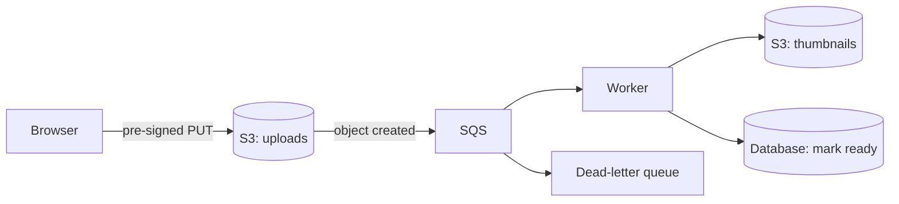
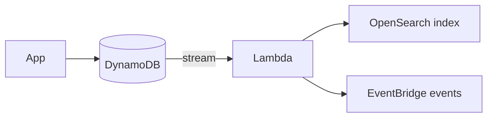

@more
## S3 in practice from Java

### Choosing how to transfer

| Situation | Approach |
|---|---|
| Small object from the server | `S3Client.putObject` |
| Large file from the server | `S3TransferManager`: multipart and parallel parts |
| User upload | Pre-signed URL or pre-signed POST |
| Reading a big file | Stream it; never load it all into memory |

```java Streaming a download through your API
@GetMapping("/files/{key}")
ResponseEntity<StreamingResponseBody> download(@PathVariable String key) {
    checkPermission(key);
    ResponseInputStream<GetObjectResponse> object =
        s3.getObject(b -> b.bucket("acme-files").key(key));
    StreamingResponseBody body = out -> {
        try (object) { object.transferTo(out); }
    };
    return ResponseEntity.ok()
        .contentLength(object.response().contentLength())
        .contentType(MediaType.parseMediaType(object.response().contentType()))
        .body(body);
}
```

Streaming through your service holds a thread and a connection for each download, so prefer a pre-signed URL when you can. Use this path only when you must transform the content or control access byte by byte.

### Versioning and protection

**Versioning** keeps earlier versions when objects are overwritten or deleted. A delete only adds a marker, so accidental deletion is recoverable. It costs storage for each version, so pair it with a lifecycle rule that expires old versions. **Object Lock** adds retention that nobody can shorten, which helps against ransomware and with compliance.

### Events

S3 can notify SQS, SNS, Lambda or EventBridge when objects change.



Notifications are delivered at least once, and may arrive out of order, so make handlers idempotent. Never write back to the same prefix that triggers the function, or you create an infinite loop with a large bill.

### Key design and performance

S3 scales request rates per prefix, and it automatically adapts. Very high request rates suit distributed prefixes. A sensible key might be `tenant/42/2026/10/uuid.pdf`. Listing is slow on huge prefixes, so keep your own database index of what exists instead of calling `ListObjects` in request paths.

### Static hosting and CORS

Serve the React build through CloudFront, as Part 4 describes. If browsers upload directly to S3 with pre-signed URLs, the bucket needs a CORS rule allowing your site's origin and `PUT`. "CORS error" on direct upload nearly always means that this rule is missing.

### Data lake basics

Cheap storage makes S3 the base of analytics. Athena queries files in S3 with SQL, and it charges per data scanned, so columnar Parquet and partitioned keys such as `dt=2026-10-31/` reduce cost sharply. Glue catalogues the data. As a backend developer, it's enough to know that you can export events to S3 and query them later, without loading production databases.

!keypoints Stream, never buffer whole files ;; Versioning protects from accidents ;; Events are at-least-once ;; Do not trigger a function from the prefix it writes to

?? A Lambda triggered by S3 writes a thumbnail into the same bucket, and the bill explodes. Why?
=> Each thumbnail triggers another invocation, in a loop. Use a separate bucket or prefix, and filter the trigger.
?? Why keep your own table of uploaded files rather than listing S3?
=> Listing is slow and paginated. A table supports fast queries, ownership and metadata.
?? How can you recover an object someone deleted by mistake?
=> With versioning on, remove the delete marker, or restore a prior version. Without it, only a separate backup can help.

## Operating RDS and Aurora

### Sizing and storage

Choose an instance class by working set: ideally, frequently used data and indexes fit in memory. Use **gp3** storage by default, and provisioned IOPS for sustained heavy I/O. Turn on storage autoscaling, because running out of disk is one of the quickest ways to take a database down.

### What to watch

| Metric | Means | Action |
|---|---|---|
| CPUUtilization | Query load | Fix slow queries before upsizing |
| FreeableMemory | Cache pressure | More memory, fewer connections |
| DatabaseConnections | Near the limit? | Pool sizes, proxy |
| ReadLatency, WriteLatency | Disk health | IOPS, query plans |
| FreeStorageSpace | Disk left | Alarm early |
| ReplicaLag | Stale reads | Slower writes or larger replica |
| DiskQueueDepth | I/O backlog | IOPS, indexes |

**Performance Insights** (or its successor features) shows which queries consume database load, grouped by wait type. This is usually the fastest route to the real problem. Enable slow query logging too.

### Parameter groups

Engine settings live in parameter groups, such as `max_connections`, `log_min_duration_statement` and `work_mem`. Some settings need a reboot. Change them in a lower environment first.

### Connection pool sizing

A common mistake is making the pool bigger when the app is slow. With 20 tasks and a pool of 50, the database faces 1,000 connections, which increases contention and makes everything slower. A starting formula from HikariCP's guidance: `connections = (cores × 2) + effective spindles`, adjusted by load testing.

```properties HikariCP settings for RDS failover
spring.datasource.hikari.maximum-pool-size=10
spring.datasource.hikari.connection-timeout=3000
spring.datasource.hikari.max-lifetime=600000
spring.datasource.hikari.validation-timeout=2000
```

Set JDBC socket timeouts as well, so a dead connection during failover doesn't hang a thread. For PostgreSQL, `socketTimeout` and `connectTimeout` in the URL do this.

### Aurora

| | RDS PostgreSQL | Aurora PostgreSQL |
|---|---|---|
| Storage | EBS volumes | Distributed, across 3 AZs, grows automatically |
| Read replicas | Several, with their own storage | Up to 15, sharing storage, low lag |
| Failover | Typically a minute or two | Often faster |
| Cost | Lower for small workloads | Higher baseline; I/O charges or I/O-optimised mode |
| Serverless | No | Serverless v2 scales capacity |

Aurora has a **reader endpoint** that spreads connections across replicas. It balances connections, not queries, so a long-lived pool can stay unevenly distributed.

### Read/write splitting

```java Route read-only transactions to a replica
public class RoutingDataSource extends AbstractRoutingDataSource {
    @Override
    protected Object determineCurrentLookupKey() {
        return TransactionSynchronizationManager.isCurrentTransactionReadOnly() ? "reader" : "writer";
    }
}
```

Wrap this in `LazyConnectionDataSourceProxy`, so that the connection is chosen after the transaction's read-only flag has been set. Remember replica lag: after a user saves a form, reading it from a replica may show old data, so read your own writes from the primary.

### Zero-downtime major upgrades

Blue/green deployments in RDS create a synchronised copy on the new version, and switch over within about a minute. Test on a restored snapshot first, and check the application against the new version. Never run major upgrades without having tested rollback options.

!interview Interview answer :: **"The database CPU is at 95%. What do you do?"** Don't upsize first. I check Performance Insights for the top queries, then look for missing indexes, N+1 patterns and connection storms. Mitigate with caching or by moving reads to replicas, and upsize only if the workload truly needs it.

!keypoints Alarm on free storage ;; Find top queries before upsizing ;; A bigger pool can make things worse ;; Reader endpoints balance connections, not queries

?? Everything is slow, so a teammate raises the pool from 20 to 100. What may happen?
=> The database has more concurrent work and contention, so it gets slower for everybody. Fix slow queries, and size the pool against the database's capacity.
?? A user saves a profile and then sees old data. Why might that happen?
=> The read went to a lagging replica. Read your own recent writes from the primary.
?? Why does a long-lived pool sometimes overload one Aurora reader?
=> The reader endpoint balances at connection time, and the pool keeps those connections. Limit connection lifetime so they rebalance.

## DynamoDB from Java, streams and modelling practice

### The Enhanced Client

The Enhanced Client maps Java classes to items.

```java A mapped entity
@DynamoDbBean
public class Order {
    private String pk;
    private String sk;
    private String status;
    private Long version;

    @DynamoDbPartitionKey @DynamoDbAttribute("PK")
    public String getPk() { return pk; }
    public void setPk(String pk) { this.pk = pk; }

    @DynamoDbSortKey @DynamoDbAttribute("SK")
    public String getSk() { return sk; }
    public void setSk(String sk) { this.sk = sk; }

    public String getStatus() { return status; }
    public void setStatus(String status) { this.status = status; }

    @DynamoDbVersionAttribute
    public Long getVersion() { return version; }
    public void setVersion(Long version) { this.version = version; }
}
```

```java Read and query
DynamoDbTable<Order> table = enhanced.table("shop", TableSchema.fromBean(Order.class));

Order order = table.getItem(Key.builder().partitionValue("ORDER#9001").sortValue("META").build());

List<Order> latest = table.query(r -> r
        .queryConditional(QueryConditional.sortBeginsWith(
            Key.builder().partitionValue("CUSTOMER#42").sortValue("ORDER#").build()))
        .scanIndexForward(false)
        .limit(20))
    .items().stream().limit(20).toList();
```

`@DynamoDbVersionAttribute` gives optimistic locking: an update fails if somebody else changed the item since it was read.

### A modelling exercise

For a ticketing system, list the access patterns first:

| Access pattern | Key used |
|---|---|
| Get a ticket | PK=`TICKET#id`, SK=`META` |
| Comments on a ticket | PK=`TICKET#id`, SK begins with `COMMENT#` |
| A user's tickets, newest first | PK=`USER#id`, SK=`TICKET#date#id` |
| Open tickets by team | GSI1: PK=`TEAM#id#OPEN`, SK=date |

Notice how "open tickets by team" uses a **sparse index**: only open tickets have the GSI attributes, so closed ones cost nothing there, and the index stays small. On closing, remove those attributes.

### Pagination

DynamoDB returns up to 1 MB per request, along with `LastEvaluatedKey`. There are no offsets. So API pagination uses an opaque cursor containing this key. This forces designs like "next page", and not "jump to page 7". Filter expressions apply after reading, so a page may come back short, or even empty, while more data still exists.

### Streams and TTL

**DynamoDB Streams** gives you a time-ordered log of item changes, for 24 hours. A Lambda can keep a search index up to date, publish events or update aggregates. **TTL** deletes items after a timestamp, for free, which suits sessions and temporary tokens. TTL deletion is not immediate, so filter expired items in reads if exactness matters.



### Limits and costs

- An item is limited to 400 KB, so store large content in S3 with a pointer.
- A partition handles limited throughput per second.
- Each GSI copies data, and it's charged for writes.
- Strongly consistent reads cost twice as much, and aren't available on GSIs.
- Transactions cost about double.

### Moving away from a relational mindset

Avoid these common errors: one table per entity with client-side joins, scans in production, normalising everything, and low-cardinality partition keys such as `status`. If you find yourself needing many ad hoc queries, DynamoDB may be the wrong choice, and that's a fine conclusion.

!keypoints Enhanced Client maps classes to items ;; Sparse indexes keep queries cheap ;; Pagination uses a cursor, not an offset ;; Streams enable change capture

?? A filtered query returns an empty page, but LastEvaluatedKey is present. What does it mean?
=> Filters apply after reading, so this page matched nothing but more data exists. Continue with the key.
?? Why is status a poor partition key?
=> It has few values, so traffic concentrates on a few partitions. Add a higher-cardinality key.
?? How do you remove expired sessions cheaply?
=> Use DynamoDB TTL, and filter by expiry in reads, as deletion can be delayed.
