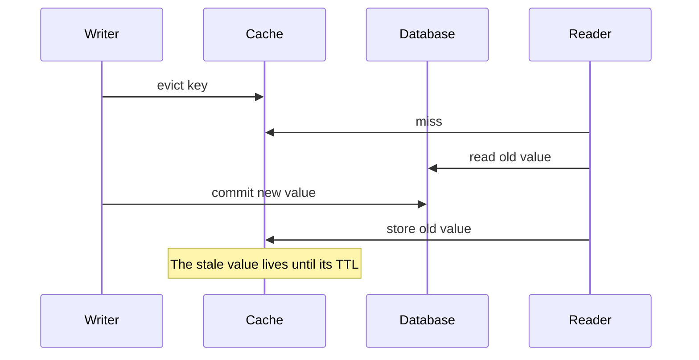
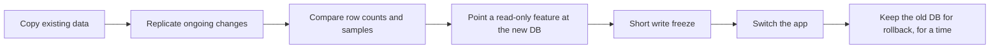

@more
## Spring caching with ElastiCache

### A cache-aside service

```java Spring's cache annotations
@Service
class ProductService {

    private final ProductRepository products;

    ProductService(ProductRepository products) { this.products = products; }

    @Cacheable(cacheNames = "products", key = "#id")
    public ProductView find(long id) {
        return ProductView.of(products.findById(id).orElseThrow());
    }

    @CacheEvict(cacheNames = "products", key = "#id")
    @Transactional
    public void updatePrice(long id, BigDecimal price) {
        products.findById(id).orElseThrow().setPrice(price);
    }
}
```

```properties Redis configuration
spring.cache.type=redis
spring.data.redis.host=${REDIS_HOST}
spring.data.redis.ssl.enabled=true
spring.data.redis.timeout=200ms
spring.cache.redis.time-to-live=10m
```

### A subtle race

`@CacheEvict` here may run around the commit. Consider this interleaving:



No simple design removes every such race. Practical answers: evict **after** commit with `@TransactionalEventListener`, keep TTLs short so that errors heal themselves, and use versioned keys for critical data. Only cache data that can tolerate brief staleness. Never make decisions on money or stock from a cache.

### What belongs in the cache

| Good candidates | Poor candidates |
|---|---|
| Product pages read far more than written | Account balances |
| Results of expensive queries | Data that changes on every read |
| Sessions, tokens, rate limit counters | Very large objects |
| Feature flags | Anything you can't rebuild |

### Measuring value

Hit rate alone can mislead: 95% on rarely used keys may save little. Estimate saved database load: `requests × hit rate × query cost`. Also check that the cache is really faster, as a network hop with serialisation may cost more than a simple indexed query.

### Serialisation

The default JDK serialisation is slow, large and breaks on class changes. Use JSON or a compact format, and include a version in the key prefix, such as `products:v2:42`, so that a deployment with a changed structure doesn't read incompatible old values.

### Two levels

A small in-process cache, using Caffeine, in front of Redis removes network hops for the hottest keys, and it protects Redis from a viral item. The cost is possible inconsistency between instances, so give it a very short TTL, measured in seconds.

### Hot keys

One key can overload a single Redis shard. Options: an in-process cache, read replicas, or splitting the value across several keys. Finding them is half the job: use your client's metrics, or sample with `redis-cli --hotkeys` in a safe window.

!warning Redis as a primary database :: ElastiCache replication is asynchronous, so failover can lose recent writes. If you need durability, use a database, or a service designed for it such as MemoryDB, after reading its guarantees.

!keypoints Evict after commit ;; Short TTLs heal mistakes ;; Version keys for safe deployments ;; Don't decide on money from a cache

?? Why might deleting a cache key before the database commit leave stale data?
=> A reader can reload the old value between the eviction and the commit. It then stays until its TTL.
?? How do you prevent a deployment from breaking on cached objects of an older structure?
=> Use a version in the key prefix and a stable format such as JSON, so that the new version reads fresh entries.

## DynamoDB capacity and cost maths

### Capacity units

| Unit | Gives you |
|---|---|
| 1 RCU | 1 strongly consistent read per second, up to 4 KB; or 2 eventually consistent |
| 1 WCU | 1 write per second, up to 1 KB |

Sizes round **up**. Transactions use twice the units.

### A worked example

An app does 500 reads per second of 6 KB items, using eventual consistency, and 100 writes per second of 1.5 KB items, with one GSI that also takes every write.

| Step | Working | Result |
|---|---|---|
| Read size | 6 KB rounds up to 8 KB, which is 2 units of 4 KB | 2 strong RCU each |
| Eventual reads | 2 ÷ 2 | 1 RCU each |
| Total reads | 500 × 1 | 500 RCU |
| Write size | 1.5 KB rounds up to 2 KB | 2 WCU each |
| Table writes | 100 × 2 | 200 WCU |
| GSI writes | Same again, if all attributes are projected | 200 WCU |
| Total writes | 200 + 200 | 400 WCU |

If the GSI projects only key attributes, each entry may fit in 1 KB, for 100 WCU. **Projection choice directly changes your bill.**

### What's a hot partition, in numbers?

A single partition supports up to about 3,000 RCU and 1,000 WCU per second. A product getting 2,000 writes a second to one key will be throttled, however large the table is. Spreading writes across 4 suffixes gives each 500 writes per second, which fits.

```java Write sharding a hot counter
int shard = ThreadLocalRandom.current().nextInt(4);
String pk = "VOTES#" + pollId + "#" + shard;
// to read the total, query all 4 keys and add them
```

### On-demand or provisioned?

| Traffic | Choose |
|---|---|
| New app, unknown traffic | On-demand |
| Very spiky | On-demand |
| Steady and predictable | Provisioned with autoscaling |
| Very steady, long term | Provisioned with reserved capacity |

Provisioned autoscaling reacts within minutes, so a sudden spike can throttle before capacity arrives.

### Reducing cost

- Keep items small. Move large fields to S3, and shorten long attribute names, because names count towards size.
- Project only what each GSI query needs.
- Use eventual consistency unless you must read your own write.
- Use TTL rather than paying for deletes.
- Avoid scans. Scan a 100 GB table, and you pay for every byte read.

### Handling throttling

The SDK retries with backoff by default. Sustained throttling surfaces as `ProvisionedThroughputExceededException`. Watch the `ThrottledRequests` metric. CloudWatch Contributor Insights identifies the most-used keys.

### Batches

`BatchWriteItem` sends up to 25 items, and `BatchGetItem` up to 100. A batch isn't a transaction, and may partly fail, so handle `UnprocessedItems` by retrying with backoff.

!keypoints Sizes round up ;; GSIs cost write capacity too ;; One partition has its own limit ;; Handle UnprocessedItems

?? How many RCUs do 1,000 strongly consistent reads of 3 KB items per second need?
=> 3 KB rounds up to 4 KB, so 1 RCU each: 1,000 RCU.
?? How many WCUs do 50 writes per second of 2.4 KB items need?
=> 2.4 rounds up to 3, so 3 WCU each: 150 WCU, plus any indexes.
?? A BatchWriteItem returned successfully, but some items are missing. Why?
=> It may return UnprocessedItems without failing. Check and retry them.

## Migrating data and analytics on AWS

### Moving a database to RDS

| Approach | Downtime | Effort |
|---|---|---|
| Dump and restore | Long, for large data | Low |
| Native replication | Short cutover | Medium |
| AWS DMS | Short cutover | Medium, with its own limits |

A safe sequence:



Practise on a copy, and time every step. Prepare a rollback before you begin: once the new database accepts writes, going back requires reverse replication.

### Moving large files

For terabytes over the internet, use `aws s3 sync` or DataSync, and check with checksums. For very large volumes over slow links, physical Snowball devices are still used.

### Keep analytics away from production

A heavy report on the production database hurts live traffic. Options, from simple to serious:

| Option | Suits |
|---|---|
| Read replica | Small reporting needs |
| Export to S3 + Athena | Occasional queries, low cost |
| Change capture to S3, using DMS or Debezium | Fresher analytics data |
| Redshift | Large, regular analytical workloads |
| OpenSearch | Full-text search and log analytics |

### Athena, in practice

```sql Partition pruning makes queries cheap
CREATE EXTERNAL TABLE orders (
  order_id string,
  total decimal(10,2),
  customer string
)
PARTITIONED BY (dt string)
STORED AS PARQUET
LOCATION 's3://acme-lake/orders/';

SELECT dt, SUM(total)
FROM orders
WHERE dt BETWEEN '2026-10-01' AND '2026-10-31'
GROUP BY dt;
```

Athena charges per data scanned. A worked comparison: querying one day of a year's 3 TB of CSV files without partitions scans all 3 TB. With daily partitions, it scans about 8 GB (3 TB ÷ 365). In Parquet, which reads only the needed columns and compresses well, it could be 1 or 2 GB. So that one query costs over a thousand times less.

### Search with OpenSearch

If users need typo tolerance, relevance ranking and filters across text, a database `LIKE '%term%'` won't scale. OpenSearch is the managed option. Keep your database as the source of truth, and feed the index asynchronously through events, accepting that the index can lag. It's also usable for vector search.

!keypoints Practise migrations, and time each step ;; Prepare the rollback first ;; Keep analytics off production ;; Columnar files and partitions cut Athena costs

?? Why not run monthly reports directly on the primary database?
=> Large scans compete with live traffic. Use a replica, or export to S3 for Athena.
?? Why does Parquet reduce Athena costs?
=> It's columnar and compressed, so queries read only the needed columns, and charges follow data scanned.
?? What makes a rollback difficult once a new database accepts writes?
=> The old one no longer has those writes, so you need reverse replication or a planned reconciliation.
