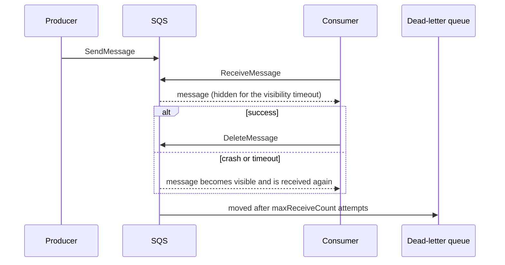
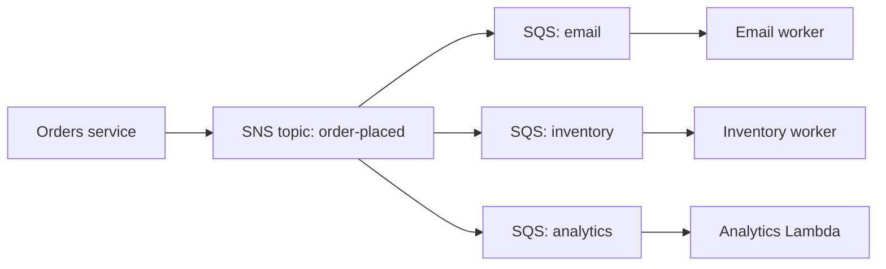
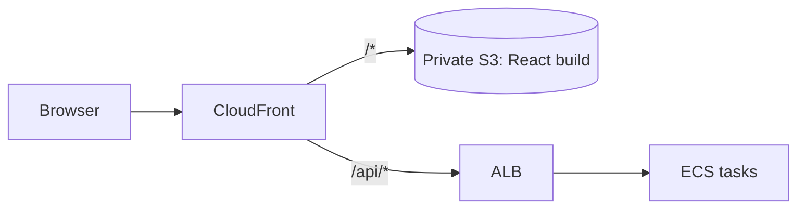

@part aws-integration | AWS Part 4: Messaging and Traffic | cloud
## SQS: queues

A queue lets one service hand work to another without both being available at once. It absorbs spikes, and failed work can retry. SQS is the simplest such service on AWS.

### How a message moves



A consumer does not "take" a message. It borrows it for the **visibility timeout** and must delete it when done. If the consumer dies, the message simply returns. This gives at-least-once delivery, which is why **consumers must be idempotent**.

### Standard or FIFO

| | Standard | FIFO |
|---|---|---|
| Delivery | At least once, rare duplicates | Exactly-once processing within a window |
| Order | Best effort | Strict, per message group |
| Throughput | Nearly unlimited | Lower, higher with high-throughput mode |
| Use | Most background work | Order per customer or account |

A **message group ID** in FIFO keeps order per group while other groups continue in parallel. A single group ID for everything turns your queue into a single-file line.

### Settings that cause incidents

- **Visibility timeout:** set it above your worst-case processing time, usually about six times the Lambda timeout when using Lambda. Too short means duplicate processing while the first attempt still runs.
- **Long polling:** set `WaitTimeSeconds` to 20. It reduces empty responses and costs.
- **Dead-letter queue:** after a set number of attempts, a message moves here instead of blocking the queue forever. Alarm when it is not empty, and have a redrive plan.
- **Size:** messages are limited, classically to 256 KB. For larger payloads, store the object in S3 and send a reference.

### Idempotent consumers

```java Record the message before doing the work, in one transaction
@Transactional
public void handle(PaymentMessage m) {
    if (processed.insertIfAbsent(m.eventId())) {   // unique key on event_id
        orders.markPaid(m.orderId());
    }
    // a duplicate does nothing, and the message is deleted after commit
}
```

### Reliable publishing

Saving to the database, then sending to SQS, has a gap: a crash between the two loses the message. The **outbox pattern** writes the message into an outbox table in the same transaction as the business change. A separate publisher then sends it. Your Kafka guide covers this in depth, and it is the same idea on any broker.

### Spring Cloud AWS

```java A listener with Spring Cloud AWS
@Component
class InvoiceListener {

    private final InvoiceService invoices;

    InvoiceListener(InvoiceService invoices) { this.invoices = invoices; }

    @SqsListener("invoice-events")
    void onMessage(InvoiceEvent event) {
        invoices.generate(event);   // the message is deleted when this returns normally
    }
}
```

!interview Interview answer :: **"A message was processed twice. Why, and what do you do?"** SQS is at-least-once, and the visibility timeout may have expired during slow processing. So I make the consumer idempotent with a unique event ID, and also raise the timeout.

!keypoints A received message is hidden, not removed ;; Consumers must be idempotent ;; Always attach a dead-letter queue, and alarm on it ;; Use an outbox for reliable publishing

?? Orders for one customer must stay in sequence, but different customers can run in parallel. How?
=> Use a FIFO queue with the customer ID as the message group ID.
?? What happens if the visibility timeout is shorter than processing time?
=> The message reappears while still being processed, and another consumer works on it too, which causes duplicates.
?? A poison message fails every time. What protects the queue?
=> A redrive policy moves it to a dead-letter queue after maxReceiveCount tries, so other messages continue. An alarm tells people to look.
?? Why save to an outbox rather than sending to SQS within the transaction?
=> SQS is not part of the database transaction, so one can succeed while the other fails. The outbox makes the write atomic, and a publisher delivers it at least once.

## SNS, EventBridge, Kinesis and MSK

Choosing messaging services is a favourite design question. The differences are about how many consumers there are, and whether messages can be replayed.

### SNS: fan-out

SNS pushes one message to all subscribers. It keeps no history. The most common pattern pairs it with SQS, so that each consumer has its own durable queue.



If the inventory service is down for an hour, its queue holds the messages, and nothing else is affected. Subscribers can use filter policies to receive only the messages they care about.

### EventBridge: routing with rules

EventBridge is an event bus. Rules match on the event's content and route it to targets. It also receives events from AWS services and SaaS products, and has a scheduler. It suits loosely connected systems, while SNS suits simple, high-volume fan-out.

### Kinesis and MSK: replayable logs

A stream keeps messages for a retention period, and each consumer tracks its own position. New consumers can read history, and a consumer can rewind after a bug. MSK is managed Apache Kafka, so all of your Kafka guide applies. Kinesis is AWS's own stream, with less to operate, but with AWS-specific APIs.

### Decision table

| Need | Choose |
|---|---|
| Work queue with retries | SQS |
| One event, several independent consumers | SNS + SQS |
| Content-based routing, SaaS or AWS events | EventBridge |
| Ordered, replayable stream, many readers | MSK or Kinesis |
| Strict order within a key, small scale | SQS FIFO |
| Multi-step workflow with retries and state | Step Functions |

### Step Functions

Step Functions runs a state machine that coordinates steps, handling retries, timeouts and branching in configuration. An order workflow with several services may use it as a saga orchestrator, with compensating steps when one fails. Debugging is easier, because each execution has a visual history.

!interview Interview answer :: **"Kafka or SQS?"** SQS for simple background jobs with low operational load. Kafka when several consumers need the same events, when I need replay or stream processing, or when per-key ordering at high throughput matters.

!keypoints SNS pushes and forgets ;; SNS plus SQS gives durable fan-out ;; Streams allow replay ;; Pick by consumers and replay needs

?? Why put SQS between SNS and a consumer?
=> The queue holds messages if the consumer is slow or down, and it controls the processing rate and retries.
?? A new analytics team wants the last week of events. Which design supports it?
=> A stream with retention, such as Kafka or Kinesis. With SNS and SQS, past messages are gone, unless they are archived.

## Load balancers, API Gateway and CloudFront

All traffic has to enter somewhere. These three services are often used together, and interviewers expect you to separate their jobs.

| Service | Job | Layer |
|---|---|---|
| Application Load Balancer | Spread HTTP traffic across tasks | 7 |
| Network Load Balancer | Very high TCP or UDP throughput, static IPs | 4 |
| API Gateway | API features: auth, throttling, keys, Lambda integration | 7 |
| CloudFront | CDN: cache close to users, TLS, WAF | 7 |
| Route 53 | DNS, health-based failover | DNS |

### Application Load Balancer

An ALB has **listeners** (port 443), **rules** (path or host) and **target groups** (your tasks, with health checks). It terminates TLS using a certificate from ACM. Sticky sessions exist, but a stateless app should not need them.

### Timeouts must line up

Timeouts should shrink as you go inward. Otherwise the outer layer gives up while the inner one keeps working on a request nobody wants.

```text Example: decreasing timeouts
CloudFront origin timeout     60 s
ALB idle timeout              55 s
Spring Boot request handling  25 s
Downstream HTTP client         5 s
Database query                 3 s
```

!warning Intermittent 502 errors :: A common cause: the app closes an idle keep-alive connection while the ALB is reusing it. Keep the server's keep-alive timeout longer than the ALB's idle timeout. In Spring Boot with Tomcat, set `server.tomcat.keep-alive-timeout` accordingly.

### API Gateway

API Gateway adds request validation, authorisers (JWT or Lambda), usage plans, API keys and throttling. It works well in front of Lambda. In front of a single Spring Boot service it may add little, as Spring and the ALB already handle much of this. It has a hard timeout and a payload limit, so long jobs must be asynchronous.

### CloudFront

CloudFront caches responses at edge locations. Typical uses: serving the React build from a private S3 bucket through Origin Access Control, and sending `/api/*` to the ALB without caching. Set long cache times on hashed assets, such as `main.8f2a.js`, and short ones on `index.html`, so that a deployment appears quickly.



A single domain also avoids CORS configuration entirely.

### WAF and rate limits

AWS WAF attaches to CloudFront or the ALB, and blocks common attacks, known bad IPs and floods by rate. It complements validation in your code but doesn't replace it.

!interview Interview answer :: **"How do you serve React and Spring Boot on AWS?"** Build React into S3, serve it through CloudFront, and route `/api/*` to an ALB in front of ECS tasks. It is one domain, so no CORS, with hashed assets cached long and `index.html` cached briefly.

!keypoints ALB for traffic, API Gateway for API features, CloudFront for caching at the edge ;; Timeouts shrink as you go inward ;; Keep buckets private behind CloudFront ;; Cache hashed assets for a long time

?? After deployment, users still see the old React app. Why?
=> `index.html` is cached by CloudFront or the browser. Give it a short cache time, and invalidate it on deployment. Hashed assets can then be cached for a long time.
?? Do you need API Gateway in front of Spring Boot on ECS?
=> Often not: an ALB plus Spring Security covers routing and auth. Add it for usage plans, API keys, or when many backends share one front door.
?? Why should inner timeouts be shorter than outer ones?
=> So that the inner call fails first and can be handled. Otherwise, the outer layer returns an error while the work continues uselessly and holds resources.
