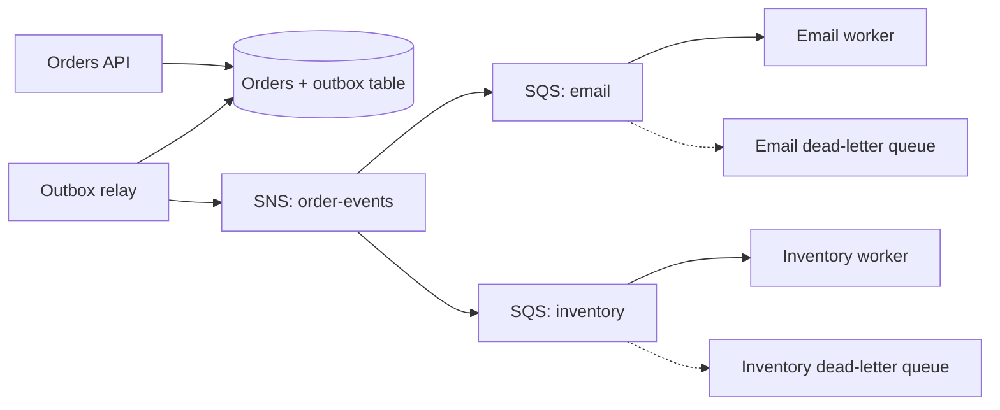
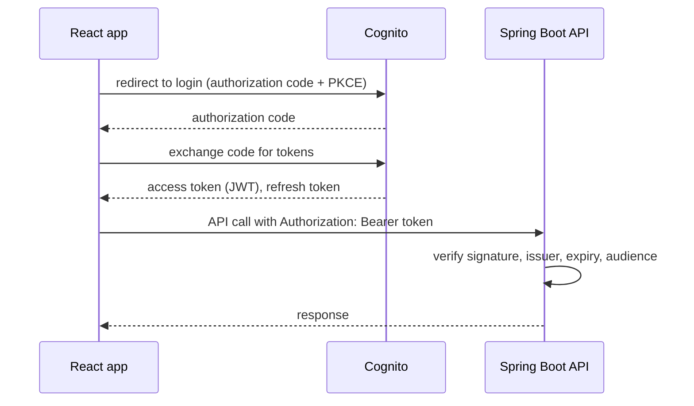
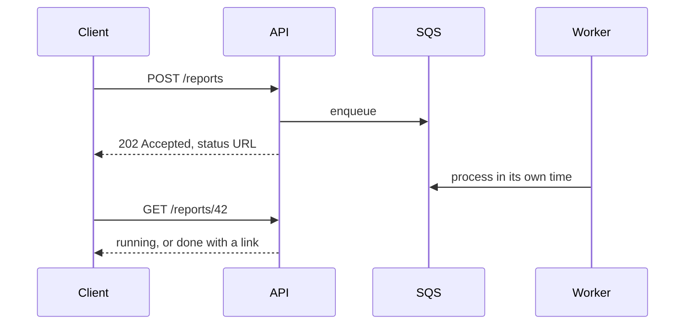

@more
## Building an event-driven flow from Spring Boot

This chapter builds a realistic flow: placing an order publishes an event, and independent workers react, without losing a message.



### Step 1: write the business change and event together

```java One transaction: the order and its event
@Transactional
public Order place(PlaceOrder cmd) {
    Order order = orders.save(Order.from(cmd));
    outbox.save(new OutboxEvent(UUID.randomUUID(), "OrderPlaced", order.getId().toString(),
        json.write(new OrderPlaced(order.getId(), order.getTotal()))));
    return order;
}
```

### Step 2: relay the outbox

```java A simple relay; one instance at a time works through a batch
@Scheduled(fixedDelay = 1000)
@SchedulerLock(name = "outboxRelay", lockAtMostFor = "30s")
@Transactional
public void relay() {
    for (OutboxEvent e : outbox.findTop100ByPublishedAtIsNullOrderByCreatedAt()) {
        sns.publish(b -> b.topicArn(topicArn)
            .message(e.getPayload())
            .messageAttributes(Map.of("type", MessageAttributeValue.builder()
                .dataType("String").stringValue(e.getType()).build(),
                "eventId", MessageAttributeValue.builder()
                .dataType("String").stringValue(e.getId().toString()).build())));
        e.markPublished();
    }
}
```

A crash after publishing but before commit will send the event again. That's the at-least-once guarantee, so consumers must handle duplicates. Debezium can replace this relay by reading the database's change log, as your Kafka guide describes.

### Step 3: consume idempotently

```java An inventory worker
@SqsListener("inventory-queue")
@Transactional
public void onOrderPlaced(OrderPlaced event, @Header("eventId") String eventId) {
    if (!processed.markIfNew(eventId)) {
        return;                  // already handled: acknowledge and move on
    }
    inventory.reserve(event.orderId());
}
```

`markIfNew` inserts into a table with a unique key on the event ID, inside the same transaction as the reservation. If the insert hits a duplicate, the handler knows it's a repeat. (Header names depend on how you set message attributes, and with raw message delivery on the SNS subscription, attributes become SQS attributes. Check this with your Spring Cloud AWS version.)

### Step 4: failure handling

| Failure | Handling |
|---|---|
| Worker crash | Message reappears after visibility timeout |
| Temporary downstream error | Throw; retried with delay |
| Bad data | Goes to dead-letter queue after N attempts |
| Consumer down for hours | Messages wait, up to retention (up to 14 days) |
| Dead-letter messages | Alarm, inspect, fix, redrive |

**Retry storms:** set a visibility timeout that grows, or use a delay, so that a failing dependency isn't hammered. A circuit breaker in the worker can pause consumption while a dependency is down.

### Step 5: observe it

Watch `ApproximateAgeOfOldestMessage`, the best sign of falling behind. Number of messages alone can mislead. Propagate a trace ID through message attributes, so that a single order can be followed across all services.

### Ordering

Standard queues don't preserve order, so handle events arriving out of sequence. A simple tactic: store a version or timestamp on the entity, and ignore events older than what you have. Using FIFO queues everywhere costs throughput, and only helps per group.

### Schema evolution

Events outlive deployments. Add optional fields rather than renaming them. Include a type and version, keep consumers tolerant of unknown fields, and remember that a dead-letter redrive can replay old-format events days later.

!interview Interview answer :: **"How do you guarantee an event is published when an order is saved?"** The transactional outbox: both are written in one database transaction, then a relay publishes. Delivery is at-least-once, so consumers deduplicate on an event ID.

!keypoints Outbox for reliable publishing ;; Dedupe with a unique key in the consumer's transaction ;; Watch the age of the oldest message ;; Events must evolve compatibly

?? The relay crashes after publishing, but before marking the event. What happens?
=> It publishes again after restart, so consumers see a duplicate, and their idempotency check handles it.
?? Why watch the age of the oldest message rather than the queue's length?
=> Age shows how far behind you are in time. A long queue with fast workers may be fine.
?? An "OrderCancelled" event arrives before "OrderPlaced". How can you cope?
=> Store versions or timestamps, ignore stale events, and keep enough state to apply them in any order, or use FIFO per order.

## Authentication on AWS: Cognito and Spring Security

### Service identity or user identity

Two different problems often get confused. **IAM** answers what AWS resources your service may use. **User authentication** answers which human is calling your API. IAM isn't for your app's end users.

### Cognito in brief

A Cognito **user pool** is a managed user directory, with sign-up, login, MFA and social sign-in, which issues JWTs through OpenID Connect. Your Spring Boot service only validates tokens. An alternative is any OIDC provider such as Auth0, Okta or Keycloak, and the Spring code stays the same.



### Validating tokens in Spring Boot

```properties Point Spring at the issuer
spring.security.oauth2.resourceserver.jwt.issuer-uri=https://cognito-idp.ap-south-1.amazonaws.com/ap-south-1_EXAMPLE
```

```java A resource server
@Configuration
@EnableMethodSecurity
class SecurityConfig {

    @Bean
    SecurityFilterChain api(HttpSecurity http) throws Exception {
        return http
            .csrf(csrf -> csrf.disable())     // stateless bearer tokens; no cookies
            .sessionManagement(s -> s.sessionCreationPolicy(SessionCreationPolicy.STATELESS))
            .authorizeHttpRequests(a -> a
                .requestMatchers("/actuator/health/**").permitAll()
                .anyRequest().authenticated())
            .oauth2ResourceServer(o -> o.jwt(Customizer.withDefaults()))
            .build();
    }
}
```

Spring fetches the issuer's public keys, and checks each token's signature, issuer and expiry, with no call to Cognito on each request. Your Spring Security guide explains this chain in depth.

Cognito puts groups in the `cognito:groups` claim, and Spring doesn't map that to authorities by default, so add a `JwtAuthenticationConverter`.

!warning Authorisation is still your job :: A valid token only proves who somebody is. `GET /orders/42` must still check that order 42 belongs to this user. Missing this check (broken object-level authorisation) is among the most common API flaws.

### Where to keep tokens in a React app

| Location | XSS risk | CSRF risk | Note |
|---|---|---|---|
| localStorage | High | None | Simple, but script can steal it |
| Memory | Lower | None | Lost on refresh; use silent renewal |
| HttpOnly cookie | Low | Needs protection | Use with a backend-for-frontend |

Many teams now prefer a **backend-for-frontend**, in which the server holds tokens and the browser holds only a session cookie.

### Service-to-service calls

Inside AWS, options include IAM (signing requests with SigV4, as API Gateway and VPC Lattice support), OAuth client credentials, and mutual TLS. Being inside a private network isn't sufficient by itself: a compromised service could otherwise call anything.

!interview Interview answer :: **"How do you secure a Spring Boot API on AWS?"** TLS at the edge, JWT validation against an OIDC provider, authorisation checks for each object, WAF and rate limits at the edge, security groups inside, least-privilege task roles, and secrets in Secrets Manager.

!keypoints IAM is for services, not your app's users ;; The API validates tokens locally ;; A valid token is not authorisation ;; Network location isn't identity

?? Why doesn't token validation need a call to Cognito for each request?
=> JWTs are signed. Spring validates them using cached public keys, and checks claims locally.
?? A logged-in user changes the ID in a URL and sees another's order. What is the bug?
=> Broken object-level authorisation: the API authenticates but does not check ownership.
?? Why isn't IAM used for the shop's customers?
=> IAM controls access to AWS resources. Customers need sign-up, login and profiles, which a user directory such as Cognito provides.

## API design at the edge: rate limits, CORS and protection

### Rate limiting layers

| Layer | Tool | Protects from |
|---|---|---|
| Edge | WAF rate rules | Floods per IP |
| API | API Gateway usage plans | Over-use per client |
| App | Bucket4j with Redis | Per-user, per-feature limits |
| Database | Pool and query limits | Overload behind everything |

```java Per-user limit with Bucket4j, in brief
Bucket bucket = buckets.computeIfAbsent(userId, id -> Bucket.builder()
    .addLimit(limit -> limit.capacity(20).refillGreedy(20, Duration.ofMinutes(1)))
    .build());

if (!bucket.tryConsume(1)) {
    throw new TooManyRequestsException();   // respond 429 with Retry-After
}
```

This in-memory version allows 20 per minute **per instance**. For a true global limit, keep the bucket's state in Redis, using Bucket4j's Redis integration.

### CORS

A browser blocks reading responses from another origin unless the server allows it. CORS is not a server security feature, as tools such as curl ignore it entirely. If CloudFront serves both the app and the API on one domain, you avoid it. Otherwise, configure specific origins, not `*`, especially with credentials. Preflight `OPTIONS` requests must reach your app or be answered at the edge, and with CloudFront, the `Origin` header needs forwarding.

### Handling load gracefully

- **Timeouts** bound the work per request.
- **Bulkheads** stop one slow dependency from using up all threads. Resilience4j offers these, along with circuit breakers.
- **Load shedding** returns 503 early when overloaded, rather than failing everything slowly.
- **Backpressure** moves writes to a queue, responding `202 Accepted` with a way to check status.



### Idempotent APIs

Networks fail after a server has done the work, so clients retry. For payments or orders, accept an `Idempotency-Key` header. Store the key with its result, and return the stored result for repeats. A unique constraint settles the race between simultaneous retries.

### API Gateway limits to remember

Hard timeout, payload size limits and per-account throttles all shape design. Large files should bypass it, using pre-signed S3 URLs. Long work should return 202. Don't discover these limits in production.

!keypoints Limit at several layers ;; CORS protects browser users, not your server ;; Return 202 for long work ;; Accept idempotency keys for writes

?? Why doesn't CORS protect your API from attackers?
=> It's enforced by browsers only. Scripts and other tools ignore it. Use authentication and authorisation.
?? A client times out on a payment and retries. How do you avoid charging twice?
=> Accept an idempotency key, with a unique constraint, and return the stored result on repeats.
?? Why might per-instance rate limits be wrong?
=> With ten instances, the true limit is ten times higher, and it changes with scaling. Keep shared state in Redis.
