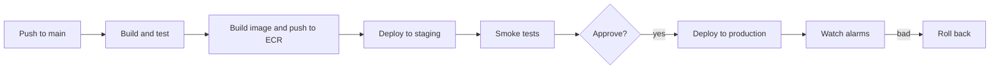
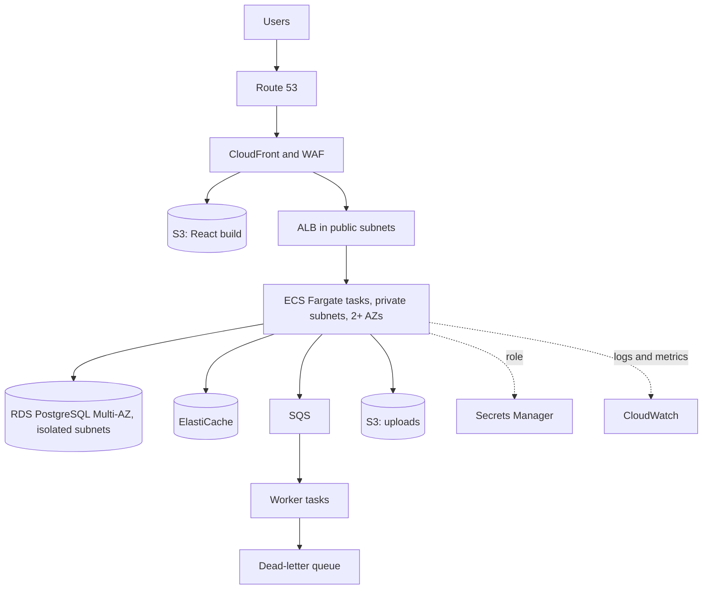

@part aws-operations | AWS Part 5: Operations, Architecture and Interviews | cloud
## Observability with CloudWatch

Once a service runs on AWS, you cannot log into a laptop and look around. You need three signals, as your Spring Boot guide describes: logs, metrics and traces.

### Logs

Container output goes to CloudWatch Logs. Write JSON, with fields you can query, and include a request or trace ID.

```text A Logs Insights query: the slowest endpoints
fields @timestamp, path, durationMs
| filter status >= 200
| stats pct(durationMs, 95) as p95, count() as calls by path
| sort p95 desc
| limit 20
```

Set a retention period on every log group. The default keeps logs forever, and that bill grows quietly.

### Metrics and alarms

Alarm on what users feel, rather than on every cause.

| Alarm on | Why |
|---|---|
| ALB 5xx rate | Users see errors |
| ALB p95 or p99 latency | Users see slowness |
| Queue age of oldest message | Work is falling behind |
| Dead-letter queue not empty | Failures need attention |
| RDS free storage, connections, CPU | A common way to fall over |

Spring Boot exposes metrics through Micrometer, and these can go to CloudWatch or Prometheus.

### Tracing

A trace follows one request across services, and shows where the time went. Use OpenTelemetry with a backend such as X-Ray. Spring Boot's observability support creates spans for HTTP calls and database queries.

!tip Average latency hides pain :: A 100 ms average can hide a p99 of 5 seconds. Look at percentiles, especially for your slowest and most important endpoints.

### CloudTrail

CloudTrail records API calls on your account: who did what and when. This answers "who deleted that?" and is essential in security investigations. Keep it on, in all Regions.

!keypoints Structured logs with trace IDs ;; Alarm on user-facing symptoms ;; Set log retention ;; CloudTrail records who did what

?? What should wake someone up at night?
=> Symptoms users feel: a high error rate, high latency, or work falling far behind. High CPU alone may not matter.
?? How do you find which downstream call makes an endpoint slow?
=> Use a distributed trace of a slow request. It shows the time per span, such as the database or a remote call.

## Infrastructure as code and delivery

Clicking in the console cannot be reviewed or repeated, and nobody remembers how production was built. Infrastructure as code (IaC) fixes this. Terraform is the most common tool. AWS CDK and CloudFormation are the AWS options.

### Terraform basics

```hcl An ECS service, in brief
resource "aws_ecs_service" "orders" {
  name            = "orders"
  cluster         = aws_ecs_cluster.main.id
  task_definition = aws_ecs_task_definition.orders.arn
  desired_count   = 2
  launch_type     = "FARGATE"

  network_configuration {
    subnets         = module.vpc.private_subnets
    security_groups = [aws_security_group.app.id]
  }

  load_balancer {
    target_group_arn = aws_lb_target_group.orders.arn
    container_name   = "app"
    container_port   = 8080
  }

  health_check_grace_period_seconds = 90
}
```

The workflow: `terraform plan` shows what will change, a human reviews it, and `terraform apply` does it. Terraform keeps **state**, its record of what exists. Store it remotely, such as in S3, with locking, and never commit it, because it can contain secrets.

!warning Read the plan :: A small edit can show "destroy and recreate" for a database. The plan is where you catch that. Add `prevent_destroy` to critical resources.

### A deployment pipeline



GitHub Actions can obtain short-lived AWS credentials through OIDC, so no AWS keys are stored in GitHub:

```yaml The important part of a GitHub Actions workflow
permissions:
  id-token: write
  contents: read
steps:
  - uses: aws-actions/configure-aws-credentials@v4
    with:
      role-to-assume: arn:aws:iam::123456789012:role/github-deploy
      aws-region: ap-south-1
  - run: |
      aws ecr get-login-password | docker login --username AWS --password-stdin $REGISTRY
      docker build -t $REGISTRY/orders:$GITHUB_SHA .
      docker push $REGISTRY/orders:$GITHUB_SHA
```

### Deployment strategies

| Strategy | How | Trade-off |
|---|---|---|
| Rolling | Replace tasks gradually | Simple; both versions serve at once |
| Blue-green | Start a full new set, then switch | Fast rollback; costs double for a while |
| Canary | Send a small share first | Catches problems early; needs good metrics |

ECS's deployment circuit breaker can stop and roll back a failing rollout automatically. Whichever you use, rollback must be practised, and schema changes must allow it.

!interview Interview answer :: **"How do you deploy with no downtime?"** Backward-compatible schema changes, health checks, a rolling or blue-green deployment, connection draining and graceful shutdown, with alarms and an automatic rollback.

!keypoints Everything in code and reviewed ;; Remote Terraform state with locking ;; OIDC rather than stored keys ;; Practise rollback

?? Why not store AWS keys as GitHub secrets?
=> They are long-lived and can leak. OIDC issues short-lived credentials for one role, tied to the repository.
?? What belongs in a pull request for infrastructure?
=> The code change and the plan output, so that a reviewer can see exactly what will change.

## Reliability, cost and disaster recovery

### How to think about availability

99.9% allows about 8.8 hours of downtime per year; 99.99% allows about 53 minutes. Each extra nine costs far more, so ask what the business truly needs. Availability of a chain multiplies: three services at 99.9% each give about 99.7% in total, which is why reducing synchronous dependencies helps.

### Disaster recovery

Two numbers define a plan. **RTO** is how long you can be down, and **RPO** is how much recent data you can lose.

| Strategy | Idea | RTO and RPO | Cost |
|---|---|---|---|
| Backup and restore | Rebuild from backups in another Region | Hours | Lowest |
| Pilot light | Data replicated, compute off | Tens of minutes | Low |
| Warm standby | Small live copy, scale up on failure | Minutes | Medium |
| Multi-site active | Both Regions take traffic | Near zero | Highest |

Most systems need multi-AZ, plus cross-Region backups. Active-active across Regions introduces hard data consistency problems, so don't choose it casually.

### Failure patterns in code

Cloud failures are normal, so code must expect them. Use timeouts on every call, retries with exponential backoff and jitter for transient errors, circuit breakers for failing dependencies, and bulkheads so that one slow dependency cannot take every thread. The AWS SDK has retries built in, so check you are not multiplying them with your own: three retries at three layers is 27 calls.

### Cost control

1. **See it.** Tag resources by team and service, and use Cost Explorer.
2. **Remove waste.** Idle environments, unattached disks, old snapshots and unused load balancers.
3. **Rightsize.** Most instances are larger than they need to be. Look at actual usage.
4. **Commit.** Savings Plans for the steady baseline.
5. **Design.** S3 lifecycle rules, VPC endpoints instead of NAT, caching, Graviton instances, and shutting down dev at night.

!interview Interview answer :: **"Your AWS bill doubled. What do you do?"** Open Cost Explorer, grouped by service and tag, and find what changed. Common causes are data transfer, NAT traffic, log volume or a forgotten environment. Fix that, then set budgets and alerts so that it is caught sooner.

!keypoints Agree RTO and RPO with the business ;; Multi-AZ first, multi-Region only when justified ;; Timeouts, backoff, jitter ;; Tag everything to see costs

?? Why add jitter to retries?
=> Without it, many clients retry at the same moment, and a recovering service is overwhelmed again.
?? Three services each have 99.9% availability and call each other in sequence. What is the combined figure?
=> About 0.999 cubed, which is around 99.7%, because any one failure breaks the chain.
?? What is the difference between RTO and RPO?
=> RTO is how long recovery may take. RPO is how much data, measured in time, may be lost.

## Reference architecture and scenarios

Here is a design you should be able to draw and defend from memory.



Walk through it as an interviewer would:

- **Why ECS and not Lambda?** Steady traffic and an existing Spring Boot app.
- **What if an AZ fails?** Tasks exist in others, the ALB routes around the failed one, and RDS fails over within a minute or two.
- **What if the database slows?** Timeouts protect threads, the cache absorbs reads, and slow work has already moved to SQS.
- **What about spikes?** CloudFront, autoscaling, and queues absorb them. The database is the limit, so check connection counts.
- **What did you leave out?** Multi-Region, because the business can accept some recovery time at a much lower cost.

### Scenario questions

| Scenario | Good answer covers |
|---|---|
| Reduce image processing load on the API | Pre-signed upload, S3 event, SQS, workers |
| Add a scheduled nightly report | EventBridge Scheduler, ECS task or Lambda, store output in S3 |
| A secret leaked | Revoke and rotate, audit CloudTrail, find the cause, add scanning |
| API slows during a sale | Find the bottleneck with traces, cache, queue writes, autoscale, protect the database |
| Isolate tenants' data | Row-level security, or separate schemas or accounts, plus IAM conditions |
| Send email without blocking the request | Publish to SNS or SQS, and have a worker call SES |

### Certifications and other clouds

For a Java developer, the **Developer Associate** is the natural fit, and **Solutions Architect Associate** is broader and widely recognised. Third-party sources report DVA-C03 replacing DVA-C02 around December 2026, so check the AWS site before booking. A real deployed project gives you far better interview stories than a certificate alone, though some employers filter resumes on certificates.

The ideas transfer between clouds, so learn one properly.

| AWS | Azure | Google Cloud |
|---|---|---|
| ECS, EKS | Container Apps, AKS | Cloud Run, GKE |
| Lambda | Functions | Cloud Run functions |
| S3 | Blob Storage | Cloud Storage |
| RDS | Azure Database | Cloud SQL |
| SQS, SNS | Service Bus | Pub/Sub |
| IAM | Entra ID, RBAC | IAM |

### A learning project

1. Deploy a Spring Boot app on ECS Fargate behind an ALB, using Terraform.
2. Add RDS with Secrets Manager, and CloudWatch alarms.
3. Build a pipeline with GitHub Actions and OIDC.
4. Add S3 pre-signed uploads and an SQS worker.
5. Delete everything afterwards, using `terraform destroy`, so that the bill stops.

!warning As a fresher :: Only list services you have actually used, and describe them as project work. "Deployed my project on ECS Fargate using Terraform" is strong and honest.

!keypoints Be able to draw this architecture ;; Know its failure modes ;; Mention cost and what you left out ;; A project beats a certificate alone

?? Walk through what happens when a user uploads a 2 GB video.
=> The API authorises the user and issues a pre-signed URL (multipart for this size). The browser uploads to S3. An object-created event goes to SQS, a worker processes it, and the status is updated.
?? How would you add a nightly report without a server running all day?
=> Use EventBridge Scheduler to start an ECS task or Lambda. It writes the file to S3, and sends a link.
