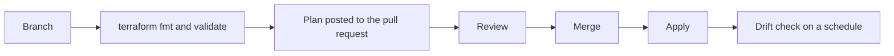
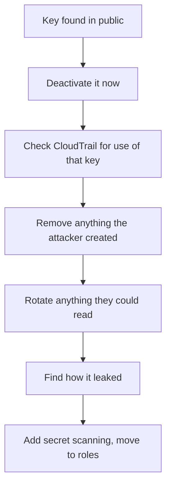
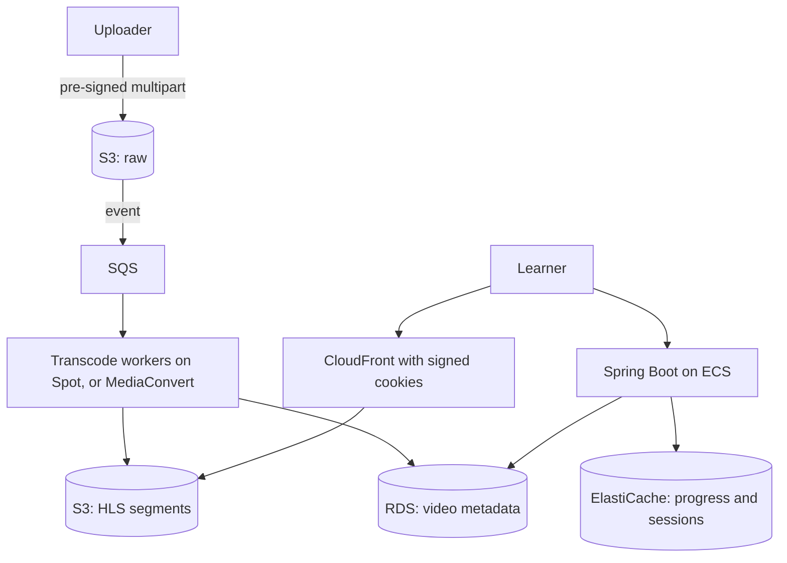

@more
## Hands-on: the whole stack in Terraform

This chapter turns the earlier manual deployment into code. Keep it small: one repository, one environment, then copy to others through variables.

### Project layout

```text A simple layout
infra/
  backend.tf      remote state in S3
  main.tf         VPC, ALB, ECS, RDS
  iam.tf          roles
  variables.tf
  outputs.tf
  envs/
    dev.tfvars
    prod.tfvars
```

### Remote state

```hcl backend.tf
terraform {
  required_version = ">= 1.6"
  required_providers {
    aws = { source = "hashicorp/aws", version = "~> 5.0" }
  }
  backend "s3" {
    bucket       = "acme-terraform-state"
    key          = "orders/terraform.tfstate"
    region       = "ap-south-1"
    encrypt      = true
    use_lockfile = true
  }
}
```

Locking stops two people from applying at once. The state bucket needs versioning, so that you can recover from a corrupted state. Older setups used a DynamoDB table for locks, which you will still see often.

### The network with a module

```hcl main.tf: VPC through a community module
module "vpc" {
  source  = "terraform-aws-modules/vpc/aws"
  version = "~> 5.0"

  name            = "${var.env}-orders"
  cidr            = "10.0.0.0/16"
  azs             = ["ap-south-1a", "ap-south-1b"]
  public_subnets  = ["10.0.0.0/24", "10.0.1.0/24"]
  private_subnets = ["10.0.10.0/24", "10.0.11.0/24"]
  database_subnets = ["10.0.20.0/24", "10.0.21.0/24"]

  enable_nat_gateway = true
  single_nat_gateway = var.env != "prod"   # cheaper outside production
}
```

### Roles, narrowly

```hcl iam.tf: a task role limited to one bucket
data "aws_iam_policy_document" "task_assume" {
  statement {
    actions = ["sts:AssumeRole"]
    principals {
      type        = "Service"
      identifiers = ["ecs-tasks.amazonaws.com"]
    }
  }
}

resource "aws_iam_role" "task" {
  name               = "${var.env}-orders-task"
  assume_role_policy = data.aws_iam_policy_document.task_assume.json
}

data "aws_iam_policy_document" "task" {
  statement {
    actions   = ["s3:GetObject", "s3:PutObject"]
    resources = ["${aws_s3_bucket.files.arn}/*"]
  }
}

resource "aws_iam_role_policy" "task" {
  role   = aws_iam_role.task.id
  policy = data.aws_iam_policy_document.task.json
}
```

### Database, protected

```hcl RDS with a managed password
resource "aws_db_instance" "orders" {
  identifier                  = "${var.env}-orders"
  engine                      = "postgres"
  instance_class              = var.db_class
  allocated_storage           = 20
  max_allocated_storage       = 200
  db_name                     = "orders"
  username                    = "orders_admin"
  manage_master_user_password = true
  multi_az                    = var.env == "prod"
  db_subnet_group_name        = module.vpc.database_subnet_group_name
  vpc_security_group_ids      = [aws_security_group.db.id]
  backup_retention_period     = 7
  deletion_protection         = var.env == "prod"
  skip_final_snapshot         = var.env != "prod"
  storage_encrypted           = true
}
```

### Workflow in a team



| Practice | Why |
|---|---|
| Pin provider and module versions | No surprise changes |
| Separate state per environment | Limits the blast radius |
| No secrets in `.tfvars` | State and Git would both hold them |
| `lifecycle { prevent_destroy = true }` on key data | Catches accidents |
| Scan with Checkov or tfsec | Finds open ports, public buckets |
| Detect drift | Someone clicked in the console |

### Application deploys versus infrastructure

A frequent question: should Terraform manage image tags? If so, every release needs a Terraform run. Many teams let Terraform create the service and ignore `task_definition` changes, while the app pipeline registers new revisions and updates the service.

```hcl Let the pipeline own releases
resource "aws_ecs_service" "orders" {
  # ...
  lifecycle { ignore_changes = [task_definition, desired_count] }
}
```

`desired_count` is ignored as well, so that autoscaling's changes aren't reverted.

### Terraform or CDK?

Terraform works across clouds and has a large community. CDK lets you write infrastructure in Java or TypeScript, and it generates CloudFormation. For a Java team that's only on AWS, CDK can feel natural, but Terraform appears in more job postings.

!keypoints Remote state with locking ;; Separate environments ;; Review plans in pull requests ;; Let app pipelines own releases

?? Terraform wants to set desired_count back to 2, though autoscaling has raised it to 8. How do you fix it?
=> Add `desired_count` to `ignore_changes`, so that Terraform leaves the scaled value alone.
?? Someone changed a security group in the console. What happens at the next plan?
=> Terraform detects drift and proposes reverting it. Decide whether to accept it or update the code.
?? Why keep separate state for dev and prod?
=> A mistake or broken state in one can't affect the other, and permissions can differ.

## Security review checklist

Use this as a checklist for your project, and as an outline for interview answers.

### Identity

- [ ] MFA on root and all people.
- [ ] No long-lived keys, or only with a reason and rotation.
- [ ] Separate accounts for production and development.
- [ ] Roles with least privilege, with no `*` on sensitive actions.
- [ ] Separate deployment roles from runtime roles.

### Network

- [ ] Databases and caches have no route from the internet.
- [ ] Security groups refer to groups, not `0.0.0.0/0`.
- [ ] No SSH open to the world. Use Session Manager.
- [ ] VPC endpoints for S3 and other high-volume services.

### Data

- [ ] Encryption at rest and TLS in transit.
- [ ] S3 Block Public Access on at the account level.
- [ ] Backups tested by restoring them, with cross-Region copies for critical data.
- [ ] Personal data identified, with retention limits.

### Application

- [ ] Authorisation checks on each object.
- [ ] Input validation and parameterised queries.
- [ ] Dependencies and images scanned in CI.
- [ ] Secrets absent from code, images and logs.

### Detection

| Service | Tells you |
|---|---|
| CloudTrail | Who did what through the API |
| GuardDuty | Suspicious activity, such as credential misuse or crypto mining |
| Security Hub | Findings gathered against best practices |
| Config | Resources that break your rules, and their history |
| IAM Access Analyzer | Resources shared outside your account, and unused permissions |
| Inspector | Vulnerabilities in images and instances |

### Incident: leaked access key



The order matters: stop the bleeding first, and then investigate. Attackers often create new users or keys, so deactivating one key might not end it. Look for unfamiliar instances in unused Regions, as crypto mining is a common abuse.

### Common real-world breach paths

| Path | Prevention |
|---|---|
| Public S3 bucket | Account-level Block Public Access |
| Key in a public repository | Secret scanning, roles |
| SSRF reaching instance metadata | IMDSv2 required, input validation |
| Over-permissioned role after an app bug | Least privilege limits the damage |
| Unpatched public service | Scanning, fewer public endpoints |

**SSRF** deserves a note. If an app fetches user-supplied URLs, an attacker may point it at the instance metadata service, and steal the role's credentials. IMDSv2 requires a session token that makes this far harder. Validate URLs too, with an allow-list.

!interview Interview answer :: **"How would you review a system's cloud security?"** Start with identity and blast radius, then network exposure, data protection, application authorisation, and detection and response. Give a concrete finding for each area, and rank them by risk.

!keypoints Least privilege limits the damage from every other failure ;; Turn on CloudTrail and GuardDuty ;; Stop the bleeding, then investigate ;; Require IMDSv2

?? Why does least privilege matter if your code has no known bugs?
=> Unknown bugs and leaks are inevitable. Least privilege limits what an attacker can do after any of them.
?? What is SSRF, and why is it dangerous on AWS?
=> The server is tricked into fetching a URL of the attacker's choice, such as the metadata service, which can expose role credentials. Use IMDSv2 and validate URLs.

## Worked design: a video learning platform

Design questions reward a method more than memorised answers. Here's one worked in full.

### Requirements

Users upload videos, the system transcodes them, and learners stream them. Assume 1 million monthly users, 50,000 daily, 500 uploads a day averaging 1 GB. Most viewers are in India.

### Rough numbers

- Uploads: 500 GB per day, about 15 TB per month.
- Transcoding into several qualities might multiply storage about 2 or 3 times.
- Streaming: suppose 50,000 users watch 30 minutes at 2 Mbps: about 450 MB per user, or about 22 TB per day. This is the dominant cost, and CDN egress decides the design.

Rough estimates like this show where to focus. Here it's delivery, not the API.

### Architecture



### Decisions and why

| Decision | Why | Rejected alternative |
|---|---|---|
| Multipart direct upload | Files are large; resumable | Through the API |
| Queue + workers | Slow, retryable, bursty | Synchronous processing |
| Spot workers | Interruptible, cheap | On-Demand only |
| HLS adaptive streaming | Adapts to network quality | One MP4 file |
| CloudFront signed cookies | Paid content, cheap to serve | Pre-signed URL for each segment |
| Lifecycle to cheaper storage | Raw files rarely reread | All in Standard |

### Failure review

| Failure | Result | Mitigation |
|---|---|---|
| Worker dies | Message returns | Idempotent, restart per segment |
| Bad video file | Repeated failure | Dead-letter queue, notify the uploader |
| API down | No new sessions | Existing streams continue from CDN |
| RDS failover | Short write errors | Retries, read from cache |
| Popular video | CDN absorbs | Cache at the edge, shield origin |

### Cost levers

CDN egress dominates, so negotiate pricing and tune bitrates. Delete old raw uploads, use Spot, and move old content to Infrequent Access.

### How to present it

1. Clarify requirements and scale.
2. Estimate, to find the dominant concern.
3. Draw the simple flow.
4. Deep-dive into the hardest part.
5. Walk through failures.
6. Mention cost, and what you've left out.

!tip Practise out loud :: Take 35 minutes, and draw on paper. Try: a URL shortener, a food delivery tracker, a ticket booking system, and an AI document assistant.

!keypoints Estimate to find the dominant concern ;; Give the rejected alternative ;; Walk through failures ;; Mention cost

?? Why start a design with rough numbers?
=> They reveal what dominates, here video delivery, so you spend your time on the part that matters.
?? How do you protect paid video segments on a CDN?
=> CloudFront signed cookies or signed URLs, with a private S3 bucket. The API issues them after checking entitlement.
?? What makes transcoding a good fit for Spot?
=> It's asynchronous and restartable, especially if split into segments. An interruption only retries the work.
