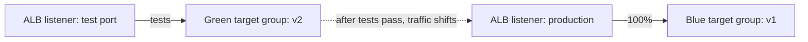
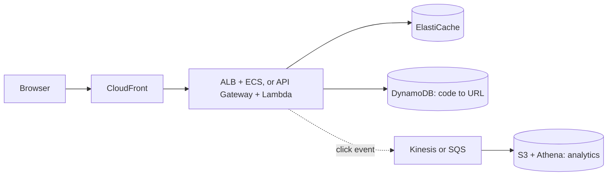
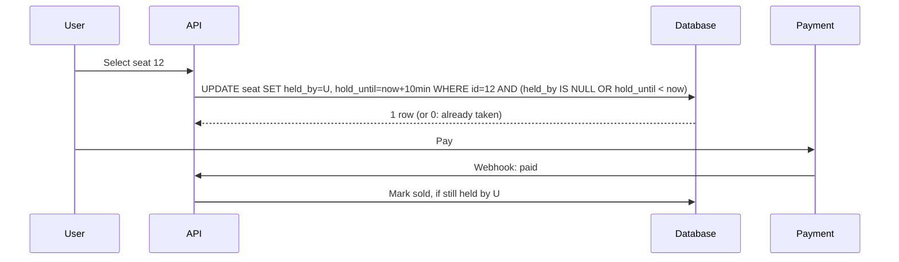
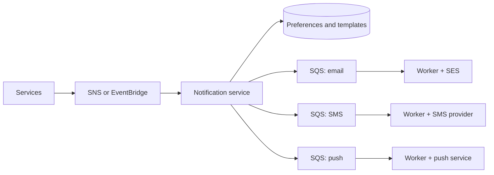

@more
## Hands-on observability with Spring Boot

### Metrics with Micrometer

```xml Dependencies
<dependency>
  <groupId>org.springframework.boot</groupId>
  <artifactId>spring-boot-starter-actuator</artifactId>
</dependency>
<dependency>
  <groupId>io.micrometer</groupId>
  <artifactId>micrometer-registry-cloudwatch2</artifactId>
</dependency>
```

```properties Export to CloudWatch
management.cloudwatch.metrics.export.namespace=orders-service
management.cloudwatch.metrics.export.step=1m
management.metrics.tags.env=${ENV}
```

Business metrics are often the most useful, because they show what's actually happening to customers.

```java Custom counters and timers
@Service
class CheckoutService {

    private final Counter placed;
    private final Timer paymentTimer;

    CheckoutService(MeterRegistry registry) {
        this.placed = Counter.builder("orders.placed").register(registry);
        this.paymentTimer = Timer.builder("payment.duration")
            .publishPercentiles(0.95, 0.99)
            .register(registry);
    }

    Order checkout(Cart cart) {
        Payment payment = paymentTimer.record(() -> gateway.charge(cart));
        placed.increment();
        return orders.save(cart, payment);
    }
}
```

!warning Cardinality :: Never use user IDs, order IDs or raw URLs as metric tags. Every unique combination creates a new time series, and CloudWatch charges for each. Use bounded values, such as `status=success`.

### Tracing

```xml Tracing with OpenTelemetry
<dependency>
  <groupId>io.micrometer</groupId>
  <artifactId>micrometer-tracing-bridge-otel</artifactId>
</dependency>
<dependency>
  <groupId>io.opentelemetry</groupId>
  <artifactId>opentelemetry-exporter-otlp</artifactId>
</dependency>
```

```properties Send to a collector
management.tracing.sampling.probability=0.1
management.otlp.tracing.endpoint=http://localhost:4318/v1/traces
```

A common shape is an OpenTelemetry collector running alongside the app, which then forwards to X-Ray or another backend. Sampling 10% keeps costs reasonable, though many teams try to keep every trace that has an error.

### Logs that join up

```json A structured log line
{"timestamp":"2026-10-31T10:15:30Z","level":"ERROR","service":"orders","traceId":"8f3a...","spanId":"2b1c...","orderId":9001,"msg":"payment declined","durationMs":842}
```

Spring Boot supports structured logging through `logging.structured.format.console=ecs` in recent versions, and puts trace IDs into the MDC when tracing is on. Now an alarm leads to a trace, which leads to the exact logs. That's the workflow you're after.

### A dashboard that helps

Use the same four panels for each service, known as the "golden signals":

| Signal | Measure | Tells you |
|---|---|---|
| Latency | p50, p95, p99 per endpoint | How slow it feels |
| Traffic | Requests per second | Load, and whether traffic disappeared |
| Errors | 5xx rate, business failures | How often it's broken |
| Saturation | CPU, memory, pool usage, queue age | How close to the limit |

### Alarms that don't wear people out

**Alert on symptoms**, with a runbook link. Require a condition for several minutes, rather than a single spike. If an alert fires and nobody needs to act, fix or delete it, because noisy alerts train people to ignore all of them.

An **SLO** makes this precise: "99.9% of requests under 500 ms over 30 days" gives an error budget of 0.1%. Alert when the budget is burning quickly, rather than on every blip. When the budget is used up, reliability work takes priority over features.

### Writing a runbook

```markdown A runbook entry
## Alert: orders API 5xx above 2%
1. Check the dashboard: is it one endpoint or all? Did a deployment just happen?
2. Recent deployment? Roll back: `aws ecs update-service ... --task-definition orders:PREVIOUS`
3. Database saturated? Check Performance Insights; look for a new slow query.
4. Payment provider down? Check its status page; the circuit breaker should be open.
5. Tell #incidents what you've found, then keep updating it.
```

!keypoints Use business metrics too ;; Never tag metrics with unbounded values ;; Link alarm to trace to logs ;; Alert on symptoms, with a runbook

?? Why not tag a metric with the user ID?
=> Each value creates a new time series, which is costly and slow. Put it in logs or traces instead.
?? A 99.9% monthly SLO allows how much downtime?
=> 0.1% of about 43,200 minutes, which is around 43 minutes.
?? Why tell someone in your alert what to do?
=> A runbook speeds up the response, especially at night or for someone new.

## Release engineering: blue-green and canary on ECS

### Rolling, the default

ECS replaces tasks gradually, using `minimumHealthyPercent` and `maximumPercent`. With 4 tasks, a 100% minimum and a 200% maximum, it starts 4 new tasks before stopping old ones. Rollback means another full rollout, unless the circuit breaker triggers.

### Blue-green with two target groups



Tools such as CodeDeploy, or ECS's own blue/green deployment option in recent versions, handle this for you: start the green tasks, run tests against a test listener, shift traffic at once or in steps, and keep blue alive for a bake period, so that rollback is immediate.

| Shift | Means |
|---|---|
| All at once | Simple, full risk at the moment of switching |
| Linear | 10% more every few minutes |
| Canary | 10% for 15 minutes, then the rest |

Tie the shift to alarms, so that a rise in errors rolls back automatically.

### Feature flags

Deployment and release need not be the same thing. A flag lets you deploy code that's switched off, and enable it for 1% of users, or just for staff. Rollback becomes flipping a flag. AWS AppConfig or a dedicated service can manage flags. Delete flags once they're done, because old ones add branches nobody tests.

### Database changes during a canary

A canary means two versions run for a long time, so schema compatibility matters even more. Follow expand and contract without exception. Never drop a column until no running version reads it, and until rollback to that version is off the table.

### What makes rollback impossible

| Change | Why rollback fails | Mitigation |
|---|---|---|
| Destructive schema change | Old code needs what's gone | Expand and contract |
| New event format | Old consumers can't read it | Add fields compatibly |
| New cache format | Old code reads bad values | Versioned keys |
| Sent emails, charged cards | Can't be undone | Flags, careful canary |

### A production checklist

- [ ] Tests, image scan and SBOM in CI.
- [ ] Immutable image tags, promoted through environments, not rebuilt.
- [ ] Health checks and graceful shutdown.
- [ ] Automatic rollback on alarms.
- [ ] Migrations backward compatible.
- [ ] Someone watching the rollout, or alarms that act for them.

!tip Promote, don't rebuild :: Build one image, and move the same image from staging to production. Rebuilding may pull different dependencies, so production would run something you've never tested.

!keypoints Blue-green gives immediate rollback ;; Tie traffic shifts to alarms ;; Flags separate deploy from release ;; Some changes can't be rolled back

?? Why keep blue tasks running after shifting traffic?
=> So that rollback is instant if problems appear during the bake period.
?? Why promote the same image rather than rebuilding for production?
=> A rebuild may include different dependencies. Promotion means that production runs what was tested.

## More worked designs on AWS

### Design 1: URL shortener

**Scale:** 100 million new links a month, and 100 reads per write. That's about 40 writes a second and 4,000 reads a second. At 500 bytes per record, it's 50 GB a month, or 3 TB over 5 years. Seven base-62 characters allow about 3.5 trillion codes.



| Decision | Why |
|---|---|
| DynamoDB | Single-key reads and writes, huge scale, TTL for expiry |
| Random code + conditional write | No central counter; retry on collision |
| CloudFront caching with a short TTL | Absorbs the hottest links |
| 302 not 301 | Browsers won't cache forever, so clicks can be counted |
| Clicks through a queue | Redirect stays fast if analytics slows |

### Design 2: ticket booking

**The hard part:** two people must never get the same seat, and a seat is held while the buyer pays.



| Concern | Approach |
|---|---|
| Double booking | Conditional update, in one row, in the database |
| Expired holds | The time check in the update needs no cleanup job |
| Sale spike | Virtual waiting room: tokens admit users at a steady rate |
| Payment webhook repeats | Idempotency key |
| Payment after hold expired | Refund automatically |
| Browsing seats | Cache the seat map for a second or two; the write path stays correct |

A cached seat map can show a seat as free when it's gone. That's fine, because the conditional update is the truth, and the user just sees "that seat was just taken".

### Design 3: notification system

Requirements: email, SMS and push; user preferences; retries; no duplicates or spam.



Separate queues mean that a slow SMS provider doesn't delay email. Rate limit per user and per provider. Store each notification's ID, so that duplicates are dropped, and let urgent messages use a separate high-priority queue. Track deliveries and bounces, and honour unsubscribes in the service itself.

### Design 4: AI document assistant on AWS

Part 6 of the AI section covers the application. On AWS: uploads through pre-signed URLs into S3, S3 events to SQS, ingestion workers on ECS writing to RDS with pgvector, chat on ECS with streaming through an ALB, and a provider through Bedrock or an external API. Note that CloudFront, ALB and any proxies need timeouts set for long streaming responses, and buffering turned off where applicable.

### A checklist for any design

1. Requirements, and what's out of scope.
2. Rough numbers: traffic, storage, and what dominates.
3. Simple diagram first.
4. Data model and access patterns.
5. The hard part, in depth.
6. Failure at each hop.
7. Security and multi-tenancy.
8. Cost, and what you'd do later.

!keypoints The database's conditional write settles races ;; A cached view can be stale if writes are correct ;; Separate queues isolate slow providers ;; Follow the same checklist each time

?? How do you stop two users booking one seat?
=> A conditional update in a single statement: only the first update succeeds, and others affect zero rows.
?? Why 302 rather than 301 for a short link?
=> A 301 may be cached forever by browsers, hiding clicks and preventing changes.
?? Why have one queue per notification channel?
=> A slow or failing provider then can't hold up the others.
