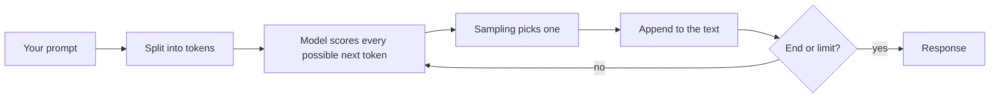

@part ai-foundations | AI Part 1: What Employers Want and How LLMs Work | ai
## What "AI skills" means in job descriptions

"AI skills" rarely means building neural networks. For a Java full stack developer it usually means two things: using AI tools to work faster and safely, and building features on top of models using normal engineering.

| Level | What it means | Who needs it | Your priority |
|---|---|---|---|
| AI-assisted development | Generate, review, test and debug with tools such as Copilot or Claude Code | Almost every developer | Must have |
| AI application engineering | Call LLM APIs, RAG, tools and agents from Spring | Many backend and full stack roles | Your differentiator |
| AI in production | Evaluation, security, cost, observability | Teams shipping AI features | Know the essentials |
| Machine learning engineering | Train models, statistics, PyTorch, GPUs | Specialist ML roles | Not needed |

A small sample of 2026 postings asks for LLMs, RAG, vector databases and AI APIs, for Java libraries such as Spring AI and LangChain4j, and for use of copilots. Many of those roles are senior or contract, so treat it as a direction rather than a requirement for fresher jobs. For a fresher, it is a way to stand out.

### What you do not need to know first

You do not need calculus or backpropagation to integrate an LLM, just as you don't need compiler theory to write Java. You do need a working mental model of how models behave, which is the rest of this part.

### How this shows up in interviews

| Question | What they are checking |
|---|---|
| How do you use AI tools? | You are productive and critical: you review and test output |
| Add a chatbot over our documents | RAG design, citations, access control, cost |
| How do you stop it inventing answers? | Grounding, evaluation, allowing "I don't know" |
| How do you know it works? | Evaluation sets, not a few manual tries |
| What could go wrong? | Prompt injection, data leakage, cost, latency |

!tip Be honest about experience :: Say "I built a RAG feature in my project and evaluated it on 40 questions" rather than claiming production AI experience. It sounds stronger, and it survives follow-up questions.

!keypoints You do not need to train models ;; AI tool use is becoming a baseline ;; Integrating LLMs is backend engineering ;; One shipped feature beats many courses

?? Do you need Python for AI application roles in Java?
=> Not for integration work, since Spring AI and LangChain4j cover it. Reading basic Python helps, as many examples use it, and dedicated AI teams may require it.
?? What separates an AI engineer from an ML engineer?
=> An AI application engineer builds products on existing models. An ML engineer trains and optimises models.

## How an LLM produces text

A large language model predicts the next piece of text, given the text so far. Everything surprising about LLMs follows from that.

### Tokens

Models do not read words. Text is split into **tokens**, which are common chunks of characters. As a rough rule for English, one token is about three-quarters of a word. Tokens are the unit of cost and limits, so a 1,000-word document is around 1,300 tokens. Languages, code and unusual strings tokenise differently, and it's why LLMs can miscount letters: they don't see letters directly.

### Generation, one token at a time



Training adjusted billions of numbers so that this prediction works well. The model has absorbed patterns from a huge amount of text, but it has no database of facts to look up. This explains why it can write well about a subject and still state something false with full confidence.

### Context window

The **context window** is the most tokens that a model can consider in one request: your instructions, the history, retrieved documents and its own answer together. Anything beyond the limit must be trimmed. More context also costs more and can distract the model, so choosing what to send is a core engineering skill.

### The model is stateless

The API does not remember your last request. A "conversation" is an illusion created by resending the history each time, which is why long chats get more expensive per message. Memory is your code's job.

### Parameters

| Parameter | Effect | Use |
|---|---|---|
| temperature | Randomness in choosing tokens | Low for extraction, higher for creative text |
| max tokens | Upper limit on the answer | Control cost, avoid runaway output |
| top-p | Limits choices to likely tokens | Usually adjust this or temperature, not both |
| stop sequences | End generation when seen | Structured formats |

Even at temperature 0, outputs are not guaranteed to be identical across calls or model versions. Do not build logic that needs exact text.

### Why models hallucinate

A model always produces plausible next tokens, even when it has no real knowledge. It may invent a method name in a library, because it looks like what such a method would be called. Mitigations: give it the source text (RAG), ask for citations, allow "I don't know", validate outputs in code, and never let it be the only check on something important.

### Choosing a model

Providers offer several sizes. Larger models reason better, cost more and respond more slowly. Small ones are often enough for classification or extraction. Pick by testing against your own evaluation set, not by benchmarks. Model names change often, so keep the model name in configuration.

!interview Interview answer :: **"Why does the same prompt give different answers?"** Generation samples from probabilities, and temperature controls how much. So I test against an evaluation set, validate structured outputs in code, and keep logic independent of exact wording.

!keypoints Models predict tokens, they do not look up facts ;; Tokens are the unit of cost and limits ;; The model is stateless ;; Confident does not mean correct

?? Why does a long chat cost more per message?
=> The model is stateless, so the whole history is resent every time, and you pay for those tokens. Trim or summarise it.
?? A model invented a library method. Why?
=> It predicts plausible text, and that name looks plausible. It has no check against the real library. Give it the docs, then compile and test.
?? When would you use low temperature?
=> When consistency matters, such as extraction and classification.

## Embeddings and similarity

An embedding model turns text into a list of numbers (a **vector**) so that similar meanings land close together. "How do I reset my password?" and "I forgot my login" share few words, but their vectors are close. This powers semantic search and RAG.

### Measuring closeness

Cosine similarity measures the angle between two vectors. Values near 1 mean very similar meaning. You rarely compute it by hand, as the database does it, but the idea matters.

```java Embedding text with Spring AI
@Service
class Similarity {

    private final EmbeddingModel embeddings;

    Similarity(EmbeddingModel embeddings) { this.embeddings = embeddings; }

    double cosine(String a, String b) {
        float[] x = embeddings.embed(a);
        float[] y = embeddings.embed(b);
        double dot = 0, nx = 0, ny = 0;
        for (int i = 0; i < x.length; i++) {
            dot += x[i] * y[i];
            nx += x[i] * x[i];
            ny += y[i] * y[i];
        }
        return dot / (Math.sqrt(nx) * Math.sqrt(ny));
    }
}
```

### Things to get right

- **Use one model for everything in an index.** Vectors from different models are not comparable. Changing model means re-embedding all your documents.
- **Dimensions** must match your database column. Many models use hundreds to a few thousand.
- **Embeddings miss exact identifiers.** Codes such as `ERR-4021` are poorly captured, so combine with keyword search.
- **Beyond search:** you can use embeddings for grouping, recommendations and duplicate detection.

### Nearest-neighbour search

Comparing a query with every vector is exact but slow at scale. Databases use **approximate** indexes, such as HNSW, which are much faster but may miss a few results. You tune the balance of speed and recall.

!keypoints Vectors place similar meanings close together ;; Keep one embedding model per index ;; Exact codes need keyword search too ;; Approximate indexes trade some recall for speed

?? You switch embedding models. What must you do?
=> Re-embed all stored documents. Vectors from different models cannot be compared.
?? Why might semantic search miss the product code X-204?
=> Embeddings capture meaning, and rarely capture exact codes. Hybrid search adds keyword matching.
