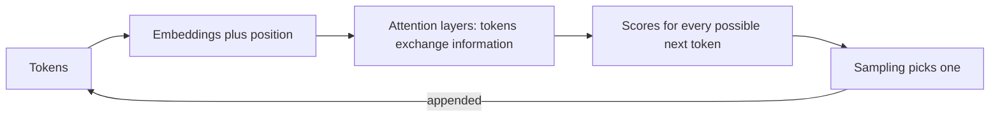

@more
## Inside the model: an intuitive tour

You do not need the maths, but a working picture of the internals helps you predict behaviour, and it comes up in interviews.

### From words to numbers

Each token becomes a vector of numbers, which is its embedding inside the model. During training, tokens used in similar ways end up with similar vectors. A classic illustration is that the direction from "king" to "queen" resembles the direction from "man" to "woman".

### Attention: what the transformer added

Consider: "The trophy didn't fit in the suitcase because **it** was too big." To understand "it", you must look back at "trophy". Earlier models read text in order, and struggled to carry meaning across long distances. The **transformer** architecture, introduced in 2017, lets each token look at every other token and decide how much each one matters. This mechanism is called **attention**.



Attention compares tokens with each other, so processing grows with text length, which is one reason longer context costs more time and money.

### How a model is trained

| Stage | What happens | Why it matters to you |
|---|---|---|
| Pre-training | Predict the next token over a huge amount of text | Creates general knowledge, up to a cutoff date |
| Tuning on instructions | Learn from examples of good responses | Makes it follow requests rather than simply continue text |
| Safety training | Learn to decline harmful requests | Explains some refusals |

Three consequences follow. The model has a **knowledge cutoff**, so anything later needs to be supplied. It learned from examples of how text *usually* continues, so it writes plausible text whether or not it's true. And it's not updated by your conversations, as training is a separate, expensive process.

### Why some tasks are surprisingly hard

| Task | Why it's hard | What to do |
|---|---|---|
| Counting letters | Tokens hide individual letters | Use code |
| Big arithmetic | Predicting digits isn't calculating | Provide a calculator tool |
| Today's date or prices | Beyond the cutoff | Provide it in the prompt, or a tool |
| Quoting exact text | Paraphrase is more natural | Retrieve it, and verify in code |
| Very long lists | Attention and output limits | Split the work |

The general rule is to give the model what it's bad at through tools, and use it for what it's good at: language, summarising, classifying, and drafting.

### Reasoning models

Some models spend extra tokens thinking before answering, which improves multi-step problems at a higher cost and latency. For straightforward extraction they waste money, so test whether a given task actually benefits.

### Fine-tuning, RAG or prompting?

| Need | Best first choice |
|---|---|
| Follow your format or tone | Prompt with examples |
| Answer from your documents | RAG |
| Fresh or user-specific data | Tools |
| Consistent specialised style at high volume | Fine-tuning, usually later |

Fine-tuning changes behaviour rather than adding reliable facts, and it brings a dataset, a process and costs. Most application developers rarely need it.

### Running models yourself

Open-weight models can run on your own GPUs, or through Ollama on a laptop, and Spring AI supports them. This may suit strict privacy needs, or very high steady volume. Don't underestimate the costs of GPUs, operations and generally lower quality. A hosted API is usually the right start.

!interview Interview answer :: **"How does an LLM work, in a minute?"** Text is split into tokens and converted to vectors. Layers of attention let each token use context from the others, producing a score for every possible next token. One is sampled, appended, and the process repeats. Training set the weights by predicting text at huge scale, so the model is great at plausible language but has no built-in check for truth.

!keypoints Attention lets tokens use distant context ;; Knowledge stops at a cutoff ;; Use tools for maths, dates and fresh data ;; Prompt first, then RAG, and fine-tuning last

?? Why can't a model tell you today's news on its own?
=> Its knowledge stops at its training cutoff. Provide fresh data through a tool or retrieval.
?? Why is fine-tuning a poor way to teach a model your product's facts?
=> It shapes behaviour, rather than reliably storing facts, and it goes stale. RAG can be updated and cited.
?? Why give a model a calculator tool?
=> It predicts digits rather than calculating, so big arithmetic can be wrong. Code gives an exact answer.

## Estimating cost and capacity

Interviewers increasingly ask about this, and it's where a backend developer can stand out.

### A cost model

```text The formula, for one feature
cost per call = input tokens × input price + output tokens × output price
monthly cost  = calls per day × 30 × cost per call
```

### A worked example

Prices below are **made up for arithmetic**. Always check the provider's current price page. Suppose a model costs $3 per million input tokens and $15 per million output tokens.

A support assistant handles 5,000 questions a day, with these prompt parts:

| Part | Tokens |
|---|---|
| System instructions | 400 |
| Retrieved chunks (5 × 300) | 1,500 |
| History | 600 |
| Question | 100 |
| **Input total** | **2,600** |
| Answer (output) | 300 |

Per call: 2,600 × $3/1,000,000 = $0.0078 for input, and 300 × $15/1,000,000 = $0.0045 for output, so $0.0123.

Per month: 5,000 × 30 × $0.0123 = **$1,845**.

### What changes the bill

| Change | New cost per call | Saving |
|---|---|---|
| Retrieve 3 chunks, not 5 | 2,000 input: $0.0105 | 15% |
| Trim history to 200 tokens | 2,200 input: $0.0111 | 10% |
| Shorter answers, 150 tokens | $0.0078 + $0.00225 = $0.0101 | 18% |
| Model at one-fifth of the price | $0.00246 | 80% |

Model choice dominates, which is why **routing** pays off: a small model for simple questions, and a larger one for the hard ones. But measure quality before switching.

### Capacity and rate limits

Providers limit requests and tokens per minute. Check peak rather than average: if 5,000 daily questions concentrate into 8 busy hours, with a peak of three times average, that's about 31 calls a minute, or about 90,000 tokens a minute. Compare this with your account's limits, and plan for a queue.

### Concurrency in your service

If each call takes 8 seconds, then 31 calls a minute means about 4 in flight at a time on average, and more during bursts. This is Little's law: **in-flight = arrival rate × duration**. It tells you what bulkhead size and thread count to set.

### Per-user limits

```java Reject before spending money
public String ask(String userId, String question) {
    if (question.length() > MAX_INPUT_CHARS) {
        throw new InputTooLongException();
    }
    if (!quota.tryConsume(userId, estimateTokens(question))) {
        throw new QuotaExceededException();
    }
    ChatResponse r = chat.prompt().user(question).call().chatResponse();
    quota.record(userId, r.getMetadata().getUsage().getTotalTokens());
    return r.getResult().getOutput().getText();
}
```

Without limits, one script or abusive user can spend your monthly budget overnight. Add a global daily budget alert too.

!tip Rough token estimate :: About four characters per token for English works for planning. Use the provider's counting API, or the usage field in responses, for real numbers.

!keypoints Multiply tokens by price, per part of the prompt ;; Model choice dominates the bill ;; Plan for peak, not average ;; Limit each user before spending money

?? Requests take 10 seconds, and you get 60 a minute. How many are in flight?
=> Little's law: 1 request per second × 10 seconds = about 10 concurrently.
?? Which change usually saves the most money?
=> Using a smaller model where quality allows, then reducing context.
?? Why check the token limit at peak rather than the daily total?
=> Limits apply per minute, so a busy hour can hit them even though the daily total looks small.
