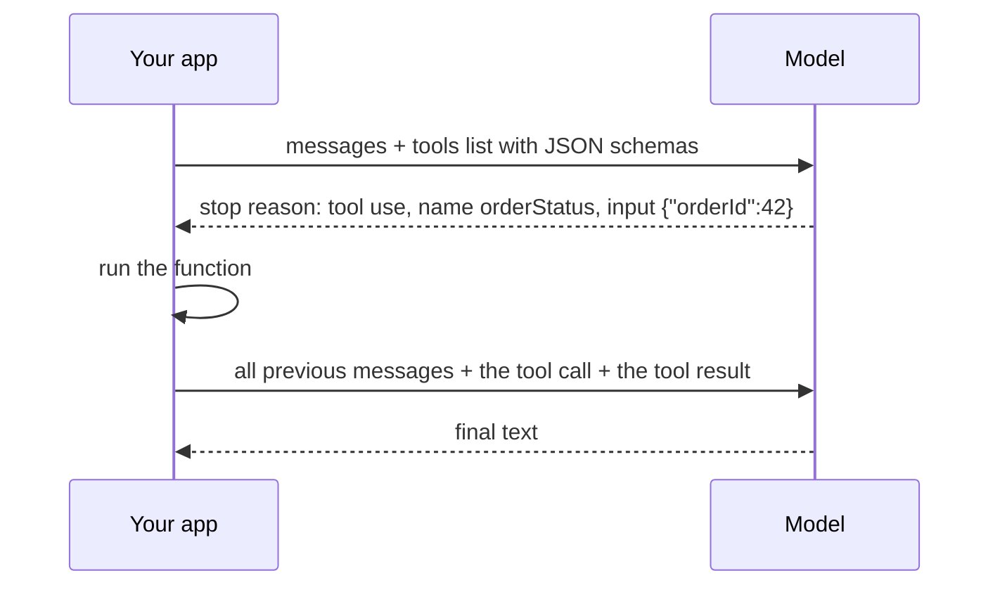

@more
## What really goes over the wire

Frameworks hide the HTTP call, which is convenient until something breaks. Understanding the raw request makes every framework easier to debug. Providers differ in details, but the shape is similar. Check your provider's API reference for exact fields.

### A request

```json A typical chat request (shape varies by provider)
{
  "model": "provider-model-name",
  "max_tokens": 300,
  "temperature": 0.2,
  "system": "You are a concise assistant for Java developers.",
  "messages": [
    { "role": "user", "content": "What is a Spring bean?" },
    { "role": "assistant", "content": "An object managed by the Spring container." },
    { "role": "user", "content": "And its default scope?" }
  ]
}
```

The whole conversation is in each request. This is what "stateless" means in practice. The model's previous reply has to be sent back by you, and in principle you could edit it, which shows that nothing is stored on the model's side unless a provider adds a feature for it.

### A response

```json A typical response
{
  "content": [{ "type": "text", "text": "The default scope is singleton." }],
  "stop_reason": "end_turn",
  "usage": { "input_tokens": 54, "output_tokens": 8 }
}
```

Check the stop reason:

| Stop reason (names vary) | Means | Action |
|---|---|---|
| Normal end | Finished | Use it |
| Max tokens | Cut off | JSON may be broken; raise the limit or continue |
| Tool use | Wants a tool | Run it, and send the result |
| Content filter or refusal | Blocked | Handle separately |

A truncated JSON answer is a classic production bug, so check this before parsing.

### Calling it from plain Java

```java A minimal client with RestClient
record Message(String role, String content) {}
record ChatRequest(String model, int max_tokens, List<Message> messages) {}

@Service
class RawLlmClient {

    private final RestClient http;

    RawLlmClient(RestClient.Builder builder, @Value("${llm.base-url}") String baseUrl,
                 @Value("${llm.api-key}") String apiKey) {
        var settings = ClientHttpRequestFactorySettings.defaults()
            .withConnectTimeout(Duration.ofSeconds(3))
            .withReadTimeout(Duration.ofSeconds(60));
        this.http = builder
            .baseUrl(baseUrl)
            .requestFactory(ClientHttpRequestFactoryBuilder.detect().build(settings))
            .defaultHeader("Authorization", "Bearer " + apiKey)
            .build();
    }

    JsonNode chat(ChatRequest request) {
        return http.post().uri("/messages")
            .body(request)
            .retrieve()
            .body(JsonNode.class);
    }
}
```

Header names and paths are provider-specific. Writing this once, as an exercise, teaches you what `ChatClient` does for you.

### Streaming on the wire

Streaming uses server-sent events: an open HTTP response, with chunks arriving as text.

```text Part of a streamed response (shape varies)
event: content_delta
data: {"delta":{"text":"The default"}}

event: content_delta
data: {"delta":{"text":" scope is singleton."}}

event: message_stop
data: {"usage":{"output_tokens":8}}
```

Proxies can break this. If your text arrives in one big lump at the end, something in the path is buffering. Check Nginx's `proxy_buffering`, and the settings of any load balancer or gateway. Idle timeouts can also cut long pauses, so send keep-alive comments.

### Tool calling on the wire



Every tool's name, description and schema is sent in each request, so it counts as input tokens. That's why 200 tools are expensive before any work begins.

### Errors to handle

| Status | Meaning | Response |
|---|---|---|
| 400 | Bad request, or context too long | Don't retry; trim or fix |
| 401, 403 | Key or permissions | Don't retry; alert |
| 408, 5xx | Provider trouble | Retry with backoff |
| 429 | Rate limited | Respect `Retry-After`; slow down |
| Overloaded (often 503 or 529) | Temporary | Retry, or fall back to another model |

Don't retry a request after a long timeout without thought: the provider may have completed it, and you pay again.

!keypoints The whole conversation goes in each request ;; Check the stop reason before parsing ;; Tools add input tokens to each call ;; Only retry transient errors

?? JSON parsing fails on some long answers only. What's the likely cause?
=> The output hit the max tokens limit and was cut off. Check the stop reason, and raise the limit or reduce the output.
?? Text only appears at the end, even though you're streaming. Why?
=> A proxy in the path is buffering the response. Turn off buffering there.
?? Why might 200 tools be costly even when none is used?
=> Their definitions are sent as input tokens on each request.

## AI on AWS: Bedrock

Amazon Bedrock provides models from several companies through one AWS API. For companies already on AWS, this often passes security review more easily than a new external vendor.

### Why teams choose it

| Benefit | Details |
|---|---|
| IAM, not API keys | Tasks use their role |
| Private network paths | VPC endpoints |
| One bill and one contract | Fits existing procurement |
| Several model providers | Switch with little code change |
| Data handling terms | Check the current terms for your use |

The trade-offs: newest models may arrive later than on the maker's own API, model availability differs by Region, and you need to request or enable access to models.

### Using it from Spring AI

```xml The Converse API starter
<dependency>
  <groupId>org.springframework.ai</groupId>
  <artifactId>spring-ai-starter-model-bedrock-converse</artifactId>
</dependency>
```

```properties Region and model; credentials come from the task role
spring.ai.bedrock.aws.region=ap-south-1
spring.ai.bedrock.aws.timeout=60s
spring.ai.bedrock.converse.chat.options.model=${BEDROCK_MODEL_ID}
```

Your `ChatClient` code doesn't change, which is the benefit of the abstraction. Don't set access keys in properties: use the default credentials chain. The Converse API doesn't cover embeddings, so these use a separate Bedrock embedding model starter. Check which models and Regions are currently supported in Spring AI's documentation and the AWS console.

```json IAM permissions for one model
{
  "Effect": "Allow",
  "Action": ["bedrock:InvokeModel", "bedrock:InvokeModelWithResponseStream"],
  "Resource": "arn:aws:bedrock:ap-south-1::foundation-model/MODEL-ID"
}
```

### Managed extras

| Feature | What it does | Consider when |
|---|---|---|
| Guardrails | Filters for content, personal data and denied topics | You want a managed layer |
| Knowledge Bases | Managed RAG: ingestion, chunking, retrieval | You want speed over control |
| Agents | Managed tool-calling loop | Simple workflows |
| Prompt caching | Cheaper repeated prefixes | Large stable instructions |
| Batch | Discounted offline work | Non-urgent bulk jobs |

Managed RAG gets you started quickly, but you lose fine control over chunking and evaluation. Building it yourself, as in Part 4, teaches far more, and interviews expect you to understand what's inside.

### Hosting your own model

SageMaker or GPU instances can serve open-weight models. A rough check: a GPU instance runs all day, whether busy or idle, whereas API calls cost nothing when idle. So hosting only pays off at high, steady volume, or with strict requirements. Include the cost of the people to run it.

### Choosing

| Situation | Reasonable choice |
|---|---|
| Learning or a personal project | The cheapest direct API with a budget limit |
| Company on AWS with strict security | Bedrock |
| Need a provider's newest features at once | Direct API |
| Strict data residency, high volume | Evaluate self-hosting |

!interview Interview answer :: **"How would you call an LLM from a Spring Boot service on ECS, securely?"** Through Bedrock, using the task role instead of API keys, over a VPC endpoint. Model ID in configuration, timeouts and limits in code, and only the permitted models allowed in IAM.

!keypoints Bedrock gives many models through one AWS API ;; Use IAM rather than keys ;; The ChatClient code stays the same ;; Self-hosting pays only at high, steady volume

?? Why might a security team prefer Bedrock?
=> IAM access control, private endpoints, one vendor contract, and logs within AWS, with no new API keys.
?? What does Spring AI's abstraction give you when moving to Bedrock?
=> ChatClient code stays the same. Only the dependency and configuration change, although behaviour should be re-evaluated.
?? When is hosting your own GPU model sensible?
=> At high, steady volume, or with strict requirements that managed services can't meet, after counting staffing costs.
