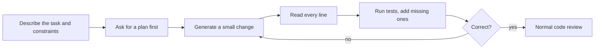

@part ai-assisted | AI Part 2: Prompting and AI-Assisted Development | ai
## Prompting that works

A prompt is an instruction for a very capable colleague who knows nothing about your situation. Most bad results come from missing context, rather than from missing tricks.

### The anatomy of a good prompt

1. **Role and task:** what to do.
2. **Context:** the information it needs, clearly separated.
3. **Rules:** constraints, including what to do when unsure.
4. **Output format:** exactly what you want back.
5. **Examples:** when the format or judgement is subtle.

```text A prompt for a support assistant
You are a support assistant for an online bookstore.

Answer using only the context below.
If the context does not contain the answer, say "I don't know" and suggest contacting support.
Reply in at most three sentences, and cite the document id, such as [doc-12].

<context>
{retrieved_documents}
</context>

<question>
{user_question}
</question>
```

Tags separate instructions from data. This helps the model and is a first step against prompt injection, though it is not a defence by itself.

### System and user messages

The **system** message holds lasting instructions. The **user** message holds the request. Put your rules in the system message, and treat everything from users or documents as data.

### Few-shot examples

If describing what you want is hard, show it.

```text Classification with examples
Classify each ticket as BILLING, BUG or OTHER.

Ticket: "I was charged twice this month." -> BILLING
Ticket: "The app crashes when I open settings." -> BUG
Ticket: "Do you have a student discount?" -> OTHER

Ticket: "{ticket}" ->
```

### Structured output

Application code needs data, not prose. Ask for JSON that matches a schema, and validate the result. Many APIs can enforce a schema, and Spring AI maps results to Java records, as Part 3 shows. Still validate the values, as valid JSON can contain a wrong answer.

### Asking for reasoning

For multi-step problems, asking the model to work through the steps first often improves accuracy. In products, keep this reasoning separate from what you show to users.

### Prompts are code

Keep prompts in version control. Test each change against an evaluation set, as a small rewording can alter behaviour in ways you cannot predict. Pin the model version, as a provider's update can do the same.

!warning Prompting mistakes :: Vague requests, conflicting rules, overly long instructions the model half follows, and no instruction for what to do when information is missing.

!keypoints Context matters more than clever wording ;; Separate instructions from data ;; Allow "I don't know" ;; Treat prompts like code

?? Why tell the model what to do when it does not know?
=> Without a way out, it tends to produce a plausible answer anyway.
?? Why should a prompt change go through an evaluation set?
=> Behaviour can shift in ways that a few manual tries will not reveal.

## Using AI tools as a developer

AI coding tools are now normal at work. What matters isn't typing prompts, but staying the engineer responsible for the result.

### Where they help and where to take care

| Good uses | Take extra care with |
|---|---|
| Boilerplate, DTOs, mappers | Authentication, authorisation, cryptography |
| Unit tests from existing behaviour | Concurrency and transactions: errors look plausible |
| Explaining unfamiliar code | Library APIs: may be invented or outdated |
| Refactoring with tests in place | Large unreviewed changes |
| First debugging ideas from a stack trace | Secrets and customer data: never paste them |

### A workflow that holds up



```text A prompt with context and constraints
Add rate limiting to POST /api/orders in this Spring Boot 3 service.
Constraints: use the existing Redis connection; limit 10 requests per minute per user;
return 429 with a Retry-After header; follow the style of RateLimitFilter in the auth package.
First list the files you would change and any risks. Do not write code yet.
```

### Reviewing AI code

Read it as if it came from a fast, confident junior developer who has never seen your system. Check:

- **Does it do what was asked,** including edge cases and errors?
- **Do the APIs exist?** Compile it, and check unfamiliar calls against documentation.
- **Do the tests really test?** Tests that only assert current behaviour would pass with a bug. Break the code and see whether a test fails.
- **Does it fit?** Duplicate helpers and new dependencies are common.
- **Is it secure?** Injection, missing permission checks and logged secrets.

!warning Invented packages :: A model can suggest a dependency that doesn't exist. Attackers register such names, so check that a package is real and maintained before installing it.

### Risks to name in an interview

| Risk | Mitigation |
|---|---|
| Plausible but wrong code | Tests, review, reading it yourself |
| Leaking company code or secrets | Approved tools only; follow company policy |
| Prompt injection through files or web pages | Treat tool output as untrusted; review actions |
| Weakening your own skills | Practise DSA and design unaided |

### As a fresher

Interviews often ban these tools, so practise without them too. Use AI to explain concepts and to review your code, then close it and write the solution by yourself. If you cannot explain a line, do not commit it.

!interview Interview answer :: **"Do you use AI tools?"** Give a specific story: the task, how you checked the output, a time it was wrong and how you caught it. That shows judgement.

!keypoints Plan first, then small changes ;; Read every line ;; Check that APIs and packages exist ;; You own what you commit

?? AI wrote a test suite that passes. Is that enough?
=> No. Tests may just assert current behaviour, including bugs. Check that they fail for a wrong implementation, and that edge cases are covered.
?? How do you check that a generated test is useful?
=> Break the code deliberately, and see if the test fails. Mutation testing does this systematically.
