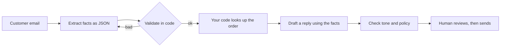

@more
## Advanced prompt patterns

### Break the task into steps

A single prompt that extracts, decides and writes often does all three badly. A chain of small prompts is easier to test and debug, and each step can use a different model.



Notice the code in the middle: lookups and rules don't need a model.

### Self-check and validation retry

```java Retry once, telling the model what was wrong
Triage parse(String ticket) {
    Triage t = chat.prompt().user(ticket).call().entity(Triage.class);
    List<String> errors = validate(t);
    if (errors.isEmpty()) {
        return t;
    }
    return chat.prompt()
        .user(ticket + "\n\nYour previous answer was invalid: " + errors + ". Answer again.")
        .call()
        .entity(Triage.class);
}
```

Limit retries, and fall back to a human queue after that.

### Choosing good examples

Examples often beat rules, but with some care:

- Cover the hard and edge cases, not just the easy ones.
- Vary them, as the model copies the patterns it sees, including unintended ones.
- Show what to do when information is missing.
- Keep them consistent with your stated rules.

### Asking for uncertainty

A confidence score from a model isn't a calibrated probability. Better signals: whether it cites a source, whether answers agree across a couple of runs, or an evaluation of how a score relates to accuracy. Route low-signal cases to a person.

### Prompt templates in code

Keep prompts out of Java strings, so that they can be reviewed and versioned.

```java Loading a template from resources
@Value("classpath:prompts/triage-v3.st")
private Resource triagePrompt;

String reply = chat.prompt()
    .system(triagePrompt)
    .user(ticket)
    .call()
    .content();
```

Record the prompt version with each result, so that you can tell which one produced a bad answer.

### Common failures and fixes

| Symptom | Likely cause | Fix |
|---|---|---|
| Ignores a rule | Too many rules, or it's buried | Put the rule last or in the output format; simplify |
| Wrong output format | Vague format | Use a schema; give an example |
| Inconsistent classification | Fuzzy categories | Define each one; give edge-case examples |
| Too long | No limit stated | State a length, and set max tokens |
| Follows instructions in user data | Mixed instructions and data | Delimit data, and limit what actions can do |
| Good in tests, poor live | Test cases too clean | Add real messy inputs to your set |

### Context engineering

As systems grow, the skill becomes choosing what goes in the context at all: which documents, how much history, which tools and which instructions. More isn't better, as irrelevant material dilutes attention and costs money. Treat the context window as a budget.

!keypoints Chain small steps ;; Validate, then retry with the errors ;; Examples should include hard cases ;; Treat context as a budget

?? Why extract facts first and draft afterwards, rather than doing both in one prompt?
=> Each step can be validated and tested, code can check facts between them, and failures are easier to locate.
?? Why isn't a model's stated confidence reliable?
=> It's generated text, not a calibrated probability. Evaluate how well any signal really predicts accuracy.

## Using coding agents well

Tools now go beyond autocomplete. Coding agents read files, run commands and make multi-file changes. They're powerful, and they need clear guidance and a safe setting.

### Give the agent your project's context

Agents start with no knowledge of your conventions. A short instructions file in the repository (such as `CLAUDE.md`, or `AGENTS.md` and similar for other tools) saves repeating yourself.

```markdown An instructions file for a Spring Boot project
# Build and test
- Build: ./mvnw -q verify
- A single test: ./mvnw test -Dtest=OrderServiceTest

# Conventions
- Java 21; records for DTOs; constructor injection only.
- Repositories are accessed only from services.
- Every endpoint needs an authorisation check and a test.
- Migrations are Flyway files; never edit an applied one.

# Do not
- Add a dependency without asking.
- Touch files under infra/ unless asked.
```

Keep it short and specific. A long file is partly ignored, and it costs context on every request.

### A loop that keeps you in control

1. **Explore first.** Ask how the code works before changing it.
2. **Plan.** Ask for a plan and read it. Correcting a plan is cheap, and correcting 500 lines isn't.
3. **Write a failing test,** so that "done" has a definition.
4. **Implement in small steps,** running tests each time.
5. **Review the diff** as you would a colleague's pull request.
6. **Commit small.** Then a bad step is easy to undo.

### Debugging with AI

Give it the error, the stack trace, what you expected, and what you've tried. Ask for hypotheses and how to test each one, not just a fix. A fix that makes the symptom vanish without an explanation often hides the real bug.

### Security in practice

| Risk | Practice |
|---|---|
| Agent runs a harmful command | Keep permission prompts on; use a container for risky work |
| Prompt injection from a dependency's README or a web page | Treat fetched content as data; review actions |
| Secrets exposed to a tool | Keep them out of the workspace and the context |
| Company code sent to an unapproved service | Use only what your employer approves |
| Hallucinated package | Verify before installing |

### What not to delegate blindly

Architecture decisions, security logic, data migrations and anything you can't verify. The rule is simple: delegate what you can check.

### Learning while using AI

For a fresher, this is the biggest risk. If AI writes everything, you won't build the skills that interviews test, and you won't be able to review its output.

| Situation | Better approach |
|---|---|
| Learning a new concept | Ask it to explain and to quiz you; write the code yourself |
| Stuck on a DSA problem | Ask for a hint, not the solution |
| Your code works | Ask for a review, then fix it yourself |
| Reading a large codebase | Ask it to explain the structure, then read the key files |

!interview Interview answer :: **"Tell me about a time AI gave you wrong code."** Have a true story: what it produced, how you noticed (a test, a compile error, reading the docs), and what you changed in your process afterwards.

!keypoints Give agents a short instructions file ;; Plan, test, then implement ;; Review every diff ;; Delegate only what you can verify

?? Why ask for a plan before code?
=> Correcting a plan is much cheaper than unpicking a large wrong change, and it shows misunderstandings early.
?? Why can leaning on AI for every DSA problem hurt you?
=> Interviews test the skills you never practised. Use hints, and solve the problem yourself.
?? What belongs in a repository's agent instructions file?
=> Build and test commands, key conventions, and things to avoid, kept short and specific.
