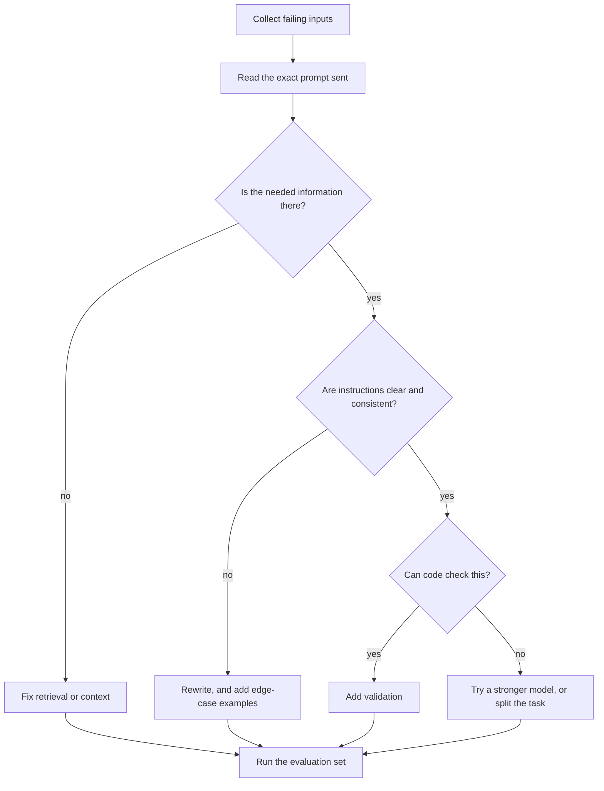

@more
## Prompt case studies

Prompting improves through iteration against real failures. These cases show how.

### Case 1: invoice extraction

**Version 1**

```text A first try
Extract the invoice details from this text.
```

Result: free-form text, with different field names each time. Unusable in code.

**Version 2**

```text Add a format
Extract these fields as JSON: invoice_number, date, total, currency.

{invoice_text}
```

Result: valid JSON mostly, but dates come in several formats, totals sometimes include a currency symbol, and missing fields get invented.

**Version 3**

```text Be precise, and handle absence
Extract fields from the invoice inside <invoice> tags.

Rules:
- date: ISO format YYYY-MM-DD. If it is ambiguous, use null.
- total: a number with no symbols or thousands separators. The final amount payable, including tax.
- currency: a 3-letter code. Use null if not stated; do not guess.
- If a field is not present, use null. Never invent a value.

<invoice>
{invoice_text}
</invoice>
```

Then, in code, validate: `subtotal + tax == total` if all are present, and the date isn't in the future. Send failures to a person. Notice what fixed things: precise definitions, an explicit rule for absence, and code checks.

| Failure | Fix | Type of fix |
|---|---|---|
| Inconsistent shape | Schema | Format |
| Ambiguous date | ISO rule, null if unsure | Definition |
| Invented values | Explicit null rule | Absence handling |
| Wrong total picked | Define "final amount" | Definition |
| Wrong sums | Arithmetic check | Code, not prompt |

### Case 2: a summariser that adds claims

A support summary sometimes states a refund was promised when it wasn't. Asking more firmly barely helps, so change the structure:

```text Quote first, then summarise
1. List direct quotes from the conversation about any promise, refund or deadline.
2. Then write the summary using only those facts. If no quotes exist, state "No commitments made."

Return JSON with "quotes" (array) and "summary" (string).
```

In code, check that each quote actually appears in the source. If one doesn't, treat the summary as unreliable. This turns a fuzzy quality problem into a checkable one.

### Case 3: classifying with fuzzy categories

Two reviewers often disagree on "BUG" versus "FEATURE REQUEST", and so does the model. Accuracy won't improve until the definitions do.

```text Definitions with boundary cases
BUG: the product does not do what it claims. "Export gives an empty file."
FEATURE_REQUEST: it works as designed, but the user wants more. "Please add PDF export."
Boundary: if the user asks for something that documentation says exists, choose BUG.
```

If two people can't agree on the labels, your evaluation set isn't reliable either. Measure their agreement first.

### Case 4: too long and too polite

"Be concise" is vague. "At most three sentences, with no greeting or closing" is testable, and you can check it in code. Prefer instructions that you could write a test for.

### A debugging routine



Change one thing at a time. Keep a change log with each prompt version and its score.

!keypoints Handle absence explicitly ;; Make outputs checkable in code ;; Clear definitions beat firm language ;; Change one thing at a time

?? A model invents a missing phone number. What do you change?
=> Say that missing fields must be null and never guessed, and validate the format in code.
?? How can quoting first reduce invented claims?
=> The model must ground the summary in quotes, and code can verify that those quotes exist in the source.
?? Why measure human agreement on labels?
=> If people disagree on the correct answer, the evaluation data is unreliable, and so is the score.

## Exercise: reviewing AI-written code

Here's a realistic piece of generated code. It compiles, and looks fine. Find the problems before reading on.

```java "Add an endpoint to transfer money between accounts"
@RestController
public class TransferController {

    @Autowired
    private AccountRepository accounts;

    @PostMapping("/transfer")
    @Transactional
    public String transfer(@RequestParam Long from, @RequestParam Long to, @RequestParam double amount) {
        Account a = accounts.findById(from).get();
        Account b = accounts.findById(to).get();
        if (a.getBalance() >= amount) {
            a.setBalance(a.getBalance() - amount);
            b.setBalance(b.getBalance() + amount);
            log.info("Transfer " + amount + " from " + a + " to " + b);
            notificationClient.send(a.getEmail(), "Transfer done");
            return "success";
        }
        return "insufficient funds";
    }
}
```

### Problems found

| # | Problem | Why it matters | Fix |
|---|---|---|---|
| 1 | No ownership check on `from` | Anyone can drain any account | Use the authenticated user |
| 2 | `double` for money | Rounding errors | `BigDecimal`, or integer paise |
| 3 | Negative amount accepted | Reverses the transfer: steals funds | Validate above zero |
| 4 | Lost updates under concurrency | Two transfers both pass the check | `@Version`, or a locked or conditional update |
| 5 | `from` equal to `to` | Odd balance results | Reject it |
| 6 | `.get()` on Optional | 500 for a bad ID | 404 |
| 7 | Remote call inside the transaction | Holds locks; if it fails after commit decisions, states diverge | Publish after commit |
| 8 | Logging whole accounts | May leak personal data | Log IDs only |
| 9 | No idempotency | A retry transfers twice | Idempotency key |
| 10 | "success" strings, 200 for failure | Clients can't tell | Proper status codes |
| 11 | Logic in the controller | Hard to test | Move to a service |
| 12 | `@Transactional` on a controller | Works only through a proxy, and it's the wrong layer | Service layer |
| 13 | Field injection | Harder to test | Constructor injection |

### A safer version

```java The core of a better design
@Transactional
public TransferResult transfer(long userId, TransferCommand cmd) {
    if (cmd.amountPaise() <= 0 || cmd.fromId() == cmd.toId()) {
        throw new InvalidTransferException();
    }
    if (ledger.alreadyProcessed(cmd.idempotencyKey())) {
        return ledger.resultFor(cmd.idempotencyKey());
    }
    long first = Math.min(cmd.fromId(), cmd.toId());           // a fixed lock order prevents deadlocks
    long second = Math.max(cmd.fromId(), cmd.toId());
    Account x = accounts.findByIdForUpdate(first).orElseThrow(AccountNotFound::new);
    Account y = accounts.findByIdForUpdate(second).orElseThrow(AccountNotFound::new);
    Account from = x.getId() == cmd.fromId() ? x : y;
    Account to = x.getId() == cmd.fromId() ? y : x;

    if (from.getOwnerId() != userId) {
        throw new AccountNotFound();                           // do not reveal that it exists
    }
    from.debit(cmd.amountPaise());                             // throws if insufficient
    to.credit(cmd.amountPaise());

    TransferResult result = ledger.record(cmd);
    events.publishEvent(new TransferCompleted(result.id()));   // a listener notifies after commit
    return result;
}
```

### What this exercise teaches

The AI's code wasn't "wrong" on the happy path. It would pass a simple demo and an easy test. The problems are all in what wasn't asked: security, concurrency, failure and money. Those are precisely where your own judgement is worth paying for, and you can only bring that judgement if you've learned the fundamentals. Your Java, Spring and Database guides cover each of these.

Better prompting helps too: "Write this assuming concurrent requests and hostile input, and list the risks you handled." But always review the result.

!keypoints AI code can pass demos and still be dangerous ;; Check ownership, concurrency, money and retries ;; Use the fundamentals to review ;; Ask explicitly for risks

?? What does a negative amount do in the original code?
=> It passes the balance check and moves money the other way, so an attacker can take funds.
?? Why lock accounts in a fixed order?
=> Two opposite transfers could otherwise each hold one lock and wait for the other, causing a deadlock.
?? Why is double unsuitable for money?
=> Binary floating point can't represent many decimal values exactly, so errors accumulate. Use BigDecimal or integer minor units.
