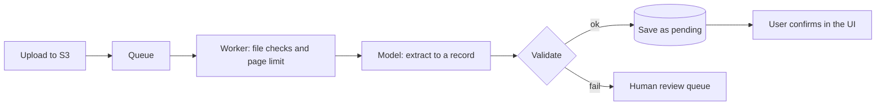

@more
## A streaming chat, from Spring Boot to React

### The backend

Use POST, since messages shouldn't be in URLs. Stream through `SseEmitter`, or return `Flux<ServerSentEvent<String>>`, with an end event and error handling.

```java A streaming endpoint with clear events
record ChatInput(@NotBlank @Size(max = 4000) String message, String conversationId) {}

@PostMapping(value = "/api/chat", produces = MediaType.TEXT_EVENT_STREAM_VALUE)
Flux<ServerSentEvent<String>> chat(@Valid @RequestBody ChatInput input, Authentication auth) {
    String conversationId = auth.getName() + ":" + conversations.check(auth.getName(), input.conversationId());

    return chat.prompt()
        .user(input.message())
        .advisors(a -> a.param(ChatMemory.CONVERSATION_ID, conversationId))
        .stream()
        .content()
        .map(text -> ServerSentEvent.builder(text).event("delta").build())
        .concatWith(Flux.just(ServerSentEvent.builder("").event("done").build()))
        .onErrorResume(e -> {
            log.warn("stream failed", e);
            return Flux.just(ServerSentEvent.builder("Sorry, something went wrong.").event("error").build());
        });
}
```

`Flux` needs WebFlux on the classpath. On Spring MVC, Spring can still handle a returned `Flux` for streaming, using `spring-boot-starter-webflux` as a library for Reactor types. Be aware that once streaming has begun, the HTTP status is already sent, so errors must travel as events.

### A React hook

The browser's `EventSource` can't POST, so read the stream with `fetch`.

```javascript useChat.js
import { useRef, useState } from 'react';

export function useChat() {
  const [messages, setMessages] = useState([]);
  const [streaming, setStreaming] = useState(false);
  const abortRef = useRef(null);

  async function send(text) {
    setMessages((m) => [...m, { role: 'user', text }, { role: 'assistant', text: '' }]);
    setStreaming(true);
    abortRef.current = new AbortController();
    try {
      const res = await fetch('/api/chat', {
        method: 'POST',
        headers: { 'Content-Type': 'application/json' },
        body: JSON.stringify({ message: text }),
        signal: abortRef.current.signal,
      });
      if (!res.ok) throw new Error(`HTTP ${res.status}`);

      const reader = res.body.pipeThrough(new TextDecoderStream()).getReader();
      let buffer = '';
      while (true) {
        const { value, done } = await reader.read();
        if (done) break;
        buffer += value;
        const events = buffer.split('\n\n');
        buffer = events.pop();             // the last piece may be incomplete
        for (const raw of events) {
          const data = raw.split('\n')
            .filter((line) => line.startsWith('data:'))
            .map((line) => line.slice(5).replace(/^ /, ''))
            .join('\n');
          if (raw.includes('event:delta')) appendToLast(data);
          if (raw.includes('event:error')) appendToLast(data);
        }
      }
    } catch (e) {
      if (e.name !== 'AbortError') appendToLast('\n[Connection lost. Please try again.]');
    } finally {
      setStreaming(false);
    }
  }

  function appendToLast(chunk) {
    setMessages((m) => {
      const copy = [...m];
      copy[copy.length - 1] = { ...copy.at(-1), text: copy.at(-1).text + chunk };
      return copy;
    });
  }

  const stop = () => abortRef.current?.abort();
  return { messages, streaming, send, stop };
}
```

Buffering matters here, because a network chunk can end halfway through an event. Check the exact `event:` spacing that your server sends, or use a small SSE parsing library.

### UI details that matter

| Detail | Why |
|---|---|
| A Stop button that aborts the fetch | Saves money and frustration; check that the server cancels too |
| Show citations as links | Builds trust, and allows checking |
| Render Markdown safely | Sanitise, and disallow raw HTML |
| Don't re-render everything on each chunk | Memoise old messages, for long chats |
| Disable Send while streaming | Prevents overlapping requests |
| Feedback buttons | Gives you evaluation data |
| Say that answers may be wrong | Sets honest expectations |

### When the client leaves

If a user closes the tab, Reactor cancels the `Flux`, and with most clients the model call stops. Test this. Otherwise, you pay for answers nobody reads. Also remember what happens to chat memory on partial answers.

!keypoints Use POST with fetch streaming ;; Errors travel as events after streaming begins ;; Buffer partial events on the client ;; Offer Stop, and test that it cancels

?? Why can't you return a 500 status halfway through a stream?
=> The status was sent with the first bytes. Send an error event, and show it in the UI.
?? Why does the client keep a buffer while reading a stream?
=> A chunk can end in the middle of an event. Only complete events, ending in a blank line, can be parsed.

## Multimodal input and documents

Many models accept images and PDFs alongside text. This solves problems that OCR plus rules struggle with: forms, screenshots and mixed layouts.

```java Asking about an image with ChatClient
String answer = chat.prompt()
    .user(u -> u
        .text("Is this a valid receipt? Give the store, date and total as JSON.")
        .media(MimeTypeUtils.IMAGE_PNG, new ClassPathResource("/receipt.png")))
    .call()
    .content();
```

### A receipt scanner



### Engineering concerns

| Concern | Approach |
|---|---|
| Cost | Image and PDF tokens can be high; resize, and limit pages |
| Sensitive content | Documents may hold ID numbers: minimise, and control retention |
| Prompt injection | Images and PDFs can contain hidden or visible instructions |
| Malicious files | Check type and size, scan them, and never trust the extension |
| Low-quality input | Detect and reject, or send to a person |
| Accuracy | Validate sums, formats and dates in code; a person confirms |

Image text can carry injected instructions, for example white text on white. Don't give a document-reading model access to powerful tools.

### Traditional OCR or a model?

| Situation | Prefer |
|---|---|
| High volume of one fixed form | Traditional OCR with templates; cheaper and steadier |
| Varied layouts | LLM with vision |
| Exact character accuracy is legally required | Specialist OCR, plus human review |
| Low volume, many types | LLM |

AWS Textract is a managed OCR option, and combining OCR text with a model is often both cheaper and more accurate than sending a page image.

### Speech and images as output

Speech-to-text and text-to-speech have their own APIs, and Spring AI has audio and image model abstractions. For most backend roles, it's enough to know these exist, with the same concerns: cost per unit, latency, privacy and quality evaluation.

!keypoints Vision handles varied layouts ;; Validate and confirm extracted data ;; Documents can contain injected instructions ;; High-volume fixed forms may suit OCR better

?? Why have a user confirm extracted invoice data?
=> Extraction can be wrong, and a person catches this before money or records are affected.
?? How might an image attack a vision-enabled agent?
=> It can contain instructions in hard-to-see text. Treat its content as data, and limit tool access.

## Provider fallback, caching and testing with WireMock

### Falling back to another model

```java Trying a second model on failure
@Service
class ResilientChat {

    private final ChatClient primary;
    private final ChatClient backup;

    ResilientChat(@Qualifier("primaryChat") ChatClient primary,
                  @Qualifier("backupChat") ChatClient backup) {
        this.primary = primary;
        this.backup = backup;
    }

    @CircuitBreaker(name = "llm-primary", fallbackMethod = "useBackup")
    public String ask(String system, String question) {
        return primary.prompt().system(system).user(question).call().content();
    }

    String useBackup(String system, String question, Exception e) {
        log.warn("primary model failed, using backup: {}", e.toString());
        return backup.prompt().system(system).user(question).call().content();
    }
}
```

A fallback isn't free of risk. A different model may behave differently, so run your evaluation set on it as well, and keep prompts portable. Also note that a fallback sends the data to a second vendor, so check that privacy terms allow it. Sometimes a graceful message is the better fallback.

### Prompt caching

Many providers can reuse a repeated **prefix** of a prompt at a lower price. Put stable content first, and changing content last.

```text Order the prompt for caching
[stable] System instructions
[stable] Tool definitions
[stable] Reference documents shared by many requests
[varying] Conversation history
[varying] The current question
```

A timestamp at the top of the system prompt can destroy your cache hit rate, since the prefix changes on each call. Measure the hit rate from the usage fields in responses. This differs from **response caching**, which stores whole answers.

### Semantic caching

Storing answers keyed by a question's embedding can skip the model for similar questions. It sounds attractive, but "How do I cancel my order?" and "How do I cancel my subscription?" are close in meaning and need different answers, and caches can cross users' boundaries. Use it only with strict thresholds, and never for personalised answers.

### Testing with WireMock

Test how your app handles real HTTP failures, using a fake provider.

```java Rate limit, then success
@SpringBootTest(properties = "spring.ai.openai.base-url=http://localhost:${wiremock.server.port}")
@AutoConfigureWireMock(port = 0)
class ChatRetryTest {

    @Autowired AssistantService assistant;

    @Test
    void retriesAfterRateLimit() {
        stubFor(post(anyUrl()).inScenario("retry").whenScenarioStateIs(STARTED)
            .willReturn(aResponse().withStatus(429).withHeader("Retry-After", "1"))
            .willSetStateTo("ok"));
        stubFor(post(anyUrl()).inScenario("retry").whenScenarioStateIs("ok")
            .willReturn(okJson(cannedChatResponse("Hello"))));

        assertThat(assistant.ask("Hi")).isEqualTo("Hello");
        verify(2, postRequestedFor(anyUrl()));
    }
}
```

Also add stubs for a timeout (`withFixedDelay`), a 500, malformed JSON and a truncated answer. These are precisely the cases your happy-path demo never shows. The base URL property and response shape depend on your provider, so adjust them to match.

!keypoints Evaluate the backup model too ;; Stable content first for prompt caching ;; Semantic caches can return wrong answers ;; Simulate provider failures in tests

?? Prompt caching isn't saving anything. What might be wrong?
=> Something near the start changes per request, such as a timestamp. Move varying content to the end.
?? Why is semantic caching risky?
=> Similar-looking questions can need different answers, and shared answers can leak between users.
?? What should you check before adding a backup provider?
=> Its quality on your evaluation set, whether your data may go to it, and that prompts work there too.
