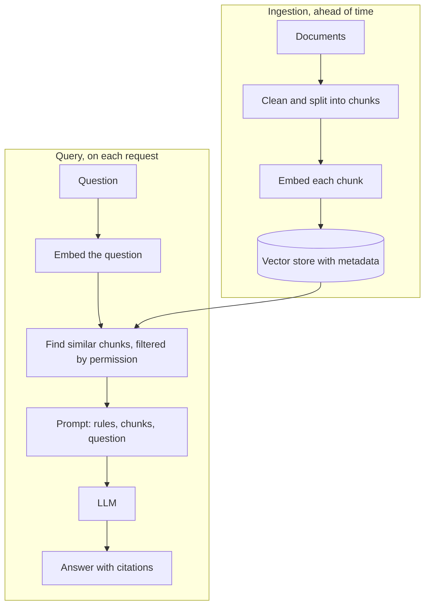

@part ai-rag | AI Part 4: RAG and Vector Search | ai
## RAG from the ground up

A model does not know your documents, your data changes, and pasting everything into a prompt does not fit. **Retrieval-augmented generation** finds the relevant pieces and places them in the prompt. It is the most common AI feature that you will be asked to build.



Most bad RAG answers are retrieval problems: if the right text never reaches the model, nothing else can save the answer. So inspect retrieved chunks first when an answer is wrong.

### RAG or not?

| Situation | Better approach |
|---|---|
| Answers live in documents that change | RAG |
| Answers live in database fields | Tools that query the database, not RAG |
| Fixed format extraction from one document | Send the document directly |
| The document is small | Put it all in the prompt |

!keypoints Retrieve first, then generate ;; Ingestion and query are separate pipelines ;; Most failures are retrieval failures ;; Not every data question needs RAG

?? Why not simply send all documents to the model?
=> They will not fit in the context window, the cost is high, and irrelevant text lowers quality.
?? A user asks for last month's total sales. Is RAG right?
=> No. That is a precise database query. Use a tool that runs a safe, parameterised query.

## Ingestion and chunking

Ingestion quality limits everything that follows.

### Extract and clean

PDFs are the hardest source: tables, columns, headers and footers all break naive extraction. (This site's own PDF extraction needed careful handling for exactly these reasons.) Remove repeated boilerplate, keep headings and record where each piece came from.

### Chunking

Embedding a whole document blurs its meaning, and tiny fragments lose context. Chunking is the trade-off.

| Strategy | Idea | Good for |
|---|---|---|
| Fixed size with overlap | N tokens, with some shared between chunks | Quick start, uniform text |
| Structure-aware | Split on headings and paragraphs | Docs, manuals, wikis |
| Parent-child | Search small chunks, send the larger parent | Precise search with full context |
| Semantic | Split where the topic changes | Long unstructured text |

Start with a few hundred tokens, with some overlap, split on structure, and then measure. Put the document title and section heading into each chunk, as a chunk that says only "It must be renewed yearly" has lost its meaning.

### Metadata

Store useful fields with each chunk: source, section, date and tenant or access group. You need these for citations, filtering and updates.

### Keeping the index fresh

Documents change. Track a content hash per document, re-embed only those that changed, and delete old chunks. Otherwise, the assistant confidently quotes a policy from two years ago.

```java An ingestion service
@Service
class Ingestion {

    private final VectorStore store;

    Ingestion(VectorStore store) { this.store = store; }

    void ingest(Resource pdf, String docId, String tenant) {
        List<Document> pages = new PagePdfDocumentReader(pdf).get();
        List<Document> chunks = TokenTextSplitter.builder().build().apply(pages);
        chunks.forEach(c -> {
            c.getMetadata().put("docId", docId);
            c.getMetadata().put("tenant", tenant);
        });
        store.delete("docId == '" + docId + "'");   // replace older chunks; docId is our own value
        store.add(chunks);                          // embeds and stores
    }
}
```

The PDF reader needs the `spring-ai-pdf-document-reader` dependency. Run ingestion asynchronously, as embedding many chunks takes time and can hit rate limits. Check the exact splitter and delete API for your Spring AI version.

!keypoints Good extraction comes first ;; Chunk by structure, then measure ;; Put headings into chunks ;; Keep metadata, and keep the index fresh

?? A chunk reads "It must be renewed every year" and retrieval fails. Why?
=> The chunk lost its subject. Add the document title and section heading to it.
?? How do you update a document that has changed?
=> Detect the change by hash, delete its old chunks using metadata, and re-embed.

## Vector stores and retrieval

### pgvector first

If you already run PostgreSQL, `pgvector` is a sensible first choice over adding a new database. Your vectors sit next to your data, and you keep your backups and transactions.

```sql What the schema looks like
CREATE EXTENSION IF NOT EXISTS vector;
CREATE EXTENSION IF NOT EXISTS hstore;
CREATE EXTENSION IF NOT EXISTS "uuid-ossp";

CREATE TABLE IF NOT EXISTS vector_store (
  id uuid DEFAULT uuid_generate_v4() PRIMARY KEY,
  content text,
  metadata json,
  embedding vector(1536)   -- must match your embedding model
);

CREATE INDEX ON vector_store USING HNSW (embedding vector_cosine_ops);
```

```yaml Spring AI configuration
spring:
  ai:
    vectorstore:
      pgvector:
        index-type: HNSW
        distance-type: COSINE_DISTANCE
        dimensions: 1536
        initialize-schema: true   # schema creation is opt-in
```

Add `spring-ai-starter-vector-store-pgvector` and inject `VectorStore`. A dedicated vector database may make sense at very large scale, or when you need its specific features. Decide on measured need.

### Basic retrieval

```java Search with a threshold and a permission filter
List<Document> hits = store.similaritySearch(SearchRequest.builder()
    .query(question)
    .topK(5)
    .similarityThreshold(0.6)
    .filterExpression("tenant == '" + currentTenant + "'")
    .build());
```

`currentTenant` must come from the authenticated user and never from request input, or a crafted value could change the filter.

### Why plain vector search falls short

| Problem | Fix |
|---|---|
| Misses exact codes and names | **Hybrid search:** combine keyword and vector results |
| Good results are ranked too low | **Reranking:** a second model reorders the top results |
| Vague or follow-up questions | **Query rewriting:** turn "what about the other one?" into a full question |
| Several questions in one | **Query decomposition:** retrieve for each part |

Hybrid search commonly merges results with reciprocal rank fusion, which scores each document by its rank in each list. PostgreSQL can do this with full-text search next to pgvector.

### Using it with ChatClient

The simple route adds `spring-ai-vector-store-advisor`:

```java QuestionAnswerAdvisor
var rag = QuestionAnswerAdvisor.builder(store)
    .searchRequest(SearchRequest.builder().similarityThreshold(0.6).topK(5).build())
    .build();

String answer = chat.prompt()
    .advisors(rag)
    .advisors(a -> a.param(QuestionAnswerAdvisor.FILTER_EXPRESSION, "tenant == '" + currentTenant + "'"))
    .user(question)
    .call()
    .content();
```

For more control, `spring-ai-rag` provides a modular flow:

```java RetrievalAugmentationAdvisor
Advisor rag = RetrievalAugmentationAdvisor.builder()
    .documentRetriever(VectorStoreDocumentRetriever.builder()
        .similarityThreshold(0.50)
        .vectorStore(store)
        .build())
    .build();
```

By default this tells the model not to answer when retrieval finds nothing, which is often what you want for a grounded assistant.

!warning Access control belongs in the query :: "Do not reveal other tenants' data" in a prompt is not a control, because a prompt can be overridden. If a chunk is not retrieved, it cannot leak. So filter at retrieval.

!keypoints Start with pgvector if you use PostgreSQL ;; Hybrid search and reranking improve recall ;; Rewrite follow-up questions ;; Enforce permissions in the query

?? Vector search misses ERR-4021. Why, and how do you fix it?
=> Embeddings capture meaning and handle exact identifiers poorly. Add keyword search and merge the results.
?? Why is a prompt instruction not access control?
=> It can be ignored or overridden. A filter at retrieval means the model never sees the data.
?? A user asks "and what about refunds?" and retrieval fails. What helps?
=> Query rewriting: use the conversation to turn it into a complete question before searching.

## Measuring RAG quality

Without measurement, every change is a guess. Evaluate retrieval and generation separately, so that you know which to fix.

### Build an evaluation set

Collect 30 to 100 real questions, each with the expected facts and the source document. Include ones that should get "I don't know", and include adversarial ones.

| Layer | Measure | Meaning |
|---|---|---|
| Retrieval | Recall at k | Is the right chunk in the top k? |
| Retrieval | MRR | How high does it rank? |
| Generation | Faithfulness | Is the answer supported by the retrieved text? |
| Generation | Correctness | Does it contain the expected facts? |
| Generation | Refusal accuracy | Does it decline when it should? |
| System | Latency, cost per question | Is it usable and affordable? |

```java A simple recall check in a test
@Test
void retrievalFindsTheRightDocument() {
    int found = 0;
    for (EvalCase c : EvalCases.load()) {
        List<Document> hits = store.similaritySearch(
            SearchRequest.builder().query(c.question()).topK(5).build());
        if (hits.stream().anyMatch(d -> c.docId().equals(d.getMetadata().get("docId")))) {
            found++;
        }
    }
    assertThat((double) found / EvalCases.size()).isGreaterThan(0.85);
}
```

### Diagnosing failures

| Symptom | Likely cause | Try |
|---|---|---|
| Right chunk is not found | Chunking, or vague queries | Better chunks, hybrid search, rewriting |
| Right chunk is found, ranked low | Ranking | Reranker, higher k |
| Right chunk is used, wrong answer | Prompt or model | Clearer rules, examples, a stronger model |
| Invents facts | Weak grounding | "Answer only from context", citations, a threshold |
| Outdated answers | Stale index | Re-ingest on change |
| Shows others' data | No filter | Filter by permission during retrieval |

!interview Interview answer :: **"Design a chatbot over company documents."** Cover ingestion and updates, chunking, embeddings, hybrid retrieval, access control at retrieval, a grounded prompt with citations, streaming, an evaluation set, cost limits, and what happens when nothing relevant is found.

!keypoints Measure retrieval and generation separately ;; Include questions that should be refused ;; Inspect failures one by one ;; Run evaluations on every important change

?? Answer quality fell after a chunking change. How do you investigate?
=> Compare evaluation results before and after. Check retrieval recall first, then inspect the failing questions' chunks.
?? Why include unanswerable questions in your evaluation set?
=> To check that the assistant refuses rather than inventing answers.
