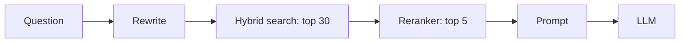
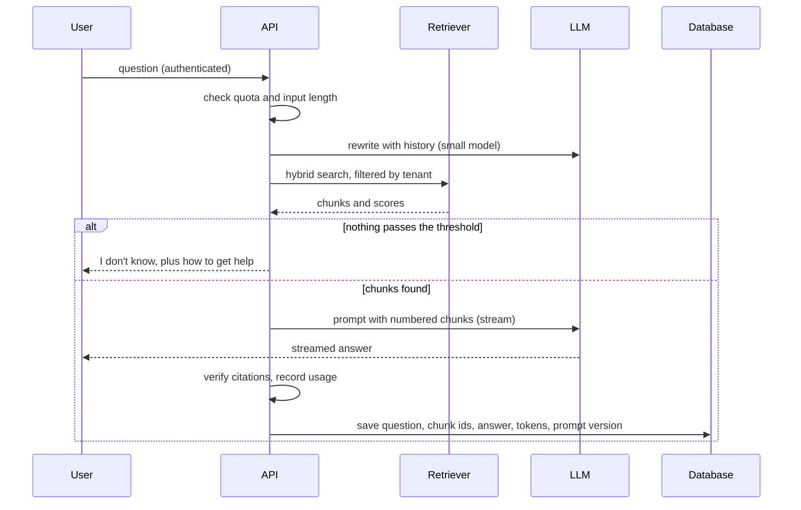

@more
## Hybrid search in PostgreSQL

Vector search finds meaning, and keyword search finds exact terms. Combining them is one of the most reliable upgrades to a RAG system, and PostgreSQL can do both in one database.

### The schema

```sql A chunks table with both indexes
CREATE TABLE doc_chunk (
  id        bigserial PRIMARY KEY,
  doc_id    text NOT NULL,
  tenant_id text NOT NULL,
  heading   text,
  content   text NOT NULL,
  tsv       tsvector GENERATED ALWAYS AS (to_tsvector('english', content)) STORED,
  embedding vector(1536) NOT NULL
);

CREATE INDEX doc_chunk_tsv ON doc_chunk USING GIN (tsv);
CREATE INDEX doc_chunk_vec ON doc_chunk USING HNSW (embedding vector_cosine_ops);
CREATE INDEX doc_chunk_tenant ON doc_chunk (tenant_id);
```

### Each search alone

```sql Vector search: nearest meaning (<=> is cosine distance)
SELECT id, content
FROM doc_chunk
WHERE tenant_id = :tenant
ORDER BY embedding <=> :query_vector
LIMIT 20;
```

```sql Keyword search: exact words
SELECT id, content, ts_rank(tsv, q) AS score
FROM doc_chunk, websearch_to_tsquery('english', :question) q
WHERE tenant_id = :tenant AND tsv @@ q
ORDER BY score DESC
LIMIT 20;
```

### Merging with reciprocal rank fusion

The two scores can't be compared directly, as they are on different scales. **Reciprocal rank fusion** (RRF) ignores the scores and uses positions: each document scores 1 / (k + rank) in each list, and k is commonly 60.

```sql Hybrid search with RRF
WITH vec AS (
  SELECT id, ROW_NUMBER() OVER (ORDER BY embedding <=> :query_vector) AS rank
  FROM doc_chunk WHERE tenant_id = :tenant
  ORDER BY embedding <=> :query_vector LIMIT 20
),
kw AS (
  SELECT id, ROW_NUMBER() OVER (ORDER BY ts_rank(tsv, q) DESC) AS rank
  FROM doc_chunk, websearch_to_tsquery('english', :question) q
  WHERE tenant_id = :tenant AND tsv @@ q
  ORDER BY ts_rank(tsv, q) DESC LIMIT 20
)
SELECT c.id, c.heading, c.content,
       COALESCE(1.0 / (60 + vec.rank), 0) + COALESCE(1.0 / (60 + kw.rank), 0) AS score
FROM vec FULL OUTER JOIN kw USING (id)
JOIN doc_chunk c USING (id)
ORDER BY score DESC
LIMIT 5;
```

### A worked RRF example

| Chunk | Vector rank | Keyword rank | Score |
|---|---|---|---|
| A | 1 | 3 | 1/61 + 1/63 = 0.0323 |
| B | 2 | none | 1/62 = 0.0161 |
| C | none | 1 | 1/61 = 0.0164 |

Chunk A wins, as both searches found it. C edges out B on rank alone.

### Calling it from Spring

```java A retriever you own
@Repository
class HybridRetriever {

    private final JdbcClient jdbc;
    private final EmbeddingModel embeddings;

    HybridRetriever(JdbcClient jdbc, EmbeddingModel embeddings) {
        this.jdbc = jdbc;
        this.embeddings = embeddings;
    }

    List<Chunk> search(String question, String tenant) {
        PGvector vector = new PGvector(embeddings.embed(question));
        return jdbc.sql(HYBRID_SQL)
            .param("query_vector", vector)
            .param("question", question)
            .param("tenant", tenant)
            .query(Chunk.class)
            .list();
    }
}
```

Using the `pgvector` JDBC library needs its type registered on the connection. An alternative is passing the vector as a string and casting with `CAST(:query_vector AS vector)`. Writing your own retriever gives you full control, whereas `VectorStore` is simpler for vector-only search.

### HNSW tuning

| Setting | Effect |
|---|---|
| `m` (at build) | Links per node: higher improves recall, uses more memory |
| `ef_construction` (at build) | Build quality against build time |
| `hnsw.ef_search` (at query) | Recall against query speed |

Filtering interacts with approximate search. With a strict filter such as a small tenant, HNSW may return fewer results than asked for, since it first finds neighbours and then filters. Check `hnsw.iterative_scan` in recent pgvector versions, or use partitioning per large tenant.

!keypoints Hybrid search covers meaning and exact terms ;; RRF merges by rank, not score ;; PostgreSQL can do both ;; Watch filtered approximate search

?? Why not simply add a vector score and a keyword score?
=> They're on different scales, so one would dominate. RRF uses ranks, avoiding the problem.
?? A small tenant's search returns only 1 of 5 results, though more exist. Why?
=> HNSW finds nearest neighbours overall, and then filters. Few pass the filter. Use iterative scan, a larger ef_search, or partitions.
?? Calculate the RRF score for a chunk ranked 2 in one list and 4 in the other, with k = 60.
=> 1/62 + 1/64, which is about 0.0161 + 0.0156 = 0.0317.

## Advanced retrieval

Reach for these when your evaluation shows a specific failure, not by default. Each adds latency, cost and complexity.

### Query transformation

| Technique | Solves | Example |
|---|---|---|
| Rewrite | Vague wording | "it's broken" becomes "payment page error" |
| Compress with history | Follow-up questions | "and refunds?" becomes "what is the refund policy for premium plans?" |
| Decompose | Several questions in one | Compare A and B: search for each |
| Multi-query | Varied wording | Generate 3 versions, and merge |
| HyDE | Short questions vs long docs | Draft a fake answer, and embed that |

Spring AI's modular RAG has components for several of these:

```java Compressing a follow-up question, then retrieving
Advisor rag = RetrievalAugmentationAdvisor.builder()
    .queryTransformers(RewriteQueryTransformer.builder()
        .chatClientBuilder(chatClientBuilder.build().mutate())
        .build())
    .documentRetriever(VectorStoreDocumentRetriever.builder()
        .vectorStore(store)
        .similarityThreshold(0.5)
        .topK(5)
        .build())
    .build();
```

Use a small, cheap model for transformation, because it adds a model call to every request.

### Reranking

Embeddings are quick but rough. A **cross-encoder reranker** reads the question and a chunk together, and scores relevance more accurately, but it's too slow for the whole database. So retrieve about 30 candidates cheaply, rerank them, and send the top 5. It's often the single biggest improvement in precision.



### Better chunks

| Technique | Idea |
|---|---|
| Contextual chunks | Add a sentence saying where the chunk fits in its document |
| Parent document | Search small chunks, and send the surrounding section |
| Table handling | Keep tables whole, or turn rows into sentences |
| Metadata filters | Limit by date, product or language before searching |

### Citations that can be trusted

Number each chunk in the prompt, and ask for citations such as `[2]`. Then **check them in code**: parse the numbers, verify that they exist, and link to the sources. Going further, you can verify that the quoted text actually appears.

```text Prompt format for citations
<documents>
[1] (refund-policy.pdf, section 3) Refunds are issued within 7 days...
[2] (premium-terms.pdf, section 1) Premium plans renew yearly...
</documents>

Answer using only these documents. Cite each claim like [1].
If they do not contain the answer, say you don't know.
```

### When nothing relevant is found

Decide this explicitly. Set a score threshold, and if nothing passes, say so and offer a next step, such as contacting support, without calling the model at all. This saves money, and it avoids confident nonsense.

### Graph RAG and agents that search

For questions spanning connected facts ("which teams depend on services owned by Asha?"), a knowledge graph can help. **Agentic RAG** lets a model search repeatedly until it's satisfied. Both are powerful, slower and harder to evaluate, so start simple.

!keypoints Add techniques only for measured failures ;; Retrieve wide, rerank, send few ;; Verify citations in code ;; Handle "nothing found" without the model

?? Why retrieve 30 chunks and rerank, rather than simply use the top 5?
=> Embedding search is rough, so the best chunk may rank low. A reranker is more accurate, but too slow for the whole database.
?? How can you tell whether a citation is real?
=> Parse it in code, and check that the source was in the retrieved set. Optionally, check that the quoted text is there.
?? Why skip the model when retrieval finds nothing?
=> It saves cost, and avoids an invented answer. Return a clear message and a next step.

## A complete RAG service, end to end

Here's the shape of a production-minded assistant, joining the previous chapters.



### The service

```java The main path
@Service
class DocsAssistant {

    private final HybridRetriever retriever;
    private final ChatClient chat;
    private final QueryRewriter rewriter;
    private final Quota quota;

    Flux<String> ask(CurrentUser user, String conversationId, String question) {
        quota.check(user, question);

        String standalone = rewriter.rewrite(conversationId, question);
        List<Chunk> chunks = retriever.search(standalone, user.tenantId());

        if (chunks.isEmpty() || chunks.getFirst().score() < MIN_SCORE) {
            return Flux.just("I couldn't find that in the documents. Please contact support.");
        }

        return chat.prompt()
            .user(u -> u.text(PROMPT)
                .param("documents", format(chunks))
                .param("question", question))
            .stream()
            .content();
    }
}
```

`MIN_SCORE` depends on your scoring method, so calibrate it from the evaluation set rather than guessing.

### Data model

| Table | Holds |
|---|---|
| `document` | Source, title, owner, access group, hash, version |
| `doc_chunk` | Text, heading, tenant, embedding |
| `conversation` | User, created at |
| `message` | Role, content, retrieved chunk IDs, tokens, prompt version |
| `feedback` | Message, thumbs up or down, comment |

Storing chunk IDs with every answer means you can later explain exactly why an answer was given. This is invaluable when debugging.

### Handling document changes

1. An upload creates a `document` row and an ingestion job, and the user sees "processing".
2. The worker extracts, chunks and embeds, in batches, with backoff on rate limits.
3. In one transaction, it replaces old chunks with new ones.
4. Search only uses documents marked as ready.
5. When a document is deleted, chunks must go too, especially for personal data.

### Permissions

Access rules are the part that's easiest to get wrong. If permissions change often, keep group IDs in chunk metadata and update them when sharing changes, or check permissions at query time by joining to your access tables. Test this explicitly: write an evaluation case proving that user A can never retrieve user B's content.

### What to measure in production

| Signal | Meaning |
|---|---|
| Top retrieval score trend | Falling: content gap, or data drift |
| "I don't know" rate | Too high: thresholds or missing content |
| Thumbs down | Inspect these each week |
| Tokens per answer | Cost control |
| Time to first token | Perceived speed |
| Questions with no good document | A to-do list for your content team |

That last signal is often the most valuable: the assistant tells you what your documentation is missing.

!interview Interview answer :: **"How would you debug a wrong answer?"** Pull the stored record: rewritten question, retrieved chunks and prompt version. If the right chunk wasn't there, it's a retrieval or ingestion problem. If it was there, it's a prompt or model problem. Then add the case to the evaluation set.

!keypoints Check quota before anything costs money ;; Store chunk IDs with each answer ;; Test access control explicitly ;; Missing-document signals improve your content

?? Why store retrieved chunk IDs with each answer?
=> To explain and debug any answer later, and to tell retrieval failures from generation failures.
?? How do you avoid users seeing half-updated documents during re-ingestion?
=> Replace chunks in one transaction, or build a new version and switch to it when ready.
?? A user's access to a document is revoked. What must happen in the RAG system?
=> Retrieval must stop returning it right away, either by updating chunk metadata or by checking permissions at query time.
