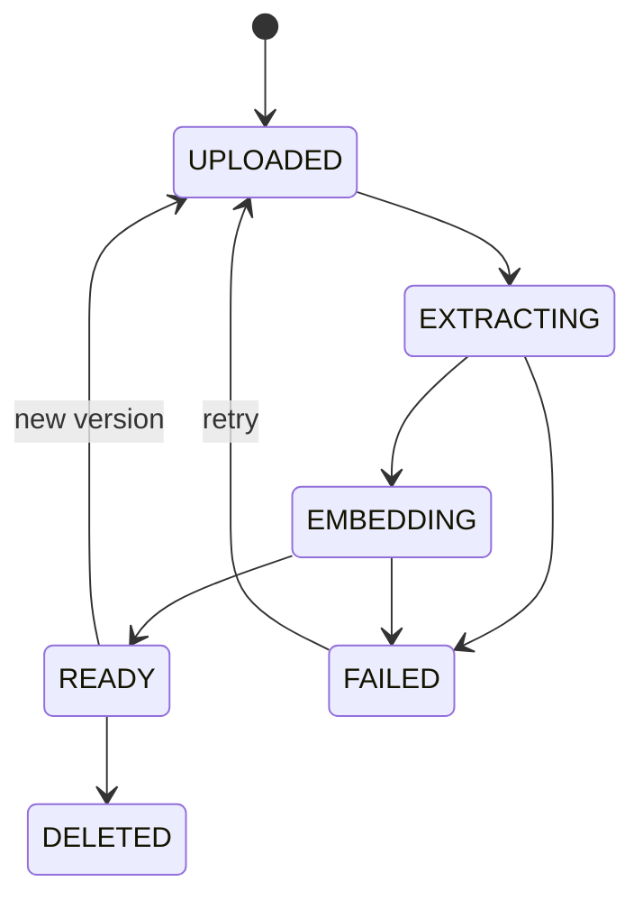
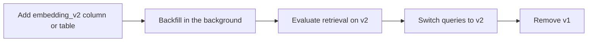
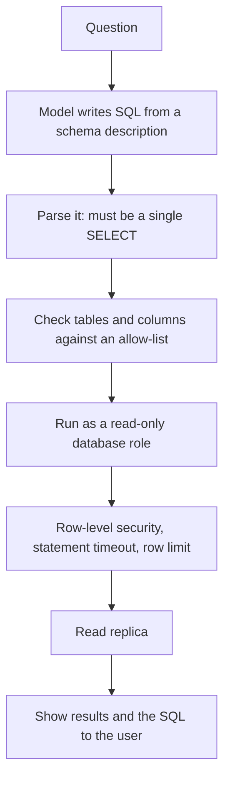

@more
## Building the ingestion worker

Ingestion looks trivial in tutorials, which load one PDF at start-up. Real ingestion has failures, rate limits and re-runs.

### States



Storing a state means that users see progress, retries are safe, and search can ignore anything that isn't `READY`.

### The worker

```java An idempotent ingestion job
@Service
class IngestionWorker {

    @SqsListener("ingest-queue")
    public void onUpload(IngestRequest req) {
        Document doc = documents.find(req.documentId());
        String hash = sha256(s3.read(doc.getKey()));
        if (hash.equals(doc.getIndexedHash())) {
            documents.markReady(doc.getId());       // nothing changed; a repeat message does nothing
            return;
        }
        documents.setState(doc.getId(), EXTRACTING);
        List<ChunkText> chunks = chunker.split(extractor.extract(doc));

        documents.setState(doc.getId(), EMBEDDING);
        List<float[]> vectors = embedInBatches(chunks);

        store.replaceChunks(doc, chunks, vectors, hash);    // one transaction: delete old, insert new, mark READY
    }

    private List<float[]> embedInBatches(List<ChunkText> chunks) {
        List<float[]> out = new ArrayList<>();
        for (List<ChunkText> batch : Lists.partition(chunks, 64)) {
            out.addAll(retry.executeSupplier(
                () -> embeddings.embed(batch.stream().map(ChunkText::text).toList())));
        }
        return out;
    }
}
```

Important choices here:

- **Batch embeddings.** Embedding APIs accept many texts at once, which is faster and often cheaper.
- **Embed outside the database transaction.** That work can take minutes.
- **Replace atomically.** Readers never see half a document.
- **Visibility timeout longer than the longest job,** or split big documents into smaller messages.

### Handling a large re-index

Changing the embedding model means re-embedding everything, and vectors from the old and new models can't be compared.



New uploads must write both during the backfill.

### Chunking code that respects structure

```java Split by headings, then by size
List<ChunkText> split(ParsedDoc doc) {
    List<ChunkText> out = new ArrayList<>();
    for (Section s : doc.sections()) {
        String prefix = doc.title() + " > " + s.heading() + "\n";
        List<String> pieces = bySize(s.text(), MAX_TOKENS, OVERLAP_TOKENS);
        for (int i = 0; i < pieces.size(); i++) {
            out.add(new ChunkText(prefix + pieces.get(i), s.heading(), i));
        }
    }
    return out;
}
```

Adding the title and heading to each chunk costs a few tokens, and often gives one of the largest improvements.

### Extraction quality

Look at your extracted text before anything else. Ask: are tables in order, did columns get mixed up, are headers repeated on each page, did scanned pages come out empty? A quick audit of 20 documents commonly reveals problems no amount of tuning later can fix.

!keypoints Track document states ;; Make jobs idempotent with a hash ;; Embed in batches, outside transactions ;; Read your extracted text first

?? An ingestion message is delivered twice. Why does nothing break here?
=> The content hash matches, so the second run does nothing. Chunk replacement is atomic as well.
?? How do you change embedding model without downtime?
=> Backfill a new column or table in the background, evaluate, switch queries, then remove the old one.

## Retrieval metrics, worked by hand

Numbers mean little until you've computed them yourself.

### Recall at k

Did the correct chunk appear in the top k? Suppose five questions, and these are the ranks at which the right chunk appeared:

| Question | Rank of the right chunk |
|---|---|
| Q1 | 1 |
| Q2 | 3 |
| Q3 | Not found |
| Q4 | 2 |
| Q5 | 1 |

| Metric | Working | Result |
|---|---|---|
| Recall at 1 | Q1 and Q5: 2 of 5 | 0.40 |
| Recall at 3 | Q1, Q2, Q4, Q5: 4 of 5 | 0.80 |

### Mean reciprocal rank (MRR)

Score each question 1/rank, or 0 if it's not found, and average them.

(1 + 1/3 + 0 + 1/2 + 1) ÷ 5 = 2.833 ÷ 5 = **0.567**

MRR rewards ranking the right chunk high. Improving Q2 from rank 3 to rank 1 raises it to 0.70, whereas recall at 3 doesn't change at all.

### Precision at k

Of the top k chunks returned, how many are relevant? If 2 of the top 5 are relevant, precision at 5 is 0.4. Low precision means you're paying for noise, and may mislead the model.

### nDCG

When several chunks are relevant, and some are more useful, nDCG scores the ordering with graded relevance. Learn what it's for, and use a library if you need it.

### Generation metrics

| Metric | Question | How to score |
|---|---|---|
| Faithfulness | Is each claim backed by the context? | Model grader, or claim-by-claim |
| Answer relevance | Does it answer the question? | Model grader |
| Correctness | Does it contain the right facts? | Expected facts |
| Citation accuracy | Do citations support the claims? | Check quoted text |
| Refusal accuracy | Does it refuse when it should? | Unanswerable questions |

### Reading the patterns

| Recall | Faithfulness | Correctness | Diagnosis |
|---|---|---|---|
| Low | High | Low | The model is honest, but lacks the data: fix retrieval |
| High | Low | Low | It has the data but invents: fix the prompt |
| High | High | Low | Grounded but wrong: chunks conflict or are outdated |
| High | High | High | Good: look at cost and latency |

### An experiment

Change one variable, and keep a table. These numbers are illustrative only:

| Run | Chunking | Search | Recall at 5 | MRR | Cost per question |
|---|---|---|---|---|---|
| A | 500 tokens, fixed | Vector | 0.72 | 0.51 | Baseline |
| B | By heading | Vector | 0.81 | 0.60 | Same |
| C | By heading | Hybrid | 0.88 | 0.66 | Same |
| D | By heading | Hybrid + rerank | 0.88 | 0.79 | Higher |

A table like this, with your own measured numbers, is one of the strongest things you can bring to an interview.

!keypoints Recall asks whether it's found ;; MRR asks how high ;; Read metrics together for a diagnosis ;; Change one variable at a time

?? Ranks are 2, 1, not found, and 4. What's the MRR?
=> (1/2 + 1 + 0 + 1/4) ÷ 4 = 1.75 ÷ 4 = 0.4375.
?? In that same case, what's recall at 3?
=> Two questions (ranks 2 and 1) out of four: 0.5.
?? Recall is high, but faithfulness is low. What do you fix first?
=> The prompt and grounding, since the right text is reaching the model, but it isn't sticking to it.

## Asking questions of databases safely

"Let users ask questions about their data" is a common request. The tempting design lets the model write SQL. It works in demos, and it's risky in production.

### Option 1: fixed tools (safest)

```java Named questions with validated parameters
@Tool(description = "Total sales for the current user's store between two dates, inclusive")
SalesTotal salesBetween(@ToolParam(description = "Start date, YYYY-MM-DD") LocalDate from,
                        @ToolParam(description = "End date, YYYY-MM-DD") LocalDate to,
                        ToolContext ctx) {
    if (to.isBefore(from) || from.plusYears(2).isBefore(to)) {
        throw new IllegalArgumentException("Date range must be valid and at most 2 years");
    }
    return sales.total(storeId(ctx), from, to);    // parameterised SQL you wrote
}
```

The model chooses which tool to call and with which values. It never writes SQL. This covers most real questions.

### Option 2: text to SQL, with layers of defence

When questions really are unpredictable, for example with an internal analytics tool:



| Layer | Stops |
|---|---|
| Parser check | `DROP`, multiple statements |
| Allow-list | Salary and password tables |
| Read-only role | All writes, even if the parser misses something |
| Row-level security | Other tenants' data |
| Timeout and limit | Huge queries and cross joins |
| Read replica | Harm to production load |
| Showing SQL | Lets people check the logic |

The database role is the real barrier. Treat other layers as helpful, but assume they can be bypassed.

```sql A role that cannot do damage
CREATE ROLE analytics_reader NOLOGIN;
GRANT USAGE ON SCHEMA reporting TO analytics_reader;
GRANT SELECT ON reporting.sales_view TO analytics_reader;
ALTER ROLE analytics_reader SET statement_timeout = '5s';

ALTER TABLE reporting.sales ENABLE ROW LEVEL SECURITY;
CREATE POLICY tenant_only ON reporting.sales
  USING (tenant_id = current_setting('app.tenant_id'));
```

Point it at purpose-built **views** with clear names rather than raw tables. Good names and column comments improve accuracy, and hide messy internals.

### Accuracy is the deeper problem

A query can run perfectly and still be wrong: "revenue" might need refunds excluded, or a "customer" might mean something specific in your business. Wrong numbers that look right are worse than an error. Mitigations:

- Provide definitions of business terms and example queries.
- Show the SQL and assumptions.
- Prefer a semantic layer of defined metrics.
- Evaluate on real questions with known answers.
- Keep high-stakes reports in human-built dashboards.

### Spreadsheets and CSVs

Giving a model a big CSV as text is wasteful, and it's bad at sums. Load the data into a table, or let it call a calculation tool, so code does the arithmetic.

!interview Interview answer :: **"Can we let users ask questions in plain English against our database?"** Start with tools that run fixed, parameterised queries. If that's too limited, allow generated SELECT queries, through a read-only role, on approved views, with row-level security, timeouts and a replica. Show the SQL, and evaluate accuracy on real questions.

!keypoints Prefer fixed tools ;; The database role is the real barrier ;; Use clear views, not raw tables ;; A wrong number that looks right is the bigger risk

?? Why is a parser check not sufficient for generated SQL?
=> Parsers can miss tricks, such as functions with side effects. A read-only role with narrow grants enforces it at the database.
?? A generated query runs, but gives wrong revenue. Why, and how do you reduce this?
=> The model doesn't know your definition, such as excluding refunds. Provide definitions and examples, use defined metrics, and evaluate on known answers.
?? How do you stop a generated query scanning for minutes?
=> A statement timeout on the role, a row limit, and running it on a replica.
