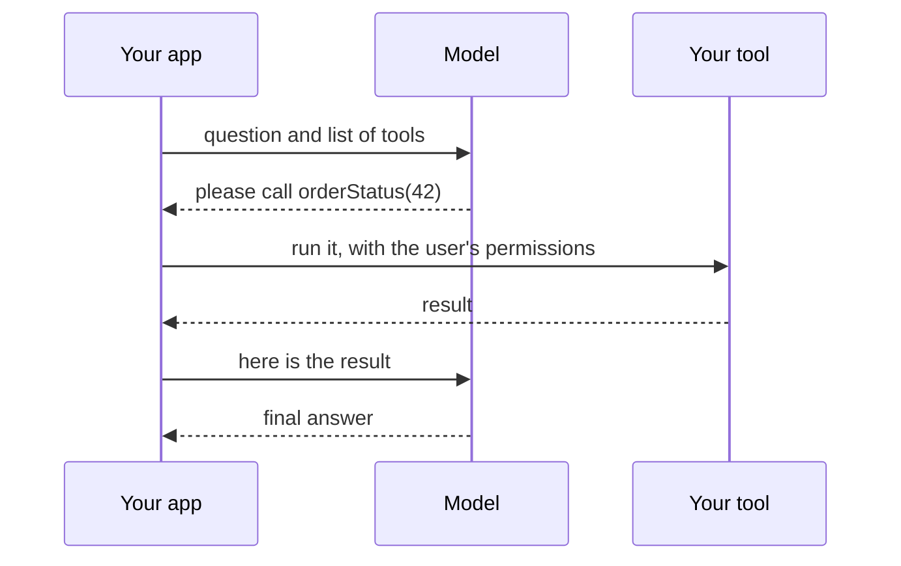
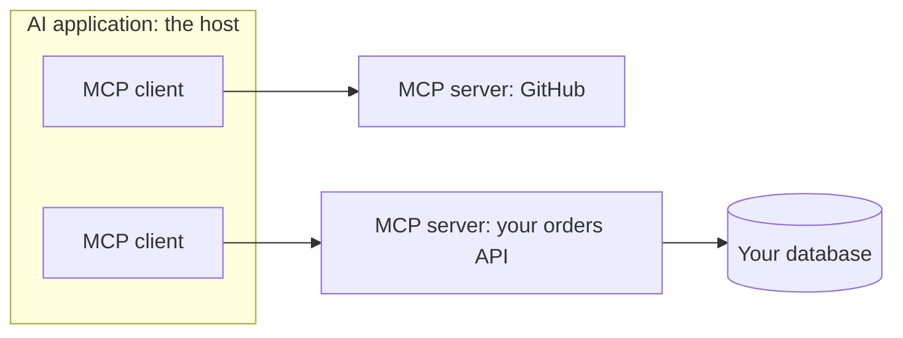

@part ai-agents | AI Part 5: Tools, Agents and MCP | ai
## Tool calling

With tool calling, a model can ask your application to run a function. **The model never runs anything itself.** It returns a request with a name and arguments, your code decides whether to run it, and the result goes back.



### Tools in Spring AI

```java A tool
@Component
class OrderTools {

    private final OrderService orders;

    OrderTools(OrderService orders) { this.orders = orders; }

    @Tool(description = "Get the delivery status of one of the current user's orders")
    String orderStatus(@ToolParam(description = "The order number") long orderId) {
        return orders.statusForCurrentUser(orderId);   // the permission check lives here
    }
}

String reply = chat.prompt()
    .tools(orderTools)
    .user("Where is my order 42?")
    .call()
    .content();
```

The description is how the model decides when to use a tool, so it's effectively a prompt: be precise about what it does, what it needs and when not to use it.

### Designing good tools

- **Narrow and specific.** `orderStatus(id)` is far safer than `runSql(query)`.
- **Validate arguments** like any public API input, because they can be wrong or manipulated.
- **Enforce permissions inside the tool,** using the authenticated user, and never an ID the model supplies for identity.
- **Return small, clear results.** Long results waste the context window. Return useful errors, as the model can often correct itself.
- **Make writes safe.** Use idempotency keys, and ask for confirmation.

!warning Who is the user? :: Take identity from your security context. If a tool takes `userId` as a model-supplied argument, then a manipulated prompt can act as somebody else.

!keypoints The model asks, your code runs ;; Tool descriptions are prompts ;; Narrow tools are safer ;; Permissions belong inside the tool

?? Why not give the model a tool that runs any SQL?
=> A manipulated or mistaken query could read or destroy anything. Offer narrow tools with fixed, parameterised queries.
?? Where should a tool get the current user from?
=> From the server's security context, never from model-supplied arguments.

## Agents and workflows

An **agent** is a loop: the model chooses a step, tools run, and the results feed the next choice, until it finishes. The word is heavily hyped. Underneath, it's a while loop with an LLM deciding what happens next.

```java The idea, in pseudocode
messages = [goal];
for (int step = 0; step < MAX_STEPS; step++) {
    reply = model.call(messages, tools);
    if (!reply.wantsTool()) return reply.text();
    messages.add(reply);
    messages.add(run(reply.toolCall()));      // validated, with permissions
}
throw new StepLimitExceeded();
```

### Prefer the simplest thing that works

| Pattern | Who decides the steps | Use when |
|---|---|---|
| Single call | Nobody; one step | Summarise, classify, extract |
| Chain | Your code | Fixed sequence of LLM steps |
| Routing | Model picks a branch, code does the rest | Different handling per request type |
| Workflow with tools | Code, using LLM at certain points | Known process, some judgement |
| Agent | The model | Steps truly cannot be known in advance |

Each step down this table costs more, is slower and is harder to test. A refund process with known steps should be normal code that calls an LLM only for, say, classifying a reason. Reach for an agent only when the path really can't be written in advance, such as open-ended research.

### Why agents fail

- **Errors compound.** If each step is 95% reliable, ten steps succeed about 60% of the time.
- **Loops.** The model may retry the same failing action.
- **Cost.** Each step resends a growing context.
- **Hard to test.** Paths vary from run to run.

### Keeping agents safe

| Rule | Why |
|---|---|
| Limit steps, time and spend | Loops can run away |
| Read-only tools first | Limits damage from mistakes |
| Human confirmation for actions that change data | The model can be wrong or manipulated |
| Use the user's permissions in every tool | A confused agent should not exceed them |
| Log every step and tool call | You need it for debugging and audit |
| Treat tool results as untrusted | Web pages and emails can contain injected instructions |

!interview Interview answer :: **"Would you use an agent for this?"** Only if the steps cannot be known in advance. I start with a plain workflow, as it is cheaper, faster and easier to test, and use the LLM only where judgement is needed.

!keypoints An agent is a loop ;; Use workflows when steps are known ;; Limit steps and spend ;; Confirm risky actions with a human

?? Ten steps at 95% reliability each: what is the overall chance of success?
=> About 0.95 to the power 10, roughly 60%. So fewer steps, and checks between them, matter.
?? When is an agent the wrong choice?
=> When the steps are known. Plain code is cheaper, faster and more reliable.

## MCP: connecting tools in a standard way

Before the **Model Context Protocol**, each AI application needed custom integrations for each tool. MCP is an open standard: a server exposes tools and data, and any compatible client can use them.



A server can offer **tools** (actions), **resources** (data to read) and **prompts** (templates). Local servers often run over standard input and output, and remote ones over HTTP.

### Building a server with Spring AI

Spring AI provides starters for MCP clients and servers. With a server starter, your annotated tool methods can be exposed through the protocol, so existing services become usable from AI tools. Check the current documentation for the exact starter and transport.

### Security

An MCP server is code and data access, so treat one as carefully as a dependency. Check who publishes it, what it can reach and what credentials it holds. Remote servers need real authentication. Tool descriptions and results can contain injected instructions, and a malicious update could change what a tool does. So pin versions, and grant the least access possible.

!keypoints MCP standardises how AI applications connect to tools ;; A server exposes tools, resources and prompts ;; Treat servers as untrusted dependencies ;; Grant least privilege

?? What problem does MCP solve?
=> It replaces custom integrations between each application and each tool with one standard, so tools are written once and used by many clients.
?? Why is installing a third-party MCP server a security decision?
=> It runs code with access to your data and credentials, and its text reaches your model, which may contain injected instructions.
