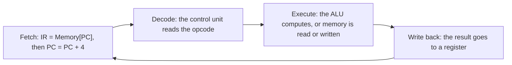

@part coa-cpu | Computer Organisation · Part 3: Instruction Set Architecture and the CPU | coa
## The CPU and the instruction cycle

A computer has three main parts: the **CPU** that executes instructions, the **memory** that holds instructions and data, and the **I/O devices**. In the **stored-program (von Neumann) model** instructions and data live in the same memory, which is why a program is just data that another program (a compiler, a loader) can create. A **Harvard architecture** keeps separate instruction and data memories; most modern CPUs look von Neumann to software but use split instruction and data **caches** inside, which is Harvard-like where it helps speed.

### Inside the CPU

| Part | Purpose |
|---|---|
| **ALU** (arithmetic logic unit) | adds, subtracts, ANDs, ORs, shifts, compares |
| **Registers** | a few fast storage locations inside the CPU |
| **Control unit** | decodes instructions and generates the control signals |
| **PC** (program counter) | address of the next instruction |
| **IR** (instruction register) | the instruction being executed |
| **MAR / MDR** | memory address register / memory data register: the CPU's connection to memory |
| **Status (flags) register** | Zero, Carry, Sign (Negative) and Overflow flags set by the ALU |
| **SP** (stack pointer) | top of the stack |

### Fetch, decode, execute

Every instruction goes through the same cycle, repeated billions of times per second:

1. **Fetch:** MAR ← PC; read memory; IR ← MDR; PC ← PC + instruction size.
2. **Decode:** the control unit works out what to do and which registers are involved.
3. **Execute:** the ALU operates, or a load/store accesses memory, or a branch changes the PC.
4. **Write back:** the result is stored in a register.
5. **Interrupts** are checked at the end of an instruction (covered in the I/O part).

A **branch** or **jump** simply overwrites the PC with a new address: that is all a `for` loop, an `if` or a method call is at machine level.

!cheat Terms people mix up ::
- **Word:** the natural data size of the CPU (32 or 64 bits). **Byte-addressable** memory gives every byte its own address.
- Address bits = log₂(memory size in addressable units): 4 GiB byte-addressable needs 32 bits.
- **Clock cycle:** one tick of the clock. Clock rate 3 GHz means a 1/3 ns cycle.
- **Instruction cycle** (fetch → execute) can take one or many clock cycles depending on the design.
- **MAR** holds an address; **MDR** holds the data being read or written. The PC is *not* the MAR.
!end

!keypoints The stored-program idea: instructions and data share memory ;; The cycle is fetch, decode, execute, write back, repeated ;; PC points to the next instruction; a branch overwrites it ;; MAR and MDR connect the CPU to memory; flags record the ALU's result ;; Byte-addressable memory with n address bits holds 2ⁿ bytes

?? What does the program counter hold, and how does a jump change execution?
=> The PC holds the address of the next instruction to fetch. After each fetch it is advanced by the instruction size. A jump or taken branch loads a new address into the PC, so the next fetch comes from there.

?? What is the difference between the MAR and the MDR?
=> The MAR holds the memory address being accessed and the MDR holds the data read from or to be written to that address. Together they are the CPU's interface to memory.

## Instruction set architecture

The **instruction set architecture (ISA)** is the contract between hardware and software: the instructions, registers, addressing modes and data types a program can use. x86-64, ARM and RISC-V are ISAs. A particular chip that implements an ISA is a **microarchitecture**; many chips share one ISA.

### Instruction formats

An instruction has an **opcode** (what to do) and **operands** (on what). The number of explicit addresses classifies a machine:

| Type | Example for X = (A + B) × (C + D) | Instructions |
|---|---|---|
| 3-address | ADD T1,A,B / ADD T2,C,D / MUL X,T1,T2 | 3 |
| 2-address | MOV T,A / ADD T,B / MOV U,C / ADD U,D / MUL T,U / MOV X,T | 6 |
| 1-address (accumulator) | LOAD A / ADD B / STORE T / LOAD C / ADD D / MUL T / STORE X | 7 |
| 0-address (stack) | PUSH A, PUSH B, ADD, PUSH C, PUSH D, ADD, MUL, POP X | 8 |

The **minimum instruction length** is the opcode bits plus all operand bits. With 64 opcodes (6 bits) and three register operands out of 32 registers (5 bits each), it is 6 + 15 = 21 bits.

### Expanding opcodes

A fixed-length instruction can reuse operand bits as opcode bits when it has fewer operands. For a 16-bit instruction with 4-bit address fields: the first 4 bits give 16 codes. Suppose 15 are used for 3-address instructions. The 1 unused code is **expanded** with the next 4 bits into 16 two-address opcodes. If 14 are used, 2 remain and expand into 2 × 16 = 32 one-address opcodes. If 30 are used, 2 remain and expand into 2 × 16 = **32 zero-address** instructions. The rule: *unused codes at a level × 2^(width of the next field) = the slots at the next level*; subtract the slots you use to get the unused codes for the level after.

### Addressing modes

The **effective address (EA)** is where the operand really is. Modes trade instruction size, flexibility and speed.

| Mode | Operand or EA | Memory accesses for the operand | Typical use |
|---|---|---|---|
| Immediate | the operand is in the instruction | 0 | constants: `ADD R1, #5` |
| Register | operand is in a register | 0 | fast arithmetic |
| Direct (absolute) | EA = address field | 1 | global variables |
| Register indirect | EA = contents of a register | 1 | pointers |
| Memory indirect | EA = M[address field] | 2 | pointers to pointers |
| Indexed / displacement | EA = register + offset | 1 | arrays, struct fields |
| Base register | EA = base register + offset | 1 | relocation, locals relative to a frame |
| PC-relative | EA = PC + offset (PC already points to the *next* instruction) | 1 | branches, position-independent code |
| Auto-increment / decrement | EA = register, then register ± size | 1 | stack, array walks |

**Examples.**
- `LOAD R1, 100(R2)` with R2 = 2000 uses the effective address 2000 + 100 = **2100**.
- A 4-byte branch at address 1000 with PC-relative offset +20 goes to (1000 + 4) + 20 = **1024**.
- A memory-indirect load of a one-word instruction costs 1 (instruction fetch) + 2 (indirection) = **3** memory accesses.
- **Little-endian** machines (x86, most ARM setups) store the least significant byte at the lowest address: 0x12345678 at address 100 places 78, 56, 34, 12 at 100, 101, 102, 103. **Big-endian** stores 12 first (network byte order). Java hides this inside the JVM but you meet it in file formats and sockets.

### RISC and CISC

| | RISC (ARM, RISC-V, MIPS) | CISC (x86) |
|---|---|---|
| Instruction length | fixed (simple to decode) | variable |
| ALU operands | registers only: a **load/store architecture** | memory operands allowed |
| Addressing modes | few | many |
| Registers | many | fewer |
| Control | usually hardwired | often microprogrammed |
| Pipelining | easy | harder (modern x86 translates to RISC-like micro-ops) |
| Code size | larger | smaller |

!cheat ISA formulas ::
- Minimum instruction bits = opcode bits + operand bits (⌈log₂ #opcodes⌉ + n × ⌈log₂ #registers⌉).
- Memory-indirect operand access: 2 memory references (+1 for the fetch).
- PC-relative target = (address of the branch + its size) + offset.
- Expanding opcodes: slots at the next level = (free codes at this level) × 2^(next field width).
- Little-endian: LSB at the lowest address.
!end

!interview Interview angle: Is x86 CISC or RISC today? :: The x86 ISA is CISC: variable-length instructions with memory operands. Inside, modern x86 cores decode each instruction into one or more RISC-like micro-operations and run those on a pipelined, out-of-order core. So the distinction now lives mostly at the ISA level, and ARM's fixed-length instructions make decoding cheaper, which is one reason it is power-efficient.

!keypoints The ISA is the hardware/software contract; many chips implement one ISA ;; Instruction length = opcode bits + operand bits ;; Expanding opcodes reuse operand bits as opcode bits ;; Know the addressing modes and how many memory accesses each needs ;; RISC: fixed length, load/store, many registers; CISC: variable length, memory operands

?? What is the effective address in indexed (displacement) addressing?
=> The sum of the contents of the index or base register and the displacement in the instruction. It is used for array elements and structure fields.

?? Why does PC-relative addressing help position-independent code?
=> The target is computed relative to the current PC, so the code works wherever it is loaded in memory, and the instruction needs only a small offset instead of a full address.

## Datapath and control unit

The **datapath** is the set of registers, the ALU, multiplexers and buses that carry and transform data. The **control unit** tells the datapath what to do in each step, by producing **control signals** (register write enable, ALU operation, memory read/write, multiplexer selects).

### A single-cycle datapath

For a simple RISC machine the datapath contains: an instruction memory, a register file with two read ports and one write port, an ALU, a data memory, a sign-extension unit, and an adder for the PC. For each instruction class:

| Instruction | Path |
|---|---|
| **R-type** (`add R1, R2, R3`) | read two registers → ALU → write the result to a register |
| **Load** (`lw R1, 8(R2)`) | read R2 → ALU adds the offset → read data memory → write R1 |
| **Store** (`sw R1, 8(R2)`) | read R1 and R2 → ALU computes the address → write data memory |
| **Branch** (`beq R1, R2, L`) | read two registers → ALU subtracts → if zero, PC ← PC + offset |

In a **single-cycle** design every instruction takes one clock cycle, and the clock period must be long enough for the **slowest** instruction (the load). That wastes time on fast instructions, which is why real CPUs use **multi-cycle** or **pipelined** designs (next part).

**Example.** If the instruction fetch, register read, ALU, memory access and register write take 200, 100, 200, 200 and 100 ps, a load needs 800 ps, an R-type instruction needs 600 ps, so the single-cycle clock must be 800 ps for all of them.

### Hardwired and microprogrammed control

| | Hardwired control | Microprogrammed control |
|---|---|---|
| Implementation | gates and flip-flops generate the signals directly | a **control store** (ROM) holds microinstructions that generate the signals |
| Speed | **faster** | slower (extra ROM lookup) |
| Flexibility | hard to change | easy to change or fix by editing the microcode |
| Design effort | complex for large ISAs | simple and systematic |
| Used in | RISC processors | CISC processors |

A **microprogram** is a sequence of **microinstructions**, each specifying which control signals to assert for one clock cycle. A **horizontal** microinstruction has one bit per control signal (wide, fast, can do several things at once). A **vertical** microinstruction encodes the signals in fields (narrow, needs decoding, slower). A control store of 256 words × 40 bits = 10,240 bits = 1,280 bytes. The **microprogram counter** and the **next-address field** or branch conditions choose the next microinstruction.

!cheat Control unit quick answers ::
- Hardwired = fast and rigid (RISC). Microprogrammed = flexible and slower (CISC).
- Horizontal microcode: wide, little decoding, more parallelism. Vertical: narrow, encoded, more decoding.
- Single-cycle clock period = the time of the slowest instruction. CPI = 1 but the clock is slow.
- Control store size = number of microinstructions × microinstruction width.
- Control signals for an R-type instruction: RegWrite = 1, ALU source = register, MemRead = MemWrite = 0.
!end

!keypoints The datapath moves and transforms data; the control unit generates the control signals ;; In a single-cycle design the clock period is set by the slowest instruction (the load) ;; Hardwired control is faster; microprogrammed control is easier to modify ;; Horizontal microinstructions are wide and parallel; vertical ones are narrow and encoded

?? Why is a single-cycle CPU inefficient?
=> Every instruction must fit in one clock cycle, so the cycle must be as long as the slowest instruction (usually a load using all five stages). Faster instructions waste the rest of the cycle.

?? What are the trade-offs between hardwired and microprogrammed control?
=> Hardwired control produces signals with logic gates, so it is faster but hard to design and change. Microprogrammed control reads microinstructions from a control store: slower because of the extra lookup, but systematic and easy to modify, which suits complex instruction sets.

## Procedures, the stack and what compilers produce

Understanding what your code becomes explains stack overflows, calling conventions and many interview questions.

### Registers and memory

A program's memory is laid out in regions: **code** (the instructions), **static data**, the **heap** (dynamic allocation, grows up) and the **stack** (calls and local variables, grows down). The **stack pointer (SP)** marks the top of the stack.

### A function call at machine level

A call is a jump that remembers where to come back to.

1. The caller puts the arguments in registers (or on the stack) and executes **CALL**: it pushes the **return address** (the address of the next instruction) and jumps to the function.
2. The callee **allocates its frame**: it decrements SP to make room for locals and saved registers.
3. It runs. Local variables live in the frame at fixed offsets from SP or the **frame pointer (FP)**.
4. It places the result in a register, **frees the frame** (SP back up), and executes **RET**, which pops the return address into the PC.

Each call adds a frame, so deep or infinite recursion exhausts the stack: `StackOverflowError` in Java, a segmentation fault in C. A **calling convention** says which registers carry arguments and the result and which registers the callee must preserve, so separately compiled code can call each other.

### One statement, many instructions

The Java statement `a[i] = a[i] + b;` becomes, on a load/store machine, roughly: compute the address of `a[i]` (base + i × 4), **load** the element into a register, **add** `b`, **store** the result back. Four or five instructions, two of them memory accesses. Counting instructions and memory accesses like this is how you estimate performance.

### Program execution trace

For `x = y + z` on a 1-address (accumulator) machine: `LOAD y` (fetch the instruction, then read memory), `ADD z` (fetch, read), `STORE x` (fetch, write). That is **3 instruction fetches and 3 data accesses = 6 memory references** (every instruction word here takes one memory word).

!interview Interview angle: Why does recursion without a base case crash the program? :: Every call pushes a stack frame (return address, saved registers, locals) and the stack has a fixed size, typically 512 KiB to a few MiB per thread. Infinite recursion keeps pushing frames until the stack is exhausted: Java throws `StackOverflowError` and a C program is killed by a segmentation fault. A base case stops the recursion so frames are popped as the calls return.

!keypoints A call pushes the return address and creates a stack frame; RET pops the return address into the PC ;; Locals live in the frame and disappear on return ;; Deep recursion exhausts the fixed-size stack ;; A calling convention fixes which registers carry arguments, results and preserved values ;; Count instructions and memory references to estimate cost

?? What happens on the stack when a function is called and when it returns?
=> The call pushes the return address and the callee reserves a frame for its locals and saved registers by moving the stack pointer. On return the frame is released and the return address is loaded into the PC, so execution continues after the call.

?? How many memory references does `x = y + z` need on a 1-address machine?
=> Three instructions (LOAD, ADD, STORE) are each fetched from memory (3 references) and each touches one data word (3 references), so 6 memory references in total.
