@part coa-pipeline | Computer Organisation · Part 4: Performance and Pipelining | coa
## Measuring performance

"Faster" is meaningless until you say what you measure. The two basic measures:

- **Response (execution) time:** how long one task takes. Important for a user waiting for a page.
- **Throughput:** how many tasks per unit time. Important for a server.

### The CPU performance equation

**CPU time = Instruction count × CPI × Clock cycle time = (Instruction count × CPI) / Clock rate**

| Factor | Set by |
|---|---|
| **Instruction count (IC)** | the algorithm, the compiler and the ISA |
| **CPI** (cycles per instruction) | the microarchitecture and the instruction mix |
| **Clock cycle time** | the hardware technology and the design |

**Example.** A program runs 2 × 10⁹ instructions at an average CPI of 1.5 on a 2 GHz CPU: time = (2 × 10⁹ × 1.5) / (2 × 10⁹) = **1.5 s**.

**Weighted CPI.** If 50% of instructions take 1 cycle, 30% take 2 and 20% take 4: CPI = 0.5 × 1 + 0.3 × 2 + 0.2 × 4 = **1.9**.

**MIPS** (millions of instructions per second) = clock rate / (CPI × 10⁶). A 3 GHz CPU with CPI 1.5 gives 2,000 MIPS. MIPS is a poor way to compare different ISAs, because one instruction does different amounts of work: a faster **MIPS** number can hide a slower machine. Compare **execution time** of the same program instead.

!cheat Performance formulas ::
- CPU time = IC × CPI × T_clock = IC × CPI / f.
- Speedup of A over B = Time_B / Time_A.
- CPI = Σ (fraction of instruction class i × CPI of class i).
- MIPS = f / (CPI × 10⁶). Clock rate alone does not decide speed.
- Throughput = tasks / time. Latency = time for one task.
!end

### Amdahl's law

Improving only **part** of a program limits the total gain. If a fraction **f** of the execution time is sped up by a factor **s**:

**Speedup = 1 / ((1 − f) + f / s)**

**Example.** Speed up 80% of a program by 4×: 1 / (0.2 + 0.8 / 4) = 1 / 0.4 = **2.5×**, not 4×. Even with infinite speedup of that part, the limit is 1 / (1 − f) = 1 / 0.2 = 5×. The lesson: **optimise the common case**, and the serial part dominates sooner than you expect. This is also why adding cores gives diminishing returns for programs with sequential sections.

!keypoints CPU time = IC × CPI × clock cycle time ;; Weighted CPI averages the CPI of instruction classes by their frequency ;; MIPS and clock rate alone are misleading; compare execution time ;; Amdahl: speedup = 1 / ((1 − f) + f/s), limited by 1/(1 − f) ;; Latency is time per task, throughput is tasks per time

?? A program executes 4 × 10⁹ instructions with an average CPI of 2 on a 4 GHz processor. What is its execution time?
=> Time = IC × CPI / f = (4 × 10⁹ × 2) / (4 × 10⁹) = 2 seconds.

?? Why can't a machine with a higher clock rate always run a program faster?
=> Execution time also depends on the instruction count and CPI. A CPU with a slower clock but lower CPI or fewer instructions for the same work can finish sooner.

## The five-stage pipeline

A **pipeline** overlaps the execution of several instructions, like an assembly line. Laundry analogy: while the first load is drying, the second is already washing. A single instruction takes no less time, but **throughput improves**: the machine finishes about one instruction per clock cycle.

The classic RISC pipeline has five stages:

| Stage | Work |
|---|---|
| **IF** | Instruction fetch: read the instruction, increment the PC |
| **ID** | Instruction decode and register read |
| **EX** | Execute: ALU operation or address calculation |
| **MEM** | Memory access (loads and stores) |
| **WB** | Write the result back to a register |

```mermaid Instructions overlapping in a five-stage pipeline
gantt
  title Cycles 1 to 8
  dateFormat X
  axisFormat %s
  section I1
  IF :0, 1
  ID :1, 2
  EX :2, 3
  MEM :3, 4
  WB :4, 5
  section I2
  IF :1, 2
  ID :2, 3
  EX :3, 4
  MEM :4, 5
  WB :5, 6
  section I3
  IF :2, 3
  ID :3, 4
  EX :4, 5
  MEM :5, 6
  WB :6, 7
```



### Pipeline timing

For a pipeline of **k stages** running **n instructions** with no stalls:

- **Cycles = k + n − 1** (the first instruction needs k cycles to fill the pipeline, then one finishes every cycle).
- **Non-pipelined time** = n × k cycles (if each instruction takes k cycles).
- **Speedup = n·k / (k + n − 1)**, which approaches **k** as n grows.

**Example.** 5 stages, 100 instructions: 5 + 99 = **104 cycles** against 500 without pipelining: speedup 500 / 104 ≈ **4.8**. With 1,000 instructions the speedup is 5000 / 1004 ≈ 4.98.

### Unequal stages and register overhead

The clock must be as long as the **slowest stage** plus the latch (pipeline register) delay. With stage times 200, 150, 250, 200 and 100 ps:

- Non-pipelined instruction time = 900 ps.
- Pipelined clock period = 250 ps (the slowest stage) and **ideal speedup = 900 / 250 = 3.6**, not 5.
- With 20 ps of latch overhead the clock is 270 ps and the speedup falls to about 3.3.

Balancing the stages matters, and splitting a stage into more stages (a deeper pipeline) allows a faster clock but increases the cost of every stall and branch misprediction.

!cheat Pipeline formulas ::
- Cycles for n instructions in a k-stage pipeline = k + n − 1 (plus stall cycles).
- Ideal speedup → k for large n; real speedup < k because of hazards and unbalanced stages.
- Pipelined clock period = max stage delay + register overhead.
- CPI of an ideal pipeline = 1. CPI with stalls = 1 + average stall cycles per instruction.
- Pipelining improves throughput, not the latency of one instruction (it can even grow slightly).
!end

!keypoints A pipeline overlaps instructions: k stages give up to k times the throughput ;; Cycles = k + n − 1; speedup → k as n grows ;; The clock is set by the slowest stage plus pipeline register delay ;; Pipelining improves throughput, not single-instruction latency ;; Deeper pipelines allow faster clocks but make stalls more expensive

?? How many cycles does an ideal 5-stage pipeline need to execute 200 instructions?
=> k + n − 1 = 5 + 200 − 1 = 204 cycles.

?? Why is the real speedup of a pipeline smaller than the number of stages?
=> The pipeline needs time to fill, stages are rarely perfectly balanced (the clock follows the slowest), pipeline registers add delay, and hazards force stalls, so on average fewer than one instruction completes per cycle.

## Pipeline hazards

A **hazard** is a situation that prevents the next instruction from executing in its clock cycle. The pipeline must **stall** (insert bubbles) or use a smarter trick.

### 1. Structural hazards

Two instructions need the **same hardware** in the same cycle. The classic case: one memory shared by instruction fetch and data access, so a load's MEM stage conflicts with a later instruction's IF. Fix: separate instruction and data caches, or more ports.

### 2. Data hazards

An instruction needs a result that an earlier instruction has not produced yet. Types, by what the **second** instruction does to a register the first uses:

| Hazard | Meaning | Can it occur in an in-order 5-stage pipeline? |
|---|---|---|
| **RAW** (read after write) | true dependence: the second reads what the first writes | **Yes**, the common one |
| **WAR** (write after read) | the second writes a register the first reads (anti-dependence) | only in out-of-order designs |
| **WAW** (write after write) | both write the same register (output dependence) | only when instructions can finish out of order |

```
ADD R1, R2, R3     ; writes R1 in WB (cycle 5)
SUB R4, R1, R5     ; needs R1 in ID (cycle 3)  -> RAW hazard
```

**Remedies:**

1. **Stall (bubbles).** Without any trick the SUB must wait. If the register file writes in the first half-cycle and reads in the second half, two bubbles are needed for adjacent instructions.
2. **Forwarding (bypassing).** Send the ALU result straight from the end of EX (or MEM) to the input of the next instruction's EX, without waiting for WB. This removes the stall for ALU-to-ALU dependences.
3. **Load-use hazard.** A load produces its data only at the end of MEM, so even with forwarding an instruction that uses it **immediately** needs **one stall cycle**. The compiler can often fill that slot with an independent instruction (**instruction scheduling**).

### 3. Control hazards

After a **branch**, the pipeline does not yet know which instruction to fetch next. Options:

| Technique | Idea | Cost |
|---|---|---|
| Stall | wait until the branch is resolved | every branch costs the full penalty |
| **Predict not taken** | keep fetching in sequence; flush if wrong | penalty only when the branch is taken |
| **Delayed branch** | the instruction after the branch always executes; the compiler fills the **delay slot** | needs compiler support |
| **Dynamic prediction** | the hardware remembers branch history | small penalty when predictions are good |

A **1-bit predictor** remembers the last outcome and mispredicts twice per loop run (at the exit and at the next entry). A **2-bit saturating counter** needs two wrong guesses in a row to change its prediction, so a loop mispredicts only **once** at its exit. A **branch target buffer (BTB)** also remembers the target address so fetching can continue at once.

**Effect on CPI.** CPI = 1 + (branch frequency × misprediction rate × penalty cycles). With 20% branches, 10% of them mispredicted, and a 3-cycle penalty: CPI = 1 + 0.2 × 0.1 × 3 = **1.06**. With 20% branches, 50% mispredicted and a 2-cycle penalty: 1 + 0.2 × 0.5 × 2 = **1.2**.

!cheat Hazard cheat sheet ::
- Structural: same resource twice → separate I and D memories, or stall.
- Data: RAW is the real problem. Forwarding fixes ALU-to-ALU; **load-use still costs 1 stall**.
- Control: branch penalty = cycles lost when the guess is wrong. CPI = 1 + f_branch × p_mispredict × penalty.
- 2-bit counters beat 1-bit predictors on loops: one mispredict per loop exit instead of two.
- WAR and WAW appear only with out-of-order execution (fixed by register renaming).
!end

!interview Interview angle: What is forwarding and why does a load still cause a stall? :: Forwarding (bypassing) routes a result from a pipeline register straight to the ALU input of a following instruction so it need not wait for the write-back stage. A load's value is only available at the end of the MEM stage, which is after the next instruction's EX stage has already begun, so an immediately following instruction that uses the loaded register must wait one cycle even with forwarding.

!keypoints Hazards: structural (resource), data (dependence), control (branches) ;; RAW is the main data hazard in order; WAR and WAW arise with out-of-order execution ;; Forwarding removes ALU-to-ALU stalls, but a load-use pair still stalls one cycle ;; Branch penalty adds f × p × penalty to CPI ;; 2-bit predictors mispredict a loop once per run, 1-bit predictors twice

?? What is the difference between a stall and forwarding?
=> A stall inserts a bubble so the dependent instruction waits for the result to be written back. Forwarding sends the result directly from a later pipeline stage to where the dependent instruction needs it, avoiding the wait.

?? Why does a 2-bit branch predictor do better than a 1-bit predictor on loops?
=> A 1-bit predictor flips its prediction after every wrong guess, so at a loop exit it mispredicts and then mispredicts again when the loop is entered again. A 2-bit counter needs two consecutive mistakes to change its prediction, so only the exit is mispredicted.

## Beyond the simple pipeline

### Instruction-level parallelism

Once a pipeline reaches CPI ≈ 1, the next step is to complete **more than one instruction per cycle**.

- **Superscalar:** several pipelines (and execution units) fetch and issue 2, 4 or more instructions per cycle, CPI < 1. Hardware checks dependences at run time.
- **Out-of-order execution:** instructions wait in a buffer and execute as soon as their operands are ready, not in program order, then are **committed in order** so the program still looks sequential. **Register renaming** removes false WAR and WAW dependences.
- **VLIW** (very long instruction word): the compiler packs independent operations into one wide instruction, simplifying the hardware.
- **Speculation:** guess a branch or a load and execute ahead, undoing the work if wrong. (The Spectre and Meltdown vulnerabilities came from side effects of speculation.)

### Flynn's taxonomy

| | Single data stream | Multiple data streams |
|---|---|---|
| **Single instruction stream** | **SISD**: a classic uniprocessor | **SIMD**: vector units, GPUs, AVX instructions |
| **Multiple instruction streams** | MISD: rare (fault-tolerant systems) | **MIMD**: multicore CPUs, clusters |

### Why multicore

Raising the clock rate ran into a **power wall**: power grows with frequency and voltage, and chips cannot shed the heat. Since the mid-2000s the extra transistors go into **more cores** instead. **Simultaneous multithreading (hyper-threading)** lets one core run several threads by filling its idle units. To use many cores a program must be **parallel**, and Amdahl's law limits the gain by its serial fraction: with 90% parallel code, 10 cores give 1 / (0.1 + 0.9/10) ≈ 5.3×, and even infinite cores cap at 10×.

!keypoints Superscalar issues several instructions per cycle; out-of-order execution runs them when operands are ready and commits in order ;; Register renaming removes false dependences ;; Flynn: SISD, SIMD (vectors, GPUs), MISD, MIMD (multicore) ;; The power wall pushed designers from faster clocks to more cores ;; Amdahl's law limits multicore speedup by the serial fraction

?? Why did processor designers move from higher clock rates to multicore?
=> Power and heat grow quickly with clock frequency and voltage, so clock rates stopped rising. More cores deliver more total throughput at acceptable power, provided software can run in parallel.

?? With 90% of a program parallelisable, what is the maximum speedup on 10 cores, and on infinitely many?
=> On 10 cores: 1 / (0.1 + 0.9/10) ≈ 5.26×. With infinitely many cores the limit is 1 / 0.1 = 10×, set by the serial 10%.
