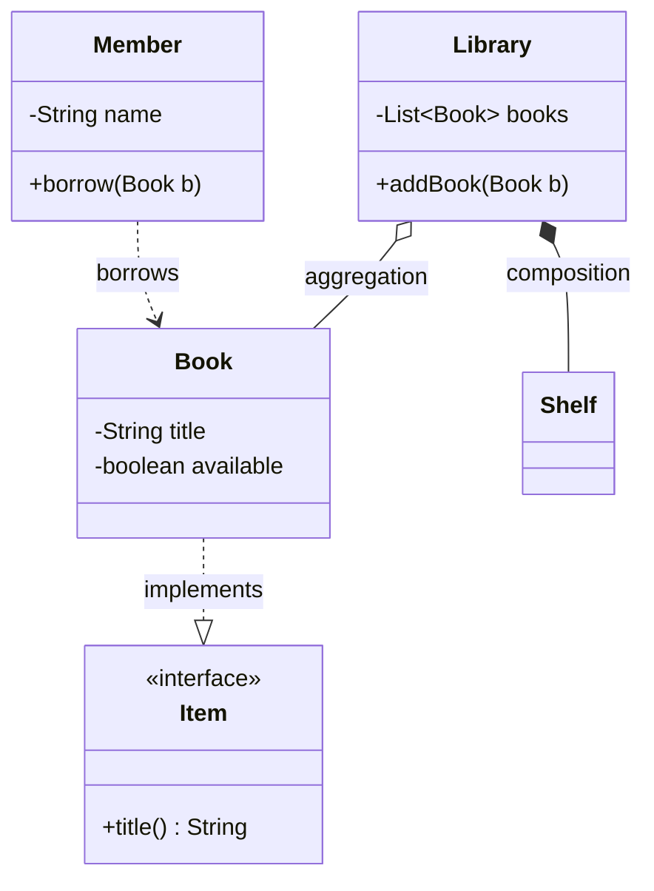

@part oop-design | Object-Oriented Programming · Part 3: Design Principles and Patterns | oop
## The SOLID principles

SOLID is five guidelines for classes that are **easy to change without breaking**. They are not laws; they are warnings about designs that become expensive. Each one below shows the smell first and then the fix.

### S: Single Responsibility Principle

*A class should have one reason to change.* A class that calculates an invoice, formats it as HTML and writes it to a database changes when tax rules change, when the layout changes and when the database changes: three reasons. Split it so each reason touches one class.

```java Srp.java
public class Srp {

    // Each class has one reason to change.
    record Invoice(String customer, long totalPaise) { }

    static class InvoiceCalculator {
        Invoice create(String customer, long netPaise) { return new Invoice(customer, netPaise + netPaise * 18 / 100); }   // tax rules
    }

    static class InvoicePrinter {
        String print(Invoice i) { return i.customer() + ": Rs " + i.totalPaise() / 100.0; }                             // layout
    }

    public static void main(String[] args) {
        Invoice invoice = new InvoiceCalculator().create("Asha", 10_000);
        System.out.println(new InvoicePrinter().print(invoice));   // Asha: Rs 118.0
    }
}
```

### O: Open/Closed Principle

*Software should be open for extension but closed for modification.* If every new discount type means editing a growing `if/else` chain, existing tested code keeps changing. Put the variation behind an interface, so a new case is a **new class**, and the old code never changes.

```java Ocp.java
import java.util.List;

public class Ocp {

    interface Discount { long apply(long paise); }

    static class NoDiscount implements Discount { public long apply(long p) { return p; } }
    static class Festival implements Discount { public long apply(long p) { return p * 80 / 100; } }
    static class Coupon implements Discount {
        private final long off;
        Coupon(long off) { this.off = off; }
        public long apply(long p) { return Math.max(0, p - off); }
    }

    // Never edited when a new Discount is added.
    static long checkout(long paise, List<Discount> discounts) {
        long total = paise;
        for (Discount d : discounts) total = d.apply(total);
        return total;
    }

    public static void main(String[] args) {
        System.out.println(checkout(10_000, List.of(new Festival(), new Coupon(500))));   // 7500
    }
}
```

### L: Liskov Substitution Principle

*Subtypes must be substitutable for their base types.* If code written for the parent breaks with a child, the hierarchy is wrong (`Square extends Rectangle`, or a `ReadOnlyList` whose `add` throws). Signs: overriding a method to throw `UnsupportedOperationException`, strengthening preconditions, weakening promised results. Fix: do not inherit; share an interface for what really is common, or use composition.

### I: Interface Segregation Principle

*Clients should not depend on methods they do not use.* A fat `Worker` interface with `work()`, `eat()` and `sleep()` forces a `Robot` to implement `eat()`. Split into small, role-specific interfaces (`Workable`, `Feedable`) so each class implements only what it can honestly do.

### D: Dependency Inversion Principle

*High-level modules should not depend on low-level modules; both should depend on abstractions.* The business logic (`OrderService`) must not construct a concrete `SmtpMailer`. It declares what it needs as an interface and **receives** the implementation (dependency injection), which makes it testable and replaceable.

```java Dip.java
public class Dip {

    interface Notifier { void send(String to, String message); }               // the abstraction

    static class EmailNotifier implements Notifier {
        public void send(String to, String message) { System.out.println("email to " + to + ": " + message); }
    }

    static class OrderService {
        private final Notifier notifier;                                      // depends on the abstraction
        OrderService(Notifier notifier) { this.notifier = notifier; }          // constructor injection
        void place(String customer) { notifier.send(customer, "order placed"); }
    }

    public static void main(String[] args) {
        new OrderService(new EmailNotifier()).place("asha@example.com");      // production wiring
        new OrderService((to, msg) -> System.out.println("test double got: " + msg)).place("x");   // a lambda in a test
    }
}
```

This is exactly what Spring does: it creates the objects and injects them (see Spring Boot Basics Part 1).

!cheat SOLID in a sentence each ::
- **S**ingle responsibility: one reason to change.
- **O**pen/closed: add behaviour by adding code, not by editing old code.
- **L**iskov substitution: a subtype must keep the parent's promises.
- **I**nterface segregation: many small interfaces beat one fat one.
- **D**ependency inversion: depend on abstractions and inject the implementations.
!end

!keypoints SRP: one reason to change; OCP: extend with new classes, do not edit old ones ;; LSP: subtypes keep the parent's promises ;; ISP: small, role-specific interfaces ;; DIP: depend on abstractions, inject implementations ;; Dependency injection makes code testable

?? Which SOLID principle does a long if/else chain on a type code usually violate?
=> The open/closed principle: adding a new type means editing the chain. Replacing it with polymorphism (an interface with one implementation per type) lets you add a type by adding a class.

?? What is dependency injection and which principle does it serve?
=> Passing an object its collaborators (through the constructor) instead of letting it create them. It serves dependency inversion: the class depends on an interface, and the concrete implementation is chosen elsewhere, which makes the class easy to test and to change.

## Coupling, cohesion and everyday principles

- **Cohesion:** how strongly the members of a class belong together. **High cohesion** is good: a `Cart` class that only deals with cart items. A `Utils` class with unrelated static methods has low cohesion.
- **Coupling:** how much one class depends on another. **Low coupling** is good: changes in one class do not ripple to others. Coupling through an **interface** is looser than through a concrete class; coupling through shared mutable state or a global is the tightest.

**Aim for high cohesion and low coupling.** Most design advice is a way of getting there.

| Principle | Meaning | Example |
|---|---|---|
| **DRY** (don't repeat yourself) | every piece of knowledge has one place | one validation method, not copies |
| **KISS** | keep it simple | prefer a plain loop to a clever one-liner nobody can read |
| **YAGNI** | you aren't gonna need it | do not build a plug-in system for a feature nobody asked for |
| **Law of Demeter** | talk only to your immediate friends | `order.getCustomer().getAddress().getCity()` couples the caller to three classes; ask `order.shippingCity()` |
| **Tell, don't ask** | tell an object what to do instead of pulling its data out to decide yourself | `account.withdraw(100)` not `if (account.getBalance() >= 100) account.setBalance(...)` |
| **Favour immutability** | objects that cannot change are easier to reason about | records, `final` fields |
| **Program to an interface** | declare `List`, not `ArrayList` | `List<String> names = new ArrayList<>();` |

!interview Interview angle: How do you recognise a class that does too much? :: It has many unrelated fields and methods; its name ends in "Manager", "Helper" or "Util"; changes for different reasons keep touching it; and its tests need a lot of setup. Split it along responsibilities so each new class is small, named for what it does, and has high cohesion.

!keypoints Aim for high cohesion and low coupling ;; DRY, KISS and YAGNI keep designs simple ;; Law of Demeter: do not chain through other objects' internals ;; Tell, don't ask: put behaviour where the data is ;; Program to interfaces, not implementations

?? What is the difference between coupling and cohesion?
=> Cohesion is how closely the members inside one class belong together (aim high). Coupling is how much classes depend on one another (aim low).

?? What does the Law of Demeter say and why does it matter?
=> A method should call only methods of itself, its parameters, objects it creates and its direct fields, not reach through other objects (`a.getB().getC().doIt()`). Reaching through couples the caller to the internals of several classes, so changes in any of them break it.

## Design patterns: creating and structuring objects

A **design pattern** is a named, reusable solution to a recurring design problem. They give teams a shared vocabulary ("use a Factory here") and are grouped into **creational** (how objects are made), **structural** (how objects are composed) and **behavioural** (how objects interact).

### Creational

**Singleton:** exactly one instance, with global access. In Java the safest form is an **enum**: serialisation-safe, reflection-safe, thread-safe by the JVM. Singletons are global state in disguise, which makes testing hard: prefer a single instance **managed by a container** (a Spring bean is a singleton by default) and injected.

**Factory method / static factory:** a method that decides which class to create, hiding the constructor: `List.of(...)`, `Optional.of(...)`, `Integer.valueOf(...)`. Benefits over `new`: a meaningful name, may return a cached or subtype instance.

**Builder:** build an object with many (optional) fields step by step, readable and safe against the "telescoping constructor":

```java PatternsCreational.java
public class PatternsCreational {

    enum Config {                                   // Singleton as an enum
        INSTANCE;
        String env = "prod";
    }

    static final class Pizza {
        private final String size; private final boolean cheese; private final boolean mushrooms;

        private Pizza(Builder b) { size = b.size; cheese = b.cheese; mushrooms = b.mushrooms; }

        static Builder builder(String size) { return new Builder(size); }   // static factory

        static final class Builder {
            private final String size; private boolean cheese; private boolean mushrooms;
            private Builder(String size) { this.size = size; }
            Builder cheese() { cheese = true; return this; }
            Builder mushrooms() { mushrooms = true; return this; }
            Pizza build() { return new Pizza(this); }
        }

        @Override public String toString() { return size + (cheese ? " +cheese" : "") + (mushrooms ? " +mushrooms" : ""); }
    }

    public static void main(String[] args) {
        System.out.println(Config.INSTANCE == Config.INSTANCE);        // true: always one instance
        System.out.println(Pizza.builder("large").cheese().mushrooms().build());   // large +cheese +mushrooms
    }
}
```

### Structural

**Adapter:** makes an incompatible interface fit the one the client expects (a plug adapter). **Decorator:** wraps an object to add behaviour while keeping the same interface, chainable (`new BufferedReader(new InputStreamReader(in))`). **Facade:** one simple interface in front of a complicated subsystem.

```java PatternsStructural.java
public class PatternsStructural {

    interface Coffee { double cost(); String describe(); }

    static class Espresso implements Coffee {
        public double cost() { return 2.0; }
        public String describe() { return "espresso"; }
    }

    static abstract class Extra implements Coffee {          // the decorator keeps the same interface
        protected final Coffee inner;
        Extra(Coffee inner) { this.inner = inner; }
    }

    static class Milk extends Extra {
        Milk(Coffee c) { super(c); }
        public double cost() { return inner.cost() + 0.5; }
        public String describe() { return inner.describe() + " + milk"; }
    }

    static class Sugar extends Extra {
        Sugar(Coffee c) { super(c); }
        public double cost() { return inner.cost() + 0.2; }
        public String describe() { return inner.describe() + " + sugar"; }
    }

    // Adapter: a legacy class with a different interface is made to look like Coffee.
    static class LegacyTea { int priceInCents() { return 150; } String label() { return "tea"; } }
    static class TeaAdapter implements Coffee {
        private final LegacyTea tea;
        TeaAdapter(LegacyTea tea) { this.tea = tea; }
        public double cost() { return tea.priceInCents() / 100.0; }
        public String describe() { return tea.label(); }
    }

    public static void main(String[] args) {
        Coffee order = new Sugar(new Milk(new Espresso()));
        System.out.println(order.describe() + " = " + order.cost());   // espresso + milk + sugar = 2.7
        Coffee tea = new TeaAdapter(new LegacyTea());
        System.out.println(tea.describe() + " = " + tea.cost());       // tea = 1.5
    }
}
```

!cheat Which pattern? ::
- Need exactly one shared instance → **Singleton** (enum, or a container-managed bean).
- Creation logic or a choice of subclass → **Factory method**.
- Many optional parameters → **Builder**.
- Existing class has the wrong interface → **Adapter**.
- Add behaviour dynamically, stackable → **Decorator** (Java I/O streams).
- Hide a complicated subsystem → **Facade**.
!end

!keypoints Patterns are named solutions that give a shared vocabulary ;; Enum singleton is the safest Java singleton; container-managed singletons are easier to test ;; Builder avoids telescoping constructors ;; Decorator adds behaviour by wrapping while keeping the interface; Adapter converts one interface to another ;; Facade simplifies a subsystem

?? What problem does the Builder pattern solve?
=> It builds objects with many parameters, several optional, without a long list of constructor overloads or a half-initialised mutable object. Each setter-like step names its value, and `build()` produces the finished (often immutable) object.

?? How does Decorator differ from inheritance for adding features?
=> A decorator adds behaviour at run time by wrapping an object, and decorators can be stacked in any combination. With inheritance the combinations are fixed at compile time and you need a class for each, causing a class explosion (MilkEspresso, SugarMilkEspresso, ...).

## Design patterns: behaviour, and UML

### Behavioural patterns

**Strategy:** put a family of interchangeable algorithms behind an interface and let the client pick one at run time (sorting with a `Comparator`). **Observer:** one subject notifies many subscribers when it changes (event listeners, `PropertyChangeListener`, message topics). **Template method:** a base class fixes the algorithm and subclasses fill in steps (seen in Part 2). **State:** an object changes behaviour when its state changes. **Command:** wrap a request as an object, so it can be queued, logged or undone. **Iterator:** traverse a collection without exposing its structure (`for-each`).

```java PatternsBehavioural.java
import java.util.ArrayList;
import java.util.Comparator;
import java.util.List;
import java.util.function.Consumer;

public class PatternsBehavioural {

    // Strategy: the algorithm is a parameter (Comparator is the Strategy interface).
    static List<String> sorted(List<String> words, Comparator<String> strategy) {
        List<String> copy = new ArrayList<>(words);
        copy.sort(strategy);
        return copy;
    }

    // Observer: a subject that notifies its subscribers.
    static class Stock {
        private final List<Consumer<Double>> observers = new ArrayList<>();
        void subscribe(Consumer<Double> observer) { observers.add(observer); }
        void setPrice(double price) { observers.forEach(o -> o.accept(price)); }
    }

    // State: behaviour depends on the current state object.
    interface TrafficLight { TrafficLight next(); String colour(); }
    static final TrafficLight RED = new TrafficLight() {
        public TrafficLight next() { return GREEN; } public String colour() { return "red"; }
    };
    static final TrafficLight GREEN = new TrafficLight() {
        public TrafficLight next() { return YELLOW; } public String colour() { return "green"; }
    };
    static final TrafficLight YELLOW = new TrafficLight() {
        public TrafficLight next() { return RED; } public String colour() { return "yellow"; }
    };

    public static void main(String[] args) {
        List<String> words = List.of("pear", "fig", "banana");
        System.out.println(sorted(words, Comparator.naturalOrder()));                 // [banana, fig, pear]
        System.out.println(sorted(words, Comparator.comparingInt(String::length)));   // [fig, pear, banana]

        Stock s = new Stock();
        s.subscribe(p -> System.out.println("display shows " + p));
        s.subscribe(p -> { if (p > 100) System.out.println("alert: price above 100"); });
        s.setPrice(120.5);

        TrafficLight light = RED;
        for (int i = 0; i < 4; i++) { System.out.print(light.colour() + " "); light = light.next(); }   // red green yellow red
        System.out.println();
    }
}
```

### UML class diagrams

The **Unified Modeling Language** gives a standard way to draw designs. In a class diagram each box lists the class name, fields and methods (`+` public, `-` private, `#` protected). The relationships, from weakest to strongest coupling:

| Relationship | Meaning | Lifetime | Java sign |
|---|---|---|---|
| **Dependency** | uses another class temporarily (a parameter or local variable) | momentary | `void print(Report r)` |
| **Association** | knows another class (a field) | independent | `Teacher` has a `Student` |
| **Aggregation** | has-a whole/part where the part **can exist without** the whole | independent | `Team` has `Player`s; players outlive the team |
| **Composition** | has-a where the part **cannot exist without** the whole, and is destroyed with it | tied | `House` has `Room`s |
| **Generalisation (inheritance)** | is-a | | `Dog extends Animal` |
| **Realisation** | implements an interface | | `ArrayList implements List` |



!interview Interview angle: Strategy versus State? :: Both use composition and an interface with interchangeable implementations. With **Strategy** the client chooses the algorithm and it usually stays the same; the algorithms are independent of each other. With **State** the object itself changes its state object as it runs, and the states know about each other (each decides the next state), like a traffic light or an order moving from placed to shipped.

!keypoints Strategy: interchangeable algorithms behind an interface ;; Observer: a subject notifies subscribers of changes ;; State: behaviour changes with an internal state object ;; Command wraps a request as an object (queue, undo); Iterator hides how a collection is traversed ;; UML: dependency, association, aggregation, composition, generalisation, realisation ;; Composition means the part cannot outlive the whole

?? What is the difference between aggregation and composition?
=> Both are has-a relationships. In aggregation the part can exist independently of the whole (players can exist without a team). In composition the part's life is tied to the whole and it is destroyed with it (rooms of a house).

?? Which pattern would you use for undo/redo in a text editor, and why?
=> The Command pattern: each edit is an object with `execute()` and `undo()`, so edits can be stored on a stack, undone and redone.
