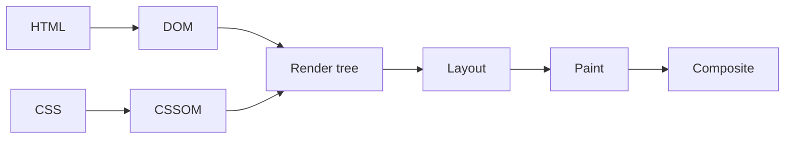
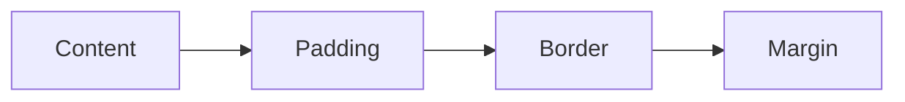

@part frontend-html-css | Frontend Part 1: HTML, CSS and Accessibility | frontend
## Semantic HTML

As a full stack developer, you don't need to be a designer, but you do need to build screens that work for everybody, and to fix layouts without guessing. HTML comes first, because it gives a page its meaning.

### Why the tag you choose matters

A `<div>` means nothing. A `<button>` comes with keyboard focus, Enter and Space handling, and a role that screen readers announce. If you build a button from a `<div>`, you must rebuild all of that by hand, and you probably won't.

```html The wrong way and the right way
<!-- Looks like a button, but can't be reached by keyboard, and isn't announced -->
<div class="btn" onclick="save()">Save</div>

<!-- All of that comes for free -->
<button type="button" onclick="save()">Save</button>
```

### A page's structure

```html Landmarks help assistive technology, and readers of your code
<body>
  <header>
    <nav aria-label="Main">
      <a href="/">Home</a>
      <a href="/orders">Orders</a>
    </nav>
  </header>

  <main>
    <h1>Your orders</h1>
    <section aria-labelledby="recent">
      <h2 id="recent">Recent</h2>
      <article>
        <h3>Order 9001</h3>
        <p>Delivered on <time datetime="2026-10-31">31 October</time>.</p>
      </article>
    </section>
  </main>

  <footer>Help and contact</footer>
</body>
```

| Element | Use |
|---|---|
| `h1` to `h6` | An outline of the page; don't skip levels for size, as CSS handles size |
| `a` | Goes somewhere: it has a URL |
| `button` | Does something on this page |
| `ul`, `ol` | Lists, including navigation |
| `table` | Tabular data, not page layout |
| `label` | Names a form control |
| `img` with `alt` | Describes an image; `alt=""` for decoration |

!tip Link or button? :: If it changes the URL, and could be opened in a new tab, use `<a>`. If it performs an action, use `<button>`. An `<a onClick>` with no `href` is a common bug.

### Forms

```html A form that works without any JavaScript
<form action="/signup" method="post">
  <label for="email">Email</label>
  <input id="email" name="email" type="email" required autocomplete="email">

  <label for="age">Age</label>
  <input id="age" name="age" type="number" min="18" max="120">

  <fieldset>
    <legend>Plan</legend>
    <label><input type="radio" name="plan" value="free" checked> Free</label>
    <label><input type="radio" name="plan" value="pro"> Pro</label>
  </fieldset>

  <button type="submit">Sign up</button>
</form>
```

- A label with `for` makes the label clickable, and gives the input a name for screen readers. A placeholder isn't a label: it vanishes as soon as someone types.
- `type="email"` brings up the right keyboard on phones, and basic validation.
- `autocomplete` helps users and password managers.
- A `<button>` inside a form submits it by default. Use `type="button"` for anything else, because this surprises many developers.

!warning Client validation isn't security :: Anybody can bypass it with curl. It exists for quick feedback. Your Spring Boot API must validate everything again.

### What the browser does with HTML

The browser parses HTML into the **DOM**, a tree of objects, and CSS into the CSSOM. These become a render tree, followed by layout (where everything goes), paint (the pixels) and compositing (combining layers). A `<script>` without `defer` blocks parsing, which is why modern pages use `<script type="module">` or `defer`.



!keypoints Choose elements for meaning ;; Buttons act, links navigate ;; Every input needs a label ;; Validate again on the server

?? Why is a clickable div worse than a button?
=> It has no keyboard focus, no Enter or Space handling and no role for screen readers. A button provides them all.
?? A button in a form reloads the page when clicked. Why?
=> Its default type is submit. Use `type="button"`, or handle the submit event.
?? Why isn't a placeholder a substitute for a label?
=> It disappears on input, often has low contrast, and isn't reliably announced.

## The CSS cascade, specificity and the box model

Most CSS frustration comes from not knowing which rule wins, and how sizes are calculated.

### Which rule wins?

The browser decides in this order: importance, then specificity, then source order.

| Selector | Specificity (ids, classes, elements) |
|---|---|
| `p` | 0, 0, 1 |
| `.note` | 0, 1, 0 |
| `p.note` | 0, 1, 1 |
| `#main` | 1, 0, 0 |
| `#main .note p` | 1, 1, 1 |
| Inline `style=""` | Beats all of these |
| `!important` | Beats normal rules; avoid it |

```css Which colour is the text?
p { color: black; }
.note { color: blue; }
p.note { color: green; }   /* wins: more specific than .note */
```

Keep specificity low and even, with classes rather than ids. If you find yourself adding `!important`, a specificity battle has begun.

### Inheritance

Some properties, such as `color` and `font-family`, pass down to children. Others, like `margin` and `border`, don't. That's why setting a font on `body` works for the whole page.

### The box model

Every element is a box: content, padding, border and margin.



```css Width calculation
.card { width: 300px; padding: 20px; border: 1px solid; }
/* Default content-box: total width = 300 + 40 + 2 = 342px */

*, *::before, *::after { box-sizing: border-box; }
/* border-box: total width = 300px, and content shrinks to 258px */
```

Almost every project sets `border-box` globally, because it matches how people think about sizes.

**Margin collapse:** vertical margins between adjacent blocks merge into the larger of the two, rather than adding up. It's a common source of "why is this gap wrong?" Flex and grid children don't collapse, and many teams use `gap` instead.

### Units

| Unit | Relative to | Use |
|---|---|---|
| `px` | Fixed | Borders, small details |
| `rem` | Root font size | Font sizes, spacing; respects user settings |
| `em` | Parent font size | Component-relative spacing |
| `%` | Parent's size | Widths |
| `vw`, `vh` | Viewport | Full-screen sections |
| `dvh` | Dynamic viewport | Full height on mobile, where toolbars move |
| `ch` | Character width | Readable line lengths |

Font sizes in `rem` let users' browser settings scale your page, which helps accessibility.

### Display and position

| `position` | Behaviour |
|---|---|
| `static` | Default flow |
| `relative` | Offsets from its normal place; anchors absolute children |
| `absolute` | Removed from flow; placed against the nearest positioned ancestor |
| `fixed` | Placed against the viewport |
| `sticky` | Normal until it reaches a scroll threshold, then sticks |

`z-index` only works within a **stacking context**, which is why `z-index: 9999` can still lose. A parent with a transform or its own z-index creates a new context that contains its children.

!interview Interview answer :: **"z-index isn't working."** It needs a positioned element, and it only compares within a stacking context. A parent with `transform`, `opacity` below 1 or its own `z-index` traps its children in that context.

!keypoints Importance, specificity, then order ;; Keep specificity low ;; Use border-box everywhere ;; z-index works within a stacking context

?? A div has width 200px, padding 10px and border 2px with content-box. How wide is it in total?
=> 200 + 20 + 4 = 224px.
?? Two blocks with margins of 30px and 20px sit one above the other. What's the gap?
=> 30px. Vertical margins collapse to the larger value.
?? Why use rem for font sizes?
=> It respects the user's browser font setting, whereas px ignores it.

## Layout with Flexbox and Grid

### Flexbox: one direction

```css Common Flexbox patterns
/* A header: logo on the left, actions on the right */
.header { display: flex; justify-content: space-between; align-items: center; gap: 1rem; }

/* Cards that wrap onto new lines */
.tags { display: flex; flex-wrap: wrap; gap: .5rem; }

/* Sidebar fixed; main content fills the rest */
.layout { display: flex; }
.sidebar { flex: 0 0 240px; }
.content { flex: 1; min-width: 0; }
```

| Property | Direction | Meaning |
|---|---|---|
| `justify-content` | Main axis | Distribute along the row |
| `align-items` | Cross axis | Align across the row |
| `flex: 1` | Item | Grow to fill the space |
| `gap` | Container | Space between items |

!warning The min-width trap :: A flex item won't shrink below its content's minimum size by default. A long code line or table inside `.content` then overflows the page. `min-width: 0` on the item fixes it, and it's one of the most useful lines to know.

### Grid: two directions

```css Common Grid patterns
/* Header, sidebar, content and footer */
.page {
  display: grid;
  grid-template-columns: 240px 1fr;
  grid-template-rows: auto 1fr auto;
  min-height: 100dvh;
}
.page > header, .page > footer { grid-column: 1 / -1; }

/* Responsive cards, with no media queries */
.cards {
  display: grid;
  grid-template-columns: repeat(auto-fill, minmax(260px, 1fr));
  gap: 1rem;
}
```

The second pattern fits as many 260px columns as possible, and stretches them to fill the row. It replaces many media queries.

| Choose | When |
|---|---|
| Flexbox | Items in a line: toolbars, nav bars, small rows |
| Grid | Rows and columns matter: page layouts, galleries |

### Responsive design

```css Mobile first
.layout { display: grid; grid-template-columns: 1fr; }

@media (min-width: 768px) {
  .layout { grid-template-columns: 240px 1fr; }
}
```

Start with the small screen, and add rules as space grows. This needs `<meta name="viewport" content="width=device-width, initial-scale=1">` in the head, without which phones render a shrunk desktop page. Container queries let a component respond to its own container rather than to the screen, which suits reusable components.

### Modern CSS features worth knowing

| Feature | Use |
|---|---|
| CSS variables `--color-accent` | Themes, dark mode |
| `clamp(1rem, 2vw, 2rem)` | Fluid sizes with limits |
| `:has()` | Style a parent based on its children |
| `aspect-ratio` | Keep video and image shapes, avoid layout shifts |
| Nesting | Group related rules natively |

### Tailwind and CSS approaches

| Approach | Good | Watch out |
|---|---|---|
| Plain CSS or modules | No tooling lock-in; full control | Naming and organisation |
| Tailwind utility classes | Fast, consistent, small CSS output | Long class lists; learning names |
| CSS-in-JS | Dynamic styles | Runtime cost in some libraries |
| Component libraries | Fast start, accessible widgets | Harder to customise |

This site uses Tailwind. Whatever you choose, you still need the CSS underneath to debug: use the browser's Elements panel, where you can see which rules apply and which are crossed out.

!keypoints Flex for a line, grid for rows and columns ;; min-width 0 fixes overflowing flex items ;; Design mobile first ;; Learn CSS beneath any framework

?? A long code block makes a flex layout overflow. What's the fix?
=> Add `min-width: 0` to the flex item, so that it can shrink, and let the code scroll.
?? How do you make a responsive card grid without media queries?
=> `grid-template-columns: repeat(auto-fill, minmax(260px, 1fr))`.
?? Why does a page look tiny on a phone even with media queries?
=> The viewport meta tag is probably missing.

## Accessibility

Accessibility means that people using keyboards, screen readers or magnification can use your product. It's also a legal requirement in many places, and it improves things for everybody. Interviewers increasingly ask about it, and few candidates can answer.

### The rules that catch most problems

| Rule | Check |
|---|---|
| Keyboard works | Unplug the mouse: can you Tab to everything, and use it? |
| Visible focus | Can you see where focus is? Never remove `outline` without a replacement |
| Real elements | `button`, `a`, `label`, and proper headings |
| Text alternatives | `alt` on images, names on icon buttons |
| Contrast | Body text needs at least 4.5:1 under WCAG AA |
| Colour isn't the only signal | Add text or icons to red error states |
| Errors are announced | Link errors to their fields |

### ARIA: only when HTML can't do it

The first rule of ARIA is that if a native element exists, use it. ARIA only changes what's announced, and adds no behaviour.

```jsx An icon button needs a name
<button aria-label="Close dialog" onClick={onClose}>
  <XIcon aria-hidden="true" />
</button>
```

```jsx A form error linked to its field
<label htmlFor="email">Email</label>
<input
  id="email"
  aria-invalid={Boolean(error)}
  aria-describedby={error ? 'email-error' : undefined}
/>
{error && <p id="email-error" role="alert">{error}</p>}
```

### Dialogs

A modal is harder than it looks: focus must move in, Tab must stay inside, Escape must close it, and focus must return to where it came from. The native `<dialog>` element with `showModal()` handles much of this. In React, a tested component library is usually better than writing your own.

### Single-page apps

When a React app changes route, no page load happens, so screen readers hear nothing. Move focus to the new page's heading, and update `document.title`. Announce dynamic changes such as "Saved" through an `aria-live` region.

### Testing

| Tool | Finds |
|---|---|
| Keyboard only | Focus order and traps |
| Lighthouse or axe | Missing names, contrast, roles |
| Screen reader (NVDA on Windows, VoiceOver on Mac) | What's really announced |
| Testing Library's `getByRole` | Encourages accessible markup in tests |

Automated tools catch only some of the issues, so do a manual keyboard pass as well.

!interview Interview answer :: **"How do you make a custom dropdown accessible?"** First ask whether a native `select` will do. If not, use a tested library, since keyboard navigation, focus and ARIA roles are all needed, and it's easy to get wrong.

!keypoints Native elements first ;; Everything works by keyboard ;; ARIA adds meaning, not behaviour ;; Test with a keyboard, then tools

?? Does adding role="button" to a div make it a working button?
=> No. It's announced as a button, but you must also add focus and keyboard handling. Use a real button.
?? How do you name an icon-only button?
=> Use `aria-label`, or visually hidden text, and hide the icon from assistive technology.
?? What must a modal do with keyboard focus?
=> Move focus inside, keep Tab within it, close on Escape, and return focus when closed.
