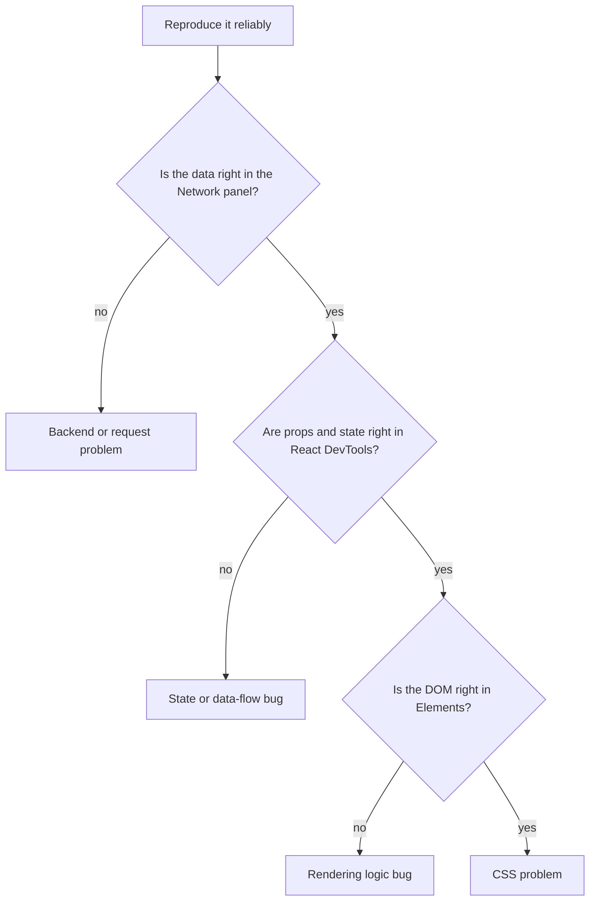

@more
## Worked example: a responsive dashboard page

Reading about layout only goes so far. Here's a complete page you can type out: a header, a sidebar that collapses on phones, a row of stat cards and a table that doesn't break the page.

```html The structure
<div class="app">
  <header class="topbar">
    <button class="menu" type="button" aria-label="Open menu">☰</button>
    <h1>Orders</h1>
  </header>

  <nav class="sidebar" aria-label="Main">
    <a href="/orders" aria-current="page">Orders</a>
    <a href="/customers">Customers</a>
  </nav>

  <main class="content">
    <section class="stats" aria-label="Summary">
      <article class="stat"><h2>Today</h2><p>42</p></article>
      <article class="stat"><h2>Pending</h2><p>7</p></article>
      <article class="stat"><h2>Revenue</h2><p>₹1,25,000</p></article>
    </section>

    <div class="table-wrap">
      <table>
        <thead><tr><th>Order</th><th>Customer</th><th>Total</th></tr></thead>
        <tbody><tr><td>9001</td><td>Asha</td><td>₹500</td></tr></tbody>
      </table>
    </div>
  </main>
</div>
```

```css The layout: one column on phones, two from 768px
*, *::before, *::after { box-sizing: border-box; }
body { margin: 0; font-family: system-ui, sans-serif; }

.app {
  display: grid;
  grid-template-columns: 1fr;
  grid-template-areas:
    "top"
    "main";
  min-height: 100dvh;
}
.topbar  { grid-area: top; display: flex; align-items: center; gap: 1rem; padding: .75rem 1rem; }
.content { grid-area: main; min-width: 0; padding: 1rem; }
.sidebar { display: none; }

@media (min-width: 768px) {
  .app {
    grid-template-columns: 240px 1fr;
    grid-template-areas:
      "top  top"
      "side main";
  }
  .sidebar { display: block; grid-area: side; padding: 1rem; }
  .menu { display: none; }
}

.stats {
  display: grid;
  grid-template-columns: repeat(auto-fit, minmax(160px, 1fr));
  gap: 1rem;
  margin-bottom: 1rem;
}
.stat { padding: 1rem; border: 1px solid #ddd; border-radius: .5rem; }
.stat h2 { margin: 0; font-size: .875rem; font-weight: 500; }
.stat p  { margin: .25rem 0 0; font-size: 1.5rem; font-weight: 700; }

.table-wrap { overflow-x: auto; }        /* the table scrolls, not the page */
table { width: 100%; border-collapse: collapse; }
th, td { padding: .5rem .75rem; text-align: left; border-bottom: 1px solid #ddd; white-space: nowrap; }
```

### What each decision does

| Line | Why it's there |
|---|---|
| `grid-template-areas` | The layout reads like a picture, and is easy to change at a breakpoint |
| `min-width: 0` on `.content` | Lets wide children scroll instead of stretching the grid |
| `auto-fit, minmax(160px, 1fr)` | Stat cards wrap without a media query |
| `.table-wrap` scrolling | Wide tables are the most common cause of sideways page scroll on phones |
| `100dvh` | Fills the screen even as mobile browser toolbars move |
| `aria-current="page"` | Tells screen readers, and gives you a CSS hook, for the active link |

### Theming with CSS variables

```css Light and dark from one set of names
:root {
  --bg: #ffffff;
  --text: #1f2937;
  --border: #e5e7eb;
  --accent: #4f46e5;
}
@media (prefers-color-scheme: dark) {
  :root:not([data-theme="light"]) {
    --bg: #111827;
    --text: #f3f4f6;
    --border: #374151;
    --accent: #818cf8;
  }
}
:root[data-theme="dark"] {
  --bg: #111827;
  --text: #f3f4f6;
  --border: #374151;
  --accent: #818cf8;
}
body { background: var(--bg); color: var(--text); }
```

```js Setting the theme before first paint, to avoid a flash
try {
  document.documentElement.dataset.theme = localStorage.getItem('theme') ?? '';
} catch {
  // storage blocked: the system preference still applies
}
```

Put that script inline in `<head>`, since a bundled script runs too late and the page flashes the wrong colours. This site does exactly this.

### Motion, carefully

Animate `transform` and `opacity`, which the browser can usually composite without layout or paint. Animating `width`, `height` or `top` forces layout, and can stutter.

```css Respect people who get motion sickness
.drawer { transition: transform .2s ease; }

@media (prefers-reduced-motion: reduce) {
  .drawer { transition: none; }
}
```

!keypoints Name grid areas for readable layouts ;; Wrap tables so that they scroll alone ;; CSS variables make theming simple ;; Animate transform and opacity

?? A wide table makes the whole page scroll sideways on phones. What's the fix?
=> Wrap it in a container with `overflow-x: auto`, and ensure its grid or flex parent has `min-width: 0`.
?? Why set the theme with an inline head script?
=> It runs before first paint, so the page doesn't flash the wrong theme.
?? Why animate transform rather than left?
=> Transform can be composited without layout, so it stays smooth.

## Debugging in the browser

Most developers use only a fraction of DevTools. A few features save hours.

### Elements panel

| Task | How |
|---|---|
| Why is this colour wrong? | Styles pane: crossed-out rules lost the cascade |
| What size is it, really? | Computed pane shows the box model |
| Why does it overflow? | Add `outline: 1px solid red` to `*` for a moment |
| Test a hover or focus state | Force state with `:hov` |
| Grid and flex layouts | Click the `grid` or `flex` badge for an overlay |
| What's stacked on top? | The Layers panel, or check for a stacking context |

### Console

```js Useful console tools
console.table(orders);                   // arrays of objects as a table
console.time('filter'); run(); console.timeEnd('filter');
$0;                                      // the element selected in the Elements panel
$$('button').length;                     // all matching elements
copy(orders);                            // copies a value to the clipboard
```

### Sources: real breakpoints

Stop adding `console.log` everywhere. Add `debugger;` or click a line number. Conditional breakpoints stop only when, say, `id === 42`. Logpoints print without changing code. **Pause on exceptions** stops exactly where an error is thrown. Source maps show your original TypeScript.

### Network panel

| Check | Tells you |
|---|---|
| Status and response body | What the server really said |
| Request headers | Was the token or cookie sent? |
| Timing tab | Waiting (server) or downloading (size)? |
| Throttling | How it feels on a slow connection |
| Copy as cURL | Reproduce it in a terminal, or send to a backend developer |
| Preflight OPTIONS | Whether CORS failed there |

A red CORS error usually hides the response from JavaScript, but the Network panel can still show its status. Check the backend logs as well.

### Application panel

Inspect cookies with their flags, localStorage, sessionStorage, service workers and cache. Clearing site data here is the quickest way to rule out stale state.

### React DevTools

The Components tab shows props, state and hooks for any component, and you can edit them live. Its "why did this render?" option in the Profiler explains renders. Search by name to find what's on screen.

### A debugging routine



This narrows any bug into one of four layers, in minutes. It's also a good answer to "how do you debug?"

### Errors in production

Minified stack traces are useless without source maps. Upload maps to an error tracker such as Sentry, rather than serving them publicly. Log the release version with every error, so that you know which deployment introduced it.

!keypoints Read crossed-out rules ;; Use breakpoints, not only logs ;; Check the Network panel first ;; Narrow bugs layer by layer

?? How do you check that a request really sent the auth token?
=> Open the request in the Network panel, and read its headers.
?? The API returns the right data, but the screen is wrong. Where do you look next?
=> React DevTools, to check props and state. If they're right, inspect the DOM, then CSS.
?? Why use a conditional breakpoint?
=> To stop only on the case you care about, such as one ID in a long list.
