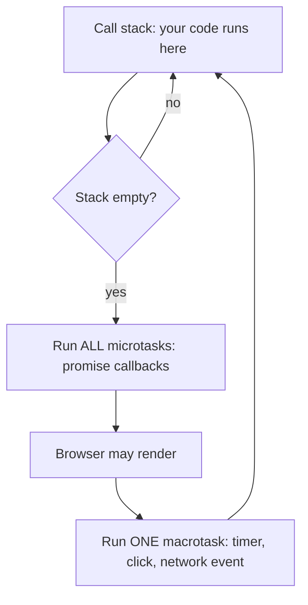

@part frontend-javascript | Frontend Part 2: JavaScript for Java Developers | frontend
## JavaScript through Java eyes

JavaScript looks like Java, which is misleading. The syntax is familiar, while the model is very different.

| Topic | Java | JavaScript |
|---|---|---|
| Types | Static, checked at compile time | Dynamic, checked at run time |
| Numbers | int, long, double, BigDecimal | One `number` type (64-bit float), plus `BigInt` |
| Objects | Instances of classes | Flexible key-value maps with a prototype |
| Functions | Methods in classes | First-class values |
| Concurrency | Threads, shared memory | One main thread, an event loop |
| Null | `null` | `null` and `undefined` |
| Equality | `==` and `.equals` | `===`, and a confusing `==` |
| Execution | Bytecode on a JVM | JIT-compiled in the browser or Node |

### Variables and scope

```javascript let, const and var
const limit = 10;      // can't be reassigned; the common default
let count = 0;         // can be reassigned
var old = 1;           // function-scoped, avoid it

const user = { name: 'Asha' };
user.name = 'Ravi';    // allowed: const fixes the binding, not the object
```

`var` ignores block scope, which creates surprising bugs. Use `const` by default, and `let` when you must reassign.

### Types and their traps

| Expression | Result | Why |
|---|---|---|
| `typeof null` | `'object'` | A historic bug |
| `typeof []` | `'object'` | Use `Array.isArray` |
| `0.1 + 0.2 === 0.3` | `false` | Floating point, as with Java's double |
| `'5' + 1` | `'51'` | `+` prefers strings |
| `'5' - 1` | `4` | `-` converts to numbers |
| `null == undefined` | `true` | A special case of `==` |
| `null === undefined` | `false` | Different types |
| `NaN === NaN` | `false` | Use `Number.isNaN` |
| `[] == false` | `true` | Coercion; never rely on it |

**Always use `===`.** Falsy values are `false`, `0`, `''`, `null`, `undefined` and `NaN`; everything else is truthy, including `[]`, `{}` and `'0'`.

```javascript Nullish coalescing is often what you meant
const a = 0 || 10;     // 10: || treats 0 as missing
const b = 0 ?? 10;     // 0: ?? only replaces null and undefined

const city = user?.address?.city;   // undefined, rather than an error
```

!warning Numbers lose precision :: Above `Number.MAX_SAFE_INTEGER`, about 9 quadrillion, integers stop being exact. A Java `long` ID sent as a JSON number can silently change in the browser. Send big IDs as strings. For money, use integer paise or a library, never floats.

### Objects and arrays, the modern way

```javascript Destructuring and spread
const { name, age = 18 } = user;           // pull out fields, with a default
const [first, ...rest] = [1, 2, 3];        // first = 1, rest = [2, 3]

const copy = { ...user, city: 'Pune' };    // new object with one change
const more = [...rest, 4];                 // new array
```

Spread makes **shallow** copies, so nested objects are still shared. React relies heavily on these patterns, as you'll see, because it detects change by comparing references.

```javascript Array methods replace most loops
const orders = [
  { id: 1, total: 500, paid: true },
  { id: 2, total: 200, paid: false },
  { id: 3, total: 300, paid: true },
];

const paid = orders.filter((o) => o.paid);                  // the Stream filter
const totals = paid.map((o) => o.total);                    // the Stream map
const sum = totals.reduce((acc, t) => acc + t, 0);          // 800
const found = orders.find((o) => o.id === 2);               // first match
const anyLarge = orders.some((o) => o.total > 400);         // true
const sorted = orders.toSorted((a, b) => b.total - a.total); // new sorted array
```

`sort()` changes the array in place, and sorts as strings by default: `[10, 9, 1].sort()` gives `[1, 10, 9]`. Pass a comparison function, and use `toSorted` to avoid mutation.

### Maps and sets

Use `Map` when keys aren't strings or are added dynamically, and `Set` for uniqueness. Note that they compare objects by reference, without any `equals` and `hashCode` to override.

!keypoints const by default, === always ;; Know the falsy values ;; Send long IDs as strings ;; Spread copies are shallow

?? What does ['a', 'b'].length + '1' give?
=> The string '21'. `+` with a string concatenates.
?? Why might an order ID from your Java API change in the browser?
=> A `long` above about 9 quadrillion can't be represented exactly in a JavaScript number. Send it as a string.
?? What does 0 ?? 5 give, and what does 0 || 5 give?
=> 0 and 5. `??` only replaces null and undefined, whereas `||` replaces anything falsy.

## Functions, closures and this

### Functions are values

```javascript Three ways to write a function
function add(a, b) { return a + b; }           // declaration: hoisted
const sub = function (a, b) { return a - b; }; // expression
const mul = (a, b) => a * b;                   // arrow
```

Passing functions around is everyday JavaScript, like Java lambdas but without the need for functional interfaces.

### Closures

A function remembers the variables from where it was created, even after that outer function has returned.

```javascript A counter with private state
function makeCounter() {
  let count = 0;                    // lives on, captured by the inner function
  return () => {
    count += 1;
    return count;
  };
}

const next = makeCounter();
next();   // 1
next();   // 2
```

Unlike Java lambdas, closures can capture and change non-final variables. Closures power React hooks, and stale closures are among React's most common bugs. The classic interview question:

```javascript var versus let in a loop
for (var i = 0; i < 3; i++) {
  setTimeout(() => console.log(i));   // prints 3, 3, 3: one shared i
}

for (let j = 0; j < 3; j++) {
  setTimeout(() => console.log(j));   // prints 0, 1, 2: a new j each iteration
}
```

### this

`this` depends on **how a function is called**, not where it's written, unlike Java.

| Call style | `this` is |
|---|---|
| `obj.method()` | `obj` |
| `const f = obj.method; f()` | `undefined` in strict mode |
| `new Thing()` | The new object |
| `f.call(x)` | `x` |
| Arrow function | Whatever `this` was where it was defined |

```javascript Losing this
const account = {
  balance: 100,
  show() { return this.balance; },
};

account.show();                 // 100
const show = account.show;
show();                         // TypeError in strict mode: this is undefined

setTimeout(account.show);       // loses this too
setTimeout(() => account.show());   // keeps it
```

Function components in React avoid `this` entirely, which is one reason people moved away from classes.

### Prototypes and classes

JavaScript's `class` is syntax over prototypes. An object has a link to another object, and property lookups walk this chain. Classes exist, with `extends`, `super` and `#private` fields, but you'll write far fewer than in Java, as plain objects and functions do most of the work.

```javascript A class
class Account {
  #balance = 0;                       // truly private
  deposit(amount) { this.#balance += amount; return this; }
  get balance() { return this.#balance; }
}
```

### Modules

```javascript ES modules
// money.js
export function formatInr(paise) {
  return new Intl.NumberFormat('en-IN', { style: 'currency', currency: 'INR' }).format(paise / 100);
}
export default class Cart {}

// app.js
import Cart, { formatInr } from './money.js';
const Lazy = await import('./heavy.js');   // loaded only when needed
```

Imports are like Java's, but each file is a module with private scope. Dynamic `import()` allows code splitting, as Part 9 shows.

!keypoints Closures capture variables by reference ;; this depends on the call ;; Arrow functions keep the outer this ;; Classes sit on top of prototypes

?? Why does a loop with var print 3, 3, 3?
=> There's one shared `i`, and the callbacks run after the loop ends. `let` creates a new binding per iteration.
?? Why does passing obj.method as a callback lose this?
=> `this` is set by the call. Called bare, it has no object. Wrap it in an arrow function, or bind it.
?? How does a JavaScript closure differ from a Java lambda?
=> It can capture and modify ordinary variables, whereas Java requires effectively final ones.

## The event loop and asynchronous code

JavaScript runs your code on **one thread**. There's no synchronized, no thread pool to tune, and no shared-memory races in normal code. Instead, long waits are handed off, and callbacks run later.



### Predict the order

```javascript A classic interview question
console.log('1');
setTimeout(() => console.log('2'), 0);
Promise.resolve().then(() => console.log('3'));
console.log('4');
// prints 1, 4, 3, 2
```

Synchronous code runs first. Then all microtasks, including promise callbacks, and then the next macrotask, such as a timer. A `setTimeout` of 0 means "as soon as possible after this", not "now".

!warning Blocking the main thread :: A long loop freezes clicks, scrolling and rendering, as the page uses that same thread. Break up heavy work, or move it to a **Web Worker**, which is a separate thread that communicates through messages.

### Promises

A promise represents a value that will arrive later, a bit like Java's `CompletableFuture`.

```javascript async and await
async function loadOrder(id) {
  const res = await fetch(`/api/orders/${id}`);
  if (!res.ok) {
    throw new Error(`HTTP ${res.status}`);      // fetch doesn't throw on 404 or 500
  }
  return res.json();
}

try {
  const order = await loadOrder(42);
} catch (e) {
  showError(e.message);
}
```

!warning fetch and errors :: `fetch` rejects only on network failure. A 404 or 500 still resolves, so always check `res.ok`. Forgetting this is among the most common frontend bugs.

### Running things together

| Method | Behaviour |
|---|---|
| `await a; await b;` | One after the other |
| `Promise.all([a, b])` | Together; fails if any fail |
| `Promise.allSettled([a, b])` | Together; reports each result |
| `Promise.race([a, b])` | First to settle wins |
| `Promise.any([a, b])` | First to succeed wins |

```javascript Sequential or parallel
// Slow: the second waits for the first, for no reason
const user = await getUser();
const orders = await getOrders();

// Faster: both start at once
const [user2, orders2] = await Promise.all([getUser(), getOrders()]);
```

### Timeouts and cancellation

```javascript Cancel a request that takes too long
const res = await fetch('/api/report', { signal: AbortSignal.timeout(5000) });

// Cancel by hand, such as when a component unmounts
const controller = new AbortController();
fetch('/api/search?q=java', { signal: controller.signal });
controller.abort();
```

### A race condition, even with one thread

One thread doesn't remove races between async operations. A user types "ja", then "java". If the first search responds last, its old results overwrite the new ones. Solve this by aborting the previous request, or by ignoring responses that aren't the latest. You'll see this again with `useEffect`.

### Events in the DOM

Events **bubble** up from the element clicked to its ancestors, so one listener on a parent can handle many children (event delegation). `event.preventDefault()` stops default behaviour, and `event.stopPropagation()` stops bubbling.

!interview Interview answer :: **"How does JavaScript handle concurrency with one thread?"** Your code runs on one thread, while the browser performs I/O and timers elsewhere. Completed work queues callbacks. The event loop runs them when the stack is empty, with microtasks before the next macrotask. Long-running code blocks everything.

!keypoints One thread and an event loop ;; Microtasks run before the next macrotask ;; Always check res.ok ;; Async races exist: abort stale requests

?? In what order do a setTimeout(0) and a resolved promise's then callback run?
=> The promise callback first: microtasks run before the next macrotask.
?? A fetch to a missing URL returns 404. Does the catch block run?
=> No. fetch only rejects on network failure. Check `res.ok`.
?? Search results sometimes show an older query's results. Why?
=> Responses can arrive out of order. Abort earlier requests, or ignore all but the latest.

## The browser, storage and security

### Browser storage

| Storage | Size | Sent to server | Lifetime | Use |
|---|---|---|---|---|
| Cookie | ~4 KB | Yes, automatically | Set by expiry | Sessions |
| localStorage | ~5 MB | No | Until cleared | Preferences |
| sessionStorage | ~5 MB | No | Until tab closes | Per-tab drafts |
| IndexedDB | Large | No | Until cleared | Offline data |

This site's progress and theme use localStorage. Any script on the page can read it, which leads to security.

### XSS

**Cross-site scripting** means an attacker's script runs in your page, and can then do anything the user can.

```jsx React escapes by default
<p>{comment}</p>                                   {/* safe: shown as text */}
<div dangerouslySetInnerHTML={{ __html: comment }} /> {/* dangerous: runs as HTML */}
<a href={userUrl}>Link</a>                         {/* check: javascript: URLs are a risk */}
```

If you must render HTML, sanitise it with a library such as DOMPurify. A **Content Security Policy** header adds a second layer, by limiting which scripts can run.

### CSRF

**Cross-site request forgery** tricks a logged-in user's browser into sending a request, using their cookies. Bearer tokens in headers aren't sent automatically, so they aren't affected in this way. With cookies, use `SameSite=Lax` or `Strict`, and CSRF tokens, which Spring Security supports.

```text A safe session cookie
Set-Cookie: session=abc123; HttpOnly; Secure; SameSite=Lax; Path=/
```

`HttpOnly` stops scripts reading the cookie, `Secure` limits it to HTTPS, and `SameSite` limits cross-site sending.

### The same-origin policy and CORS

An origin is scheme, host and port. Scripts can't read responses from another origin, unless that server allows it through CORS headers. Part 8 covers this with Spring Boot.

### Third-party scripts and dependencies

Every npm package and script tag runs with your page's full power. Keep dependencies few, run `npm audit`, commit your lock file, and be careful with analytics snippets.

!keypoints React escapes text by default ;; Sanitise any HTML you must render ;; HttpOnly, Secure and SameSite on cookies ;; Every dependency is trusted code

?? Why is storing a token in localStorage a risk?
=> Any script running on the page can read it, so one XSS flaw can steal it.
?? Why doesn't CSRF affect a bearer token stored in memory?
=> The browser doesn't attach it automatically to requests. Your code does this explicitly.
?? How does React protect you from XSS, and what bypasses it?
=> It escapes values in JSX. `dangerouslySetInnerHTML`, and `javascript:` URLs, can bypass this.
