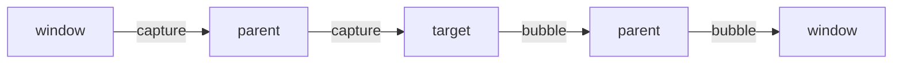

@more
## Strings, dates, JSON and regular expressions

### Strings

```javascript Common operations
const s = 'Java Trail';
s.includes('Trail');                 // true
s.startsWith('Java');                // true
s.split(' ');                        // ['Java', 'Trail']
s.slice(0, 4);                       // 'Java'
s.slice(-5);                         // 'Trail'
s.replaceAll('a', 'o');              // 'Jovo Troil'
'  hi '.trim();                      // 'hi'
'7'.padStart(3, '0');                // '007'
`Total: ${2 + 3}`;                   // 'Total: 5'
```

Strings are immutable, as in Java, but compare with `===`, as there's no `equals`.

### Dates

`Date` is a frequent source of bugs. Remember these four facts.

| Fact | Example |
|---|---|
| Months start at 0 | `new Date(2026, 0, 15)` is 15 January |
| Date-only ISO strings parse as UTC | `new Date('2026-10-31')` is midnight UTC |
| Date-time strings with no zone parse as local | `new Date('2026-10-31T10:00')` is local time |
| A `Date` is mutable, and holds one instant | `setDate` changes it in place |

So `new Date('2026-10-31')`, displayed in a timezone behind UTC, shows 30 October. A server-provided `LocalDate` shouldn't go through `Date` at all if you only want to show it. Your Spring API should send instants as UTC, and the browser should format them.

```javascript Formatting for people
const when = new Date('2026-10-31T10:00:00Z');
new Intl.DateTimeFormat('en-IN', {
  dateStyle: 'medium',
  timeStyle: 'short',
  timeZone: 'Asia/Kolkata',
}).format(when);                       // 31 Oct 2026, 3:30 pm

new Intl.RelativeTimeFormat('en', { numeric: 'auto' }).format(-1, 'day');   // 'yesterday'
```

`Intl` needs no library. For heavier date maths, use `date-fns`. The new `Temporal` API fixes much of this, once your target browsers support it.

### JSON

```javascript JSON traps
JSON.stringify({ a: undefined, b: () => 1, c: null });   // '{"c":null}'
JSON.stringify({ when: new Date(0) });     // '{"when":"1970-01-01T00:00:00.000Z"}'
JSON.parse('{"when":"1970-01-01T00:00:00.000Z"}').when;  // a string, not a Date
```

`undefined` and functions vanish, and dates become strings that stay strings. `JSON.parse` throws on bad input, so wrap untrusted strings in `try`.

### Regular expressions

```javascript Practical patterns
/^[6-9]\d{9}$/.test('9876543210');          // true: an Indian mobile number format
'2026-10-31'.match(/(\d{4})-(\d{2})-(\d{2})/)[1];   // '2026'
'a1b22'.replace(/\d+/g, '#');               // 'a#b#'
[...'a1b22'.matchAll(/\d+/g)].map((m) => m[0]);     // ['1', '22']
```

Named groups make long patterns readable: `/(?<year>\d{4})/`. Avoid regular expressions for email validation beyond a basic check, or for parsing HTML. Nested quantifiers such as `(a+)+` can freeze the page on certain input, which is called catastrophic backtracking.

### Iterators and generators

Anything with `Symbol.iterator` works with `for...of` and spread. A generator produces values lazily.

```javascript A generator
function* pages(total) {
  for (let page = 0; page < total; page++) {
    yield page;
  }
}
[...pages(3)];                                 // [0, 1, 2]

const entries = Object.entries({ a: 1, b: 2 });   // [['a', 1], ['b', 2]]
Object.fromEntries(entries);                      // { a: 1, b: 2 }
Object.groupBy([1, 2, 3], (n) => (n % 2 ? 'odd' : 'even'));   // { odd: [1, 3], even: [2] }
```

!keypoints Months start at 0 ;; Date-only strings parse as UTC ;; JSON drops undefined and functions ;; Intl handles most formatting

?? new Date('2026-10-31') shows 30 October for some users. Why?
=> Date-only strings are parsed as UTC midnight, which is the previous day west of UTC. Don't convert a plain date through Date.
?? What does JSON.stringify({ a: undefined }) give?
=> `{}`. Undefined values are dropped.
?? Which month is new Date(2026, 1, 1)?
=> February, since months start at 0.

## The DOM without React

React sits on top of the DOM, and interviews sometimes ban frameworks. Knowing the plain API also makes you better at debugging React.

```html The markup
<form id="add"><input id="title" required><button>Add</button></form>
<ul id="todos"></ul>
```

```javascript A todo list in plain JavaScript
const form = document.querySelector('#add');
const input = document.querySelector('#title');
const list = document.querySelector('#todos');
let todos = [];

function render() {
  list.replaceChildren(...todos.map((todo) => {
    const li = document.createElement('li');
    li.textContent = todo.title;                 // textContent is safe; innerHTML is not
    li.dataset.id = todo.id;
    const del = document.createElement('button');
    del.textContent = 'Delete';
    li.append(' ', del);
    return li;
  }));
}

form.addEventListener('submit', (e) => {
  e.preventDefault();
  todos = [...todos, { id: crypto.randomUUID(), title: input.value }];
  input.value = '';
  render();
});

list.addEventListener('click', (e) => {          // one listener, thanks to bubbling
  if (e.target.matches('button')) {
    const id = e.target.closest('li').dataset.id;
    todos = todos.filter((t) => t.id !== id);
    render();
  }
});
```

Notice how this already resembles React: state, a `render` function, and updates that make new arrays. What React adds is working out the smallest DOM change, which this `render` doesn't do, and so it loses input focus inside rows.

### Events in depth



| Term | Meaning |
|---|---|
| `event.target` | The element clicked |
| `event.currentTarget` | The element whose listener is running |
| `preventDefault()` | Stops default behaviour, like submitting |
| `stopPropagation()` | Stops the event travelling further |
| Delegation | One listener on a parent handles children, including future ones |

### Layout thrashing

Reading a layout value such as `offsetHeight` after changing styles forces the browser to calculate layout immediately. Doing this in a loop is very slow.

```javascript Read first, then write
// Slow: forces layout on every iteration
for (const el of items) {
  el.style.height = `${el.offsetHeight + 10}px`;
}

// Fast: all reads, then all writes
const heights = items.map((el) => el.offsetHeight);
items.forEach((el, i) => { el.style.height = `${heights[i] + 10}px`; });
```

### Browser APIs worth knowing

| API | Use |
|---|---|
| `IntersectionObserver` | Infinite scroll, lazy loading |
| `ResizeObserver` | React to an element's size |
| `MutationObserver` | Watch for DOM changes |
| `requestAnimationFrame` | Smooth animation |
| `navigator.clipboard` | Copy to clipboard |
| `URL`, `URLSearchParams` | Build URLs safely |
| `AbortController` | Cancel fetches and remove listeners |
| `BroadcastChannel` | Talk between tabs |

```javascript Build URLs safely
const url = new URL('/api/search', location.origin);
url.searchParams.set('q', 'java & spring');
url.href;   // .../api/search?q=java+%26+spring
```

!keypoints textContent is safe, innerHTML isn't ;; Delegate events to a parent ;; target and currentTarget differ ;; Read layout, then write

?? Why add one click listener to a list instead of one per row?
=> Bubbling brings all clicks there, and it also covers rows added later.
?? What is layout thrashing?
=> Repeatedly changing styles and reading layout, forcing recalculation each time. Batch reads and writes.
?? What's the difference between event.target and currentTarget?
=> `target` is where the event began. `currentTarget` is the element with the running listener.

## Memory, errors and Node

### Memory leaks in the browser

The JavaScript engine has a garbage collector, as the JVM does, so the concept is familiar: anything still reachable stays in memory.

| Leak | Example | Fix |
|---|---|---|
| Listeners not removed | `window.addEventListener` in an effect | Remove in cleanup |
| Timers still running | `setInterval` with no clear | `clearInterval` in cleanup |
| Growing caches | A module-level array | Limit the size |
| Detached DOM | Holding removed elements in a variable | Drop the reference |
| Closures holding large data | A long-lived callback | Keep closures small |

To find them, use the Memory panel: take a heap snapshot, repeat the action several times, take another, and compare what grew. It's the same idea as a Java heap dump with Eclipse MAT. Single-page apps run for hours in one tab, so leaks matter more than on classic pages.

### Handling errors

```javascript Catch what you can handle
window.addEventListener('error', (e) => report(e.error));
window.addEventListener('unhandledrejection', (e) => report(e.reason));

class HttpError extends Error {
  constructor(status, message) {
    super(message);
    this.name = 'HttpError';
    this.status = status;
  }
}

try {
  await save();
} catch (e) {
  if (e instanceof HttpError && e.status === 409) {
    showConflict();
  } else {
    throw e;                     // don't swallow what you can't handle
  }
}
```

There are no checked exceptions, and anything can be thrown, so `e` may not even be an `Error`. An `async` function's rejected promise, with no `await` or `catch`, becomes an unhandled rejection and often goes unnoticed.

### Node and npm essentials

Node runs JavaScript outside the browser, and your build tools use it even if your backend is Java.

| Command | Does |
|---|---|
| `npm install` | Installs dependencies, may update the lock file |
| `npm ci` | Clean install, exactly from the lock file |
| `npm run dev` | Runs a script from `package.json` |
| `npx tool` | Runs a package's tool |
| `npm outdated` | Shows newer versions |
| `npm audit` | Reports known vulnerabilities |

```json Versions in package.json
{
  "dependencies": {
    "react": "^19.0.0",
    "zod": "~4.1.0"
  },
  "devDependencies": {
    "vitest": "3.2.0"
  }
}
```

`^` allows minor and patch updates, `~` allows only patches, and an exact version allows neither. The lock file records exactly what got installed. `devDependencies` are for building and testing only.

### Bundlers and modules

Browsers can load modules natively, but thousands of small requests are slow, so a bundler combines them. Vite uses native modules for speed in development, and bundles for production. **Tree shaking** removes exports you don't import, and it works best with ES modules, which is why `import { debounce } from 'lodash-es'` can be smaller than importing from CommonJS `lodash`.

!warning Supply chain risk :: Installing a package can run its install scripts on your machine, and malicious packages do appear. Check names carefully, avoid unnecessary dependencies, and commit your lock file. `npm ci --ignore-scripts` reduces risk in CI when your build doesn't need those scripts.

!keypoints Clean up listeners and timers ;; Compare heap snapshots to find leaks ;; Rethrow what you can't handle ;; Use npm ci in CI

?? A tab gets slower after hours of use. What do you suspect, and how do you check?
=> A leak, such as listeners or timers. Compare heap snapshots after repeating an action.
?? What does ^19.0.0 allow?
=> Any 19.x.y version at or above 19.0.0, though the lock file pins what's actually installed.
?? Why isn't every error safe to catch and ignore?
=> You hide bugs. Handle what you expect, and rethrow or report the rest.
