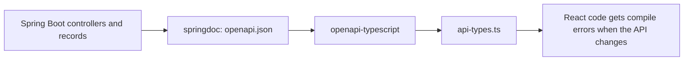

@part frontend-typescript | Frontend Part 3: TypeScript | frontend
## TypeScript for Java developers

TypeScript adds static types to JavaScript. The compiler checks your code, then removes the types, so at run time it's plain JavaScript. Most React job postings now expect it. And coming from Java, you'll feel at home quickly, with one big difference.

### Structural typing

Java cares about what a type is called. TypeScript cares about what shape it has.

```ts Same shape, so it's accepted
interface Point { x: number; y: number; }

function print(p: Point) { console.log(p.x, p.y); }

const location = { x: 1, y: 2, label: 'home' };
print(location);        // fine: it has x and y, no "implements" needed
```

There are no `implements` requirements, and two types with the same fields are interchangeable. This fits JavaScript, where objects come from JSON.

### Everyday types

```ts Annotations you'll write daily
let title: string = 'Orders';
let count = 0;                       // inferred as number: leave it out
const ids: number[] = [1, 2, 3];

type Status = 'PENDING' | 'PAID' | 'SHIPPED';   // a union of string literals

interface Order {
  readonly id: string;
  total: number;
  status: Status;
  note?: string;                     // optional: string or undefined
  customer: { name: string; email: string | null };
}

function isPaid(order: Order): boolean {
  return order.status === 'PAID';
}
```

Let inference do the work for local variables, and annotate function parameters and public APIs.

| Java | TypeScript |
|---|---|
| `enum Status { PAID }` | `'PAID' \| 'SHIPPED'`, usually better |
| `Optional<String>` | `string \| undefined` |
| `List<Order>` | `Order[]` |
| `Map<String, Order>` | `Record<string, Order>` or `Map` |
| `Object` | `unknown` (safe) or `any` (unsafe) |
| `T extends Comparable<T>` | `T extends { id: string }` |

### interface or type?

Both describe object shapes. `type` can also express unions and more. Many teams use `interface` for objects and props, and `type` for unions. Pick one convention, and don't spend long on this.

### any and unknown

`any` turns off checking, and it spreads. `unknown` forces you to check before use.

```ts unknown makes you prove it
function parse(json: string): unknown {
  return JSON.parse(json);
}

const data = parse('{"name":"Asha"}');
// data.name;                        // compile error
if (typeof data === 'object' && data !== null && 'name' in data) {
  console.log(data.name);            // fine, after checking
}
```

### Strict mode

Set `"strict": true` in `tsconfig.json`. With `strictNullChecks`, `null` and `undefined` aren't part of every type, which removes the equivalent of Java's `NullPointerException` at compile time.

```ts The compiler catches what Java wouldn't
function greet(name: string | null) {
  // return name.toUpperCase();       // error: name may be null
  return name?.toUpperCase() ?? 'GUEST';
}
```

!warning Types vanish at run time :: `const order: Order = await res.json()` is an unverified promise to the compiler. If the API returns something else, TypeScript won't notice. Validate at the boundary with a library such as Zod, where it matters.

!keypoints Shape matters, not the name ;; Turn on strict ;; Prefer unknown to any ;; Types don't check data at run time

?? Why does an object with extra fields satisfy an interface?
=> Typing is structural: it only needs the required fields. (Fresh object literals get an extra check for typos.)
?? Does TypeScript validate an API response at run time?
=> No. Types are removed in compilation. Use a validator such as Zod at the boundary.
?? What's the difference between any and unknown?
=> `any` turns off checks. `unknown` allows anything in, but requires checks before use.

## Narrowing, unions and generics

### Narrowing

The compiler tracks your checks, and refines types within each branch.

```ts Control flow narrows the type
function format(value: string | number) {
  if (typeof value === 'string') {
    return value.toUpperCase();    // string here
  }
  return value.toFixed(2);         // number here
}
```

### Discriminated unions

This pattern replaces a lot of Java class hierarchies, and it's perfect for UI states. A shared literal field tells the compiler which variant it has.

```ts Impossible states become impossible
type RemoteData<T> =
  | { status: 'loading' }
  | { status: 'error'; message: string }
  | { status: 'success'; data: T };

function render(state: RemoteData<Order[]>) {
  switch (state.status) {
    case 'loading':
      return 'Loading...';
    case 'error':
      return state.message;           // message exists only here
    case 'success':
      return `${state.data.length} orders`;
  }
}
```

Compare it with `{ loading: boolean; error?: string; data?: T[] }`, which permits nonsense such as loading and error together. Model states so that invalid combinations can't exist.

```ts Exhaustiveness: get an error if a case is forgotten
function assertNever(x: never): never {
  throw new Error(`Unexpected: ${JSON.stringify(x)}`);
}
// add `default: return assertNever(state);` to the switch
```

### Generics

They work much as in Java, with inference doing most of the work.

```ts A generic API helper
async function getJson<T>(url: string): Promise<T> {
  const res = await fetch(url);
  if (!res.ok) throw new Error(`HTTP ${res.status}`);
  return res.json() as Promise<T>;
}

const orders = await getJson<Order[]>('/api/orders');

function first<T>(items: T[]): T | undefined {
  return items[0];
}
```

### Utility types

Transform existing types, rather than repeating them.

| Utility | Meaning | Example use |
|---|---|---|
| `Partial<T>` | All fields optional | PATCH payloads |
| `Required<T>` | All required | Normalised config |
| `Pick<T, 'a' \| 'b'>` | Only these | List rows |
| `Omit<T, 'id'>` | All but these | Create requests |
| `Readonly<T>` | No reassignment | Props |
| `Record<K, V>` | Key-value map | Lookup tables |
| `ReturnType<typeof f>` | A function's return | Reuse without repeating |

```ts Derive types from one source
interface Order { id: string; total: number; status: Status; }
type NewOrder = Omit<Order, 'id' | 'status'>;
type OrderRow = Pick<Order, 'id' | 'total'>;
```

### const and keyof

```ts Deriving a union from a value
const STATUSES = ['PENDING', 'PAID', 'SHIPPED'] as const;
type Status = (typeof STATUSES)[number];    // 'PENDING' | 'PAID' | 'SHIPPED'

function getField<T, K extends keyof T>(obj: T, key: K): T[K] {
  return obj[key];
}
```

Now the list exists at run time for your dropdown, and the type always matches it.

!keypoints Narrow with ordinary checks ;; Use discriminated unions for states ;; Use utility types rather than repeating ;; Derive types from a single source

?? Why is a status union better than three booleans for loading, error and success?
=> Booleans permit impossible combinations. A union allows exactly one state, with the right data.
?? What does Partial<Order> give you?
=> A type with all of Order's fields optional, useful for updates.
?? Why can a generic getJson<Order[]> still be wrong at run time?
=> The cast promises a shape with no check. Validate the data if you need certainty.

## TypeScript with React and your API

### Component props

```tsx Typing props
interface OrderCardProps {
  order: Order;
  onCancel?: (id: string) => void;
  children?: React.ReactNode;
}

export function OrderCard({ order, onCancel, children }: OrderCardProps) {
  return (
    <article>
      <h3>{order.id}</h3>
      {onCancel && <button onClick={() => onCancel(order.id)}>Cancel</button>}
      {children}
    </article>
  );
}
```

### Hooks and events

```tsx Common patterns
const [order, setOrder] = useState<Order | null>(null);   // say what it can become
const [tags, setTags] = useState<string[]>([]);           // otherwise inferred as never[]
const inputRef = useRef<HTMLInputElement>(null);

function onChange(e: React.ChangeEvent<HTMLInputElement>) {
  setQuery(e.target.value);
}

function onSubmit(e: React.FormEvent<HTMLFormElement>) {
  e.preventDefault();
}
```

Usually you needn't type event handlers written inline, as inference does it.

### Generic components

```tsx A reusable list
interface ListProps<T> {
  items: T[];
  keyOf: (item: T) => string;
  render: (item: T) => React.ReactNode;
}

function List<T>({ items, keyOf, render }: ListProps<T>) {
  return <ul>{items.map((item) => <li key={keyOf(item)}>{render(item)}</li>)}</ul>;
}

<List items={orders} keyOf={(o) => o.id} render={(o) => o.total} />;
```

### Keeping Java and TypeScript in sync

Your Spring Boot records and TypeScript interfaces describe the same data. Writing both by hand lets them drift.

| Approach | How | Trade-off |
|---|---|---|
| Handwrite | Copy by hand | Simple, and goes out of date |
| OpenAPI generation | springdoc produces a spec, and `openapi-typescript` generates types | Automatic, needs a build step |
| Zod schemas | Validate at run time, and infer types | Also catches real mismatches |



Now renaming a Java field causes a TypeScript compile error in the frontend, rather than a bug in production. It's a strong point for a full stack interview.

```ts Runtime validation with Zod
import { z } from 'zod';

const OrderSchema = z.object({
  id: z.string(),
  total: z.number().nonnegative(),
  status: z.enum(['PENDING', 'PAID', 'SHIPPED']),
});
type Order = z.infer<typeof OrderSchema>;

const order = OrderSchema.parse(await res.json());   // throws if the shape is wrong
```

### Mapping Java types to JSON

| Java | JSON | TypeScript | Watch out |
|---|---|---|---|
| `long` | number | `number` | Loses precision: send as a string when large |
| `BigDecimal` | number or string | `string` | Prefer a string for money |
| `LocalDate` | `"2026-10-31"` | `string` | Not a `Date` until you parse it |
| `Instant` | `"2026-10-31T10:15:30Z"` | `string` | Parse, and watch timezones |
| `Optional`, nullable | value or `null` | `T \| null` | `null`, not `undefined` |
| `enum` | `"PAID"` | a union | Keep in sync |

### Compiler settings

```json A sensible tsconfig excerpt
{
  "compilerOptions": {
    "strict": true,
    "noUncheckedIndexedAccess": true,
    "target": "ES2022",
    "module": "ESNext",
    "moduleResolution": "bundler",
    "jsx": "react-jsx",
    "skipLibCheck": true
  }
}
```

`noUncheckedIndexedAccess` makes `items[0]` possibly undefined, matching reality. Vite doesn't type-check, so run `tsc --noEmit` in CI.

!keypoints Type props with interfaces ;; Generate types from OpenAPI to keep Java and TS in sync ;; A JSON date is a string ;; Run tsc in CI

?? Your frontend treats order.createdAt as a Date and crashes. Why?
=> JSON has no date type, so it's a string. Parse it explicitly.
?? How can a backend rename cause a frontend compile error?
=> Generate TypeScript types from the OpenAPI spec, so a renamed field breaks the type check.
?? Vite builds fine, but the code has a type error. Why?
=> Vite strips types without checking them. Run `tsc --noEmit` separately, in CI.
