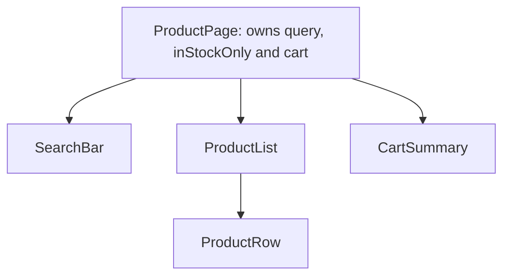

@more
## Worked example: a product catalogue

Let's apply "think in components" from start to finish on a small screen: a product list with search, an in-stock filter, and an add-to-cart button.

### Step 1: draw the boxes



### Step 2: find the minimal state

Go through each piece of data, and ask three questions.

| Data | Changes over time? | Comes from props? | Calculable? | State? |
|---|---|---|---|---|
| All products | No | Yes, from a parent or the API | | No |
| Search text | Yes | No | No | **Yes** |
| In-stock checkbox | Yes | No | No | **Yes** |
| Filtered list | Yes | | Yes, from the above | No |
| Cart items | Yes | No | No | **Yes** |
| Cart total | Yes | | Yes, from the cart | No |

So there are three pieces of state, and everything else is calculated during render.

### Step 3: the code

```tsx The complete feature
interface Product { id: string; name: string; price: number; stock: number; }

function SearchBar({ query, inStockOnly, onQuery, onInStock }: {
  query: string;
  inStockOnly: boolean;
  onQuery: (q: string) => void;
  onInStock: (v: boolean) => void;
}) {
  return (
    <form role="search" onSubmit={(e) => e.preventDefault()}>
      <label htmlFor="q">Search products</label>
      <input id="q" value={query} onChange={(e) => onQuery(e.target.value)} />
      <label>
        <input type="checkbox" checked={inStockOnly} onChange={(e) => onInStock(e.target.checked)} />
        In stock only
      </label>
    </form>
  );
}

function ProductRow({ product, onAdd }: { product: Product; onAdd: (p: Product) => void }) {
  const soldOut = product.stock === 0;
  return (
    <li>
      {product.name}: ₹{product.price}
      <button disabled={soldOut} onClick={() => onAdd(product)}>
        {soldOut ? 'Sold out' : 'Add'}
      </button>
    </li>
  );
}

export function ProductPage({ products }: { products: Product[] }) {
  const [query, setQuery] = useState('');
  const [inStockOnly, setInStockOnly] = useState(false);
  const [cart, setCart] = useState<Product[]>([]);

  const q = query.trim().toLowerCase();
  const visible = products.filter(
    (p) => p.name.toLowerCase().includes(q) && (!inStockOnly || p.stock > 0),
  );
  const total = cart.reduce((sum, p) => sum + p.price, 0);

  return (
    <>
      <SearchBar query={query} inStockOnly={inStockOnly} onQuery={setQuery} onInStock={setInStockOnly} />
      {visible.length === 0 ? (
        <p>No products match.</p>
      ) : (
        <ul>
          {visible.map((p) => (
            <ProductRow key={p.id} product={p} onAdd={(x) => setCart((c) => [...c, x])} />
          ))}
        </ul>
      )}
      <p>Cart: {cart.length} items, ₹{total}</p>
    </>
  );
}
```

### Why it's built this way

- **`visible` and `total` aren't state,** so they can't disagree with their sources.
- **`SearchBar` holds no state.** Its parent owns it, so that the list can use it too.
- **`onAdd` uses an updater,** so rapid clicks all count.
- **A `form` with a `role`,** and real labels, means that the screen is accessible, and tests can find everything by role.
- **Empty state is handled,** which is often forgotten.

### What would change in a real app

| This example | Production |
|---|---|
| Products as a prop | TanStack Query |
| `query` in state | URL search params, so that links are shareable |
| Cart in state | Stored per user, on the server |
| Filter on every key | Fine for hundreds; debounce and paginate on the server for thousands |
| `price` as a number | Integer paise, or a string from the API |

!keypoints Ask three questions to find state ;; Calculate the rest during render ;; Parents own shared state ;; Always handle the empty state

?? Why isn't the filtered list stored in state?
=> It can be calculated from products, query and the checkbox. Storing it adds a chance for them to disagree.
?? Why does SearchBar receive query as a prop rather than own it?
=> The list needs it too, so the state lives in their common parent.

## Component patterns

Reading real codebases means recognising these patterns.

### Compound components

Related components share state implicitly, giving a flexible API. Tabs are the classic example.

```tsx Tabs as compound components
const TabsContext = createContext<{ active: string; setActive: (id: string) => void } | null>(null);

function useTabs() {
  const ctx = useContext(TabsContext);
  if (!ctx) throw new Error('Tab parts must be inside <Tabs>');
  return ctx;
}

function Tabs({ initial, children }: { initial: string; children: React.ReactNode }) {
  const [active, setActive] = useState(initial);
  const value = useMemo(() => ({ active, setActive }), [active]);
  return <TabsContext.Provider value={value}>{children}</TabsContext.Provider>;
}

function Tab({ id, children }: { id: string; children: React.ReactNode }) {
  const { active, setActive } = useTabs();
  return (
    <button role="tab" aria-selected={active === id} onClick={() => setActive(id)}>
      {children}
    </button>
  );
}

function Panel({ id, children }: { id: string; children: React.ReactNode }) {
  const { active } = useTabs();
  return active === id ? <div role="tabpanel">{children}</div> : null;
}

// The caller controls structure and order
<Tabs initial="items">
  <div role="tablist">
    <Tab id="items">Items</Tab>
    <Tab id="history">History</Tab>
  </div>
  <Panel id="items">Your items</Panel>
  <Panel id="history">Your history</Panel>
</Tabs>
```

A full ARIA tabs pattern also needs arrow-key navigation, which tested libraries such as Radix provide.

### Controlled or uncontrolled components

Good reusable components can support both modes.

```tsx A component that works either way
function Toggle({ on, defaultOn = false, onChange }: {
  on?: boolean;
  defaultOn?: boolean;
  onChange?: (v: boolean) => void;
}) {
  const [inner, setInner] = useState(defaultOn);
  const controlled = on !== undefined;
  const value = controlled ? on : inner;

  function flip() {
    if (!controlled) setInner(!value);
    onChange?.(!value);
  }
  return <button aria-pressed={value} onClick={flip}>{value ? 'On' : 'Off'}</button>;
}
```

### Render props and slots

Pass a function as a prop, so that a component controls logic while the caller controls display. Hooks replaced many uses, but they're still common in lists, tables and virtualisers.

```tsx Slots are simply props holding elements
<Layout
  header={<Header />}
  sidebar={<Nav />}
>
  <Content />
</Layout>
```

### Portals

Render to another part of the DOM, escaping `overflow: hidden` and stacking contexts. Events still bubble through the **React** tree.

```tsx A modal through a portal
function Modal({ onClose, children }: { onClose: () => void; children: React.ReactNode }) {
  return createPortal(
    <div className="backdrop" onClick={onClose}>
      <div role="dialog" aria-modal="true" onClick={(e) => e.stopPropagation()}>
        {children}
      </div>
    </div>,
    document.body,
  );
}
```

### Higher-order components

A function that takes a component and returns another, such as `withAuth(Page)`. You'll see them in older code, but custom hooks usually replace them today.

### Which pattern when?

| Need | Use |
|---|---|
| Share logic | Custom hook |
| Share layout | `children` and slots |
| Related parts sharing state | Compound components |
| Customise rendering of items | Render prop |
| Escape parent's overflow | Portal |

Patterns are tools rather than goals. Reach for the simplest thing, and only add a pattern when plain props become awkward.

!keypoints Compound components share state implicitly ;; Reusable components can be controlled or not ;; Portals escape overflow, not the React tree ;; Hooks replaced most HOCs

?? A dropdown inside an overflow: hidden parent gets cut off. What helps?
=> A portal, rendering it at the document body, positioned over the trigger.
?? What's the difference between controlled and uncontrolled?
=> In controlled, the parent owns the value through props. In uncontrolled, the component keeps its own state.
?? A click inside a portal: does it bubble to the React parent?
=> Yes. Events follow the React tree, even though the DOM node is elsewhere.

## Styling in React

### The main options, in code

```tsx CSS Modules: scoped by default
import styles from './Card.module.css';

function Card({ urgent }: { urgent: boolean }) {
  return <div className={`${styles.card} ${urgent ? styles.urgent : ''}`}>...</div>;
}
```

```tsx Tailwind: utilities in the markup
function Card({ urgent }: { urgent: boolean }) {
  return (
    <div className={`rounded-lg border p-4 ${urgent ? 'border-red-500' : 'border-gray-200'}`}>
      ...
    </div>
  );
}
```

!warning Tailwind needs whole class names :: Tailwind scans your files for complete class strings. `bg-${color}-500` won't work, as that class never appears anywhere. Use a lookup: `{ red: 'bg-red-500', green: 'bg-green-500' }[color]`.

### Reusable variants

```tsx A button with typed variants
const VARIANTS = {
  primary: 'bg-indigo-600 text-white hover:bg-indigo-700',
  ghost: 'bg-transparent hover:bg-gray-100',
} as const;

interface ButtonProps extends React.ComponentProps<'button'> {
  variant?: keyof typeof VARIANTS;
}

function Button({ variant = 'primary', className = '', ...rest }: ButtonProps) {
  return <button className={`rounded px-3 py-2 ${VARIANTS[variant]} ${className}`} {...rest} />;
}
```

Extending `ComponentProps<'button'>` means `type`, `disabled` and `onClick` all work and are typed, without declaring each.

### Component libraries

| Library | Character |
|---|---|
| shadcn/ui | Copy components into your repo, built on Radix and Tailwind |
| Radix, React Aria | Unstyled and accessible; you add looks |
| Material UI | Complete and styled; common in enterprises |
| Ant Design | Rich data components; common for admin panels |

For an internal tool with tables and forms, a complete library saves weeks. Don't hand-build dialogs, date pickers and comboboxes, because accessible versions are harder than they look.

### Design tokens

Keep colours, spacing and radii as named tokens, in CSS variables or a Tailwind theme, rather than hard-coded values. This makes dark mode and rebranding easy. This site defines its tokens in `src/index.css`.

### Icons and images in React

Use an icon library such as Lucide, which allows tree shaking. Importing a whole icon font or set increases your bundle. Decorative icons need `aria-hidden`, and icon-only buttons need a label.

!keypoints CSS Modules scope styles ;; Tailwind needs complete class names ;; Use libraries for complex widgets ;; Name your design values

?? Why doesn't `bg-${color}-500` work with Tailwind?
=> Tailwind finds class names by scanning source text, and that complete string never appears.
?? Why extend ComponentProps<'button'> in a Button?
=> All native button props are accepted and typed, with no need to redeclare them.
