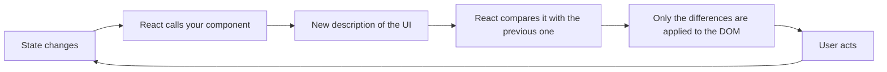
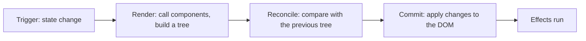
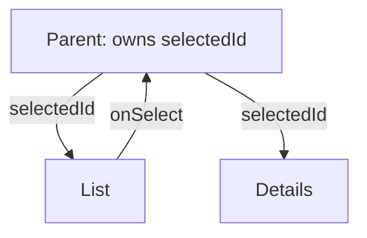
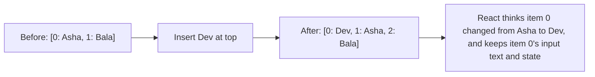

@part frontend-react-fundamentals | Frontend Part 4: React Fundamentals | frontend
## The idea behind React

Before React, code changed the page directly: find this element, update its text, add a class. As screens grew, keeping everything in step became the hard part. React changes the question. You describe **what the screen should look like for the current data**, and React works out how to update the page.



### Setting up

```bash Create a project with Vite
npm create vite@latest shop -- --template react-ts
cd shop
npm install
npm run dev
```

Vite serves your code during development and bundles it for production. Think of `package.json` as your `pom.xml`, `npm` as Maven, and `node_modules` as a local `.m2`. Commit `package-lock.json`, so that every machine installs the same versions.

| Java world | Frontend world |
|---|---|
| Maven or Gradle | npm, pnpm |
| `pom.xml` | `package.json` |
| Compiler plus jar | Vite bundling |
| JUnit | Vitest |
| Checkstyle | ESLint, Prettier |

### Components and JSX

A component is a function that returns a description of UI.

```tsx Your first component
interface GreetingProps {
  name: string;
  unread: number;
}

export function Greeting({ name, unread }: GreetingProps) {
  return (
    <section className="greeting">
      <h2>Hello, {name}</h2>
      {unread > 0 && <p>You have {unread} new messages.</p>}
    </section>
  );
}

// Used like an HTML tag
<Greeting name="Asha" unread={3} />
```

JSX isn't HTML. It compiles to function calls, so:

| HTML | JSX | Why |
|---|---|---|
| `class` | `className` | `class` is a keyword |
| `for` | `htmlFor` | `for` is a keyword |
| `onclick="..."` | `onClick={fn}` | Pass a function, not text |
| `style="color:red"` | `style={{ color: 'red' }}` | An object |
| `<br>` | `<br />` | Every tag must close |

A component must start with a capital letter, and return one parent element. Use a fragment, `<>...</>`, to group without an extra DOM node.

!warning The 0 trap :: `{count && <Badge />}` shows a literal `0` when count is 0, because `0` is what `&&` returns, and React renders numbers. Write `{count > 0 && <Badge />}`.

### Props

Props are a component's parameters. They flow **down** from parent to child, and are read-only. To let a child affect a parent, pass a function.

```tsx Passing data down and events up
function Parent() {
  const [selected, setSelected] = useState<string | null>(null);
  return <OrderList orders={orders} onSelect={setSelected} />;
}

function OrderList({ orders, onSelect }: { orders: Order[]; onSelect: (id: string) => void }) {
  return orders.map((o) => (
    <button key={o.id} onClick={() => onSelect(o.id)}>{o.id}</button>
  ));
}
```

### Composition

The special `children` prop lets you build wrappers, and React prefers this to inheritance. You'll almost never write `extends` for components.

```tsx Composition
function Card({ title, children }: { title: string; children: React.ReactNode }) {
  return (
    <div className="card">
      <h3>{title}</h3>
      {children}
    </div>
  );
}

<Card title="Total">
  <strong>₹800</strong>
</Card>
```

!keypoints Describe the UI for the current data ;; A component is a function ;; JSX compiles to calls, not HTML ;; Data flows down, and events flow up

?? Why does {items.length && <List />} sometimes show 0?
=> `&&` returns 0 when the length is 0, and React renders that number. Use `items.length > 0 &&`.
?? How does a child tell its parent something?
=> The parent passes a function as a prop, and the child calls it.
?? Why doesn't React use inheritance for sharing component behaviour?
=> Composition through props and children is more flexible, and custom hooks share logic.

## State and how rendering works

### State

Regular variables reset on each render, and changing them doesn't update the screen. State survives renders, and changing it schedules a new render.

```tsx A counter
function Counter() {
  const [count, setCount] = useState(0);
  return <button onClick={() => setCount(count + 1)}>Clicked {count} times</button>;
}
```

### State is a snapshot

This surprises nearly everyone at first. During one render, `count` is a fixed value, and setting state doesn't change it until the next render.

```tsx Why this adds only 1
function handleClick() {
  setCount(count + 1);    // count is 0 here: asks for 1
  setCount(count + 1);    // count is still 0: asks for 1
  setCount(count + 1);    // again, 1
  console.log(count);     // still 0
}

function handleClickFixed() {
  setCount((c) => c + 1);  // an updater: uses the latest queued value
  setCount((c) => c + 1);
  setCount((c) => c + 1);  // result: 3
}
```

Use the updater form whenever the new value depends on the old one. React also batches several updates in one event into a single render.

### Never mutate state

React detects change by comparing references with `Object.is`. A mutated object is still the same reference, so nothing happens.

```tsx Always make a new value
const [order, setOrder] = useState({ id: 1, status: 'NEW', items: [] as Item[] });

// Wrong: same object
order.status = 'PAID';
setOrder(order);

// Right
setOrder({ ...order, status: 'PAID' });

// Arrays
setOrder({ ...order, items: [...order.items, newItem] });                        // add
setOrder({ ...order, items: order.items.filter((i) => i.id !== id) });           // remove
setOrder({ ...order, items: order.items.map((i) => i.id === id ? { ...i, qty } : i) }); // change one
```

Deep updates get verbose. Keep state flat, or use a helper such as Immer.

### What makes a component render?

1. Its own state changes.
2. Its parent renders.
3. A context it reads changes.

Note the second: **by default, when a parent renders, all its children render too**, even if props are unchanged. A render isn't a DOM update: React calls the function and compares, and then often changes nothing.



### Derived data isn't state

If you can calculate it from existing state or props, then don't store it.

```tsx Calculate during render
// Unnecessary state that can go out of step
const [items, setItems] = useState<Item[]>([]);
const [total, setTotal] = useState(0);

// Better
const total = items.reduce((sum, i) => sum + i.price * i.qty, 0);
```

### Where to put state: lifting up

When two components need the same data, move the state to their closest common parent, and pass it down.



!interview Interview answer :: **"Why doesn't my state update right away?"** State is a snapshot for each render. A setter schedules a new render, and the current variable keeps its value. Use the updater form for repeated changes, and `useEffect` only if you must react after the commit.

!keypoints State is a snapshot per render ;; Use updaters when building on the old value ;; Never mutate state ;; Don't store what can be calculated

?? Three setCount(count + 1) calls in one handler. What happens?
=> It increases by 1, since each uses the same snapshot. Use `setCount(c => c + 1)`.
?? Why doesn't mutating an array in state update the screen?
=> React compares references. It's the same array, so no change is detected.
?? Parent state changes, but a child's props don't. Does the child render?
=> Yes, by default. A render doesn't necessarily change the DOM.

## Lists, keys and conditional rendering

### Rendering lists

```tsx Map to elements
function OrderTable({ orders }: { orders: Order[] }) {
  if (orders.length === 0) {
    return <p>No orders yet.</p>;
  }
  return (
    <ul>
      {orders.map((order) => (
        <li key={order.id}>{order.id}: {order.total}</li>
      ))}
    </ul>
  );
}
```

### Keys matter

A key tells React which item is which between renders. It must be stable and unique among siblings.



With index keys, state inside a row stays at the position rather than with the data, so a half-typed input can appear on the wrong person's row. Use a real ID.

!warning Key mistakes :: Avoid `key={Math.random()}`, which remounts every row on every render, destroying state and speed. Index keys are acceptable only for static lists that never reorder.

Keys have another use: changing a key tells React to throw away and recreate a component. `<EditForm key={user.id} user={user} />` resets the form's state whenever the user changes, with no effect needed.

### State belongs to a position

React keeps state tied to a component's place in the tree.

```tsx Same position, same state
{isAdmin ? <Counter label="Admin" /> : <Counter label="User" />}
// The count survives the switch: both are a Counter in the same place

{isAdmin ? <Counter key="a" label="Admin" /> : <Counter key="b" label="User" />}
// Different keys: separate state
```

Never declare a component inside another component. A new function is created on each render, so React sees a new type, and destroys all state below it. It's a frequent cause of "my input loses focus on every keystroke".

### Conditional rendering

```tsx Common patterns
if (isLoading) return <Spinner />;               // an early return

{error ? <ErrorBox message={error} /> : <Results />}   // either-or

{isAdmin && <AdminPanel />}                      // show or nothing
```

### Handling events

```tsx Passing a function, not calling it
<button onClick={save}>Save</button>             // right
<button onClick={save()}>Save</button>           // wrong: runs during render
<button onClick={() => remove(order.id)}>Delete</button>  // with an argument
```

### Controlled inputs

In React, the state usually owns the input's value.

```tsx A controlled input
function Search() {
  const [query, setQuery] = useState('');
  return (
    <input
      value={query}
      onChange={(e) => setQuery(e.target.value)}
      placeholder="Search orders"
    />
  );
}
```

Each keystroke updates state, which renders the input with its new value. It also means you can validate or transform as people type. Part 7 covers forms in depth.

!keypoints Use stable IDs as keys ;; State belongs to a position in the tree ;; Don't define components inside components ;; Pass functions, don't call them

?? An input loses focus on every keystroke. What's a common cause?
=> The component is defined inside another, so each render makes a new type and remounts. Or the key changes each render.
?? How can you reset a form's state when the selected user changes?
=> Give it `key={user.id}`, so that React creates a fresh instance.
?? What's wrong with onClick={save()}?
=> It calls `save` during render. Pass `save`, or an arrow function.

## Structuring a React application

### Think in components

1. Draw boxes around the screen's parts.
2. Build a static version from props.
3. Find the minimal state.
4. Decide who owns each piece of state.
5. Add events that change it.

### Project layout

```text Organise by feature
src/
  features/
    orders/
      OrderList.tsx
      OrderDetails.tsx
      useOrders.ts
      orders.api.ts
      orders.test.tsx
    auth/
  components/        shared UI: Button, Modal
  lib/               API client, utilities
  App.tsx
  main.tsx
```

Grouping by feature keeps related code together, and it's what you do in Spring packages too. This site is organised this way.

### Separate data from display

```tsx Container and presentational parts
function OrdersPage() {                                  // knows about data
  const { data, isPending, error } = useOrders();
  if (isPending) return <Spinner />;
  if (error) return <ErrorBox error={error} />;
  return <OrderTable orders={data} />;
}

function OrderTable({ orders }: { orders: Order[] }) {   // only displays: easy to test
  return <table>{/* ... */}</table>;
}
```

### Handling errors

An error thrown during render would unmount the whole app, unless an **error boundary** catches it. These are one of the rare remaining uses of class components, or use the `react-error-boundary` library.

```tsx An error boundary around a risky part
<ErrorBoundary fallback={<p>This section couldn't load.</p>}>
  <OrdersPage />
</ErrorBoundary>
```

They catch render errors, but not errors in event handlers or async code. Handle those with `try` and `catch`, or through your data library.

### Lazy loading and Suspense

```tsx Load a heavy page only when needed
const Reports = lazy(() => import('./features/reports/Reports'));

<Suspense fallback={<Spinner />}>
  <Reports />
</Suspense>
```

### Component rules of thumb

| Rule | Why |
|---|---|
| One job per component | Easier to test and reuse |
| Under about 200 lines | Past that, it usually does too much |
| Avoid passing props through many layers | Use composition or context |
| Keep components pure | Same props and state give the same output |
| Hooks at the top level | The rules of hooks require it |

**Pure** matters: rendering shouldn't change anything outside itself. React's Strict Mode calls components twice in development to expose violations, which is why you may see effects and logs run twice.

### What's new in React 19

| Feature | Use |
|---|---|
| `ref` as a normal prop | No more `forwardRef` in most cases |
| Actions and `useActionState` | Form submission state |
| `useOptimistic` | Show success immediately |
| `use()` | Read a promise or context in render |
| React Compiler | Automatic memoisation at build time |
| `<title>` and `<meta>` in components | Document metadata |

Your hooks and forms parts cover the main ones. This site runs on React 19.

!keypoints Group code by feature ;; Separate data loading from display ;; Error boundaries catch render errors ;; Keep components pure

?? Why might a console log appear twice in development?
=> Strict Mode renders twice, to expose impure code. It doesn't do this in production.
?? Does an error boundary catch an error from an onClick handler?
=> No. It catches render errors. Use try and catch in handlers.
?? Why separate OrdersPage and OrderTable?
=> The table takes only props, which makes it easy to test and reuse, while the page handles data states.
