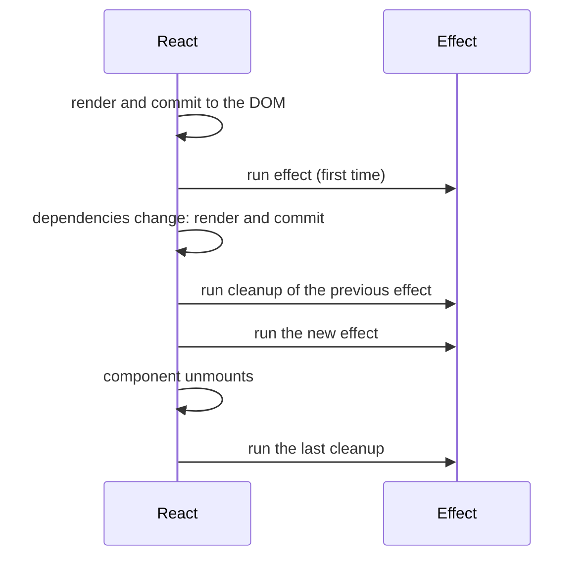

@part frontend-react-hooks | Frontend Part 5: React Hooks in Depth | frontend
## Rules, useState and useRef

### The rules of hooks

React tracks hooks by **call order**, in a list for each component. So:

1. Call hooks only at the top level, never inside conditions, loops or nested functions.
2. Call them only from components or custom hooks.

```tsx Why order matters
function Profile({ id }: { id: string }) {
  if (!id) return null;           // an early return before a hook breaks the rule
  const [name, setName] = useState('');   // called on some renders, not others
}
```

If the order changes between renders, React gives each hook the wrong slot. The ESLint plugin `react-hooks` catches this, so keep it enabled.

### useState details

```tsx Lazy initial state
const [draft, setDraft] = useState(() => localStorage.getItem('draft') ?? '');
```

Passing a function means that the costly read runs once only. A value expression would run on every render, and its result would then be ignored.

| Choose | When |
|---|---|
| One object in state | Fields that change together |
| Several `useState`s | Unrelated values |
| `useReducer` | Many transitions, or next state depends on several fields |

### useRef

A ref is a box whose `.current` survives renders, and changing it doesn't cause a render.

```tsx Two main uses
function Search() {
  // 1. Reach a DOM node
  const inputRef = useRef<HTMLInputElement>(null);
  useEffect(() => { inputRef.current?.focus(); }, []);

  // 2. Keep a value that doesn't affect the display
  const timer = useRef<number | undefined>(undefined);
  function onType() {
    clearTimeout(timer.current);
    timer.current = window.setTimeout(runSearch, 300);
  }

  return <input ref={inputRef} onChange={onType} />;
}
```

| | `useState` | `useRef` |
|---|---|---|
| Causes a render when changed | Yes | No |
| Value during render | A snapshot | Latest, but don't read it in render |
| Use for | What's shown | Timers, DOM nodes, previous values |

Don't read or write `ref.current` during rendering, except for lazy initialisation, because it makes rendering impure.

!keypoints Hooks rely on call order ;; Lazy initial state for costly work ;; A ref survives renders silently ;; Use state for anything displayed

?? Why can't a hook go inside an if?
=> React matches hooks by order, so a skipped call shifts every later hook to the wrong slot.
?? Would you store a timer ID in useState or useRef?
=> useRef, as it isn't shown, and changing it shouldn't cause a render.

## useEffect done properly

`useEffect` synchronises a component with something **outside React**: the network, timers, subscriptions and the DOM. It's the most misused hook.

### How it runs



```tsx A subscription with cleanup
useEffect(() => {
  const socket = connect(roomId);
  socket.on('message', addMessage);
  return () => socket.disconnect();     // cleanup
}, [roomId]);                           // runs again when roomId changes
```

| Dependencies | Runs |
|---|---|
| `[a, b]` | After mount, and when a or b changes |
| `[]` | After mount only |
| Missing | After every render |

### You might not need an effect

Most bugs come from effects that shouldn't exist.

| Instead of an effect for | Do this |
|---|---|
| Calculating derived data | Compute during render |
| Costly calculation | `useMemo` |
| Reacting to a click | Put it in the event handler |
| Resetting state when a prop changes | A `key` |
| Fetching data | A data library such as TanStack Query |
| Notifying a parent | Call its function in the handler |

```tsx An effect that shouldn't exist
// Wrong: an extra render, and states out of step for a moment
const [fullName, setFullName] = useState('');
useEffect(() => {
  setFullName(`${first} ${last}`);
}, [first, last]);

// Right
const fullName = `${first} ${last}`;
```

The test: **why does this code run?** Because the component appeared or data changed: an effect may fit. Because a user clicked: use the handler.

### Fetching with an effect, correctly

It's useful to see the problems, even if you'll generally use a library.

```tsx Handling races and cancellation
function useOrder(id: string) {
  const [state, setState] = useState<RemoteData<Order>>({ status: 'loading' });

  useEffect(() => {
    const controller = new AbortController();
    setState({ status: 'loading' });

    fetch(`/api/orders/${id}`, { signal: controller.signal })
      .then((res) => {
        if (!res.ok) throw new Error(`HTTP ${res.status}`);
        return res.json();
      })
      .then((data) => setState({ status: 'success', data }))
      .catch((e) => {
        if (e.name !== 'AbortError') setState({ status: 'error', message: e.message });
      });

    return () => controller.abort();    // id changed, or unmounted: cancel the old request
  }, [id]);

  return state;
}
```

Without the abort, if `id` changes from 1 to 2 and request 1 responds last, the page shows the wrong order. This code still has no caching, retries or sharing between components, which is why libraries exist.

### Dependencies are not a choice

Include every reactive value that the effect uses. Don't silence the lint rule. If a dependency causes too many runs, fix the cause:

| Problem | Fix |
|---|---|
| An object made in render changes each time | Move it inside the effect, or use primitive values |
| A function prop changes each render | `useCallback` in the parent, or move it inside |
| State only used for its previous value | Use the updater form |

### The stale closure

```tsx A timer stuck at 1
function Timer() {
  const [count, setCount] = useState(0);

  useEffect(() => {
    const id = setInterval(() => {
      setCount(count + 1);          // always sees count = 0, from the first render
    }, 1000);
    return () => clearInterval(id);
  }, []);

  return <p>{count}</p>;
}
```

The effect's closure captured the first render's `count`. It stays at 1. Fix it with `setCount((c) => c + 1)`, which needs no captured value.

### Double runs in development

Strict Mode runs effects, cleans them up, and runs them again on mount, in development only. This proves that your cleanup works. If this breaks something, your effect has a bug, such as a missing cleanup.

!interview Interview answer :: **"What is the stale closure problem?"** A function captures variables from the render that created it. If an effect with empty dependencies uses state, it sees the initial value forever. Fix it with an updater, correct dependencies, or a ref for the latest value.

!keypoints Effects synchronise with outside systems ;; Events belong in handlers ;; Always clean up ;; List all dependencies honestly

?? A form resets when a prop changes, using an effect. What's cleaner?
=> Give the form a `key` based on that prop, so React recreates it.
?? Why might an effect run twice in development?
=> Strict Mode mounts, cleans up and remounts, to test the cleanup. It doesn't in production.
?? What goes wrong without aborting a fetch when the id changes?
=> An older response can arrive last and overwrite newer data.

## useMemo, useCallback and useReducer

### useMemo and useCallback

`useMemo` caches a calculated value, and `useCallback` caches a function, both until dependencies change.

```tsx Two genuine reasons to use them
function Report({ rows, filter }: Props) {
  // 1. A truly expensive calculation
  const visible = useMemo(() => expensiveFilter(rows, filter), [rows, filter]);

  // 2. Keeping a reference stable for a memoised child
  const onSelect = useCallback((id: string) => setSelected(id), []);

  return <BigTable rows={visible} onSelect={onSelect} />;   // BigTable uses memo()
}
```

They aren't free, and don't speed up everything. Without `memo()` on the child, a stable callback changes nothing. Part 9 covers when they're worthwhile. The **React Compiler** adds this memoisation automatically at build time, so such hand-written code is becoming less necessary in projects that use it.

### useReducer

When state changes in many related ways, put all the transitions in one place, as a pure function.

```tsx A shopping cart
type CartItem = { id: string; price: number; qty: number };
type Action =
  | { type: 'add'; item: CartItem }
  | { type: 'remove'; id: string }
  | { type: 'setQty'; id: string; qty: number }
  | { type: 'clear' };

function cartReducer(items: CartItem[], action: Action): CartItem[] {
  switch (action.type) {
    case 'add': {
      const found = items.find((i) => i.id === action.item.id);
      return found
        ? items.map((i) => (i.id === found.id ? { ...i, qty: i.qty + 1 } : i))
        : [...items, action.item];
    }
    case 'remove':
      return items.filter((i) => i.id !== action.id);
    case 'setQty':
      return items.map((i) => (i.id === action.id ? { ...i, qty: action.qty } : i));
    case 'clear':
      return [];
  }
}

function Cart() {
  const [items, dispatch] = useReducer(cartReducer, []);
  return <button onClick={() => dispatch({ type: 'clear' })}>Empty ({items.length})</button>;
}
```

A reducer is plain code, so you can unit test it without React. It works like a small state machine.

### useContext

Context passes a value to everything below, without prop drilling.

```tsx Authentication through context
const AuthContext = createContext<User | null>(null);

function App() {
  const [user, setUser] = useState<User | null>(null);
  return (
    <AuthContext.Provider value={user}>
      <Layout />
    </AuthContext.Provider>
  );
}

function Avatar() {
  const user = useContext(AuthContext);
  return user ?  : null;
}
```

Every consumer renders again when the value changes. Part 6 covers when that's a problem.

### Newer hooks

| Hook | Use |
|---|---|
| `useId` | Stable unique IDs for labels and ARIA |
| `useTransition` | Mark an update as non-urgent, to keep typing smooth |
| `useDeferredValue` | Let a slow part lag behind input |
| `useLayoutEffect` | Measure the DOM before the browser paints |
| `useSyncExternalStore` | Subscribe to an outside store safely |
| `useActionState`, `useOptimistic`, `use` | React 19 form and data patterns |

!keypoints useMemo and useCallback are for real costs ;; A reducer gathers transitions in one testable place ;; Context avoids prop drilling, but re-renders consumers ;; The compiler reduces hand memoisation

?? Does useCallback make a component faster by itself?
=> No. It only helps if a memoised child, or a dependency list, relies on the function's identity.
?? When would you pick useReducer over useState?
=> When there are many related transitions, or the next state depends on several values. It's also easy to test.

## Writing custom hooks

A custom hook is a function starting with `use` that calls other hooks. It shares **logic**, not state: each call has its own state.

### Debounce

```tsx useDebounce
function useDebounce<T>(value: T, delayMs: number): T {
  const [debounced, setDebounced] = useState(value);

  useEffect(() => {
    const id = setTimeout(() => setDebounced(value), delayMs);
    return () => clearTimeout(id);       // cancel if the value changes first
  }, [value, delayMs]);

  return debounced;
}

function ProductSearch() {
  const [query, setQuery] = useState('');
  const search = useDebounce(query, 300);
  const results = useProducts(search);   // fetches only when typing pauses
  return <input value={query} onChange={(e) => setQuery(e.target.value)} />;
}
```

### localStorage

```tsx useLocalStorage
function useLocalStorage<T>(key: string, initial: T) {
  const [value, setValue] = useState<T>(() => {
    try {
      const saved = localStorage.getItem(key);
      return saved === null ? initial : (JSON.parse(saved) as T);
    } catch {
      return initial;                    // private mode, or corrupted JSON
    }
  });

  useEffect(() => {
    try {
      localStorage.setItem(key, JSON.stringify(value));
    } catch {
      // storage full or blocked: keep working without it
    }
  }, [key, value]);

  return [value, setValue] as const;
}
```

### Online status, safely

```tsx useSyncExternalStore for outside values
function subscribe(callback: () => void) {
  window.addEventListener('online', callback);
  window.addEventListener('offline', callback);
  return () => {
    window.removeEventListener('online', callback);
    window.removeEventListener('offline', callback);
  };
}

function useOnline() {
  return useSyncExternalStore(subscribe, () => navigator.onLine);
}
```

### Good custom hooks

| Do | Avoid |
|---|---|
| Name by purpose: `useOrders` | Lifecycle wrappers like `useMount` |
| Return what callers need | Hiding effects that surprise callers |
| Keep one concern | One hook that does everything |
| Test it alone | Sharing state by accident |

Test hooks with `renderHook` from Testing Library, as Part 10 shows.

!interview Interview answer :: **"Do two components using the same custom hook share state?"** No. Each call gets its own state, because a hook is just a function. To share state, lift it up, use context, or use a store.

!keypoints Custom hooks share logic, not state ;; Clean up timers and listeners ;; Handle storage errors ;; Name them by purpose

?? Two components call useDebounce. Do they share the debounced value?
=> No. Each call has its own state.
?? Why wrap localStorage in try and catch?
=> It can throw in private modes, when full, or on corrupted JSON. The app should keep working.
?? Why debounce search input?
=> To avoid a request per keystroke, and call the API only when typing pauses.
