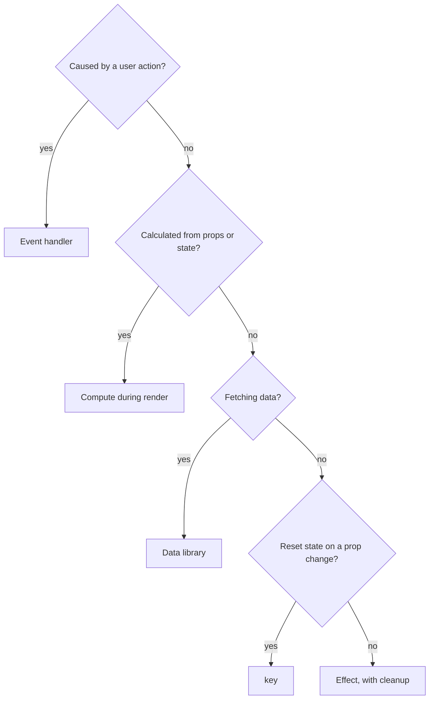
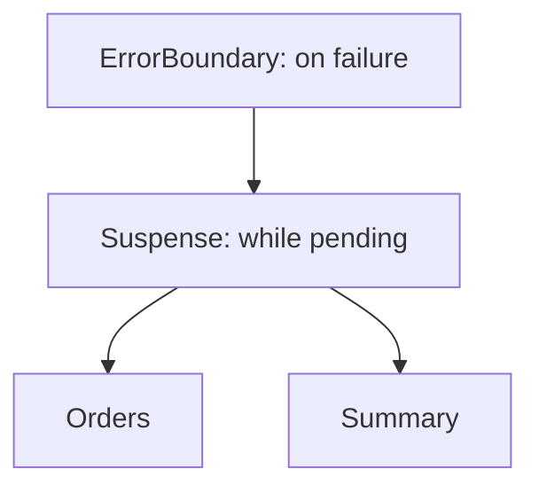

@more
## The useEffect clinic

Each of these bugs appears in real code. Try to diagnose each before reading the fix.

### Case 1: the infinite loop

```tsx Bug
const [user, setUser] = useState(null);
useEffect(() => {
  fetchUser().then(setUser);
});                                // no dependency array: runs after every render
```

Each fetch sets state, which renders, which runs the effect again. **Fix:** add `[]`, or better, use a query library.

### Case 2: an object dependency

```tsx Bug
function Results({ term }: { term: string }) {
  const [items, setItems] = useState([]);
  const options = { term, limit: 20 };         // a new object every render

  useEffect(() => {
    search(options).then(setItems);
  }, [options]);                               // always "changed", so this loops
}
```

**Fix:** create the object inside the effect, and depend on the primitive.

```tsx Fixed
useEffect(() => {
  search({ term, limit: 20 }).then(setItems);
}, [term]);
```

### Case 3: events disguised as effects

```tsx Bug
const [submitted, setSubmitted] = useState(false);

useEffect(() => {
  if (submitted) {
    post('/api/orders', order);
    showToast('Order placed');
  }
}, [submitted]);

<button onClick={() => setSubmitted(true)}>Place order</button>
```

It's complicated, it can repeat on remount, and it can't easily tell which click caused it. **Fix:** do it in the handler.

```tsx Fixed
async function placeOrder() {
  await post('/api/orders', order);
  showToast('Order placed');
}
<button onClick={placeOrder}>Place order</button>
```

### Case 4: copying props to state

```tsx Bug
function Editor({ user }: { user: User }) {
  const [name, setName] = useState(user.name);   // only reads the initial value
  // choosing another user still shows the old name
}
```

**Fix:** `<Editor key={user.id} user={user} />`, which gives a fresh instance per user. Avoid syncing with an effect, which causes an extra render, and briefly shows the wrong data.

### Case 5: chains of effects

```tsx Bug
useEffect(() => { setCity(null); }, [country]);
useEffect(() => { setArea(null); }, [city]);
useEffect(() => { setPincode(''); }, [area]);
```

Each step renders again, in a cascade. **Fix:** update everything in the one handler that changes `country`, or use a reducer.

```tsx Fixed
function onCountry(next: string) {
  setCountry(next);
  setCity(null);
  setArea(null);
  setPincode('');
}
```

### Case 6: async function as the effect

```tsx Bug
useEffect(async () => {          // returns a promise; React expects a cleanup function or nothing
  const data = await load();
  setData(data);
}, []);
```

**Fix:** define the async function inside.

```tsx Fixed
useEffect(() => {
  let active = true;
  (async () => {
    const data = await load();
    if (active) setData(data);
  })();
  return () => { active = false; };
}, []);
```

### Case 7: missing cleanup

```tsx Bug
useEffect(() => {
  window.addEventListener('resize', onResize);
  const id = setInterval(tick, 1000);
}, []);                          // the listener and timer outlive the component
```

**Fix:** return a cleanup that removes the listener and clears the timer. Strict Mode's double mount shows up this bug in development, as you'd get two listeners.

### Case 8: latest value without re-subscribing

A callback prop changes each render, but you don't want to reconnect a socket each time.

```tsx Keep the latest callback in a ref
function useChat(room: string, onMessage: (m: string) => void) {
  const latest = useRef(onMessage);
  useEffect(() => { latest.current = onMessage; });

  useEffect(() => {
    const socket = connect(room);
    socket.on('message', (m: string) => latest.current(m));
    return () => socket.close();
  }, [room]);                     // reconnects only when the room changes
}
```

### A decision guide



!keypoints Objects made in render change every time ;; User actions belong in handlers ;; Reset with a key ;; An effect can't be async directly

?? Why does an object created in render make an effect run every time?
=> It's a new reference each render, so the dependency comparison always sees a change.
?? Why can't you pass an async function directly to useEffect?
=> It returns a promise, whereas React expects a cleanup function or nothing.
?? How do you use the latest callback without reconnecting?
=> Store it in a ref updated each render, and call the ref from a stable effect.

## React 19: use, Suspense and optimistic UI

### useOptimistic

Show the expected result immediately during an action, falling back automatically when it ends.

```tsx A comment list
function Comments({ comments, send }: { comments: Comment[]; send: (text: string) => Promise<void> }) {
  const [optimistic, addOptimistic] = useOptimistic(
    comments,
    (current, text: string) => [...current, { id: 'temp', text, pending: true }],
  );

  async function action(data: FormData) {
    const text = String(data.get('text'));
    addOptimistic(text);
    await send(text);          // when this ends, the view returns to the real comments prop
  }

  return (
    <>
      <ul>
        {optimistic.map((c) => (
          <li key={c.id} style={{ opacity: c.pending ? 0.5 : 1 }}>{c.text}</li>
        ))}
      </ul>
      <form action={action}>
        <input name="text" aria-label="Comment" />
        <button>Post</button>
      </form>
    </>
  );
}
```

### useFormStatus

Lets a child know that its parent form is submitting, without passing props.

```tsx A submit button anywhere in a form
function SubmitButton() {
  const { pending } = useFormStatus();
  return <button disabled={pending}>{pending ? 'Saving…' : 'Save'}</button>;
}
```

It must be in a component **inside** the form, not in the one that renders the form.

### use

`use` reads a promise or context during render, and unlike other hooks, it can be called in conditions.

```tsx Reading a promise with Suspense
function OrderTotal({ orderPromise }: { orderPromise: Promise<Order> }) {
  const order = use(orderPromise);        // suspends until resolved
  return <p>{order.total}</p>;
}

<Suspense fallback={<p>Loading…</p>}>
  <OrderTotal orderPromise={promise} />
</Suspense>
```

The promise must be stable across renders. Creating it during render gives a new one each time, which suspends forever, so create it outside, cache it, or use a framework or library.

### Suspense for data with TanStack Query

```tsx useSuspenseQuery lets the component assume data exists
function Orders() {
  const { data } = useSuspenseQuery({ queryKey: ['orders'], queryFn: getOrders });
  return <OrderTable orders={data} />;     // no loading check needed here
}

<ErrorBoundary fallback={<ErrorBox />}>
  <Suspense fallback={<Skeleton />}>
    <Orders />
  </Suspense>
</ErrorBoundary>
```

Loading and errors move out to the parents, which can place one skeleton across several components.



### Transitions

```tsx Keep the old screen while the next loads
const [isPending, startTransition] = useTransition();

function goTo(next: number) {
  startTransition(() => setPage(next));   // no fallback flash for already shown content
}
```

### The React Compiler

The compiler analyses your components at build time, and adds memoisation, so hand-written `useMemo`, `useCallback` and `memo` are needed less. It needs code that follows the rules of React, so the `react-hooks` ESLint rules matter even more. Existing memoisation doesn't harm, and you can adopt it gradually. It doesn't fix slow calculations in general, oversized bundles or slow APIs.

### Older code you'll still meet

| Older | Modern |
|---|---|
| `forwardRef` | `ref` as a prop |
| `<Context.Provider>` | `<Context>` directly, in React 19 |
| Class lifecycles | Hooks |
| Manual `isSubmitting` state | `useActionState`, `useFormStatus` |

!keypoints useOptimistic reverts when the action ends ;; useFormStatus must be inside the form ;; use needs a stable promise ;; The compiler needs code that follows the rules

?? Why must a promise passed to use be stable?
=> A new promise each render suspends again, causing an endless loop of loading.
?? Why doesn't useFormStatus work in the component that renders the form?
=> It reads the status of a parent form, so it must be in a child of that form.
?? Does the React Compiler make all apps fast?
=> No. It reduces needless re-rendering, but not slow APIs, big bundles or expensive work.
