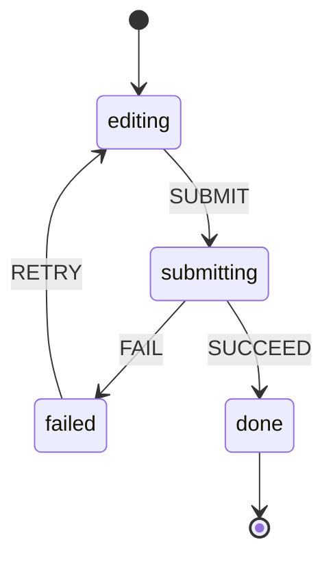

@more
## Modelling state well

Most state bugs are modelling bugs. A better shape often removes whole categories of error.

### Booleans become state machines

```tsx Booleans allow impossible states
const [isLoading, setLoading] = useState(false);
const [isError, setError] = useState(false);
const [isSuccess, setSuccess] = useState(false);
// loading AND error can both be true. What should the screen show?
```

```tsx One status with defined transitions
type Status =
  | { name: 'editing' }
  | { name: 'submitting' }
  | { name: 'failed'; message: string }
  | { name: 'done'; orderId: string };

type Event =
  | { type: 'SUBMIT' }
  | { type: 'FAIL'; message: string }
  | { type: 'SUCCEED'; orderId: string }
  | { type: 'RETRY' };

function checkout(state: Status, event: Event): Status {
  switch (state.name) {
    case 'editing':
      return event.type === 'SUBMIT' ? { name: 'submitting' } : state;
    case 'submitting':
      if (event.type === 'FAIL') return { name: 'failed', message: event.message };
      if (event.type === 'SUCCEED') return { name: 'done', orderId: event.orderId };
      return state;
    case 'failed':
      return event.type === 'RETRY' ? { name: 'editing' } : state;
    case 'done':
      return state;
  }
}
```



Now a second SUBMIT while submitting does nothing, which prevents double orders by design. Any unexpected event is ignored. You can test every transition with plain unit tests. The XState library takes this further, though a reducer is enough for most screens.

### A multi-step wizard

```tsx Steps as data
type Step = 'address' | 'payment' | 'review';
const ORDER: Step[] = ['address', 'payment', 'review'];

interface Wizard {
  step: Step;
  address?: Address;
  payment?: PaymentMethod;
}

type WizardAction =
  | { type: 'saveAddress'; value: Address }
  | { type: 'savePayment'; value: PaymentMethod }
  | { type: 'back' };

function wizard(state: Wizard, action: WizardAction): Wizard {
  const index = ORDER.indexOf(state.step);
  switch (action.type) {
    case 'saveAddress':
      return { ...state, address: action.value, step: 'payment' };
    case 'savePayment':
      return { ...state, payment: action.value, step: 'review' };
    case 'back':
      return { ...state, step: ORDER[Math.max(index - 1, 0)] };
  }
}
```

Keep the current step in the URL as well, if the browser's back button should work between steps.

### Normalising

Nested server data leads to deep update code and duplicates.

```ts Nested and normalised
// Nested: a user's name is repeated, and updating means searching
const posts = [{ id: 'p1', author: { id: 'u1', name: 'Asha' }, comments: [{ id: 'c1', author: { id: 'u1', name: 'Asha' } }] }];

// Normalised: like tables in a database, referenced by ID
const state = {
  users: { u1: { id: 'u1', name: 'Asha' } },
  posts: { p1: { id: 'p1', authorId: 'u1', commentIds: ['c1'] } },
  comments: { c1: { id: 'c1', authorId: 'u1' } },
};
```

It's the same idea as database normalisation, which you know from your Databases guide. Redux Toolkit's `createEntityAdapter` helps. You only need this for client-side stores with heavy, interlinked data. A query cache usually avoids it.

### Rules for clean state

| Rule | Example |
|---|---|
| Group related values | `{ x, y }`, rather than two separately changing values |
| Avoid contradictions | One status rather than several booleans |
| Avoid redundancy | Calculate totals |
| Avoid duplication | Keep an ID, not a copy |
| Avoid deep nesting | Flatten, or normalise |

!keypoints One status beats many booleans ;; Transitions can prevent double submits ;; Reducers test without React ;; Normalise only heavy client data

?? How does a state machine prevent double submits?
=> In the submitting state, a SUBMIT event has no transition, so it's ignored.
?? Why is one status better than isLoading, isError and isSuccess?
=> Booleans allow impossible combinations. A single status can only be one thing at a time.

## Advanced TanStack Query

### A query key factory

Scattered string keys go out of step. Keep them in one place.

```ts Keys and options in one module
export const orderKeys = {
  all: ['orders'] as const,
  lists: () => [...orderKeys.all, 'list'] as const,
  list: (filters: OrderFilters) => [...orderKeys.lists(), filters] as const,
  detail: (id: string) => [...orderKeys.all, 'detail', id] as const,
};

export const orderQuery = (id: string) =>
  queryOptions({
    queryKey: orderKeys.detail(id),
    queryFn: ({ signal }) => api.get<Order>(`/orders/${id}`, { signal }),
    staleTime: 60_000,
  });

// Elsewhere
useQuery(orderQuery(id));
queryClient.invalidateQueries({ queryKey: orderKeys.lists() });   // all lists, not details
```

Invalidation matches by prefix, so a hierarchy lets you refresh exactly what's needed.

### Dependent and parallel queries

```tsx One query waits for another
const { data: user } = useQuery(userQuery);
const { data: orders } = useQuery({
  queryKey: ['orders', user?.id],
  queryFn: () => getOrders(user!.id),
  enabled: !!user,                 // doesn't run until user exists
});
```

### Infinite scroll

```tsx useInfiniteQuery with an observer
function Feed() {
  const { data, fetchNextPage, hasNextPage, isFetchingNextPage } = useInfiniteQuery({
    queryKey: ['feed'],
    queryFn: ({ pageParam, signal }) => api.get<CursorPage<Post>>(`/feed?cursor=${pageParam}`, { signal }),
    initialPageParam: '',
    getNextPageParam: (last) => last.nextCursor ?? undefined,
  });

  const sentinel = useRef<HTMLDivElement>(null);
  useEffect(() => {
    const el = sentinel.current;
    if (!el) return;
    const observer = new IntersectionObserver(([entry]) => {
      if (entry.isIntersecting && hasNextPage && !isFetchingNextPage) fetchNextPage();
    });
    observer.observe(el);
    return () => observer.disconnect();
  }, [hasNextPage, isFetchingNextPage, fetchNextPage]);

  return (
    <>
      {data?.pages.flatMap((p) => p.items).map((post) => <PostCard key={post.id} post={post} />)}
      <div ref={sentinel} />
      {isFetchingNextPage && <Spinner />}
    </>
  );
}
```

On the Spring side, a keyset query such as `WHERE created_at < :cursor ORDER BY created_at DESC LIMIT 20` stays fast at any depth, unlike a large `OFFSET`, as your Databases guide explains.

### Prefetching

```tsx Fetch before the user clicks
<Link
  to={`/orders/${order.id}`}
  onMouseEnter={() => queryClient.prefetchQuery(orderQuery(order.id))}
>
  {order.id}
</Link>
```

### Updating from a response

If a mutation returns the updated object, write it straight into the cache, rather than refetching.

```tsx setQueryData from a response
useMutation({
  mutationFn: updateOrder,
  onSuccess: (updated) => {
    queryClient.setQueryData(orderKeys.detail(updated.id), updated);
    queryClient.invalidateQueries({ queryKey: orderKeys.lists() });
  },
});
```

### Global error handling

```ts One place for query errors
const queryClient = new QueryClient({
  queryCache: new QueryCache({
    onError: (error) => {
      if (error instanceof ApiError && error.status === 401) redirectToLogin();
    },
  }),
  defaultOptions: {
    queries: {
      staleTime: 30_000,
      retry: (count, error) =>
        !(error instanceof ApiError && error.status < 500) && count < 2,   // don't retry 4xx
    },
  },
});
```

The default retry policy retries failed queries three times with backoff, which makes a 404 look slow. Skip retries for client errors.

### Common mistakes

| Mistake | Result | Fix |
|---|---|---|
| Missing a variable in the key | Shows the wrong data | Include every input |
| Copying query data into `useState` | Goes stale | Use `data` directly |
| Fetching in `useEffect` and caching by hand | Duplicate logic | Use a query |
| No `staleTime` | Too many refetches | Set one for each kind of data |
| Sharing a `QueryClient` across users on a server | Data leaks | One per request in SSR |

!keypoints Keep keys in a factory ;; enabled makes queries dependent ;; Use a cursor for infinite scroll ;; Don't retry 4xx errors

?? Two filters show the same results. What's the likely bug?
=> The filter isn't in the query key, so both use one cache entry.
?? Why does a 404 take several seconds to show an error?
=> Default retries with backoff. Skip retries for client errors.
?? How do you refresh order lists but not an order's details?
=> Invalidate by a hierarchical key prefix, such as `['orders', 'list']`.
