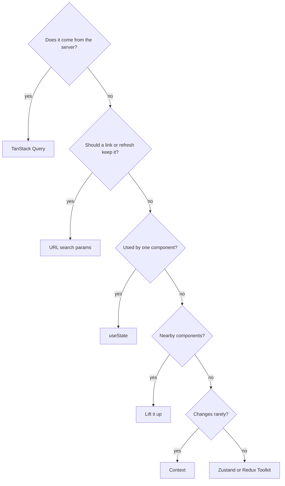
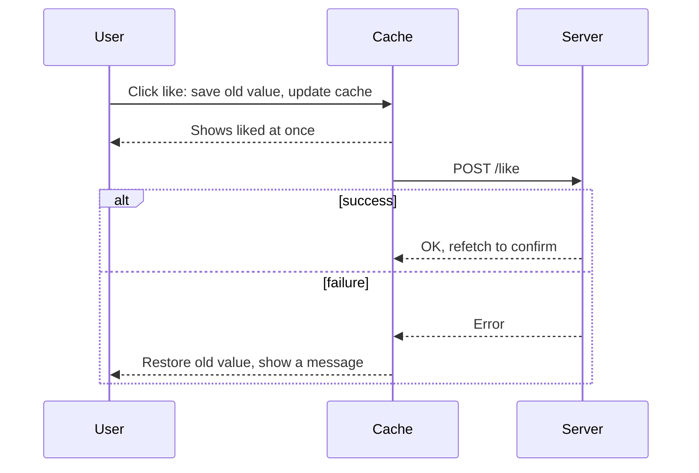
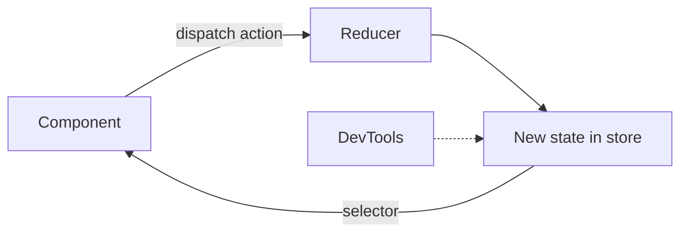

@part frontend-react-state | Frontend Part 6: State Management | frontend
## Kinds of state, and where each belongs

"Which state library should we use?" is usually the wrong first question. Most state doesn't need one. Sort it by kind first.

| Kind | Examples | Best home |
|---|---|---|
| Local UI | Is this menu open? | `useState` |
| Shared UI | Theme, sidebar, toasts | Context or a small store |
| Server cache | Orders, products, user | TanStack Query or RTK Query |
| URL | Filters, page, tab, selected ID | The router's search params |
| Form | Field values, errors | React Hook Form |
| Persistent preference | Dark mode | localStorage with state |



Many apps that once needed Redux now need very little global state, because most of it was really a server cache. Removing it is one of the biggest simplifications in modern React.

### URL state

Filters and pagination belong in the URL. Then links can be shared, refresh keeps the view, and the back button works.

```tsx Filters in the URL with React Router
function Orders() {
  const [params, setParams] = useSearchParams();
  const status = params.get('status') ?? 'ALL';
  const page = Number(params.get('page') ?? 1);

  return (
    <select
      value={status}
      onChange={(e) => setParams({ status: e.target.value, page: '1' })}
    >
      <option>ALL</option>
      <option>PAID</option>
    </select>
  );
}
```

### Keep state minimal

Avoid duplicate and contradictory state. Store `selectedId`, not a copy of the selected object, which goes out of date when the list updates. Calculate the rest during render.

!keypoints Sort state by kind first ;; Server data isn't client state ;; Filters belong in the URL ;; Store IDs rather than copies

?? Why store a selected order's ID rather than the object?
=> A copy goes stale when the list updates. Derive the object from the ID and the list.
?? Why put search filters in the URL?
=> Links are shareable, refresh keeps them, and back and forward work.

## Context, and its limits

Context solves prop drilling for values that many components need.

```tsx A theme context with a safe hook
type Theme = 'light' | 'dark';
const ThemeContext = createContext<{ theme: Theme; toggle: () => void } | null>(null);

export function ThemeProvider({ children }: { children: React.ReactNode }) {
  const [theme, setTheme] = useState<Theme>('dark');
  const value = useMemo(
    () => ({ theme, toggle: () => setTheme((t) => (t === 'dark' ? 'light' : 'dark')) }),
    [theme],
  );
  return <ThemeContext.Provider value={value}>{children}</ThemeContext.Provider>;
}

export function useTheme() {
  const ctx = useContext(ThemeContext);
  if (!ctx) throw new Error('useTheme must be used inside ThemeProvider');
  return ctx;
}
```

Without `useMemo`, the value is a new object each render, and every consumer renders again. The throwing hook gives a clear error when someone forgets the provider. This site's theme works the same way.

### The performance limit

Every component using a context renders when its value changes, even if it uses only one field.

```tsx Splitting contexts
// One big context: changing the cart renders everything reading the user
<AppContext.Provider value={{ user, cart, theme }}>

// Better: separate things that change at different rates
<UserContext.Provider value={user}>
  <CartContext.Provider value={cart}>
```

| Good for context | Poor for context |
|---|---|
| Theme, locale | Text being typed |
| Current user | Mouse position |
| Rarely changing settings | Large lists that change often |

Context is a delivery method, and not a state manager in itself. Before reaching for it, consider **composition**: passing components as `children` often removes prop drilling altogether.

```tsx Composition removes the middle layers
// Drilling: Layout and Sidebar only pass user along
<Layout user={user} />

// Composition: Layout doesn't need to know
<Layout sidebar={<Sidebar><Avatar user={user} /></Sidebar>} />
```

!keypoints Memoise a provider's value ;; Split contexts by rate of change ;; Consumers render on any change ;; Try composition first

?? Why might every consumer render even though the data hasn't changed?
=> The provider's value is a new object each render. Memoise it.
?? Context holds user and cart. Adding to the cart renders the avatar. How do you fix it?
=> Split into two contexts, or use a store with selectors.

## Server state with TanStack Query

Server data differs from client state. It's owned elsewhere, can be out of date, and needs caching, refetching, deduplication and error handling. Writing this by hand with `useEffect` means rewriting a library badly.

```tsx Setup
const queryClient = new QueryClient();

createRoot(document.getElementById('root')!).render(
  <QueryClientProvider client={queryClient}>
    <App />
  </QueryClientProvider>,
);
```

### Reading

```tsx useQuery
function useOrders(status: string, page: number) {
  return useQuery({
    queryKey: ['orders', { status, page }],     // the cache key: include every input
    queryFn: ({ signal }) => api.get<OrderPage>(`/orders?status=${status}&page=${page}`, { signal }),
    staleTime: 30_000,                          // fresh for 30 seconds
    placeholderData: keepPreviousData,          // keep the old page visible while the next loads
  });
}

function Orders() {
  const { data, isPending, isError, error } = useOrders('PAID', 1);
  if (isPending) return <Spinner />;
  if (isError) return <ErrorBox error={error} />;
  return <OrderTable orders={data.content} />;
}
```

You get, for free: caching, sharing between components, request deduplication, retries, refetching when the window regains focus, and cancellation through the signal.

### Stale and cached

| Term | Meaning | Default |
|---|---|---|
| `staleTime` | How long data counts as fresh | 0: always refetch in the background |
| `gcTime` | How long unused data stays in memory | 5 minutes |
| Fetching | A request is running | |
| Pending | No data yet | |

**Stale-while-revalidate:** show cached data at once, and update it quietly. The default refetching is often more than people expect, so set a sensible `staleTime`.

### Writing

```tsx useMutation with cache invalidation
function useCancelOrder() {
  const queryClient = useQueryClient();
  return useMutation({
    mutationFn: (id: string) => api.post(`/orders/${id}/cancel`),
    onSuccess: () => {
      queryClient.invalidateQueries({ queryKey: ['orders'] });   // refetch all order lists
    },
  });
}

function CancelButton({ id }: { id: string }) {
  const cancel = useCancelOrder();
  return (
    <button disabled={cancel.isPending} onClick={() => cancel.mutate(id)}>
      {cancel.isPending ? 'Cancelling…' : 'Cancel'}
    </button>
  );
}
```

### Optimistic updates

Show the result at once, and undo it if the server refuses.



```tsx Optimistic with rollback
useMutation({
  mutationFn: (id: string) => api.post(`/posts/${id}/like`),
  onMutate: async (id) => {
    await queryClient.cancelQueries({ queryKey: ['post', id] });
    const previous = queryClient.getQueryData<Post>(['post', id]);
    queryClient.setQueryData<Post>(['post', id], (p) => p && { ...p, liked: true });
    return { previous };
  },
  onError: (_e, id, ctx) => queryClient.setQueryData(['post', id], ctx?.previous),
  onSettled: (_d, _e, id) => queryClient.invalidateQueries({ queryKey: ['post', id] }),
});
```

Use it for low-risk actions, such as likes. Don't show money transfers as done before the server confirms.

### Pagination and infinite scroll

Use `useInfiniteQuery` with Spring's `Page` response or a cursor. Prefer a cursor when data changes often, since offset pages shift when rows are added. Spring Data's `Slice` avoids a costly count query for infinite scroll.

!interview Interview answer :: **"Why not just useEffect and useState for fetching?"** You'd have to write caching, deduplication, race handling, retries, background refresh and cache invalidation yourself. TanStack Query provides these, and shares data across components with a single key.

!keypoints Query keys include every input ;; Set a sensible staleTime ;; Invalidate after writes ;; Use optimistic updates only for low-risk actions

?? Two components use the same query key. How many requests are sent?
=> One. Requests are deduplicated, and both share the cached result.
?? After a mutation, the list shows old data. What's missing?
=> Invalidate the related query keys, or update the cache.
?? What does staleTime: 0 cause when you return to the tab?
=> A background refetch, since data counts as stale immediately.

## Redux Toolkit and Zustand

When you truly have complex client state, used across the app and changed from many places, use a store: for example an editor, a dashboard builder or a complex multi-step workflow.

### Zustand: small and simple

```ts A store in a few lines
import { create } from 'zustand';

interface CartState {
  items: CartItem[];
  add: (item: CartItem) => void;
  clear: () => void;
}

export const useCart = create<CartState>((set) => ({
  items: [],
  add: (item) => set((s) => ({ items: [...s.items, item] })),
  clear: () => set({ items: [] }),
}));
```

```tsx Selecting only what you need
function CartBadge() {
  const count = useCart((s) => s.items.length);   // renders only when the count changes
  return <span>{count}</span>;
}
```

Selectors solve context's problem: components render only when their selected value changes. There's no provider.

### Redux Toolkit

Redux has one store, actions that describe events, and pure reducers. It's common in large companies, so expect to meet it at work. Redux Toolkit (RTK) is the modern way to write it, and removes the old boilerplate.

```ts A slice
import { createSlice, configureStore, type PayloadAction } from '@reduxjs/toolkit';

const cartSlice = createSlice({
  name: 'cart',
  initialState: { items: [] as CartItem[] },
  reducers: {
    added(state, action: PayloadAction<CartItem>) {
      state.items.push(action.payload);     // looks like mutation: Immer makes it safe
    },
    cleared(state) {
      state.items = [];
    },
  },
});

export const { added, cleared } = cartSlice.actions;
export const store = configureStore({ reducer: { cart: cartSlice.reducer } });
export type RootState = ReturnType<typeof store.getState>;
```

```tsx Using it
function Cart() {
  const items = useSelector((s: RootState) => s.cart.items);
  const dispatch = useDispatch();
  return <button onClick={() => dispatch(cleared())}>Clear ({items.length})</button>;
}
```



### Choosing

| | Context | Zustand | Redux Toolkit |
|---|---|---|---|
| Setup | None | Very small | More |
| Selective re-render | No | Yes | Yes |
| DevTools and time travel | No | Basic, by middleware | Excellent |
| Structure in large teams | Little | Little | Strong conventions |
| Data fetching | No | No | RTK Query |
| Common in | All apps | Newer apps | Large or older apps |

**A sensible default:** TanStack Query for server data, URL for filters, `useState` for local state. Add a store only if something remains that hurts.

!interview Interview answer :: **"Redux or Context?"** They solve different problems. Context passes values down, and re-renders all consumers. Redux is a store with selectors, DevTools and structure. I'd first move server data to TanStack Query, as often little remains that needs a global store.

!keypoints Stores are for complex client state ;; Selectors limit re-renders ;; RTK removes Redux boilerplate ;; Many apps need neither

?? Why does RTK allow state.items.push inside a reducer?
=> Immer records the changes on a draft, and produces a new immutable state.
?? Why might a Zustand selector perform better than context?
=> A component renders only when its selected value changes, rather than on any change.
?? An app has Redux full of API data and loading flags. What would you suggest?
=> Move server data to TanStack Query or RTK Query, leaving only real client state.
