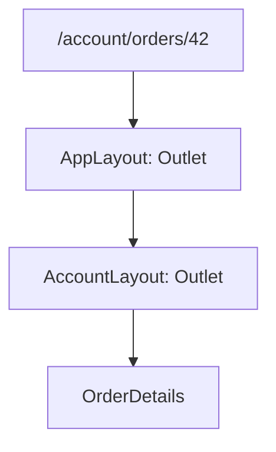

@more
## Nested layouts, loaders and actions

### Nested routes share layouts

```tsx An account area with tabs that keep their layout
const router = createBrowserRouter([
  {
    path: '/',
    element: <AppLayout />,
    errorElement: <RootError />,
    children: [
      { index: true, element: <Home /> },
      {
        path: 'account',
        element: <RequireAuth><AccountLayout /></RequireAuth>,
        children: [
          { index: true, element: <Navigate to="profile" replace /> },
          { path: 'profile', element: <Profile /> },
          { path: 'orders', element: <AccountOrders /> },
          { path: 'orders/:id', element: <OrderDetails />, errorElement: <OrderError /> },
        ],
      },
    ],
  },
]);

function AccountLayout() {
  return (
    <div className="account">
      <nav aria-label="Account">
        <NavLink to="profile">Profile</NavLink>
        <NavLink to="orders">Orders</NavLink>
      </nav>
      <Outlet />
    </div>
  );
}
```



`NavLink` knows if it matches the URL, and it sets `aria-current="page"` and an active class. Moving between tabs renders only what changes, so that scroll, layout and state in the parent survive. A nested `errorElement` means that a failure replaces only that part of the screen.

### Loaders and actions

A **loader** runs before a route renders, and an **action** handles a form submission.

```tsx A route with data and a mutation
const orderRoute = {
  path: 'orders/:id',
  loader: async ({ params }: LoaderFunctionArgs) => {
    const res = await fetch(`/api/orders/${params.id}`);
    if (res.status === 404) throw new Response('Not found', { status: 404 });
    if (!res.ok) throw new Response('Failed', { status: res.status });
    return res.json();
  },
  action: async ({ params, request }: ActionFunctionArgs) => {
    const form = await request.formData();
    const res = await fetch(`/api/orders/${params.id}/note`, {
      method: 'POST',
      headers: { 'Content-Type': 'application/json' },
      body: JSON.stringify({ note: form.get('note') }),
    });
    return res.ok ? { saved: true } : { error: 'Could not save' };
  },
  element: <OrderDetails />,
  errorElement: <OrderError />,
};

function OrderDetails() {
  const order = useLoaderData() as Order;
  const result = useActionData() as { saved?: boolean; error?: string } | undefined;
  const navigation = useNavigation();

  return (
    <>
      <h1>Order {order.id}</h1>
      <Form method="post">
        <label htmlFor="note">Note</label>
        <input id="note" name="note" />
        <button disabled={navigation.state === 'submitting'}>Save</button>
      </Form>
      {result?.error && <p role="alert">{result.error}</p>}
    </>
  );
}

function OrderError() {
  const error = useRouteError();
  return isRouteErrorResponse(error) && error.status === 404
    ? <p>That order doesn't exist.</p>
    : <p>Something went wrong.</p>;
}
```

After an action, the router automatically reloads the page's loaders, so that data stays fresh without manual cache work.

| Approach | Good | Watch out |
|---|---|---|
| TanStack Query in components | Rich cache; simple to adopt | Loading happens after navigation |
| Router loaders | No loading flicker; data before render | Basic caching on its own |
| Both | Loader calls `ensureQueryData` | A little more setup |

### Unsaved changes

```tsx Warn before leaving
function useUnsavedWarning(dirty: boolean) {
  const blocker = useBlocker(dirty);

  useEffect(() => {
    if (!dirty) return;
    const handler = (e: BeforeUnloadEvent) => e.preventDefault();
    window.addEventListener('beforeunload', handler);     // closing or reloading the tab
    return () => window.removeEventListener('beforeunload', handler);
  }, [dirty]);

  return blocker;     // show a dialog when blocker.state === 'blocked'
}
```

`useBlocker` needs a data router, and it covers navigation inside your app. `beforeunload` covers leaving the app.

### URL design

| Rule | Good | Avoid |
|---|---|---|
| Resource in the path | `/orders/42` | `/orderDetails?id=42` |
| View state in query | `/orders?status=PAID&page=2` | State in memory only |
| Nouns | `/orders` | `/getOrders` |
| Readable | `/products/java-book-42` | `/p?x=42&y=a7` |

Validate values in the URL, as users can type anything: `?page=abc` shouldn't crash the page.

!keypoints Layouts nest through Outlet ;; Nested errorElement limits damage ;; Actions reload loaders ;; Validate URL values

?? What does Outlet do?
=> It marks where the matched child route renders in a parent layout.
?? How do you warn about closing a tab with unsaved work?
=> A `beforeunload` listener, while dirty. Use `useBlocker` for navigation inside the app.
?? A user changes ?page=abc in the URL. What should happen?
=> Parse and validate it, then fall back to page 1, rather than crashing or sending it to the API.

## Hard forms: arrays, dependent fields and editing

### Dynamic rows with useFieldArray

An invoice has any number of line items, each validated.

```tsx An invoice form
const schema = z.object({
  customer: z.string().min(1, 'Required'),
  items: z.array(z.object({
    name: z.string().min(1, 'Required'),
    qty: z.coerce.number().int().min(1, 'At least 1'),
    price: z.coerce.number().min(0, 'Cannot be negative'),
  })).min(1, 'Add at least one item'),
});
type Input = z.input<typeof schema>;
type Output = z.output<typeof schema>;

function InvoiceForm({ onSave }: { onSave: (v: Output) => Promise<void> }) {
  const {
    register, control, handleSubmit,
    formState: { errors, isSubmitting },
  } = useForm<Input, unknown, Output>({
    resolver: zodResolver(schema),
    defaultValues: { customer: '', items: [{ name: '', qty: 1, price: 0 }] },
  });
  const { fields, append, remove } = useFieldArray({ control, name: 'items' });

  const items = useWatch({ control, name: 'items' });
  const total = (items ?? []).reduce(
    (sum, i) => sum + Number(i?.qty ?? 0) * Number(i?.price ?? 0), 0,
  );

  return (
    <form onSubmit={handleSubmit(onSave)} noValidate>
      <label htmlFor="customer">Customer</label>
      <input id="customer" {...register('customer')} />
      {errors.customer && <p role="alert">{errors.customer.message}</p>}

      {fields.map((field, i) => (
        <fieldset key={field.id}>
          <legend>Item {i + 1}</legend>
          <label htmlFor={`name-${i}`}>Name</label>
          <input id={`name-${i}`} {...register(`items.${i}.name`)} />
          {errors.items?.[i]?.name && <p role="alert">{errors.items[i].name.message}</p>}
          <label htmlFor={`qty-${i}`}>Quantity</label>
          <input id={`qty-${i}`} type="number" {...register(`items.${i}.qty`)} />
          <label htmlFor={`price-${i}`}>Price</label>
          <input id={`price-${i}`} type="number" {...register(`items.${i}.price`)} />
          <button type="button" onClick={() => remove(i)}>Remove item {i + 1}</button>
        </fieldset>
      ))}
      <button type="button" onClick={() => append({ name: '', qty: 1, price: 0 })}>Add item</button>
      <p>Total: ₹{total}</p>
      <button disabled={isSubmitting}>Save invoice</button>
    </form>
  );
}
```

Use `field.id` as the key, never the array index, as `useFieldArray` provides it for this reason. Both add and remove buttons have `type="button"`, otherwise they'd submit the form. Note that `total` here is for display only: the server must calculate the real total.

### Cross-field validation

```ts Rules that involve several fields
const signup = z.object({
  password: z.string().min(8),
  confirm: z.string(),
  start: z.iso.date(),
  end: z.iso.date(),
})
  .refine((v) => v.password === v.confirm, {
    message: 'Passwords do not match',
    path: ['confirm'],                  // shows the error on this field
  })
  .refine((v) => v.start <= v.end, {
    message: 'End date must be after start',
    path: ['end'],
  });
```

### Fields that depend on each other

```tsx Reset the city when the state changes
const state = watch('state');
const { data: cities = [] } = useQuery({
  queryKey: ['cities', state],
  queryFn: () => getCities(state),
  enabled: !!state,
});

<select {...register('state', { onChange: () => setValue('city', '') })}>...</select>
<select {...register('city')} disabled={!state}>
  {cities.map((c) => <option key={c.id} value={c.id}>{c.name}</option>)}
</select>
```

### Editing existing data

Load the data first, then pass it as default values. Remount with a `key`, or call `reset(data)`, when the data arrives.

```tsx Edit form
function EditOrder({ id }: { id: string }) {
  const { data } = useQuery(orderQuery(id));
  if (!data) return <Spinner />;
  return <OrderForm key={data.id} defaultValues={data} />;
}
```

Consider what happens if two people edit one record. Send a version with the form, and let Spring's `@Version` return a 409, which the UI can explain.

### Non-native inputs

Date pickers and custom selects don't expose a `ref` to a real input, so use `Controller`.

```tsx Controller adapts a custom component
<Controller
  control={control}
  name="deliveryDate"
  render={({ field, fieldState }) => (
    <>
      <DatePicker value={field.value} onChange={field.onChange} onBlur={field.onBlur} />
      {fieldState.error && <p role="alert">{fieldState.error.message}</p>}
    </>
  )}
/>
```

### Accessible forms

| Practice | Why |
|---|---|
| Move focus to the first error on submit | Keyboard and screen reader users find it |
| `aria-invalid` and `aria-describedby` | Links errors to fields |
| `fieldset` and `legend` for groups | Gives context to radio groups |
| Don't rely on placeholders or colour | Both can be missed |
| Don't disable submit until valid | People can't discover what's wrong |

React Hook Form focuses the first invalid field by default, using registered refs.

!keypoints Use field.id as the key ;; Type="button" for non-submit buttons ;; Use path to place cross-field errors ;; Controller adapts custom inputs

?? Why not use the array index as key in useFieldArray?
=> Removing a row would shift indexes, and inputs would keep the wrong values. `field.id` is stable.
?? How does a cross-field error appear on the right input?
=> The refine's `path` names the field that receives it.
?? Two people edit one order. How can the second be told?
=> Send a version, let Spring's `@Version` return a 409, and offer to reload.
