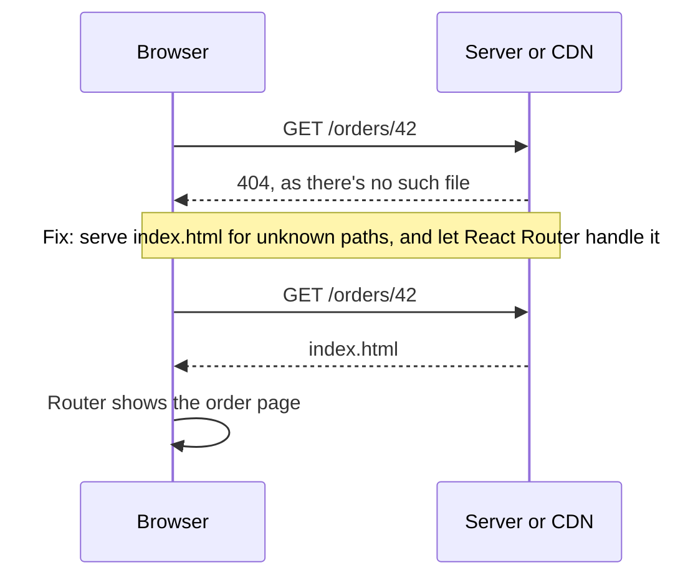

@part frontend-routing-forms | Frontend Part 7: Routing and Forms | frontend
## Client-side routing

In a single-page app, the server sends one HTML file, and JavaScript chooses what to show based on the URL. No full reload happens when moving between pages.

```tsx Routes with React Router
import { createBrowserRouter, RouterProvider, Outlet, Link } from 'react-router';

const router = createBrowserRouter([
  {
    path: '/',
    element: <Layout />,
    errorElement: <ErrorPage />,
    children: [
      { index: true, element: <Home /> },
      { path: 'orders', element: <Orders /> },
      { path: 'orders/:id', element: <OrderDetails /> },
      { path: '*', element: <NotFound /> },
    ],
  },
]);

function Layout() {
  return (
    <>
      <nav><Link to="/orders">Orders</Link></nav>
      <main><Outlet /></main>      {/* the matched child appears here */}
    </>
  );
}

createRoot(document.getElementById('root')!).render(<RouterProvider router={router} />);
```

### Reading the URL

```tsx Hooks for route data
function OrderDetails() {
  const { id } = useParams();                       // from the path /orders/:id
  const [params] = useSearchParams();               // from ?tab=items
  const tab = params.get('tab') ?? 'summary';
  const navigate = useNavigate();                   // go somewhere from code

  async function onDelete() {
    await remove(id!);
    navigate('/orders', { replace: true });
  }
  return <button onClick={onDelete}>Delete {id} ({tab})</button>;
}
```

### The 404 on refresh

A very common deployment bug. The user opens `/orders/42`, which works through client routing. But on refresh, the browser asks the **server** for `/orders/42`, and no such file exists.



The fix is to send `index.html` for any path that's not a real file. In Spring Boot, forward non-API routes. In CloudFront, map 403 and 404 errors to `/index.html`, though that also hides API 404s if they share the same distribution, so scope this behaviour carefully. Nginx uses `try_files $uri /index.html`.

```java Serving a React build from Spring Boot
@Controller
class SpaController {
    @GetMapping({"/orders/**", "/account/**"})
    String forward() {
        return "forward:/index.html";
    }
}
```

### Protecting routes

```tsx A guard component
function RequireAuth({ children }: { children: React.ReactNode }) {
  const user = useAuth();
  const location = useLocation();
  if (!user) {
    return <Navigate to="/login" replace state={{ from: location }} />;
  }
  return children;
}

{ path: 'account', element: <RequireAuth><Account /></RequireAuth> }
```

!warning Guards aren't security :: Anyone can change JavaScript in their browser. A route guard only improves the experience. Your Spring Boot API must check permissions on every request.

### Data routers

Route **loaders** fetch before showing a page, and **actions** handle form submissions. They reduce loading flicker, and work with TanStack Query as well.

```tsx Loaders and error handling
{
  path: 'orders/:id',
  element: <OrderDetails />,
  loader: ({ params }) => queryClient.ensureQueryData(orderQuery(params.id!)),
}
```

### Split per route

Loading each page lazily keeps the first download small: routes are the natural points to split, as Part 9 shows. Also restore scroll position (`<ScrollRestoration />`) and update the page title, so that navigation feels normal.

!keypoints Client routing needs a server fallback ;; Guards are for experience, not security ;; Put view state in the URL ;; Split code by route

?? A deployed app works until a user refreshes on /orders/42. Why?
=> The server has no such file. Serve index.html for app paths, and let the router handle them.
?? Why isn't a RequireAuth component enough to protect admin data?
=> Client code can be changed by the user. The API must check permissions.

## Forms from simple to serious

### Uncontrolled forms and FormData

For simple forms, let the browser hold values, and read them on submit.

```tsx Simple and fast
function Contact() {
  function onSubmit(e: React.FormEvent<HTMLFormElement>) {
    e.preventDefault();
    const data = new FormData(e.currentTarget);
    send(Object.fromEntries(data));
  }
  return (
    <form onSubmit={onSubmit}>
      <input name="email" type="email" required />
      <button>Send</button>
    </form>
  );
}
```

### Actions in React 19

```tsx useActionState tracks pending state and results
function Subscribe() {
  const [state, formAction, isPending] = useActionState(
    async (_previous: { error?: string } | null, data: FormData) => {
      const res = await fetch('/api/subscribe', {
        method: 'POST',
        body: JSON.stringify({ email: data.get('email') }),
        headers: { 'Content-Type': 'application/json' },
      });
      return res.ok ? { error: undefined } : { error: 'Could not subscribe' };
    },
    null,
  );

  return (
    <form action={formAction}>
      <input name="email" type="email" required />
      <button disabled={isPending}>{isPending ? 'Saving…' : 'Subscribe'}</button>
      {state?.error && <p role="alert">{state.error}</p>}
    </form>
  );
}
```

### React Hook Form with Zod

For real forms, with many fields, validation and server errors, use a library. It avoids re-rendering on every keystroke, and removes much repetitive code.

```tsx A typed, validated form
const schema = z.object({
  email: z.email('Enter a valid email'),
  age: z.coerce.number().min(18, 'You must be at least 18'),
  password: z.string().min(8, 'Use at least 8 characters'),
});
type FormInput = z.input<typeof schema>;      // what the fields hold: age is still unknown
type FormValues = z.output<typeof schema>;    // what you get after validation: age is a number

function SignUp() {
  const {
    register, handleSubmit, setError,
    formState: { errors, isSubmitting },
  } = useForm<FormInput, unknown, FormValues>({ resolver: zodResolver(schema) });

  async function onSubmit(values: FormValues) {
    const res = await fetch('/api/users', {
      method: 'POST',
      headers: { 'Content-Type': 'application/json' },
      body: JSON.stringify(values),
    });
    if (res.status === 400) {
      const problem = await res.json();
      for (const [field, message] of Object.entries(problem.errors ?? {})) {
        setError(field as keyof FormInput, { message: String(message) });
      }
      return;
    }
    if (!res.ok) {
      setError('root', { message: 'Something went wrong. Please try again.' });
    }
  }

  return (
    <form onSubmit={handleSubmit(onSubmit)} noValidate>
      <label htmlFor="email">Email</label>
      <input id="email" {...register('email')} aria-invalid={!!errors.email} />
      {errors.email && <p role="alert">{errors.email.message}</p>}

      <label htmlFor="age">Age</label>
      <input id="age" type="number" {...register('age')} />
      {errors.age && <p role="alert">{errors.age.message}</p>}

      <label htmlFor="password">Password</label>
      <input id="password" type="password" {...register('password')} />
      {errors.password && <p role="alert">{errors.password.message}</p>}

      {errors.root && <p role="alert">{errors.root.message}</p>}
      <button disabled={isSubmitting}>{isSubmitting ? 'Creating…' : 'Create account'}</button>
    </form>
  );
}
```

`z.coerce` changes the type between input and output, which is why this form names both. Using a single `z.infer` type here gives a compile error, so copy this shape when any field is coerced or transformed.

### Matching validation with Spring Boot

Validation runs twice: the client gives fast feedback, while the server is what counts. Map Spring's errors onto fields.

```java Field errors in a shape React can use
@RestControllerAdvice
class ApiErrors {

    @ExceptionHandler(MethodArgumentNotValidException.class)
    ProblemDetail invalid(MethodArgumentNotValidException e) {
        ProblemDetail problem = ProblemDetail.forStatus(HttpStatus.BAD_REQUEST);
        problem.setTitle("Validation failed");
        Map<String, String> errors = new HashMap<>();
        e.getBindingResult().getFieldErrors()
            .forEach(f -> errors.put(f.getField(), f.getDefaultMessage()));
        problem.setProperty("errors", errors);
        return problem;
    }
}
```

### Form details that matter

| Detail | Why |
|---|---|
| Disable submit while pending | Prevents duplicates; the server should still be idempotent |
| Show errors next to fields | Faster to fix |
| Keep input after an error | Don't punish people by clearing it |
| Warn before losing changes | Long forms |
| Correct input types and autocomplete | Mobile keyboards, password managers |
| Validate on blur or submit, not on each key | Less noise |

### File uploads

```tsx Upload with progress
function upload(file: File, onProgress: (percent: number) => void) {
  return new Promise<void>((resolve, reject) => {
    const xhr = new XMLHttpRequest();                 // fetch has no upload progress
    xhr.open('PUT', presignedUrl);
    xhr.setRequestHeader('Content-Type', file.type);
    xhr.upload.onprogress = (e) => onProgress(Math.round((e.loaded / e.total) * 100));
    xhr.onload = () => (xhr.status < 300 ? resolve() : reject(new Error(`HTTP ${xhr.status}`)));
    xhr.onerror = () => reject(new Error('Network error'));
    xhr.send(file);
  });
}
```

Your AWS part explains pre-signed URLs. Check size and type in the browser for quick feedback, and again on the server, where it counts.

!keypoints Use FormData for simple forms ;; Use a form library with a schema for real ones ;; Validate on both sides ;; Map server errors onto fields

?? Why does React Hook Form re-render less than controlled inputs?
=> It keeps inputs uncontrolled and reads values through refs, so typing needn't render the form.
?? The server returns a 400 for a duplicate email. How should the UI show it?
=> Map it to the email field's error, and keep the user's other input.
?? Why disable the submit button if the server is idempotent anyway?
=> It gives clear feedback and avoids needless requests. The server's protection remains the real guarantee.
