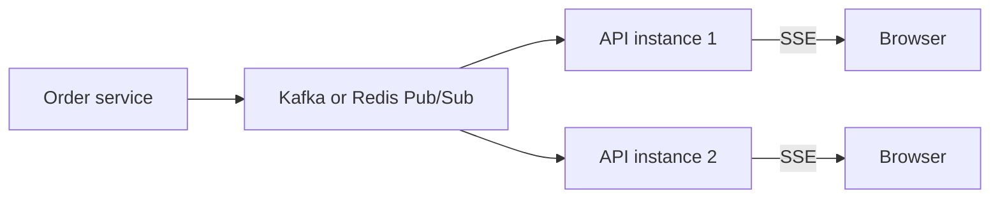

@more
## A complete CRUD feature, end to end

This chapter builds a "notes" feature on both sides, showing how each decision connects.

### The Spring Boot API

```java Records, validation, and ownership checks
public record NoteDto(Long id, String title, String body, long version, Instant updatedAt) {
    static NoteDto of(Note n) {
        return new NoteDto(n.getId(), n.getTitle(), n.getBody(), n.getVersion(), n.getUpdatedAt());
    }
}

public record SaveNote(@NotBlank @Size(max = 120) String title,
                       @Size(max = 5000) String body,
                       Long version) {}

@RestController
@RequestMapping("/api/notes")
class NoteController {

    private final NoteService notes;

    NoteController(NoteService notes) { this.notes = notes; }

    @GetMapping
    PagedModel<NoteDto> list(@AuthenticationPrincipal Jwt jwt,
                             @RequestParam(defaultValue = "") String q,
                             @PageableDefault(size = 20, sort = "updatedAt", direction = DESC) Pageable page) {
        return new PagedModel<>(notes.list(jwt.getSubject(), q, page));
    }

    @PostMapping
    ResponseEntity<NoteDto> create(@AuthenticationPrincipal Jwt jwt, @Valid @RequestBody SaveNote body) {
        NoteDto saved = notes.create(jwt.getSubject(), body);
        return ResponseEntity.created(URI.create("/api/notes/" + saved.id())).body(saved);
    }

    @PutMapping("/{id}")
    NoteDto update(@AuthenticationPrincipal Jwt jwt, @PathVariable long id, @Valid @RequestBody SaveNote body) {
        return notes.update(jwt.getSubject(), id, body);       // checks owner and version
    }

    @DeleteMapping("/{id}")
    ResponseEntity<Void> delete(@AuthenticationPrincipal Jwt jwt, @PathVariable long id) {
        notes.delete(jwt.getSubject(), id);
        return ResponseEntity.noContent().build();
    }
}
```

`PagedModel` gives a stable JSON shape with `content` and a nested `page` object. A version conflict from `@Version` throws `ObjectOptimisticLockingFailureException`, which you can map to a 409 in your `@RestControllerAdvice`.

### Frontend: the data layer

```ts features/notes/notes.api.ts
export interface Note { id: number; title: string; body: string; version: number; updatedAt: string; }
export interface NotePage {
  content: Note[];
  page: { size: number; number: number; totalElements: number; totalPages: number };
}
export type SaveNote = { title: string; body: string; version?: number };

export const noteKeys = {
  all: ['notes'] as const,
  list: (q: string, page: number) => ['notes', 'list', { q, page }] as const,
  detail: (id: number) => ['notes', 'detail', id] as const,
};

export const notesApi = {
  list: (q: string, page: number, signal?: AbortSignal) =>
    api.get<NotePage>(`/notes?q=${encodeURIComponent(q)}&page=${page}`, { signal }),
  get: (id: number) => api.get<Note>(`/notes/${id}`),
  create: (body: SaveNote) => api.post<Note>('/notes', body),
  update: (id: number, body: SaveNote) => api.put<Note>(`/notes/${id}`, body),
  remove: (id: number) => api.del<void>(`/notes/${id}`),
};
```

### Frontend: hooks

```ts features/notes/useNotes.ts
export function useNotes(q: string, page: number) {
  return useQuery({
    queryKey: noteKeys.list(q, page),
    queryFn: ({ signal }) => notesApi.list(q, page, signal),
    placeholderData: keepPreviousData,
  });
}

export function useSaveNote() {
  const client = useQueryClient();
  return useMutation({
    mutationFn: ({ id, ...body }: SaveNote & { id?: number }) =>
      id ? notesApi.update(id, body) : notesApi.create(body),
    onSuccess: (note) => {
      client.setQueryData(noteKeys.detail(note.id), note);
      client.invalidateQueries({ queryKey: ['notes', 'list'] });
    },
  });
}

export function useDeleteNote() {
  const client = useQueryClient();
  return useMutation({
    mutationFn: notesApi.remove,
    onSuccess: () => client.invalidateQueries({ queryKey: ['notes', 'list'] }),
  });
}
```

### Frontend: the list screen

```tsx features/notes/NotesPage.tsx
export function NotesPage() {
  const [params, setParams] = useSearchParams();
  const q = params.get('q') ?? '';
  const page = Math.max(0, Number(params.get('page')) || 0);
  const [draft, setDraft] = useState(q);
  const search = useDebounce(draft, 300);

  useEffect(() => {
    if (search !== q) setParams(search ? { q: search } : {}, { replace: true });
  }, [search]);        // keep the URL in step once typing pauses

  const { data, isPending, isError, refetch, isPlaceholderData } = useNotes(q, page);
  const remove = useDeleteNote();

  return (
    <main>
      <h1>Notes</h1>
      <Link to="new">New note</Link>
      <label htmlFor="q">Search</label>
      <input id="q" value={draft} onChange={(e) => setDraft(e.target.value)} />

      {isPending && <p>Loading…</p>}
      {isError && <p role="alert">Couldn't load notes. <button onClick={() => refetch()}>Try again</button></p>}
      {data?.content.length === 0 && <p>{q ? 'No notes match your search.' : 'No notes yet. Create your first one.'}</p>}

      <ul style={{ opacity: isPlaceholderData ? 0.6 : 1 }}>
        {data?.content.map((n) => (
          <li key={n.id}>
            <Link to={String(n.id)}>{n.title}</Link>
            <button
              aria-label={`Delete ${n.title}`}
              onClick={() => { if (confirm(`Delete "${n.title}"?`)) remove.mutate(n.id); }}
            >
              Delete
            </button>
          </li>
        ))}
      </ul>

      {data && data.page.totalPages > 1 && (
        <nav aria-label="Pagination">
          <button disabled={page === 0} onClick={() => setParams({ q, page: String(page - 1) })}>Previous</button>
          <span>Page {page + 1} of {data.page.totalPages}</span>
          <button disabled={page + 1 >= data.page.totalPages} onClick={() => setParams({ q, page: String(page + 1) })}>Next</button>
        </nav>
      )}
    </main>
  );
}
```

### Handling the conflict

```tsx Showing a version conflict
const save = useSaveNote();

async function onSubmit(values: FormValues) {
  try {
    await save.mutateAsync({ id: note?.id, version: note?.version, ...values });
    navigate('/notes');
  } catch (e) {
    if (e instanceof ApiError && e.status === 409) {
      setError('root', { message: 'Someone else changed this note. Reload to see their version.' });
    } else if (e instanceof ApiError && e.status === 400) {
      applyFieldErrors(e.problem, setError);
    } else {
      setError('root', { message: 'Could not save. Please try again.' });
    }
  }
}
```

### Checklist: what makes this production-minded

| Concern | Where it's handled |
|---|---|
| Ownership | The service, using the token's subject |
| Validation | Bean Validation on the server; Zod for quick feedback |
| Lost updates | `@Version`, and a 409 in the UI |
| Stale results | Query keys, plus abort signals |
| Shareable state | Search and page in the URL |
| All the states | Loading, error, empty, no matches, placeholder |
| Accessible delete | A label naming each row |

!keypoints Build features in layers: API, data, screen ;; Keep search and page in the URL ;; Map 409 and 400 to useful messages ;; The server checks ownership

?? Why does the delete button's label include the note's title?
=> "Delete" alone is ambiguous for a screen reader in a list. The title identifies the row.
?? What protects two tabs from overwriting each other?
=> A version sent with each update. `@Version` rejects stale writes, and the UI shows the 409.
?? Why keep a separate draft state from the q in the URL?
=> The input must update on every key, whereas the URL and fetch only change when typing pauses.

## Live updates and file uploads

### Server-sent events from Spring Boot

```java Pushing order status updates
@RestController
class OrderEvents {

    private final Map<String, List<SseEmitter>> clients = new ConcurrentHashMap<>();

    @GetMapping(value = "/api/orders/events", produces = MediaType.TEXT_EVENT_STREAM_VALUE)
    SseEmitter subscribe(@AuthenticationPrincipal Jwt jwt) {
        SseEmitter emitter = new SseEmitter(0L);                      // no timeout
        String user = jwt.getSubject();
        clients.computeIfAbsent(user, k -> new CopyOnWriteArrayList<>()).add(emitter);
        Runnable remove = () -> clients.getOrDefault(user, List.of()).remove(emitter);
        emitter.onCompletion(remove);
        emitter.onTimeout(remove);
        emitter.onError(e -> remove.run());
        return emitter;
    }

    void publish(String user, OrderUpdate update) {
        for (SseEmitter emitter : clients.getOrDefault(user, List.of())) {
            try {
                emitter.send(SseEmitter.event().name("order").data(update));
            } catch (IOException e) {
                emitter.complete();
            }
        }
    }
}
```

```tsx Connecting events to the query cache
function useOrderEvents() {
  const client = useQueryClient();
  useEffect(() => {
    const source = new EventSource('/api/orders/events', { withCredentials: true });
    source.addEventListener('order', () => {
      client.invalidateQueries({ queryKey: ['orders'] });
    });
    return () => source.close();
  }, [client]);
}
```

`EventSource` reconnects by itself, but it can't set an `Authorization` header, so it works best with cookie authentication. With bearer tokens, read the stream with `fetch`, as the AI part's chat hook does.

An in-memory emitter map works for one instance only. With several, publish through Redis Pub/Sub or Kafka, so that the instance holding each connection receives the event.



### File uploads through the API

```java Spring multipart upload
@PostMapping("/api/avatars")
ResponseEntity<Void> upload(@AuthenticationPrincipal Jwt jwt, @RequestParam("file") MultipartFile file) throws IOException {
    if (file.getSize() > 2_000_000) {
        throw new ResponseStatusException(HttpStatus.PAYLOAD_TOO_LARGE);
    }
    if (!List.of("image/png", "image/jpeg").contains(file.getContentType())) {
        throw new ResponseStatusException(HttpStatus.UNSUPPORTED_MEDIA_TYPE);
    }
    avatars.store(jwt.getSubject(), file.getInputStream());     // check real content too: this header can lie
    return ResponseEntity.noContent().build();
}
```

```tsx An upload form with a preview
function AvatarUpload() {
  const [preview, setPreview] = useState<string | null>(null);

  useEffect(() => () => { if (preview) URL.revokeObjectURL(preview); }, [preview]);

  function onPick(e: React.ChangeEvent<HTMLInputElement>) {
    const file = e.target.files?.[0];
    if (!file) return;
    if (file.size > 2_000_000) {
      alert('Please choose an image under 2 MB');
      return;
    }
    setPreview(URL.createObjectURL(file));
  }

  async function onSubmit(e: React.FormEvent<HTMLFormElement>) {
    e.preventDefault();
    const body = new FormData(e.currentTarget);
    await fetch('/api/avatars', { method: 'POST', body, credentials: 'include' });  // no Content-Type!
  }

  return (
    <form onSubmit={onSubmit}>
      <label htmlFor="file">Choose a photo</label>
      <input id="file" name="file" type="file" accept="image/png,image/jpeg" onChange={onPick} />
      {preview && }
      <button>Upload</button>
    </form>
  );
}
```

!warning Don't set Content-Type for FormData :: The browser adds `multipart/form-data` with the required boundary. Setting it yourself removes the boundary, and Spring then fails to parse the upload. A shared API client that always sets JSON causes this bug.

`URL.createObjectURL` holds memory until revoked, hence the cleanup. For large files, use pre-signed URLs, as your AWS part explains.

!keypoints EventSource reconnects, but can't set headers ;; Scale SSE with a broker ;; Let the browser set multipart headers ;; Check file content on the server

?? An upload fails with "no multipart boundary". Why?
=> Content-Type was set by hand. Let the browser set it for FormData.
?? SSE works locally, but only some users get updates in production. Why?
=> Connections are on different instances, and the emitter map is per instance. Publish through a broker.
?? Why revoke an object URL?
=> It keeps the file in memory until released or the page closes.

## Docker, Nginx and production serving

### A frontend image

```dockerfile Build with Node, serve with Nginx
FROM node:22-alpine AS build
WORKDIR /app
COPY package.json package-lock.json ./
RUN npm ci
COPY . .
RUN npm run build

FROM nginx:1.27-alpine
COPY nginx.conf /etc/nginx/conf.d/default.conf
COPY dist /usr/share/nginx/html
```

The final image holds only Nginx and static files, with no Node and no source code. This is the multi-stage build from your Docker guide.

```nginx nginx.conf
server {
  listen 80;
  root /usr/share/nginx/html;

  # React Router: serve index.html for app paths
  location / {
    try_files $uri /index.html;
    add_header Cache-Control "no-cache";
  }

  # Hashed assets can be cached for a long time
  location /assets/ {
    add_header Cache-Control "public, max-age=31536000, immutable";
  }

  # One domain, so no CORS
  location /api/ {
    proxy_pass http://backend:8080;
    proxy_set_header Host $host;
    proxy_set_header X-Forwarded-For $proxy_add_x_forwarded_for;
    proxy_set_header X-Forwarded-Proto $scheme;
    proxy_buffering off;              # lets server-sent events stream
    proxy_read_timeout 3600s;
  }

  gzip on;
  gzip_types text/css application/javascript application/json image/svg+xml;
}
```

Spring Boot needs `server.forward-headers-strategy=native` to trust these forwarded headers, for correct redirects and links.

### Running it all locally

```yaml docker-compose.yml
services:
  db:
    image: postgres:16
    environment:
      POSTGRES_PASSWORD: dev
      POSTGRES_DB: shop
    volumes: [dbdata:/var/lib/postgresql/data]
  backend:
    build: ./backend
    environment:
      SPRING_DATASOURCE_URL: jdbc:postgresql://db:5432/shop
      SPRING_DATASOURCE_USERNAME: postgres
      SPRING_DATASOURCE_PASSWORD: dev
    depends_on: [db]
  frontend:
    build: ./frontend
    ports: ["8081:80"]
    depends_on: [backend]
volumes:
  dbdata:
```

### Security headers

```nginx Useful response headers
add_header X-Content-Type-Options "nosniff";
add_header Referrer-Policy "strict-origin-when-cross-origin";
add_header X-Frame-Options "DENY";
add_header Content-Security-Policy "default-src 'self'; img-src 'self' data:; object-src 'none'; base-uri 'self'";
```

A Content Security Policy is the strongest defence against XSS damage, as it limits which scripts can run. Begin in report-only mode, as a strict policy can break inline scripts and third-party tools. Note that `add_header` in a `location` block replaces those from the parent level, so repeat them or use an include.

### Tracking errors and usage

| Tool type | Gives you |
|---|---|
| Error tracking, such as Sentry | Stack traces per release |
| Real user monitoring | Web Vitals from real devices |
| Product analytics | What people actually use |
| Session replay | Reproduces bugs; handle privacy with care |

Respect privacy: get consent where needed, don't record passwords or personal details, and be honest about what you collect.

!keypoints Multi-stage build, with only static files in the image ;; try_files handles client routes ;; Turn off buffering for streams ;; CSP limits XSS damage

?? Why doesn't the final image contain Node?
=> The build stage produced static files, and Nginx serves them, so the image is smaller and safer.
?? What does try_files $uri /index.html do?
=> It serves a real file if one exists, or index.html, so that React Router handles the path.
?? Why serve the API through the same Nginx?
=> Same origin means no CORS, and only one public address.
