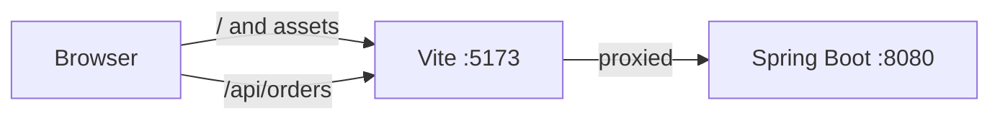
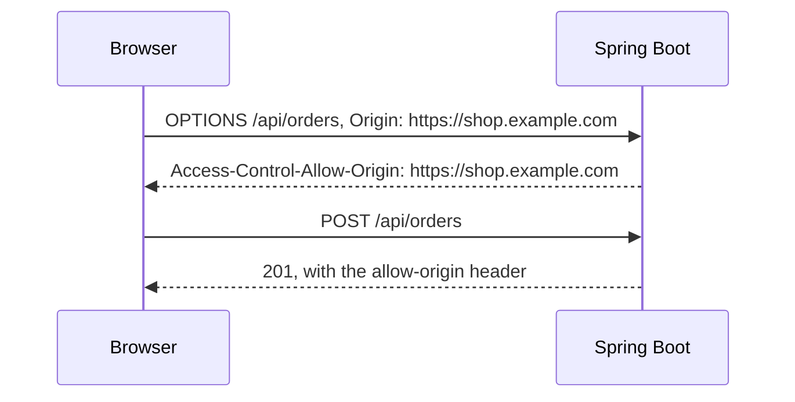
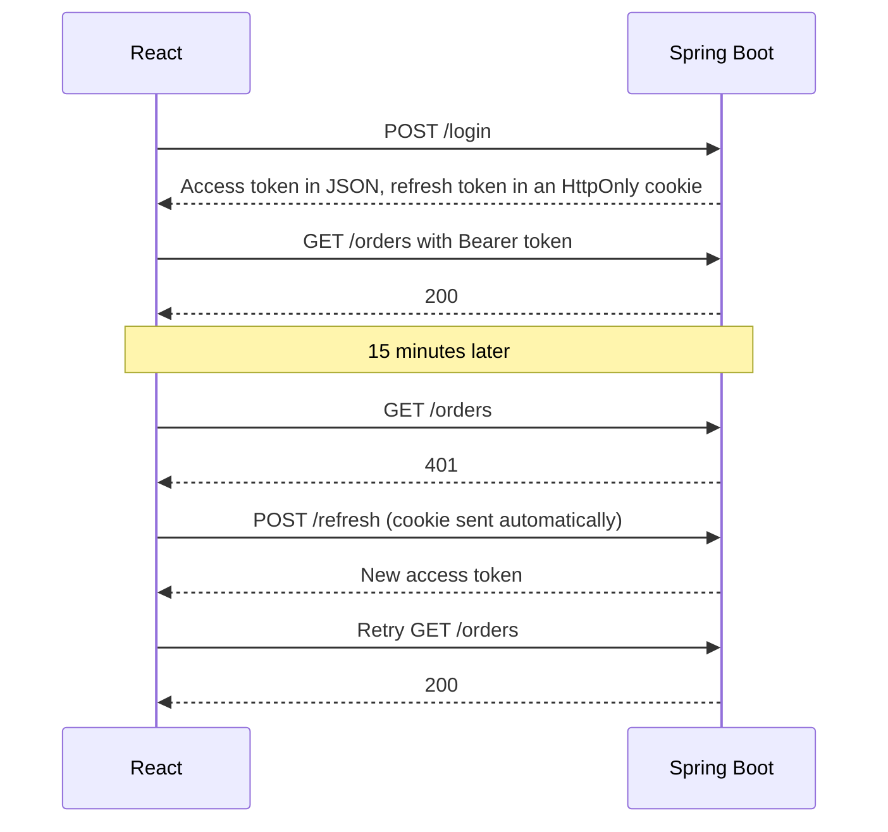

@part frontend-react-spring | Frontend Part 8: React with a Spring Boot API | frontend
## Connecting the two halves

### Development setup

React runs on Vite's dev server, and Spring Boot on another port. Different ports mean different origins, so the browser would apply CORS rules. A **proxy** avoids this in development.

```ts vite.config.ts: forward /api to Spring Boot
export default defineConfig({
  plugins: [react()],
  server: {
    proxy: {
      '/api': { target: 'http://localhost:8080', changeOrigin: true },
    },
  },
});
```



The browser only sees one origin, so no CORS is involved, and your code can use relative URLs such as `/api/orders`.

### CORS

If the two are on different origins in production, the server must allow it.



```java CORS through Spring Security
@Bean
CorsConfigurationSource corsConfigurationSource() {
    CorsConfiguration config = new CorsConfiguration();
    config.setAllowedOrigins(List.of("https://shop.example.com"));
    config.setAllowedMethods(List.of("GET", "POST", "PUT", "PATCH", "DELETE"));
    config.setAllowedHeaders(List.of("Authorization", "Content-Type"));
    config.setAllowCredentials(true);
    UrlBasedCorsConfigurationSource source = new UrlBasedCorsConfigurationSource();
    source.registerCorsConfiguration("/api/**", config);
    return source;
}

@Bean
SecurityFilterChain api(HttpSecurity http) throws Exception {
    return http.cors(Customizer.withDefaults())   /* ...the rest of your rules... */ .build();
}
```

Common causes of CORS errors:

| Symptom | Cause |
|---|---|
| Works in Postman, fails in the browser | CORS is only enforced by browsers |
| Preflight fails with 401 | Spring Security blocks OPTIONS: enable `.cors()` in the chain |
| `*` with credentials fails | Wildcards can't be used with credentials |
| Header missing only on errors | The error response bypasses your CORS configuration |
| A 500 shown as a CORS error | The real error is hidden: check the server's logs |

### A small API client

Don't scatter `fetch` everywhere. One module handles the base URL, JSON, tokens and errors.

```ts lib/api.ts
export class ApiError extends Error {
  constructor(public status: number, public problem: unknown, message: string) {
    super(message);
  }
}

async function request<T>(path: string, options: RequestInit = {}): Promise<T> {
  const res = await fetch(`/api${path}`, {
    ...options,
    headers: { 'Content-Type': 'application/json', ...options.headers },
    credentials: 'include',
  });

  if (res.status === 401) {
    window.location.assign('/login');
    throw new ApiError(401, null, 'Please sign in');
  }
  if (!res.ok) {
    const problem = await res.json().catch(() => null);
    throw new ApiError(res.status, problem, problem?.detail ?? `Request failed (${res.status})`);
  }
  return res.status === 204 ? (undefined as T) : res.json();
}

export const api = {
  get: <T>(path: string, init?: RequestInit) => request<T>(path, init),
  post: <T>(path: string, body?: unknown) =>
    request<T>(path, { method: 'POST', body: JSON.stringify(body) }),
};
```

Axios is a popular alternative, with interceptors and automatic JSON, though `fetch` is enough for many apps.

!keypoints Use a proxy in development ;; CORS is enforced by browsers ;; Centralise API calls ;; Check the server logs behind a CORS error

?? Why does an API work in Postman but not in React?
=> CORS is only enforced by browsers. The server must allow the page's origin.
?? Why can a preflight fail with 401?
=> The security filter blocks OPTIONS, as it has no credentials. Enable CORS in the security chain.
?? Why have one API module?
=> Base URL, headers, errors and token handling live in one place.

## Authentication

### Options

| Approach | How | XSS risk | CSRF risk | Fits |
|---|---|---|---|---|
| Server session with HttpOnly cookie | Spring Session; cookie sent automatically | Low | Needs protection | Your own frontend and API, same site |
| JWT in memory, refresh in HttpOnly cookie | Short-lived access token | Lower | For the refresh endpoint | SPA with a separate API |
| JWT in localStorage | Simple | **High** | None | Avoid for sensitive apps |
| Backend for frontend (BFF) | Server holds tokens; browser has a cookie | Low | Needs protection | OAuth with strong security |

Don't assume that JWTs are required: a session cookie is simple and strong when your frontend and API share a site.

### Access and refresh tokens



```ts A shared refresh, so that parallel 401s don't all refresh
let refreshing: Promise<string> | null = null;

async function refreshToken(): Promise<string> {
  refreshing ??= fetch('/api/auth/refresh', { method: 'POST', credentials: 'include' })
    .then((res) => {
      if (!res.ok) throw new Error('Session expired');
      return res.json();
    })
    .then((body) => body.accessToken)
    .finally(() => { refreshing = null; });
  return refreshing;
}
```

Ten requests may fail at once, and without this shared promise, ten refreshes run. With refresh token rotation, this can log the user out. Keep this in mind.

### Keeping the user in React

```tsx An auth hook on TanStack Query
function useCurrentUser() {
  return useQuery({
    queryKey: ['me'],
    queryFn: () => api.get<User>('/me'),
    retry: false,
    staleTime: 5 * 60_000,
  });
}
```

Treat `/me` as the source of truth. On logout, call the server, and clear the query cache, so that the next user doesn't see cached data on a shared computer.

### Roles in the UI

Hide buttons a user can't use, for a better experience. But every API call must still check. **Hiding isn't protecting.**

```tsx Show actions by permission
{user.permissions.includes('ORDER_REFUND') && <RefundButton order={order} />}
```

### Login with Google, using OAuth

For an SPA, use the **Authorization Code flow with PKCE**, or let Spring Boot act as the OAuth client as a backend for frontend, which keeps tokens away from the browser. Avoid the old implicit flow.

!interview Interview answer :: **"Where do you store a JWT in the browser?"** Ideally not in localStorage, as XSS can read it. I'd hold a short-lived access token in memory, and a refresh token in an HttpOnly, Secure, SameSite cookie, or use a session cookie if the API and app share a site.

!keypoints A session cookie is often enough ;; Avoid localStorage for tokens ;; Refresh once, and share the promise ;; The API must always check

?? Why do many parallel 401s need special handling?
=> Otherwise each triggers a refresh. Share one refresh promise, and retry afterwards.
?? On logout, why clear the React Query cache?
=> Otherwise, the next user on that device could see the previous user's data.
?? Is hiding the Refund button enough?
=> No. Someone can call the API directly, so the server must check permission.

## Handling API results in the UI

### Pagination with Spring Data

```java A paged endpoint
@GetMapping("/orders")
Page<OrderView> orders(@RequestParam(defaultValue = "0") int page,
                       @RequestParam(defaultValue = "20") int size,
                       @AuthenticationPrincipal User user) {
    Pageable pageable = PageRequest.of(page, Math.min(size, 100), Sort.by("createdAt").descending());
    return orders.findByOwner(user.id(), pageable).map(OrderView::of);
}
```

Spring's `Page` JSON has `content`, `totalElements` and `totalPages`. Recent Spring versions warn that serialising `PageImpl` directly isn't a stable format, so consider `PagedModel`, or your own response record. Note the cap on `size`: never trust a client's page size.

```tsx Pagination in React
function OrdersPage() {
  const [params, setParams] = useSearchParams();
  const page = Number(params.get('page') ?? 0);
  const { data, isPlaceholderData } = useQuery({
    queryKey: ['orders', page],
    queryFn: () => api.get<Page<Order>>(`/orders?page=${page}`),
    placeholderData: keepPreviousData,
  });

  return (
    <>
      <OrderTable orders={data?.content ?? []} dim={isPlaceholderData} />
      <button disabled={page === 0} onClick={() => setParams({ page: String(page - 1) })}>Previous</button>
      <button disabled={!data || page + 1 >= data.totalPages} onClick={() => setParams({ page: String(page + 1) })}>Next</button>
    </>
  );
}
```

### Every async screen has several states

| State | Show |
|---|---|
| Loading first time | Skeleton, in the page's shape |
| Refreshing | Keep content; a small indicator |
| Empty | A helpful message, and the next action |
| Error | What happened, and a retry |
| Partial | Show what loaded |
| Success | The data |

Forgetting the empty and error states is the most common sign of an inexperienced frontend.

### Errors

Spring Boot supports RFC 9457 **Problem Details**, a standard error format.

```json A problem response
{
  "type": "https://example.com/errors/insufficient-stock",
  "title": "Insufficient stock",
  "status": 409,
  "detail": "Only 2 items are left.",
  "instance": "/api/orders"
}
```

| Status | UI behaviour |
|---|---|
| 400, 422 | Show on the form's fields |
| 401 | Refresh, or go to login |
| 403 | "You don't have access" |
| 404 | A not-found page |
| 409 | Explain the conflict; offer a reload |
| 429 | Wait and retry; tell the user |
| 500, 503 | A generic message with a retry and a request ID for support |

Don't show raw server messages or stack traces to users. Do report unexpected errors to a tool such as Sentry.

### Real-time updates

| Technique | Direction | Use |
|---|---|---|
| Polling (`refetchInterval`) | Client asks | Simple status checks |
| Server-sent events | Server to client | Notifications, progress, AI streaming |
| WebSockets (STOMP in Spring) | Both ways | Chat, collaboration |

Start with polling, as it's simple, and works through every proxy. Reach for WebSockets only when you truly need both directions and low latency. WebSockets also need sticky routing, or a broker, when you scale out.

### Timezones and formats

Send UTC from the server (`Instant`), and format in the browser for the user.

```ts Formatting for an Indian user
new Intl.DateTimeFormat('en-IN', { dateStyle: 'medium', timeStyle: 'short' })
  .format(new Date(order.createdAt));

new Intl.NumberFormat('en-IN', { style: 'currency', currency: 'INR' }).format(125000.5);
// ₹1,25,000.50
```

!keypoints Cap the page size on the server ;; Design all states: loading, empty and error ;; Use Problem Details ;; Start with polling

?? What states must an order list handle besides success?
=> First load, background refresh, empty, and error, ideally with a retry.
?? Why should the server cap page size?
=> A client could ask for millions of rows, and overload the database.
?? When would you pick server-sent events over WebSockets?
=> When only the server needs to push, such as progress or streaming. It's simpler, and uses plain HTTP.

## Building and deploying

### The production build

```bash Build
npm run build     # creates dist/, with hashed file names
npm run preview   # check it locally
```

Hashed names such as `index-8f2a1c.js` let you cache files forever, and each new build gets new names. Only `index.html` must not be cached for long.

### Two ways to deploy

| | Serve from Spring Boot | Separate static hosting |
|---|---|---|
| How | Copy `dist` to `resources/static` | S3 + CloudFront, or similar |
| Origin | Same: no CORS | Same if routed behind one domain |
| Deploy | One artefact | Frontend and backend independently |
| Fit | Small apps, portfolio | Production apps |

```xml Building React inside the Maven build (frontend-maven-plugin)
<plugin>
  <groupId>com.github.eirslett</groupId>
  <artifactId>frontend-maven-plugin</artifactId>
  <version>1.15.1</version>
  <configuration>
    <workingDirectory>frontend</workingDirectory>
    <nodeVersion>v22.14.0</nodeVersion>
  </configuration>
  <executions>
    <execution><id>install</id><goals><goal>install-node-and-npm</goal></goals></execution>
    <execution><id>ci</id><goals><goal>npm</goal></goals><configuration><arguments>ci</arguments></configuration></execution>
    <execution><id>build</id><goals><goal>npm</goal></goals><configuration><arguments>run build</arguments></configuration></execution>
  </executions>
</plugin>
```

### Configuration

Vite embeds `import.meta.env.VITE_*` values **at build time**, in public JavaScript. Never put secrets there: everything in a frontend bundle is public. Anything secret stays on the server. If you need one build across environments, load `/config.json` at start-up.

### Rolling out

A user may keep an old tab open across a deployment, and then a lazy-loaded chunk it wants may no longer exist. Keep old assets for a while after deploying, and catch chunk-load failures with a prompt to refresh. Old frontend code also keeps calling your API, so keep API changes backward compatible.

### CI

```yaml A frontend job
- run: npm ci
- run: npm run lint
- run: npx tsc --noEmit
- run: npm test -- --run
- run: npm run build
```

`npm ci` installs exactly what the lock file says, unlike `npm install`.

!warning Everything shipped is public :: API keys in a React bundle can be read by anyone. Call third-party services through your backend, as Spring Boot can hold the secret.

!keypoints Hashed assets can be cached for a long time ;; Short cache for index.html ;; Secrets never go in the bundle ;; Old tabs keep calling your API

?? Can you hide an API key using a VITE_ environment variable?
=> No. It's built into public JavaScript. Keep the key on the server.
?? Users get a chunk load error after a deployment. Why?
=> An old tab requested a file that was removed. Keep old assets for a while, and prompt a refresh.
?? What's the difference between npm ci and npm install?
=> `npm ci` installs exactly from the lock file, and fails if it disagrees with package.json. Use it in CI.
