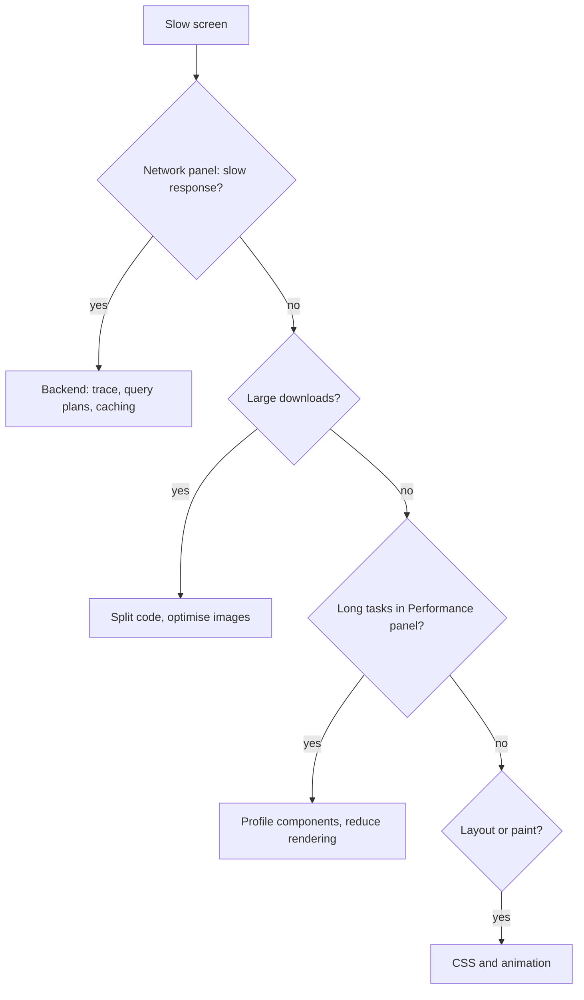
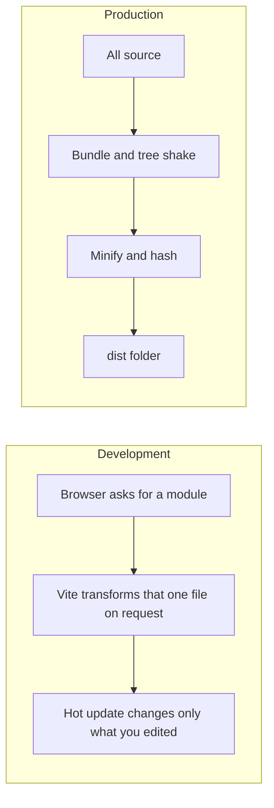

@more
## Case studies in slowness

These show the method: measure, find the actual cause, fix it, measure again. The numbers are illustrative.

### Case 1: typing lags in a data table

**Symptom:** a 2,000-row orders table, with a filter box. Each key takes a noticeable moment to appear.

**Measure:** the Profiler shows the whole table rendering on every keystroke, at around 180 ms each.

```tsx Before: state above the table
function Orders({ rows }: { rows: Order[] }) {
  const [filter, setFilter] = useState('');
  const visible = rows.filter((r) => r.customer.includes(filter));
  return (
    <>
      <input value={filter} onChange={(e) => setFilter(e.target.value)} />
      <Table rows={visible} />
    </>
  );
}
```

**Options, in order:**

| Fix | Effect | Effort |
|---|---|---|
| Paginate or virtualise to about 50 rows | Render time falls greatly | Medium |
| `useDeferredValue` + `memo(Table)` | Typing stays smooth; the table catches up | Low |
| Filter on the server, with debounce | Best for very large data | Medium |

```tsx After: typing is urgent, and the table isn't
const Table = memo(function Table({ rows }: { rows: Order[] }) { /* ... */ });

function Orders({ rows }: { rows: Order[] }) {
  const [filter, setFilter] = useState('');
  const deferred = useDeferredValue(filter);
  const visible = useMemo(
    () => rows.filter((r) => r.customer.includes(deferred)),
    [rows, deferred],
  );
  return (
    <>
      <input value={filter} onChange={(e) => setFilter(e.target.value)} />
      <Table rows={visible} />
    </>
  );
}
```

Note how each tool has a purpose: the deferred value separates urgent from non-urgent, `useMemo` keeps the array reference stable, and `memo` lets React skip the table when that reference hasn't changed. Remove any of them, and the benefit disappears.

### Case 2: a slow first load

**Symptom:** the home page takes 6 seconds on a mid-range phone.

**Measure:** the Network panel shows a 1.9 MB bundle. The visualiser shows a chart library, a date library and a rich text editor, all in the main bundle, and used only on other pages.

| Fix | Result |
|---|---|
| Route-level `lazy()` | Editor and charts leave the main bundle |
| Replace the date library with `Intl` | Removes a large dependency |
| Enable Brotli compression at the CDN | Smaller transfer |
| Preload the main image, in WebP, with dimensions | Better LCP and no layout shift |

Add a **budget** in CI so that it doesn't creep back:

```json A size limit (with the size-limit tool)
[{ "path": "dist/assets/index-*.js", "limit": "200 KB" }]
```

### Case 3: the page gets slower over time

**Symptom:** a dashboard is fine at first, but sluggish after an hour.

**Measure:** heap snapshots grow by a steady amount with each refresh of the data. Comparing them shows retained detached DOM nodes and many listeners.

```tsx The bug
useEffect(() => {
  const id = setInterval(refresh, 5000);
  window.addEventListener('resize', onResize);
  // no cleanup: every remount adds another timer and listener
}, []);
```

**Fix:** add cleanup, and limit retained data: for example, keep the last 500 points in a live chart rather than all of them. Remember that a chart library's instance often needs an explicit `destroy()`.

### Case 4: an animation stutters

**Symptom:** a side drawer janks on low-end phones. The Performance panel shows layout on every frame, since the code animates `left`.

**Fix:** animate `transform: translateX()`, which doesn't trigger layout. Use `will-change: transform` only on what truly animates, as promoting many layers wastes memory.

### Case 5: it's not React at all

**Symptom:** a list takes 3 seconds to appear.

**Measure:** in the Network panel, the API takes 2.8 s, and React takes 40 ms. The trace on the backend shows an N+1 query, the kind your Spring data guide covers. No amount of `memo` would ever fix this, so check the network first. As a full stack developer, you can fix both sides.



!interview Interview answer :: **"Tell me how you improved performance."** Use numbers you really measured: what the symptom was, how you found the cause, what you changed, and the result. If it's a personal project, say so: "I profiled my project's table and reduced typing delay by virtualising the list."

!keypoints Measure before and after ;; Each memo tool only works with the others ;; Budgets stop regressions ;; Check the network first

?? Why do memo, useMemo and useDeferredValue work together in Case 1?
=> The deferred value separates urgency, useMemo keeps a stable array, and memo skips rendering when it's unchanged.
?? The API takes 2.8 seconds and rendering takes 40 ms. Where do you work?
=> On the backend. Rendering is a tiny share of the delay.
?? What would prevent a bundle from growing again?
=> A size budget in CI that fails the build when it passes a limit.

## How Vite and bundling work

Understanding the build helps you solve mysterious problems.

### Development and production



During development, Vite serves native ES modules, so start-up stays quick even for large apps. Dependencies are pre-bundled once. **Hot Module Replacement** swaps the changed module, and React Refresh keeps component state where it can.

### What a production build does

| Step | Result |
|---|---|
| Transpile TS and JSX | Plain JavaScript; types removed with no checking |
| Tree shaking | Unused exports removed |
| Code splitting | One chunk per dynamic `import()` |
| Minification | Shorter names, no whitespace |
| Hashing | `index-a1b2c3.js`, for long-term caching |
| CSS processing | Extraction and minification |
| Source maps | Optional, for debugging |

### Tree shaking in practice

```ts What gets removed depends on how you import
// Tree-shakeable: named ES module exports
import { format } from 'date-fns';

// Often pulls in everything
import _ from 'lodash';
_.debounce(fn, 300);

// Better
import debounce from 'lodash-es/debounce';
```

Code with side effects at import time can't be removed safely, and that's what the `sideEffects` field in `package.json` tells bundlers about.

### Splitting vendor code

```ts vite.config.ts: separate rarely changing libraries
export default defineConfig({
  build: {
    rollupOptions: {
      output: {
        manualChunks: {
          react: ['react', 'react-dom', 'react-router'],
          query: ['@tanstack/react-query'],
        },
      },
    },
  },
});
```

When only your app code changes, users keep their cached library chunk. Don't overdo it: too many tiny files can also slow loading. Vite's defaults are good, so measure first, and note that newer Vite versions may use different bundler options.

### Environment and modes

`import.meta.env.MODE`, `DEV` and `PROD` are replaced at build time, so `if (import.meta.env.DEV) {...}` is removed from production bundles. Only variables starting with `VITE_` reach the browser, which protects you from leaking others.

### Common build problems

| Problem | Likely cause |
|---|---|
| Works in dev, but a blank page in production | Wrong `base` path; check console and asset URLs |
| "Failed to fetch dynamically imported module" | Old tab after a deployment |
| Huge bundle | Whole-library imports; use the visualiser |
| Type error not caught | Vite doesn't type-check; run `tsc` |
| `process is not defined` | Node-only code or env usage in the browser |
| Case-sensitive import fails on Linux CI | Windows ignores filename case |

That last one catches many Windows developers: `import x from './Card'` works locally with `card.tsx`, and fails on a Linux build server.

!keypoints Dev serves modules, and production bundles ;; Named ES imports allow tree shaking ;; Only VITE_ variables reach the browser ;; Filename case matters on Linux

?? Why is Vite's development start-up quick for large apps?
=> It transforms files only when the browser requests them, rather than bundling everything first.
?? A build passes on Windows but fails on Linux CI with a missing module. Why?
=> Probably filename case: Windows ignores it, whereas Linux doesn't.
?? Why does a production build need no check for import.meta.env.DEV?
=> The value is replaced at build time, so the dead branch gets removed.
