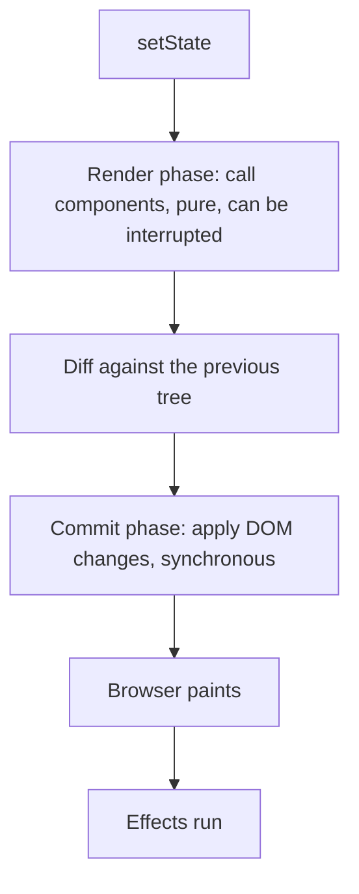

@part frontend-react-performance | Frontend Part 9: Rendering and Performance | frontend
## How React renders

### Reconciliation

When state changes, React calls your components to get a new tree of elements, compares it with the previous one, and applies only the differences to the DOM. A full comparison of two trees would be far too slow, so React uses two shortcuts:

1. **Different type, new subtree.** If `<div>` becomes `<section>`, or `<A>` becomes `<B>`, React destroys everything below, including state.
2. **Keys identify children** in a list, so that it can match them across renders.



**Fiber** is React's internal structure, which splits rendering into small units of work. This lets it pause for urgent updates, like typing. That's the basis for concurrent features such as `useTransition`.

### Render is not paint

A component "rendering" means React called the function. If the result matches the last one, the DOM isn't touched. So a re-render is usually cheap, and many re-renders are harmless. **Measure before you optimise.**

### When renders are a problem

| Cause | Symptom |
|---|---|
| State too high up | Typing in one field renders a whole page |
| Large lists | Scrolling and typing lag |
| Costly calculation in render | Every update feels slow |
| Context with a changing value | Many unrelated parts render |
| New objects as props to memoised children | `memo` does nothing |

### Move state down

The simplest fix uses no special tools. If only one child uses the state, keep it in that child.

```tsx Colocating state
// Typing renders the whole page, including the slow chart
function Page() {
  const [query, setQuery] = useState('');
  return (
    <>
      <input value={query} onChange={(e) => setQuery(e.target.value)} />
      <SlowChart />
    </>
  );
}

// Typing renders only SearchBox
function SearchBox() {
  const [query, setQuery] = useState('');
  return <input value={query} onChange={(e) => setQuery(e.target.value)} />;
}
function BetterPage() {
  return (
    <>
      <SearchBox />
      <SlowChart />
    </>
  );
}
```

Passing `children` helps as well: elements created by a parent's parent don't re-render when an intermediate component's state changes.

### memo, useMemo and useCallback

`memo` skips a render if props are shallowly equal.

```tsx Using them together
const Row = memo(function Row({ order, onSelect }: RowProps) {
  return <li onClick={() => onSelect(order.id)}>{order.total}</li>;
});

function List({ orders }: { orders: Order[] }) {
  const [selected, setSelected] = useState<string | null>(null);
  const onSelect = useCallback((id: string) => setSelected(id), []);  // stable reference
  return orders.map((o) => <Row key={o.id} order={o} onSelect={onSelect} />);
}
```

Without `useCallback`, `onSelect` is a new function each render, so `memo` always sees a change.

| Worth it | Not worth it |
|---|---|
| Expensive child rendering often with the same props | Simple components |
| Long lists of rows | Props that change each render anyway |
| Measured slowness | "Just in case" |

Memoising costs memory and adds complexity, and a wrong dependency list causes stale bugs. The **React Compiler** does this automatically where enabled, which reduces the need for manual work.

!keypoints A render isn't a DOM update ;; Measure before optimising ;; Move state down first ;; memo needs stable props

?? A memoised child still renders on every parent render. Why?
=> A prop, often a function or object, is new each time. Stabilise it with useCallback or useMemo.
?? Typing in a search box makes the page lag. What do you check first?
=> Whether the state sits too high, so that typing renders slow components. Move it down.

## Finding what's slow

### React DevTools Profiler

Record an interaction, and see which components rendered, how long each took, and why. Turn on "Highlight updates when components render" to see this visually. Profile a production build for true numbers, since development mode is slower.

### Browser Performance panel

The flame chart shows long tasks on the main thread. Anything over 50 ms can make the page feel sluggish. You can throttle the CPU to simulate a cheap phone. Your users' devices are probably slower than your laptop.

### Core Web Vitals

Google's measures of real user experience. The thresholds below are the "good" levels at the time of writing.

| Metric | Measures | Good |
|---|---|---|
| LCP (Largest Contentful Paint) | Main content appears | Under 2.5 s |
| INP (Interaction to Next Paint) | Response to clicks and keys | Under 200 ms |
| CLS (Cumulative Layout Shift) | Content jumping around | Under 0.1 |

| Problem | Common fixes |
|---|---|
| Poor LCP | Smaller bundles, optimised images, server rendering, a CDN |
| Poor INP | Shorter tasks, less rendering, `useTransition`, workers |
| Poor CLS | Set image dimensions, reserve space, careful font loading |

Lighthouse gives a lab score. Real user data, using the `web-vitals` library, tells you what people actually experience.

### Network

The Network panel shows what loads, how big and in which order. Check bundle contents with `rollup-plugin-visualizer`. You'll often find one big date library or icon set.

!keypoints Profile before you change anything ;; Long tasks block the page ;; Test with CPU throttling ;; Lab numbers differ from real users

?? What does INP measure?
=> How quickly the page visually responds to user interactions.
?? Why profile a production build?
=> Development mode adds checks and double rendering, so its timings mislead.

## Fixes that usually matter most

### Code splitting

```tsx Split by route
const Reports = lazy(() => import('./features/reports/Reports'));
const Admin = lazy(() => import('./features/admin/Admin'));

<Suspense fallback={<PageSkeleton />}>
  <Routes>
    <Route path="reports" element={<Reports />} />
    <Route path="admin" element={<Admin />} />
  </Routes>
</Suspense>
```

Most users never open admin pages, so why should they download them? This site loads each guide part only when opened, and that's how large content stays fast. Load heavy libraries such as charts and editors the same way.

### Long lists: virtualisation

Rendering 50,000 rows means 50,000 sets of DOM nodes. Virtualisation renders only what's visible.

```tsx With TanStack Virtual
function BigList({ rows }: { rows: Order[] }) {
  const parentRef = useRef<HTMLDivElement>(null);
  const virtual = useVirtualizer({
    count: rows.length,
    getScrollElement: () => parentRef.current,
    estimateSize: () => 48,
  });

  return (
    <div ref={parentRef} style={{ height: 600, overflow: 'auto' }}>
      <div style={{ height: virtual.getTotalSize(), position: 'relative' }}>
        {virtual.getVirtualItems().map((item) => (
          <div
            key={item.key}
            style={{ position: 'absolute', top: 0, transform: `translateY(${item.start}px)`, height: item.size }}
          >
            {rows[item.index].id}
          </div>
        ))}
      </div>
    </div>
  );
}
```

Consider pagination first, as it's simpler and also limits how much you load. Note that virtualisation can hamper browser find-in-page and accessibility.

### Keeping input responsive

```tsx useDeferredValue lets a slow list lag behind typing
function Search({ products }: { products: Product[] }) {
  const [query, setQuery] = useState('');
  const deferred = useDeferredValue(query);
  const stale = query !== deferred;
  return (
    <>
      <input value={query} onChange={(e) => setQuery(e.target.value)} />
      <div style={{ opacity: stale ? 0.6 : 1 }}>
        <ProductList products={products} query={deferred} />   {/* must be memo-wrapped */}
      </div>
    </>
  );
}
```

```tsx useTransition marks an update as non-urgent
const [isPending, startTransition] = useTransition();

function selectTab(next: string) {
  startTransition(() => setTab(next));      // urgent updates can interrupt this
}
```

| Technique | Good for |
|---|---|
| Debounce | Reducing network calls while typing |
| Throttle | Scroll or resize handlers |
| `useDeferredValue` | Slow rendering of a value |
| `useTransition` | Slow state changes you start |
| Web Worker | Heavy calculation off the main thread |

### Images and assets

- Use modern formats such as WebP or AVIF.
- Set `width` and `height` to stop layout shifts.
- `loading="lazy"` for images below the fold.
- Serve sizes that match the display, with `srcset`.
- Compress with Brotli or gzip at the CDN.
- Limit web fonts, and use `font-display: swap`.

### Bundle size

Import what you need: `import debounce from 'lodash/debounce'`, not all of lodash. Prefer small libraries, use `Intl` rather than a heavy date library where possible, and check a package's size before adding it.

### Network and caching

Prefetch likely next pages on hover, use a CDN, and use HTTP caching for API responses that allow it. A cached response beats any rendering optimisation. Also check the backend: a slow API is often the real problem, and that's where your Spring and database skills come in.

### An order of work

1. Measure, with real users if possible.
2. Fix slow APIs, and oversized images and bundles.
3. Split code.
4. Paginate or virtualise long lists.
5. Move state down.
6. Add `memo` where the profiler shows a benefit.

!interview Interview answer :: **"Your React page is slow. What do you do?"** Measure first, with the Network panel, Performance panel and the React Profiler. Slow APIs and large bundles are commonest. Then split code, paginate or virtualise, and move state down. `memo` comes last, where the profile justifies it.

!keypoints Split by route ;; Paginate or virtualise long lists ;; Keep typing responsive ;; Memo comes last

?? How does virtualisation help a 50,000-row table?
=> Only visible rows exist in the DOM, greatly cutting memory and rendering work.
?? What's the difference between debouncing and useDeferredValue?
=> Debounce delays work by a fixed time, and suits network calls. A deferred value lets rendering lag adaptively, with no fixed delay.
?? Which is usually the first fix for a slow first load?
=> Reduce what's downloaded: split code, optimise images, and check the bundle's contents.
