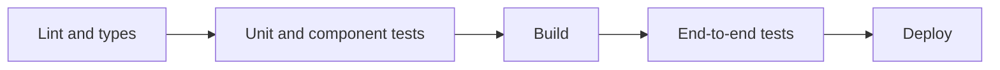

@more
## Testing recipes

Copy these shapes when you meet each situation.

### A shared render helper

Most components need providers. Keep them in one helper.

```tsx src/test/render.tsx
export function renderApp(ui: React.ReactElement, { route = '/' } = {}) {
  const client = new QueryClient({
    defaultOptions: { queries: { retry: false }, mutations: { retry: false } },
  });
  const user = userEvent.setup();
  const result = render(
    <QueryClientProvider client={client}>
      <MemoryRouter initialEntries={[route]}>{ui}</MemoryRouter>
    </QueryClientProvider>,
  );
  return { user, client, ...result };
}
```

### Routes and URL parameters

```tsx Testing a route with a parameter
it('shows the order from the URL', async () => {
  server.use(http.get('/api/orders/42', () => HttpResponse.json({ id: '42', total: 500 })));
  renderApp(
    <Routes>
      <Route path="/orders/:id" element={<OrderDetails />} />
    </Routes>,
    { route: '/orders/42' },
  );
  expect(await screen.findByRole('heading', { name: /order 42/i })).toBeInTheDocument();
});
```

### Forms and server errors

```tsx A server validation error appears on the field
it('shows a duplicate email error', async () => {
  server.use(http.post('/api/users', () =>
    HttpResponse.json({ errors: { email: 'Already registered' } }, { status: 400 })));
  const { user } = renderApp(<SignUp />);

  await user.type(screen.getByLabelText(/email/i), 'asha@example.com');
  await user.type(screen.getByLabelText(/age/i), '25');
  await user.type(screen.getByLabelText(/password/i), 'long-enough');
  await user.click(screen.getByRole('button', { name: /create account/i }));

  expect(await screen.findByText('Already registered')).toBeInTheDocument();
});
```

### Checking what was sent

```tsx Capture the request body
it('sends the entered data', async () => {
  let body: unknown;
  server.use(http.post('/api/notes', async ({ request }) => {
    body = await request.json();
    return HttpResponse.json({ id: 1, title: 'Hi', body: '', version: 0 }, { status: 201 });
  }));
  const { user } = renderApp(<NoteForm />);

  await user.type(screen.getByLabelText(/title/i), 'Hi');
  await user.click(screen.getByRole('button', { name: /save/i }));

  await waitFor(() => expect(body).toMatchObject({ title: 'Hi' }));
});
```

### Loading states

```tsx Delay the response to see the spinner
it('shows loading, then data', async () => {
  server.use(http.get('/api/orders', async () => {
    await delay(50);
    return HttpResponse.json({ content: [{ id: '1', total: 5 }], totalPages: 1 });
  }));
  renderApp(<Orders />);

  expect(screen.getByText(/loading/i)).toBeInTheDocument();
  expect(await screen.findByText('1')).toBeInTheDocument();
  expect(screen.queryByText(/loading/i)).not.toBeInTheDocument();
});
```

### Timers

```tsx Fake timers with user-event
beforeEach(() => vi.useFakeTimers({ shouldAdvanceTime: true }));
afterEach(() => vi.useRealTimers());

it('searches once after typing pauses', async () => {
  const user = userEvent.setup({ advanceTimers: vi.advanceTimersByTime });
  const onSearch = vi.fn();
  render(<SearchBox onSearch={onSearch} />);

  await user.type(screen.getByRole('textbox'), 'java');
  expect(onSearch).not.toHaveBeenCalled();

  act(() => { vi.advanceTimersByTime(300); });
  expect(onSearch).toHaveBeenCalledTimes(1);
  expect(onSearch).toHaveBeenCalledWith('java');
});
```

Without `advanceTimers`, user-event's own internal delays wait on the fake clock, and the test hangs. It's a common cause of mysterious timeouts.

### Things jsdom doesn't have

jsdom isn't a real browser: it has no layout, so sizes are 0. Provide stubs in your setup file for APIs such as `IntersectionObserver`, `matchMedia` and `ResizeObserver`.

```ts A stub in setup.ts
window.matchMedia = vi.fn().mockImplementation((query: string) => ({
  matches: false,
  media: query,
  addEventListener: vi.fn(),
  removeEventListener: vi.fn(),
}));
```

If a test depends on real layout, such as virtualisation, use Playwright instead.

!warning Router actions under jsdom :: Submitting a React Router `<Form>` in a jsdom test can fail with "Expected init.body to be an instance of URLSearchParams". jsdom has its own `URLSearchParams`, which Node's `Request` rejects. The app is fine: the mismatch exists only in the test environment. Test the action as a plain function, or cover it with Playwright.

### Accessible states as assertions

```tsx Testing what users perceive
expect(screen.getByRole('button', { name: /save/i })).toBeDisabled();
expect(screen.getByRole('tab', { name: /items/i })).toHaveAttribute('aria-selected', 'true');
expect(screen.getByLabelText(/email/i)).toHaveAccessibleDescription(/valid email/i);
expect(screen.queryByRole('dialog')).not.toBeInTheDocument();
```

!keypoints Keep providers in one helper ;; Assert what was sent, and what's shown ;; Delay responses to see loading ;; jsdom has no layout

?? A fake-timer test with user-event times out. What's missing?
=> Pass `advanceTimers: vi.advanceTimersByTime` to `userEvent.setup`, so that its delays advance.
?? Why can't jsdom test a virtualised list well?
=> It has no layout, so element sizes are zero. Use a real browser test.
?? How do you assert what a form sent?
=> Capture the request body in the MSW handler, and assert on it.

## Test-driven React, coverage and quality

### Writing the test first

TDD works well for behaviour with clear rules. Let's add a discount field.

```tsx 1. Describe the behaviour: this fails, as there's no field yet
it('applies a valid discount code', async () => {
  server.use(http.post('/api/discounts/check', () => HttpResponse.json({ percent: 10 })));
  const { user } = renderApp(<Cart items={[{ id: 'a', price: 1000, qty: 1 }]} />);

  await user.type(screen.getByLabelText(/discount code/i), 'SAVE10');
  await user.click(screen.getByRole('button', { name: /apply/i }));

  expect(await screen.findByText('Total: ₹900')).toBeInTheDocument();
});
```

```tsx 2. Make it pass in the simplest way
function Cart({ items }: { items: CartItem[] }) {
  const [code, setCode] = useState('');
  const [percent, setPercent] = useState(0);
  const subtotal = items.reduce((sum, i) => sum + i.price * i.qty, 0);

  async function apply() {
    const res = await fetch('/api/discounts/check', {
      method: 'POST',
      headers: { 'Content-Type': 'application/json' },
      body: JSON.stringify({ code }),
    });
    const { percent } = await res.json();
    setPercent(percent);
  }

  return (
    <>
      <label htmlFor="code">Discount code</label>
      <input id="code" value={code} onChange={(e) => setCode(e.target.value)} />
      <button onClick={apply}>Apply</button>
      <p>Total: ₹{subtotal - (subtotal * percent) / 100}</p>
    </>
  );
}
```

**3. Next test:** an invalid code shows an error. It fails, as `res.ok` isn't checked yet, which you then add. Each test drives the next piece of code, and each failure case gets remembered. Then refactor with the tests protecting you.

### What coverage means

```bash Coverage with Vitest
npx vitest run --coverage
```

Coverage shows which lines ran, but not whether anything was checked. A test that renders a component with no assertions gives high coverage and no protection. Use it to find **untested areas**, not as a target to hit. A sensible team watches the trend, and looks closely at critical paths.

| Metric says | Doesn't say |
|---|---|
| This line ran | The result was checked |
| This branch was taken | Every input is right |

### Mutation testing

A mutation tool such as Stryker changes your code, for example `>` to `>=`, and sees if tests fail. Tests that keep passing are weak. It's slow, so run it occasionally on critical logic.

### Tests that hurt

| Smell | Problem | Better |
|---|---|---|
| Snapshot of a whole page | Fails on any change; gets blindly updated | Assert specific behaviour |
| Mocking everything | Tests only your mocks | Mock the network alone |
| Testing hook internals | Breaks on refactor | Test through the UI |
| Sleeping | Slow and flaky | `findBy`, `waitFor` |
| Order dependence | Random failures | Isolated setup |
| Huge shared fixtures | Hard to read | Small factories per test |

### Storybook

Storybook renders components alone, in each state, without running your app. It's useful as living documentation for design systems, and it makes states that are hard to reach, such as errors, simple to see. It can also run accessibility checks and interaction tests.

```tsx A story for each state
export default { component: OrderCard } satisfies Meta<typeof OrderCard>;

export const Paid: StoryObj<typeof OrderCard> = { args: { order: { id: '1', status: 'PAID', total: 500 } } };
export const Cancelled: StoryObj<typeof OrderCard> = { args: { order: { id: '2', status: 'CANCELLED', total: 500 } } };
```

### A CI order



Fast checks run first, so failures show up in seconds. Run the end-to-end tests on main branches and before releases, if they're too slow for every push.

!keypoints Tests can drive design ;; Coverage finds gaps, not quality ;; Mock only at the network ;; Run fast checks first

?? A file has 100% coverage. Is it well tested?
=> Not necessarily. Lines ran, but nothing may have been asserted. Check that tests fail when the code breaks.
?? Why avoid large snapshots?
=> They fail on any change, and people update them without reading, so bugs slip through.
?? What does a mutation tool reveal?
=> Whether tests really detect changes in logic.
