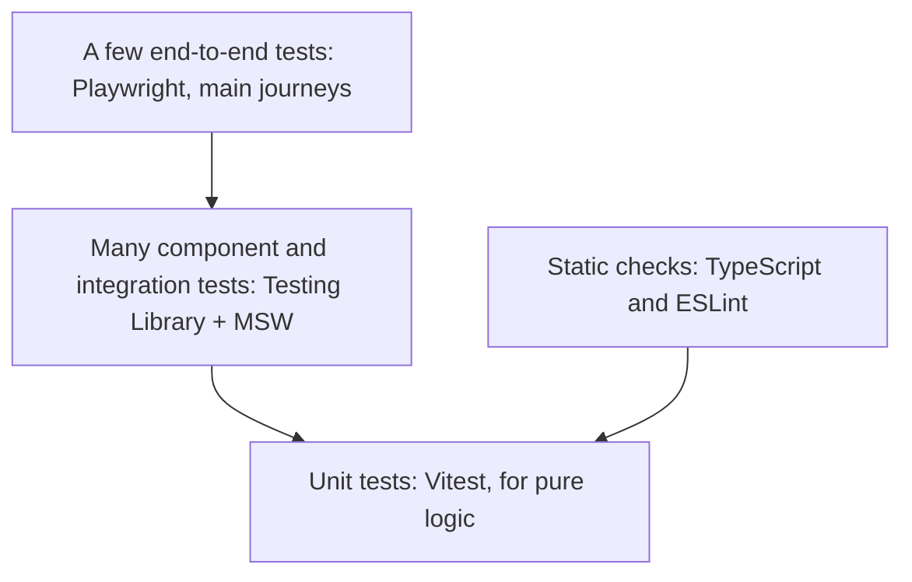
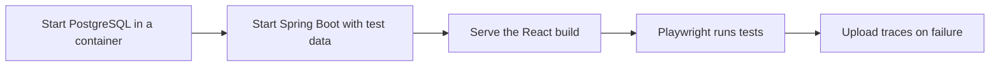

@part frontend-testing | Frontend Part 10: Testing React Applications | frontend
## A testing strategy

Test what users do, not how components work inside. A test that survives a refactor is a good test.



| Level | Test | Tool | Speed |
|---|---|---|---|
| Static | Types and common mistakes | TypeScript, ESLint | Instant |
| Unit | Reducers, formatters, utilities | Vitest | Milliseconds |
| Component | A screen with mocked network | Testing Library, MSW | Fast |
| End to end | A real browser against a real app | Playwright | Slow |

| Worth testing | Not worth testing |
|---|---|
| User journeys and business rules | Implementation details |
| Form validation and error states | That React renders a prop |
| Edge cases: empty, loading, failure | Third-party libraries |
| Complex reducers and helpers | Exact styling |

### Setup

```bash Install
npm install -D vitest jsdom @testing-library/react @testing-library/user-event @testing-library/jest-dom msw
```

```ts vite.config.ts test section
export default defineConfig({
  plugins: [react()],
  test: {
    environment: 'jsdom',
    globals: true,
    setupFiles: './src/test/setup.ts',
  },
});
```

```ts src/test/setup.ts
import '@testing-library/jest-dom/vitest';
import { cleanup } from '@testing-library/react';
import { afterEach } from 'vitest';

afterEach(() => cleanup());
```

### Unit testing logic

```ts A reducer test needs no React
describe('cartReducer', () => {
  it('adds a new item', () => {
    const next = cartReducer([], { type: 'add', item: { id: 'a', price: 10, qty: 1 } });
    expect(next).toEqual([{ id: 'a', price: 10, qty: 1 }]);
  });

  it('increases quantity for an existing item', () => {
    const start = [{ id: 'a', price: 10, qty: 1 }];
    const next = cartReducer(start, { type: 'add', item: { id: 'a', price: 10, qty: 1 } });
    expect(next[0].qty).toBe(2);
    expect(start[0].qty).toBe(1);        // didn't mutate
  });
});
```

!keypoints Test behaviour rather than internals ;; Most tests belong in the middle ;; Pure logic is cheapest to test ;; Types catch a whole class of bugs

?? Why avoid testing a component's internal state?
=> It breaks on refactoring even when behaviour is the same, and it doesn't prove users can do anything.
?? Why do reducers make testing easier?
=> They're pure functions, so no rendering or mocks are needed.

## Component tests with Testing Library

### Query as a user would

```tsx A form test
import { render, screen } from '@testing-library/react';
import userEvent from '@testing-library/user-event';

function renderLogin(onLogin = vi.fn()) {
  render(<LoginForm onLogin={onLogin} />);
  return { onLogin, user: userEvent.setup() };
}

it('submits the entered details', async () => {
  const { user, onLogin } = renderLogin();

  await user.type(screen.getByLabelText(/email/i), 'asha@example.com');
  await user.type(screen.getByLabelText(/password/i), 'secret123');
  await user.click(screen.getByRole('button', { name: /sign in/i }));

  expect(onLogin).toHaveBeenCalledWith({ email: 'asha@example.com', password: 'secret123' });
});

it('shows an error for a bad email', async () => {
  const { user, onLogin } = renderLogin();

  await user.type(screen.getByLabelText(/email/i), 'nope');
  await user.click(screen.getByRole('button', { name: /sign in/i }));

  expect(await screen.findByRole('alert')).toHaveTextContent(/valid email/i);
  expect(onLogin).not.toHaveBeenCalled();
});
```

| Query priority | Example | Note |
|---|---|---|
| `getByRole` | `button`, with name "Save" | Best: also checks accessibility |
| `getByLabelText` | Form fields | |
| `getByText` | Non-interactive content | |
| `getByTestId` | Last resort | Users can't see test IDs |

| Prefix | Not found | Waits | Use |
|---|---|---|---|
| `getBy` | Throws | No | Should be there now |
| `queryBy` | Returns null | No | Assert absence |
| `findBy` | Rejects after a timeout | Yes | Appears later |

If `getByRole` can't find your button, your markup may be inaccessible, and the test has done you a favour.

### Mocking the network with MSW

Mock Service Worker intercepts requests at the network level, so that your real `fetch` code runs, and no `api` module mocks are needed.

```ts src/test/server.ts
import { http, HttpResponse } from 'msw';
import { setupServer } from 'msw/node';

export const server = setupServer(
  http.get('/api/orders', () =>
    HttpResponse.json({ content: [{ id: '9001', total: 500 }], totalPages: 1 })),
);

beforeAll(() => server.listen({ onUnhandledRequest: 'error' }));
afterEach(() => server.resetHandlers());
afterAll(() => server.close());
```

```tsx Testing all the states
function renderWithClient(ui: React.ReactElement) {
  const client = new QueryClient({ defaultOptions: { queries: { retry: false } } });
  return render(<QueryClientProvider client={client}>{ui}</QueryClientProvider>);
}

it('shows orders', async () => {
  renderWithClient(<Orders />);
  expect(await screen.findByText('9001')).toBeInTheDocument();
});

it('shows a message when empty', async () => {
  server.use(http.get('/api/orders', () => HttpResponse.json({ content: [], totalPages: 0 })));
  renderWithClient(<Orders />);
  expect(await screen.findByText(/no orders yet/i)).toBeInTheDocument();
});

it('shows an error and can retry', async () => {
  server.use(http.get('/api/orders', () => new HttpResponse(null, { status: 500 }), { once: true }));
  const user = userEvent.setup();
  renderWithClient(<Orders />);

  await user.click(await screen.findByRole('button', { name: /try again/i }));

  expect(await screen.findByText('9001')).toBeInTheDocument();
});
```

Use a new `QueryClient` per test, so that cached data doesn't leak between tests, and turn off retries so that failure tests finish quickly.

### Testing hooks

```tsx renderHook
it('debounces the value', () => {
  vi.useFakeTimers();
  const { result, rerender } = renderHook(({ v }) => useDebounce(v, 300), {
    initialProps: { v: 'a' },
  });

  rerender({ v: 'ab' });
  expect(result.current).toBe('a');

  act(() => { vi.advanceTimersByTime(300); });
  expect(result.current).toBe('ab');
  vi.useRealTimers();
});
```

### Common problems

| Problem | Cause | Fix |
|---|---|---|
| "not wrapped in act" warning | An update after the test's checks | Await with `findBy` or `waitFor` |
| Unable to find an element | Not there yet | Use `findBy` |
| Tests pass alone, fail together | Shared state | New client; reset handlers |
| Router errors | No router in the test | Wrap in `MemoryRouter` |
| Test checks a class name | Implementation detail | Check behaviour or accessible state |

!keypoints Query by role and label ;; Use user-event rather than fireEvent ;; MSW mocks at the network level ;; New QueryClient per test

?? Why prefer getByRole to a test ID?
=> It finds elements as users and assistive technology do, and fails if the markup isn't accessible.
?? getBy, queryBy or findBy: which do you use to check that something is absent?
=> `queryBy`, as it returns null rather than throwing.
?? Why mock at the network level rather than mocking your API module?
=> Your real client code runs, including error handling, and tests survive refactoring.

## End-to-end tests with Playwright

Component tests can't prove the whole system works. A few end-to-end tests cover the journeys that matter most: sign in, checkout and the main workflow.

```ts A checkout journey
import { test, expect } from '@playwright/test';

test('a customer can place an order', async ({ page }) => {
  await page.goto('/products');
  await page.getByRole('link', { name: 'Java Basics' }).click();
  await page.getByRole('button', { name: 'Add to cart' }).click();
  await page.getByRole('link', { name: 'Cart (1)' }).click();
  await page.getByRole('button', { name: 'Checkout' }).click();

  await expect(page.getByRole('heading', { name: 'Order confirmed' })).toBeVisible();
});
```

Playwright waits automatically for elements to be ready, which removes most flakiness that older tools suffered from. Its trace viewer lets you step through failures with screenshots.

### Sign in once, reuse the state

```ts Save and reuse a login
// auth.setup.ts
setup('sign in', async ({ page }) => {
  await page.goto('/login');
  await page.getByLabel('Email').fill(process.env.TEST_USER!);
  await page.getByLabel('Password').fill(process.env.TEST_PASSWORD!);
  await page.getByRole('button', { name: 'Sign in' }).click();
  await page.context().storageState({ path: 'playwright/.auth/user.json' });
});
```

### Running the whole stack



Each test should create its own data, through the API where possible, so that tests can run in parallel and don't depend on order.

### Keeping tests reliable

| Do | Avoid |
|---|---|
| Use roles and labels | Fragile CSS selectors |
| Auto-waiting assertions | Fixed sleeps |
| Create data per test | Shared accounts changing state |
| Keep the suite small | Testing every validation here |
| Mock third parties, such as payment | Calling real external services |

### Contract tests

Frontend and backend can each pass their own tests, and still disagree. Generating types from OpenAPI, as Part 3 shows, or contract testing with a tool such as Pact, catches this mismatch early.

### Accessibility and visual testing

`@axe-core/playwright` scans pages for accessibility violations, and Playwright can compare screenshots to catch visual regressions. Keep visual checks few, as they're sensitive to small changes.

!interview Interview answer :: **"How do you test a React app?"** TypeScript and ESLint first. Unit tests for pure logic. Most tests are component tests with Testing Library and MSW, covering loading, empty and error states. A few Playwright tests cover key journeys against the real backend.

!keypoints A few end-to-end tests for key journeys ;; Rely on auto-waiting ;; Each test creates its own data ;; Don't call real third parties

?? Why not test everything end to end?
=> They're slow and can be brittle. Keep them for main journeys, and use faster tests for detail.
?? A Playwright test sometimes fails, and passes on retry. What do you look for?
=> Shared data, fixed sleeps, or order dependence. Use its trace to see what happened.
