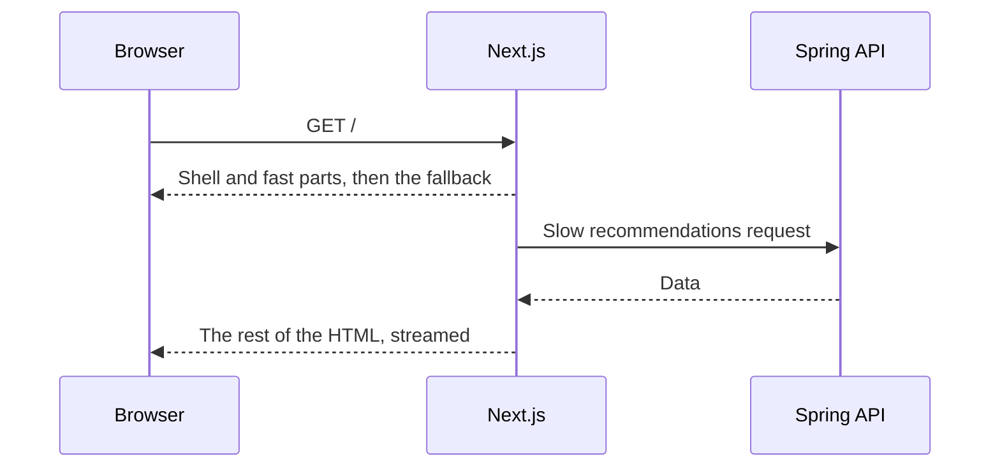
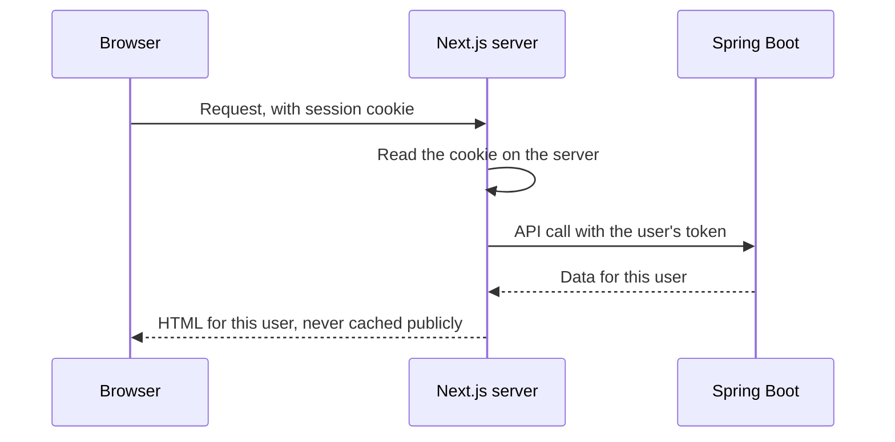
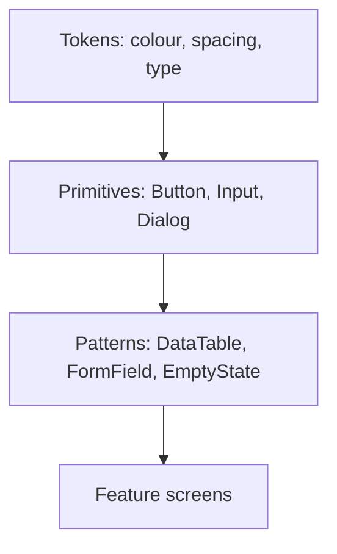

@more
## Data, caching and authentication in Next.js

Next.js changes quickly, and its caching defaults have changed between major versions. Treat this chapter as the concepts, and check the docs for your version.

### Rendering choices on a page

| Page behaviour | How it's rendered |
|---|---|
| No request-specific data | Static, at build time |
| `fetch` with `next: { revalidate: 60 }` | Static, refreshed at intervals |
| Reads cookies or headers | Dynamic, per request |
| `cache: 'no-store'` | Dynamic, per request |

```tsx Three kinds of data on one route
export default async function Home() {
  const categories = await fetch(`${API}/categories`, { next: { revalidate: 3600 } }).then((r) => r.json());
  const deals = await fetch(`${API}/deals`, { cache: 'no-store' }).then((r) => r.json());
  return (
    <>
      <Categories items={categories} />
      <Deals items={deals} />
      <Suspense fallback={<p>Loading recommendations…</p>}>
        <Recommendations />      {/* streamed in when it's ready */}
      </Suspense>
    </>
  );
}
```

### Streaming

The server can send HTML in pieces. The page shell appears at once, and slower parts arrive when ready, each replacing its `Suspense` fallback.



### On-demand revalidation

When data changes, tell Next.js to drop what it has cached, rather than waiting.

```ts Refresh after a change
'use server';
import { revalidatePath } from 'next/cache';

export async function updateProduct(formData: FormData) {
  const session = await requireAdmin();
  await callSpringApi(session, formData);
  revalidatePath('/products');
}
```

A Spring service can trigger this too, through a protected route handler, whenever products change.

### Authentication with a Spring API



```tsx Forwarding identity from a server component
import { cookies } from 'next/headers';

export default async function Account() {
  const token = (await cookies()).get('access_token')?.value;
  if (!token) redirect('/login');

  const res = await fetch(`${process.env.API_URL}/me`, {
    headers: { Authorization: `Bearer ${token}` },
    cache: 'no-store',                       // personal data must never be shared
  });
  if (res.status === 401) redirect('/login');
  const me = await res.json();
  return <h1>Hello, {me.name}</h1>;
}
```

!warning Caching personal data :: A mistake here shows one user's data to another. Mark personal requests `no-store`, and check your CDN's rules as well. Read the framework's caching docs carefully before launch.

### Middleware

Middleware runs before a request completes, and is useful for redirects, locale detection and quick auth checks. Don't rely on it alone for authorisation, since a past Next.js vulnerability let attackers bypass middleware-based checks. Check permissions in the data layer too, and keep the framework patched.

### Deploying

| Option | Fits |
|---|---|
| Vercel | The simplest path; made by the framework's authors |
| Docker on ECS or similar | Control, with your own infrastructure |
| Static export | No server features needed |

```dockerfile A standalone Docker image (with output: 'standalone' in next.config)
FROM node:22-alpine AS build
WORKDIR /app
COPY . .
RUN npm ci && npm run build

FROM node:22-alpine
WORKDIR /app
ENV NODE_ENV=production
COPY build/.next/standalone ./
COPY build/.next/static ./.next/static
COPY build/public ./public
USER node
CMD ["node", "server.js"]
```

The image above needs `COPY --from=build` paths adjusted to your layout, and multiple instances need a shared cache setup for ISR. Self-hosting means that you now run Node in production: memory, scaling, logging and upgrades are yours.

### Other frameworks

| Framework | Character |
|---|---|
| React Router in framework mode | Successor to Remix: loaders and actions on the server |
| TanStack Start | Type-safe routing and data; newer |
| Astro | Content sites; ships little JavaScript by default |
| Vite + React | A client-only app, with no server |

Since your backend is Spring Boot, you already have an API, so ask what a Node server would add. If the answer is only SEO for a few public pages, a small static site beside your SPA may be simpler.

!keypoints Reading cookies makes a page dynamic ;; Streaming sends the shell first ;; Never cache personal data ;; Authorise in the data layer

?? A page that reads cookies stops being static. Why?
=> Its output depends on each request, so it can't be built once for everyone.
?? Why isn't middleware alone enough for authorisation?
=> It's only one layer, and has had bypass flaws. Check permissions where data is read as well.
?? Your backend is Spring Boot. What should a Next.js server add before you adopt it?
=> Real SEO or first-load benefits, enough to justify running and securing a Node server.

## Internationalisation and accessibility at scale

### Setting up translations

```tsx react-i18next
// en.json: { "cart": { "items_one": "{{count}} item", "items_other": "{{count}} items" } }
// hi.json: { "cart": { "items_one": "{{count}} आइटम", "items_other": "{{count}} आइटम" } }

function CartBadge({ count }: { count: number }) {
  const { t } = useTranslation();
  return <span>{t('cart.items', { count })}</span>;
}
```

| Do | Avoid |
|---|---|
| Whole sentences as messages | Joining fragments: word order differs between languages |
| Named placeholders | Positional guesses |
| `Intl` for numbers and dates | Hand-written formats |
| Load only the active language | Shipping all languages to everyone |
| Set `<html lang="hi">` | Leaving screen readers to guess |

Indian numbering is a good test: `new Intl.NumberFormat('hi-IN')` groups 100000 as 1,00,000, which your code gets free.

### A design system

As an app grows, consistency comes from shared components, rather than from each page deciding again.



A `FormField` component that always wires up label, input, hint and error means that every form in the app is accessible by default, and it's cheaper than fixing each one by hand.

```tsx A form field that gets accessibility right once
function FormField({ label, error, hint, children }: {
  label: string;
  error?: string;
  hint?: string;
  children: (props: { id: string; 'aria-invalid': boolean; 'aria-describedby'?: string }) => React.ReactNode;
}) {
  const id = useId();
  const describedBy = [hint && `${id}-hint`, error && `${id}-error`].filter(Boolean).join(' ') || undefined;
  return (
    <div>
      <label htmlFor={id}>{label}</label>
      {children({ id, 'aria-invalid': Boolean(error), 'aria-describedby': describedBy })}
      {hint && <p id={`${id}-hint`}>{hint}</p>}
      {error && <p id={`${id}-error`} role="alert">{error}</p>}
    </div>
  );
}
```

### Common accessibility fixes, by frequency

| Problem | Fix |
|---|---|
| Low contrast text | Use tokens that meet 4.5:1 |
| Missing form labels | `FormField` |
| Images with no `alt` | Lint rule `jsx-a11y` |
| Non-semantic clickable divs | `button` and `a` |
| Focus lost after a route change | Focus the heading |
| Toast messages not announced | An `aria-live="polite"` region |
| Modal focus traps | A tested dialog component |
| Icon buttons with no name | `aria-label` |

Add `eslint-plugin-jsx-a11y` and axe tests in CI, then do manual keyboard testing on main flows.

!keypoints Translate whole sentences ;; Use Intl for numbers and dates ;; Shared components spread good defaults ;; Automate checks, and test by keyboard

?? Why is "You have " + n + " items" bad for translation?
=> Word order and plural rules differ by language. Use one message with a placeholder.
?? How does a FormField component improve accessibility?
=> It wires labels, hints and errors correctly everywhere, so individual forms can't forget.
