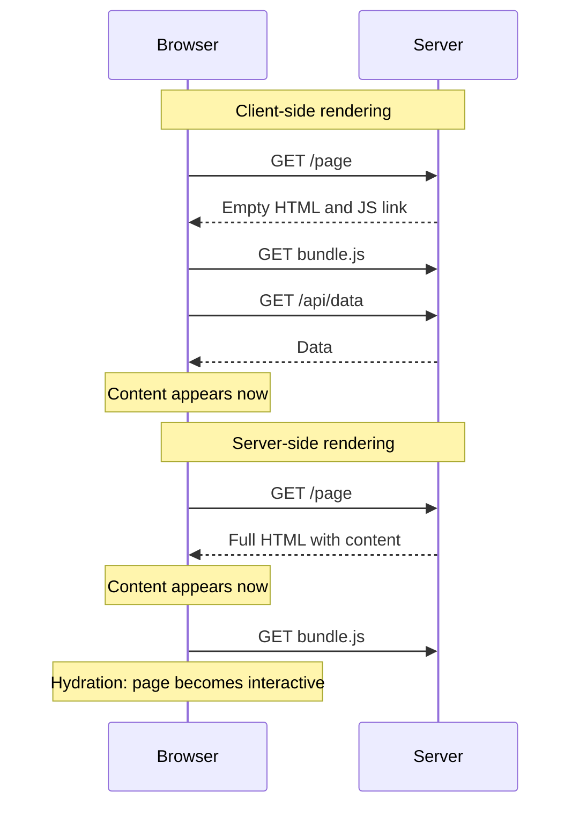
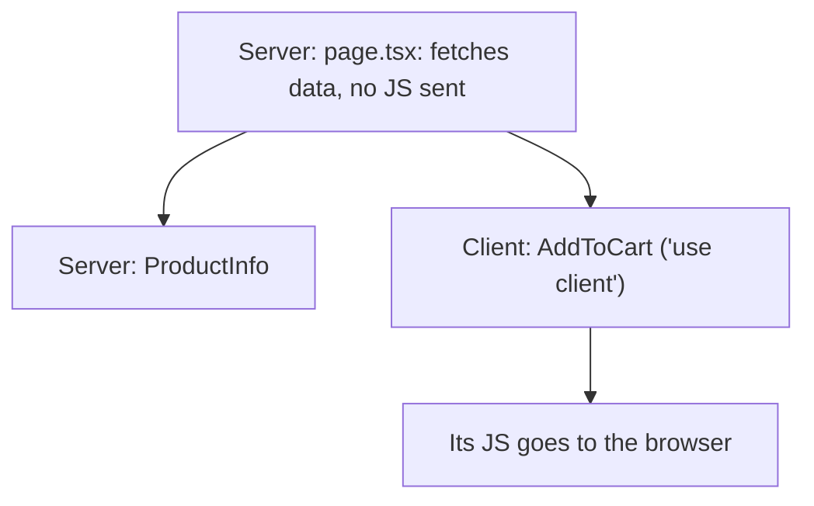
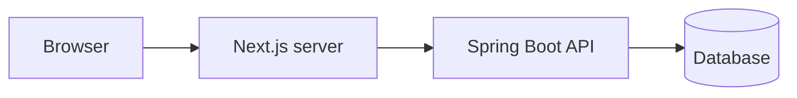

@part frontend-nextjs-ssr | Frontend Part 11: Next.js and Server Rendering | frontend
## Rendering strategies

Where HTML gets produced matters for first load speed, search engines and cost.

| Strategy | HTML made | Good for | Trade-off |
|---|---|---|---|
| CSR (client-side rendering) | In the browser | Dashboards behind a login | Blank until JS loads; weak for SEO |
| SSR (server-side rendering) | On each request | Personalised, SEO-relevant pages | Server cost, time to first byte |
| SSG (static generation) | At build time | Blogs, docs, marketing | Stale until rebuilt |
| ISR (incremental regeneration) | Rebuilt periodically | Catalogues | Some staleness |
| RSC (Server Components) | On the server, sending less JS | Data-heavy pages in modern frameworks | New model to learn |



### Hydration

With SSR, the browser gets real HTML, shows it, and then React attaches event handlers to it. Until then, the page is visible but not interactive. The HTML from the server must match what React creates on the client, or you get a **hydration mismatch**.

```tsx A hydration mismatch
function Clock() {
  return <p>{new Date().toLocaleTimeString()}</p>;   // the server's time differs from the browser's
}

function BetterClock() {
  const [time, setTime] = useState<string | null>(null);
  useEffect(() => setTime(new Date().toLocaleTimeString()), []);   // runs in the browser only
  return <p>{time ?? '--:--'}</p>;
}
```

Other causes: reading `window` or `localStorage` during render, random values, and invalid HTML such as a `<div>` inside a `<p>`.

### Choosing

| Your app | Reasonable choice |
|---|---|
| Admin panel, internal tool | Vite + React (CSR) |
| Logged-in product, no SEO needs | Vite + React |
| Public shop or content site | Next.js |
| Marketing pages + app | Static site or Next.js, with an app |
| Your portfolio with Spring Boot | Vite + React is simplest |

Your Spring Boot API works with any of these. Vite with React stays simple, and it's what this site uses.

!keypoints CSR for apps behind a login ;; SSR and SSG for public content ;; Hydration attaches behaviour ;; Server and client HTML must match

?? Why can't a search engine rely on pure CSR?
=> The first HTML is nearly empty. Some crawlers run JavaScript, but it's slower and less reliable than server-rendered content.
?? What causes a hydration mismatch?
=> Different output between server and client: dates, random values, or browser-only data used during render.
?? Why isn't Next.js needed for an internal dashboard?
=> It has no SEO need, and login gates the content, so the extra server complexity gives little benefit.

## Next.js and Server Components

Next.js is the most widely used React framework. It adds file-based routing, server rendering, data fetching and optimisation. Details change between versions, so check its docs.

### App Router structure

```text Files define routes
app/
  layout.tsx            shared layout
  page.tsx              /
  products/
    page.tsx            /products
    [id]/
      page.tsx          /products/42
      loading.tsx       shown while loading
      error.tsx         shown on error
  api/
    health/route.ts     an API endpoint
```

### Server and client components

In the App Router, components run **on the server by default**. They can read data directly, send no JavaScript to the browser, and can't use state or browser APIs.

```tsx A server component fetching from Spring Boot
// app/products/[id]/page.tsx
export default async function ProductPage({ params }: { params: Promise<{ id: string }> }) {
  const { id } = await params;
  const res = await fetch(`${process.env.API_URL}/products/${id}`, {
    next: { revalidate: 60 },              // reuse for 60 seconds
  });
  if (res.status === 404) notFound();
  const product: Product = await res.json();

  return (
    <article>
      <h1>{product.name}</h1>
      <AddToCart productId={product.id} />
    </article>
  );
}
```

```tsx A client component, for interactivity
'use client';

import { useState } from 'react';

export function AddToCart({ productId }: { productId: string }) {
  const [added, setAdded] = useState(false);
  return (
    <button onClick={async () => { await addToCart(productId); setAdded(true); }}>
      {added ? 'Added' : 'Add to cart'}
    </button>
  );
}
```



| Server component | Client component |
|---|---|
| Fetch data, use secrets | Use state and effects |
| Reduce JavaScript sent | Handle clicks and input |
| Can't use `useState` | Can't use server-only secrets |

Keep client components small, and at the edges of the tree.

### Server actions

```tsx Calling server code from a form
// app/contact/actions.ts
'use server';

export async function subscribe(formData: FormData) {
  const session = await getSession();             // always check: it's a public endpoint
  if (!session) throw new Error('Not signed in');
  await db.subscribe(session.userId, String(formData.get('email')));
}
```

!warning Server actions are public endpoints :: A server action looks like a function, but anyone can call it through HTTP. Authenticate and validate inside each one, as you would in a Spring controller.

### With a Spring Boot backend

Next.js can act as a frontend server that calls your Spring API.



That adds a Node server to run, monitor and scale. So ask whether SEO or first-load needs justify it. Forward authentication carefully: a server-rendered request must pass the user's cookie or token to Spring. And be careful not to cache personalised pages, or you may show one user's data to another.

!interview Interview answer :: **"What are Server Components?"** Components that render only on the server. They fetch data directly and ship no JavaScript, whereas client components handle interactivity. It's different from SSR, which renders client components to HTML and then hydrates them.

!keypoints Server by default in the App Router ;; Keep client components small ;; Server actions are public endpoints ;; Beware of caching personalised data

?? Can a server component use useState?
=> No. It runs only on the server. Add a client component for interaction.
?? What's the difference between SSR and Server Components?
=> SSR renders to HTML, and the client hydrates with all the JS. Server Components never run in the browser, and send no JS of their own.
?? Why authenticate inside a server action?
=> It's exposed as an HTTP endpoint, so anyone can call it directly.

## SEO, internationalisation and PWAs

### SEO basics

| Item | Why |
|---|---|
| Server-rendered or static content | Reliable indexing |
| A unique `<title>` and meta description per page | What appears in results |
| Semantic HTML with one clear `h1` | Understanding the page |
| Real `<a href>` links | Crawlers follow them |
| Open Graph tags | Link previews on social media |
| `sitemap.xml`, `robots.txt` | Guiding crawlers |
| Canonical URLs | Avoiding duplicates |
| Good Web Vitals | A ranking signal |

React 19 lets components render `<title>` and `<meta>`, which React moves to the document's head.

### Internationalisation

```tsx Avoid building strings by hand
// Breaks in other languages
<p>You have {count} item{count === 1 ? '' : 's'}</p>

// Use a library such as react-i18next, or FormatJS
<p>{t('cart.items', { count })}</p>
```

Use `Intl` for dates, numbers and currency. Different languages have different plural rules, and text can expand by a large amount, so don't fix widths. Right-to-left languages need CSS logical properties, such as `margin-inline-start`. Indian apps may need several scripts, so test your fonts.

### Progressive web apps

A PWA can be installed, and work offline through a **service worker** that caches files and responses.

| Benefit | Cost |
|---|---|
| Works on poor networks | Cache invalidation is hard |
| Installable, no app store | Different iOS and Android support |
| Push notifications | A bad cache can trap users on an old version |

Vite has a PWA plugin. Only add this when offline use really matters, such as for field workers.

### Micro-frontends, in brief

Large companies may split one frontend across several teams, with module federation or iframes. This lets teams deploy independently, at the cost of consistency and complexity. It's the frontend version of microservices, and the same warning applies: don't use it without an organisational reason.

!keypoints SEO needs real content and links ;; Don't concatenate translated strings ;; Use a service worker only when offline matters ;; Micro-frontends solve team problems

?? Why might `<div onClick>` navigation hurt SEO?
=> Crawlers follow `<a href>` links, and may not find pages reachable only through script.
?? Why not add an s for plurals in code?
=> Languages have different plural rules. Use an i18n library.
