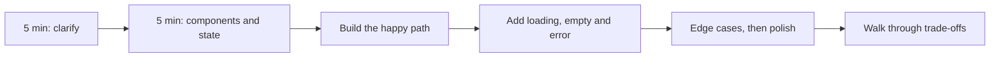
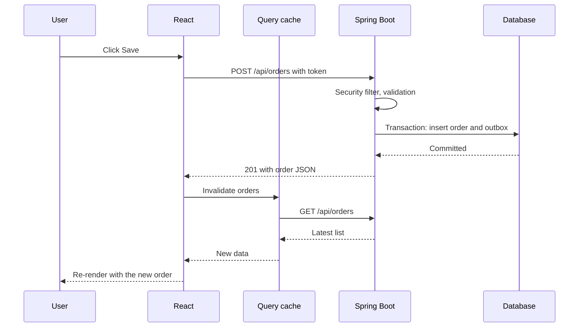

@part frontend-interview | Frontend Part 12: Frontend Interviews and Machine Coding | frontend
## Output questions, worked

Full stack interviews often test JavaScript fundamentals through short snippets. Trace them on paper before you read the answers.

### 1. Hoisting and the temporal dead zone

```javascript What's printed?
console.log(a);   // undefined: var is hoisted and starts as undefined
var a = 1;

console.log(b);   // ReferenceError: let exists, but isn't initialised yet
let b = 2;
```

### 2. Function hoisting

```javascript What's printed?
hello();                     // "hi": declarations are fully hoisted
function hello() { console.log('hi'); }

greet();                     // TypeError: greet is undefined here, and not a function
var greet = () => console.log('hey');
```

### 3. Closures

```javascript What's printed?
function outer() {
  let n = 0;
  return { inc: () => ++n, get: () => n };
}
const a = outer();
const b = outer();
a.inc();
a.inc();
b.inc();
console.log(a.get(), b.get());   // 2 1: each call has its own n
```

### 4. this

```javascript What's printed?
const obj = {
  name: 'A',
  regular() { return this?.name; },
  arrow: () => this?.name,
};
console.log(obj.regular());        // 'A'
console.log(obj.arrow());          // undefined: arrows don't get their own this
const f = obj.regular;
console.log(f());                  // undefined: called with no object (in a module)
```

### 5. Event loop

```javascript What's printed?
console.log('A');
setTimeout(() => console.log('B'));
Promise.resolve()
  .then(() => console.log('C'))
  .then(() => console.log('D'));
(async () => {
  console.log('E');
  await null;
  console.log('F');
})();
console.log('G');
// A E G C F D B
```

Synchronous code first: A, E and G. The code before the first `await` runs synchronously. Then microtasks in queue order: C, F, then D, which was queued by C. Finally, the timer: B.

### 6. References

```javascript What's printed?
const x = { n: 1 };
const y = x;
y.n = 2;
console.log(x.n);                  // 2: same object

const z = { ...x };
z.n = 3;
console.log(x.n);                  // 2: a copy

const deep = { inner: { n: 1 } };
const copy = { ...deep };
copy.inner.n = 9;
console.log(deep.inner.n);         // 9: spread is shallow
```

Use `structuredClone` for a deep copy.

### 7. Array traps

```javascript What's printed?
console.log([1, 2, 3].map(parseInt));      // [1, NaN, NaN]: parseInt gets the index as radix
console.log([10, 9, 1].sort());            // [1, 10, 9]: compared as strings
console.log([1, 2] + [3]);                 // '1,23': arrays convert to strings
console.log(typeof NaN);                   // 'number'
```

### Common utilities to write by hand

```javascript debounce and throttle
function debounce(fn, ms) {
  let timer;
  return (...args) => {
    clearTimeout(timer);
    timer = setTimeout(() => fn(...args), ms);
  };
}

function throttle(fn, ms) {
  let last = 0;
  return (...args) => {
    const now = Date.now();
    if (now - last >= ms) {
      last = now;
      fn(...args);
    }
  };
}
```

```javascript Promise.all by hand
function all(promises) {
  return new Promise((resolve, reject) => {
    const results = [];
    let done = 0;
    if (promises.length === 0) resolve(results);
    promises.forEach((p, i) => {
      Promise.resolve(p).then((value) => {
        results[i] = value;                  // keeps the original order
        if (++done === promises.length) resolve(results);
      }, reject);
    });
  });
}
```

```javascript A memoise function, and flatten
function memoize(fn) {
  const cache = new Map();
  return (arg) => {
    if (!cache.has(arg)) cache.set(arg, fn(arg));
    return cache.get(arg);
  };
}

function flatten(items) {
  return items.reduce((acc, x) => acc.concat(Array.isArray(x) ? flatten(x) : x), []);
}
```

!keypoints Trace on paper ;; Sync, then microtasks, then a macrotask ;; Spread is shallow ;; Practise writing debounce by hand

?? What does [1, 2, 3].map(parseInt) return, and why?
=> [1, NaN, NaN]. map passes the index as parseInt's radix.
?? Why does the code before an await run immediately?
=> An async function runs synchronously until its first await.
?? How do debounce and throttle differ?
=> Debounce waits until calls stop. Throttle runs at most once per interval.

## React questions

### Concepts

| Question | Answer in brief |
|---|---|
| What is the virtual DOM? | An in-memory tree of elements that React compares to find minimal DOM changes |
| Why are keys needed? | To match list items across renders; index keys break on reorder |
| Controlled or uncontrolled? | State owns the value, or the DOM does |
| Why are hooks only at the top level? | React tracks them by call order |
| What are the phases? | Render (pure), then commit (DOM changes), then effects |
| What triggers a render? | Its state, its parent, or a context |
| `useEffect` or `useLayoutEffect`? | After paint, or before paint for measuring |
| What's prop drilling? | Passing props through layers; use composition or context |
| What's an error boundary? | A component that catches render errors below it |
| Why not mutate state? | React compares references |
| What is batching? | Several updates in one render |
| What are portals? | Rendering to another DOM place, as for modals |
| Why use `lazy` and `Suspense`? | Load code when needed, with a fallback |
| What's the React Compiler? | A build tool that memoises automatically |

### Predict the behaviour

```tsx How many times does it log, and what does the screen show?
function App() {
  const [n, setN] = useState(0);
  console.log('render', n);
  return (
    <button onClick={() => {
      setN(n + 1);
      setN(n + 1);
      setN((x) => x + 1);
    }}>{n}</button>
  );
}
```

After one click, the screen shows 2. The first two calls each set 1, and the updater adds 1 to the latest value. Batching means one extra render (ignoring Strict Mode).

```tsx Find the bug
function Search() {
  const [q, setQ] = useState('');
  const [results, setResults] = useState([]);

  useEffect(() => {
    fetch(`/api/search?q=${q}`).then((r) => r.json()).then(setResults);
  });

  return <input value={q} onChange={(e) => setQ(e.target.value)} />;
}
```

This one has several problems: no dependency array means that it fetches after every render, and `setResults` causes another render, so **an infinite loop**. It also has no race handling, no `res.ok` check, no URL encoding, and no debounce.

### Class components

Older code uses them, so recognise `componentDidMount`, `componentDidUpdate` and `componentWillUnmount`, which map roughly to `useEffect`, plus `this.state` and `this.setState`.

!keypoints Be ready to explain render and commit ;; Spot infinite effect loops ;; Keys and references come up often ;; Recognise class components

?? Why does an effect with no dependency array that sets state cause a loop?
=> Each state change renders, and the effect runs after every render, setting state again.
?? What's the difference between useEffect and useLayoutEffect?
=> useEffect usually runs after paint. useLayoutEffect runs before paint, for DOM measurement, and can block painting.

## Machine coding rounds

You're given 60 to 90 minutes to build a small working feature. Interviewers look for working code, sensible structure, handled states and clear communication.

### A method



### Worked problem: autocomplete

**Requirements:** type to search users from an API, with suggestions, keyboard navigation, and no stale results.

```tsx An autocomplete search
function useSearch(query: string) {
  const [state, setState] = useState<{ items: User[]; loading: boolean; error: string | null }>(
    { items: [], loading: false, error: null },
  );

  useEffect(() => {
    if (query.trim() === '') {
      setState({ items: [], loading: false, error: null });
      return;
    }
    const controller = new AbortController();
    const timer = setTimeout(async () => {
      setState((s) => ({ ...s, loading: true, error: null }));
      try {
        const res = await fetch(`/api/users?q=${encodeURIComponent(query)}`, { signal: controller.signal });
        if (!res.ok) throw new Error(`HTTP ${res.status}`);
        setState({ items: await res.json(), loading: false, error: null });
      } catch (e) {
        if ((e as Error).name !== 'AbortError') {
          setState({ items: [], loading: false, error: 'Search failed' });
        }
      }
    }, 300);

    return () => {
      clearTimeout(timer);
      controller.abort();
    };
  }, [query]);

  return state;
}

function Autocomplete({ onPick }: { onPick: (user: User) => void }) {
  const [query, setQuery] = useState('');
  const [active, setActive] = useState(-1);
  const { items, loading, error } = useSearch(query);

  function onKeyDown(e: React.KeyboardEvent) {
    if (e.key === 'ArrowDown') {
      e.preventDefault();
      setActive((i) => Math.min(i + 1, items.length - 1));
    } else if (e.key === 'ArrowUp') {
      e.preventDefault();
      setActive((i) => Math.max(i - 1, 0));
    } else if (e.key === 'Enter' && items[active]) {
      onPick(items[active]);
    } else if (e.key === 'Escape') {
      setQuery('');
    }
  }

  return (
    <div>
      <input
        aria-label="Search users"
        value={query}
        onChange={(e) => { setQuery(e.target.value); setActive(-1); }}
        onKeyDown={onKeyDown}
      />
      {loading && <p>Searching…</p>}
      {error && <p role="alert">{error}</p>}
      {!loading && !error && query && items.length === 0 && <p>No matches</p>}
      <ul>
        {items.map((u, i) => (
          <li key={u.id} aria-selected={i === active} onClick={() => onPick(u)}>{u.name}</li>
        ))}
      </ul>
    </div>
  );
}
```

Things worth saying aloud: debounce saves requests, abort handles races, `encodeURIComponent` prevents broken URLs, and in real work you'd add a full ARIA combobox pattern, or use a tested library.

### More problems to practise

| Problem | Key skills |
|---|---|
| Todo list with filters and persistence | State, derived data, localStorage |
| Pagination and sortable data table | URL state, derived data |
| Infinite scroll feed | `IntersectionObserver`, cursor pages |
| Modal with focus handling | Portals, accessibility |
| Star rating | Controlled component, hover state |
| Multi-step form | Reducer, validation |
| Tic-tac-toe | State, derived winner, immutable updates |
| Tabs and accordion | Composition, keyboard support |
| Countdown or stopwatch | Effects, cleanup, stale closures |
| Nested comments | Recursion |
| Kanban board | Lists, drag and drop |
| Shopping cart | Reducer, totals, money handling |

### Frontend system design

For experienced roles, you may be asked to design a news feed, a chat app or a shared document. Cover these areas:

| Area | Questions |
|---|---|
| Requirements | Users, devices, scale, offline? |
| Architecture | CSR or SSR, routing, code splitting |
| Data | API shape, caching, pagination, real time |
| State | Server, URL, local |
| Performance | Bundles, images, virtualised lists |
| Accessibility and i18n | Keyboard, screen readers, languages |
| Reliability | Errors, retries, monitoring |
| Security | XSS, CSRF, tokens |

### For full stack candidates

Interviewers often connect the two halves. Be ready to walk through what happens when a user clicks Save, from `onClick` through fetch, CORS, the load balancer, the Spring Security filter chain, the controller, the transaction and the response, to the cache update and re-render. Few candidates can tell the whole story, and it's a strong way to show that you really are full stack.



### What to build for a portfolio

One polished project beats several half-finished ones. Connect a React and TypeScript frontend to your Spring Boot API, with authentication, TanStack Query, handled states, responsive design and tests, and deploy it. A live link, plus a README with a screenshot and your decisions, helps a lot for a fresher.

!interview Interview answer :: **"Why React rather than plain JavaScript?"** Describing UI as a function of state avoids manual DOM syncing, and components make large screens manageable. The trade-offs are bundle size, tooling and a build step, so very simple pages may not need it.

!keypoints Clarify, plan, then build ;; Handle states, even under time pressure ;; Say your trade-offs aloud ;; Tell the full journey of a click

?? In a machine coding round, what do you build first?
=> The simplest working happy path, then loading, empty and error states, then polish.
?? Why does the autocomplete hook both clear a timer and abort?
=> Clearing stops a request that hasn't started, and aborting cancels one in progress, so stale results can't overwrite new ones.
?? How do you show you're truly full stack in an interview?
=> Trace one action from the click, through the network and server to the database, and back to the re-render.
